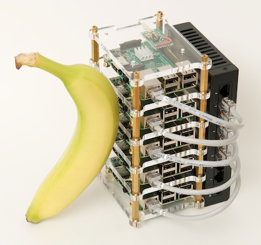

# How to build your own Raspberry Pi Cluster

May 7, 2016

  
*The banana is for scale.*

When I originally built the Raspberry Pi Dramble 6-node Pi cluster in 2014 (for testing Ansible with bare metal hardware on the cheap), I compiled all the code, notes, etc. into a [GitHub repository](https://github.com/geerlingguy/raspberry-pi-dramble). In 2015, I decided to take it a step further, and I started hosting [www.pidramble.com](http://www.pidramble.com/) *on the cluster*, *in my basement office*!

Every time I've shared the cluster with others during presentations or at events like DrupalCon, someone asks how it's built. While I *do* have almost all my notes and instructions for building the entire cluster on the [Pi Dramble Wiki](http://www.pidramble.com/wiki), a step-by-step visual guide is better. Therefore, I'm posting a series of videos, "Let's Build a Raspberry Pi Cluster", to [my YouTube channel](https://www.youtube.com/user/geerlingguy).

The [first video](https://www.youtube.com/watch?v=1SvNkdTzUng) goes over hardware parts and setup:

The [second](https://www.youtube.com/watch?v=RZugKrvxWIQ) goes over microSD card setup and Raspbian OS configuration:

These videos also serve as background material for those attending my upcoming talks on Drupal 8 and the Raspberry Pi:

- **[Raspberry Pi with a Side of Drupal 8](https://www.acquia.com/drupalcon/new-orleans-2016/mini-sessions)** Acquia Booth, Wednesday afternoon, 3:15 p.m.
- **[Highly-available Drupal on a Raspberry Pi Cluster](https://tek.phparch.com/speakers/#70505)** php[tek], May 25, 3:30 p.m.

I'll post again once I've wrapped up the video series (it will likely be either 5 or 6 parts total). What do you think of the videos? Should I consider making more of this kind of video, or ditch the idea and stick to writing?

## Further reading

- [Ansible 101 - on a Cluster of Raspberry Pi 2s](http://www.jeffgeerling.com/blog/ansible-101-cluster-raspberry-pi-2s)
- [Teaching Ansible with six Raspberry Pis](http://www.jeffgeerling.com/blog/2015/having-fun-six-raspberry-pis)
- [How to Build Your Own Raspberry Pi Cluster ('Bramble')](http://www.jeffgeerling.com/blog/2015/how-build-your-own-raspberry-pi-cluster-bramble)

[raspberry pi](http://www.jeffgeerling.com/category/raspberry-pi)

[drupal](http://www.jeffgeerling.com/category/tags/drupal)

[drupal planet](http://www.jeffgeerling.com/category/tags/drupal-planet)

[cluster](http://www.jeffgeerling.com/category/cluster)

[how-to](http://www.jeffgeerling.com/category/tags/how)

[video](http://www.jeffgeerling.com/category/tutorial-tags/video)

[youtube](http://www.jeffgeerling.com/category/tags/youtube)

[drupal 8](http://www.jeffgeerling.com/category/drupal-8)

[pictures](http://www.jeffgeerling.com/category/tutorial-tags/pictures)

- [Add new comment](http://www.jeffgeerling.com/comment/reply/2647#comment-form "Share your thoughts and opinions related to this posting.")

## Comments

Andrew – [6 hours ago](http://www.jeffgeerling.com/comment/3571#comment-3571)

Loved the videos. I'm looking forward to watching the rest in the series.

- [reply](http://www.jeffgeerling.com/comment/reply/2647/3571)

.

Eastrader – [6 hours ago](http://www.jeffgeerling.com/comment/3572#comment-3572)

You did a very good video. Keep em coming.

- [reply](http://www.jeffgeerling.com/comment/reply/2647/3572)

.

.
