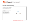
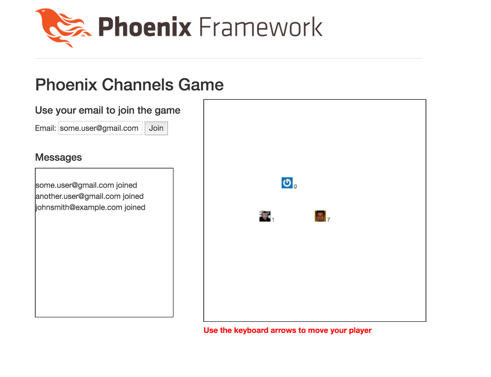
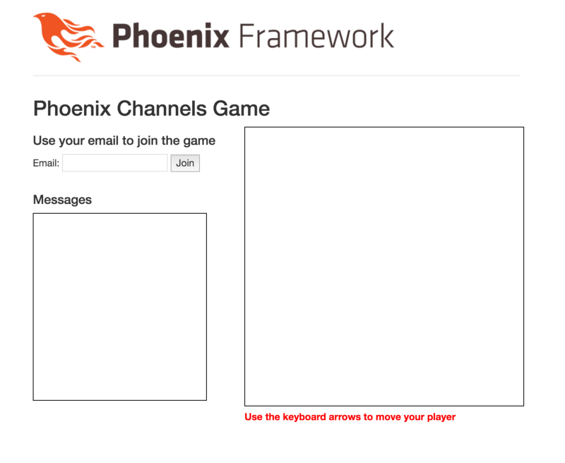

# Building a Game with Phoenix Channels

Some days ago I was thinking about a topic to show the capabilities of the Phoenix Channels implementation. A chat implementation is s0 2015! And I thought that building a game would be an interesting exercise. The basic implementation was completed in a couple of hours one late night at the middle of the week. It took me even longer to write this article, almost two days! Anyway, let’s get started.

The game is very simple, you control a player with the arrows in your keyboard and if you hit other players you earn points, thus increasing your score.. Each player joins using their web browser. There is no limit to how many players are allowed in the game. Easy, right?

Obligatory finished product picture,





The finished game!

You can find the complete source code in <https://github.com/miguelcoba/phoenix_channels_game>.

Let's build it.

We'll use the HTML canvas element to draw the board where the players interact and Phoenix Channels to communicate the players with the server and to keep everything synchronised correctly.

First create a new Phoenix project:

```
mix phoenix.new phoenix_channels_game
```

Now lets add the basic HTML layout to render our game. Open **web/templates/layout/app.html.eex** and change everything inside the <body> tag with this:

```
<body>  
  <div class="container">  
    <header class="header">  
      <span class="logo"></span>  
    </header>  
    <main role="main">  
      <%= render @view_module, @view_template, assigns %>  
    </main>  
  </div> <!-- /container -->  
  <script src="//code.jquery.com/jquery-1.11.3.min.js"></script>  
  <script src="<%= static_path(@conn, "/js/app.js") %>"></script>  
</body>
```

I removed the boilerplate and added the jQuery library that I'll be using to access and manipulate the HTML elements in the game.

Next, open **web/templates/page/index.html.eex** and change its contents to:

```
<h2>Phoenix Channels Game</h2>  
<div class="row">  
  <div class="col-md-5">  
    <h4>Use your email to join the game</h4>  
    Email: <input id="email" type="email" required>  
    <button id="joinButton">Join</button>  
    <br/><br/>  
    <h4>Messages</h4>  
    <div id="messages" class="messages"></div>  
  </div>  
  <div class="col-md-7">  
    <canvas id="canvas" class="canvas" width="<%= 400 %>" height="<%= 400 %>"></canvas>  
    <p class="instructions">Use the keyboard arrows to move your player</p>  
  </div>  
</div>
```

I added an input field to enter an email that will be used as the player's identifier. We have the canvas itself where the action happens and a message box to show some informational text about the game activity.

Just one more thing to make this look good. At the end of **web/static/css/app.css** add the following styles:

```
.canvas {  
  border: 1px solid black;  
}
```

```
.instructions {  
  font-weight: bold;  
  color: red;  
}
```

```
.messages {  
  height: 270px;  
  width: 250px;  
  overflow: scroll;  
  border: 1px solid black;  
}
```

Nice! If you run

```
mix phoenix.server
```

in your project root, and go to [http://localhost:4000](http://localhost:4000,/), you should see something like this:




Ok, enough HTML and CSS. Lets add some code to this. We need a module to hold the game state. Create **lib/phoenix\_channels\_game/game\_state.ex** and add the following constants,

```
defmodule PhoenixChannelsGame.GameState do  
  @moduledoc """  
    This module holds the game current state. It also contains the game logic.  
    Allows to add new players to the board, move them and detect collisions.  
  """
```

```
  @board_size 20  # cells  
  @player_size 20 # pixels
```

```
  def player_size, do: @player_size  
  def screen_width, do: @board_size * @player_size  
  def screen_height, do: @board_size * @player_size  
end
```

With this in place we can do our last HTML change and remove all ugly magic numbers. Open **web/templates/page/index.html.eex** and look for this this line,

```
<canvas id="canvas" class="canvas" width="<%= 400 %>" height="<%= 400 %>"></canvas>
```

it should read like this,

```
<canvas id="canvas" class="canvas" width="<%= PhoenixChannelsGame.GameState.screen_width %>" height="<%= PhoenixChannelsGame.GameState.screen_height %>"></canvas>
```

Okay. Not that hard right?

Lets explain the logic we'll use to keep the game state. We're not using the database persistence facilities Phoenix provides us. That would be overkill for this example. But we need a way to keep information for the duration of the players' sessions. We can use Elixir Agents.

> [The Agent module provides a basic server implementation that allows state to be retrieved and updated via a simple API.](http://elixir-lang.org/docs/stable/elixir/Agent.html)

I'll store the players' information in a map. And this map will be keep persistent for us by the agent. The map key will be the user's email (the player id) and the value will be another map with all the relevant information for a single player. Something like this:

```
%{  
  "player1@example.com": %{   
    id: "player1@example.com",   
    x: 12,   
    y: 10,  
  },  
  "player2@example.com": %{   
    id: "player2@example.com",   
    x: 2,   
    y: 19,  
  }  
}
```

Let's add some very basic methods to the API this **GameState** module will provide:

```
@doc """  
  Used by the supervisor to start the Agent that will keep the game state persistent.  
 The initial value passed to the Agent is an empty map.  
"""  
def start_link do  
  Agent.start_link(fn -> %{} end, name: __MODULE__)  
end
```

```
@doc """  
 Put a new player in the map  
"""  
def put_player(player) do  
  Agent.update(__MODULE__, &Map.put_new(&1, player.id, player))  
  player  
end
```

```
@doc """  
  Retrieve a player from the map  
"""  
def get_player(player_id) do  
  Agent.get(__MODULE__, &Map.get(&1, player_id))  
end
```

```
@doc """  
  Update the player information in the map  
"""  
def update_player(player) do  
  Agent.update(__MODULE__, &Map.put(&1, player.id, player))  
  player  
end
```

```
@doc """  
 Get all the players in the map  
"""  
def players do  
  Agent.get(__MODULE__, &(&1))  
end
```

The first method is required for the supervisor tree to automatically create an agent when the application starts up. We provide an empty map as the initial state and we fill it with the player's information as the game progresses. The remaining methods simply add a new player to the map, retrieve it or update it, or retrieve all the players in the map. They all return the stored player to the caller. This will simplify our code later.

The syntax is a little dense here but the methods are quite simple. For example, this function:

```
&Map.put_new(&1, player.id, player)
```

is the same as:

```
fn map -> Map.put(map, player.id, player) end
```

This function is passed on to the Agent's update function to update the current value held by the Agent. The value returned by this function will be the new value held by the agent. In this case, the new value is a new map that includes a new value for the player.id key.

As this Agent needs to be started at the same time that our app starts, lets add this Agent to the application supervision tree. Open **lib/phoenix\_channels\_game.ex** and change the commented worker() line:

```
children = [  
  # Start the endpoint when the application starts  
  supervisor(PhoenixChannelsGame.Endpoint, []),  
  # Start the Ecto repository  
  supervisor(PhoenixChannelsGame.Repo, []),  
  # Here you could define other workers and supervisors as children  
  # worker(PhoenixChannelsGame.Worker, [arg1, arg2, arg3]),  
]
```

to this:

```
children = [  
  # Start the endpoint when the application starts  
  supervisor(PhoenixChannelsGame.Endpoint, []),  
  # Start the Ecto repository  
  supervisor(PhoenixChannelsGame.Repo, []),  
  # Here you could define other workers and supervisors as children  
  worker(PhoenixChannelsGame.GameState, []),  
]
```

Now the Agent will be created and started along with our application.

#### Enabling Sockets and Channels

Now we need to setup our communications framework. Let's first configure the socket that will enable our two-way communications between browser and server. Open the **web/channels/user\_socket.ex** and do the following changes. First define the channels we'll have (they allows us to logically separate the types of messages passed through the communication link):

```
## Channels  
# channel "rooms:*", PhoenixChannelsGame.RoomChannel
```

```
## Channels  
channel "players:*", PhoenixChannelsGame.PlayerChannel
```

We're configuring a PlayerChannel to handle all the communication for the channels that matches the channel name "players:\*". You can have as many handlers as you need. For this game though, only one is needed.

Now configure how the connection will be initiated. Change this:

```
def connect(_params, socket) do  
  {:ok, socket}  
end
```

```
def connect(%{"user_id" => email}, socket) do  
  socket = assign(socket, :player_id, email)  
  {:ok, socket}  
end
```

This expects that the incoming connection provides an email to be used as the identifier for the player. This is stored in the socket "assigns" property in order to be available on subsequent requests.

Now create the PlayerChannel module as **web/channels/player\_channel.ex**

```
defmodule PhoenixChannelsGame.PlayerChannel do  
  use Phoenix.Channel
```

```
  alias PhoenixChannelsGame.GameState
```

```
  def join("players:lobby", message, socket) do  
    players = GameState.players()  
    send(self, {:after_join, message})
```

```
    {:ok, %{players: players}, socket}  
  end
```

```
  def join("players:" <> _private_room_id, _params, _socket) do  
    {:error, %{reason: "unauthorized"}}  
  end
```

```
  def handle_info({:after_join, _message}, socket) do  
    player_id = socket.assigns.player_id  
    player = %{id: player_id}  
    player = GameState.put_player(player)  
    broadcast! socket, "player:joined", %{player: player}  
    {:noreply, socket}  
  end  
end
```

A lot of things are happening here. First thing is the join(“players:lobby”, message, socket) function. It allows incoming connections to connect only if they are trying to join the "players:lobby" channel. Any other will be denied, as the next join(“players:” <> \_private\_room\_id, \_params, \_socket) shows. Furthermore, when joining the game the connecting party will receive the list of current connected players as a response (synchronously, that is). Some peculiar line is the one that reads:

```
send(self, {:after_join, message})
```

What this line does is to send a message to itself so that in a point in the future when the message arrives (and that can be in fact after the connecting party has received the players list) it will broadcast a "player:joined" message to every socket connected to the server, including the one that just connected. And that is a very recurrent pattern when using channels, in the browser, you notify the central server about something and let the central server to notify everyone about that something, this includes you. That way you don't need to double handle the event, one locally and one when an event arrives on the channel. You ONLY need to handle that event when arrives on the channel. No need to treat them differently than other similar messages.

Ok, so this takes us to the last function

```
handle_info({:after_join, _message}, socket)
```

What this does is to pattern match incoming messages. If one matches, the player id will be extracted from the socket assigns, used to build a player map and the new player will be added to the GameState. Finally, everyone is notified that a new player is in. Good!

Let's see how the browser joins the server.

Open **web/static/js/app.js** and replace its contents with this:

```
import "phoenix_html"
```

```
import {connectToSocket} from "./socket"
```

```
// handler for the join button  
$(document).ready(function() {  
  $("#joinButton").click(function() {  
    var email = $("#email").val()  
    if (/@/.test(email)) {  
      connectToSocket(email.trim(), document)  
    } else {  
      alert("You should enter your email to join the game")  
    }  
  })  
})
```

Nothing hard here, just plain jQuery code. This takes the value on the email field and passes it to the connectToSocket() function to be used when connecting to the socket in the server. This is coded this way so that we join the socket and channel when we click the button and not when the page loads.

Now change the contents of **web/static/js/socket.js** with this:

```
import {Socket} from "phoenix"
```

```
let me  
let players = {}
```

```
// Start the connection to the socket and joins the channel  
// Does initialization and key binding  
function connectToSocket(user_id, document) {  
  // connects to the socket endpoint  
  let socket = new Socket("/socket", {params: {user_id: user_id}})  
  socket.connect()  
  let channel = socket.channel("players:lobby", {})  
  me = user_id
```

```
  // joins the channel  
  channel.join()  
    .receive("ok", initialPlayers => { // on joining channel, we receive the current players list  
      console.log('Joined to channel');  
      players = initialPlayers.players  
      drawBoard()  
    })  
}
```

```
export {connectToSocket}
```

The connectToSocket creates the Socket object pointing to the server endpoint and then creates a channel for "players:lobby" passing no additional parameters.

At this time no connection to the channel is done yet. The join() functions does that and on a succesful response, we pass a callback to log a message to the console and extract the players list from the response and store it in our players object.

With the players in place, we can draw the board with drawBoard().

Add the drawBoard() function at the beginning of the **socket.js** file

```
import {Socket} from "phoenix"
```

```
let me  
let players = {}  
let messagesContainer = $("#messages")  
let canvas = $("#canvas")[0]  
let ctx = canvas.getContext("2d")  
let w = $("#canvas").width()  
let h = $("#canvas").height()  
let playerWidth = 20  
let playerHeight = 20
```

```
// draw board  
function drawBoard() {  
  ctx.fillStyle = "white"  
  ctx.fillRect(0, 0, w, h)
```

```
  for (let id in players) {  
    drawPlayer(players[id])  
  }  
}
```

```
// draw a player  
function drawPlayer(player) {  
  let x = player.x * playerWidth  
  let y = player.y * playerHeight
```

```
  ctx.fillStyle = "blue"  
  ctx.fillRect(x, y, playerWidth, playerHeight)  
  ctx.strokeStyle = "white"  
  ctx.strokeRect(x, y, playerWidth, playerHeight)  
}
```

This uses the canvas API to render a white board and then draw the players on it. The players are just blue boxes with white borders, but for now that will suffice. Pay attention on the x and y coordinates in board calculated from player x and y position in the board.

Now, open the browser, point it to [http://localhost:4000](http://localhost:4000/), open the browser console, and join the game with your email. You should see something like this:


Nice, you're joined to the server with a persistent communication link. But sadly, nothing was rendered on the board. This is due to the fact that if we are the first player to join, there are no players to draw (the current players list responded by the server didn't included ours, our player is created until after the response is sent, in the handler for the :after\_join message)

Additionally, even though we received the player:joined message in the browser, the browser is currently doing nothing with it.

Lets add some more interesting messages to our channel. First one is one to handle the "player:joined" message that we're currently ignoring. Add the following function to **web/static/js/socket.js**:

```
function setupChannelMessageHandlers(channel) {  
  // New player joined the game  
  channel.on("player:joined", ({player: player}) => {  
    messagesContainer.append(`<br/>${player.id} joined`)  
    messagesContainer.scrollTop( messagesContainer.prop("scrollHeight"))  
    players[player.id] = player  
    drawBoard()  
  })
```

```
  // Player changed position in board  
  channel.on("player:position", ({player: player}) => {  
    players[player.id] = player  
    drawBoard()  
  })  
}
```

This function sets up a couple of handlers for "player:joined" and "player:position". The first one will get a players info as the payload. With this on hand, we add a text line to the messages container (and scroll automatically to always show the last appended line) and then adds the new player to our players object in the browser. As this is a new player, we didn't receive this when we joined and get the players list. So we can just add it to the players list and drawBoard() again.

Add the call to this function inside the callback for the ok response in the channel.join() operation, so that is correctly set up when we join the channel:

```
// joins the channel  
channel.join()  
  .receive("ok", initialPlayers => { // on joining channel, we receive the current players list  
    console.log('Joined to channel');  
    setupChannelMessageHandlers(channel)  
    players = initialPlayers.players  
    drawBoard()  
  })
```

If you reload the app and join the game again, you'll see that a message is added to the messages area of the game.

But the player is not added to the board. The problem is that the player we get in the "player:joined" callback has no coordinates to position the player. Lets fix that.

Lets reset the position of the player each time we add a new player to the game. Edit **GameState** and change put\_player function to this:

```
@doc """  
 Put a new player in the map  
"""  
def put_player(player) do  
  player =  
    player  
    |> reset_player_position  
  Agent.update(__MODULE__, &Map.put_new(&1, player.id, player))  
  player  
end
```

And add this function to the end of the file:

```
defp reset_player_position(player), do: Map.merge(player, %{x: @board_size / 2, y: @board_size / 2})
```

This resets the position of the player to the center of the board.

Lets add support to move the player on the browser

```
// Maps the arrow keys to a direction  
function bindArrowKeys(channel, document) {  
  $(document).keydown(function(e) {  
    let key = e.which, d
```

```
    if(key == "37") {  
      d = "left"  
    } else if(key == "38") {  
      d = "up"  
    } else if(key == "39") {  
      d = "right"  
    } else if(key == "40") {  
      d = "down"  
    }
```

```
    if (d) {  
      // notifies everyone our move  
      channel.push("player:move", {direction: d})  
    }  
  });  
}
```

We just add a callback for the keydown event on the whole html document and we detect four specific keys: the arrow keys. We transform that to a direction string that is used to create a message that we'll send to the server to indicate we moved in a certain direction.

Add the call to this function inside the callback for the ok response in the channel.join() operation:

```
// joins the channel  
channel.join()  
  .receive("ok", initialPlayers => { // on joining channel, we receive the current players list  
     console.log('Joined to channel');  
    setupChannelMessageHandlers(channel)  
    bindArrowKeys(channel, document)  
    players = initialPlayers.players  
    drawBoard()  
  })
```

And the corresponding handler in the **web/channels/player\_channel.ex**:

```
def handle_in("player:move", %{"direction" => direction}, socket) do  
  player_id = socket.assigns.player_id  
  player = GameState.move_player(player_id, direction)  
  broadcast! socket, "player:position", %{player: player}  
  {:noreply, socket}  
end
```

The server takes the direction and moves the player one position in that direction. After that it broadcast the new position to everyone so that everyone can update its own board accordingly. The move\_player function in GameState is this:

```
# Game logic
```

```
@doc """  
  Move the player one cell in the indicated direction  
"""  
def move_player(player_id, direction) do  
  delta = case direction do  
    "right" -> %{ x: 1, y: 0 }  
    "left" -> %{ x: -1, y: 0 }  
    "up" -> %{ x: 0, y: -1 } # canvas coordinates start from top  
    "down" -> %{ x: 0, y: 1 }  
  end
```

```
  player_id  
    |> get_player  
    |> new_position(delta)  
    |> update_player  
end
```

```
defp new_position(player, delta) do  
  player  
    |> Map.update!(:x, &bounded_increment(&1 + delta.x))  
    |> Map.update!(:y, &bounded_increment(&1 + delta.y))  
end
```

```
defp bounded_increment(value) when value < 0, do: 0  
defp bounded_increment(value) when value > @board_size - 1, do: @board_size - 1  
defp bounded_increment(value), do: value
```

Pretty straighforward. We calculate the delta to change the coordinates of the player and then we update the player position and update the information in our agent. The bounded\_increment functions check that we are always within the board boundaries when moving.

Reload the app and yay! we can control the player with the arrows.

Also, if you open another browser and join with a different email, you'll see that the actions are propagated to all the browsers connected to the channel.

#### Adding Gravatar support

We can improve this. Lets add some Gravatar support in order to show the user's gravatar instead of a blue box.

Start by adding the ExGravatar dependency to the project. Open **mix.ex** and add the exgravatar dependency to the deps function:

```
# Specifies your project dependencies.  
#  
# Type `mix help deps` for examples and options.  
defp deps do  
 [{:phoenix, "~> 1.1.4"},  
  {:postgrex, ">= 0.0.0"},  
  {:phoenix_ecto, "~> 2.0"},  
  {:phoenix_html, "~> 2.4"},  
  {:phoenix_live_reload, "~> 1.0", only: :dev},  
  {:gettext, "~> 0.9"},  
  {:exgravatar, "~> 2.0"},  
  {:cowboy, "~> 1.0"}]  
end
```

and download the new dependency

```
mix deps.get
```

If you import the ExGravatar functions into **web/channels/user\_socket.ex** you can use them to get the gravatar url for the just joined user:

```
defmodule PhoenixChannelsGame.UserSocket do  
  use Phoenix.Socket
```

```
  import Exgravatar
```

```
  ## Channels  
  channel "players:*", PhoenixChannelsGame.PlayerChannel
```

With this in place we can get the gravatar url with the Exgravatar.gravatar\_url function and assign it to the socket

```
def connect(%{"user_id" => email}, socket) do  
  socket = assign(socket, :gravatar_url, gravatar_url(email, s: PhoenixChannelsGame.GameState.player_size))  
  socket = assign(socket, :player_id, email)  
  {:ok, socket}  
end
```

We pass the email and the required size (one that matches the size of our cells) to the gravatar\_url function and store the resulting url on the gravatar\_url key in the assigns of the socket.

We can use this value when the player is created after joining the game. Change the handle\_info function in **web/channels/player\_channel.ex** to this:

```
def handle_info({:after_join, _message}, socket) do  
  player_id = socket.assigns.player_id  
  gravatar_url = socket.assigns.gravatar_url  
  player = %{id: player_id, gravatar_url: gravatar_url}  
  player = GameState.put_player(player)  
  broadcast! socket, "player:joined", %{player: player}  
 {:noreply, socket}  
end
```

We store the gravatar\_url along the other player information so that it’s available in the browser code.

We can use this to render that instead of the blue box we have been using so far. Lets modify our drawPlayer() in **web/static/js/socket.js** to use this.

```
let gravatarImages = {}
```

```
// draw a player  
function drawPlayer(player) {  
  let x = player.x * playerWidth  
  let y = player.y * playerHeight  
  let gravatarImage = gravatarImages[player.gravatar_url]
```

```
  // Draws the player sprite  
  if (gravatarImage) {  
    ctx.drawImage(gravatarImage, x, y);  
  } else {  
    // until we have a gravatar image, we use a square player sprite  
    ctx.fillStyle = "blue"  
    ctx.fillRect(x, y, playerWidth, playerHeight)  
    ctx.strokeStyle = "white"  
    ctx.strokeRect(x, y, playerWidth, playerHeight)
```

```
    // Background image  
    let image = new Image();  
    image.onload = function () {  
      // When we have finished loading the image, we store it in the image cache  
      gravatarImages[player.gravatar_url] = image  
      drawBoard()  
    };  
    image.src = player.gravatar_url  
  }  
}
```

We are using a new variable to track the already downloaded images for the players. If we have the image corresponding to the gravatar in this cache, we just directly render it as the player sprite. For new players, we draw the blue box but we create an HTML Image object and set the src attribute to the gravatar url. This will take some time to download, and when it is loaded at last, we store the image object in the cache and redraw the board. Easy peasy!

#### Collision detection

Almost there. Last thing to add to our game is some collision detection and counters to track how many collisions each player have. We'll show this count on the side of the player sprite.

First lets add a new method to detect collisions in the **lib/phoenix\_channels\_game/game\_state.ex** file:

```
@doc """  
  Moves the player in the indicated direction and checks if there was a collision  
  with other player already in that position.
```

```
  Returns  
    {player, nil} if no collision was detected.  
    {player, killed_player} if a collision was detected. The killed player has  
      the position reset to the initial position  
"""  
def move_player_and_detect_collision(player_id, direction) do  
  player = move_player(player_id, direction)  
  case detect_collision(player) do  
    nil ->  
      {player, nil}  
    killed_player ->  
      killed_player = respawn_killed_player(killed_player)  
      {player, killed_player}  
  end  
end
```

```
# Detects if the player current position is the same as some other player  
# Returns nil if no collision or the player map if a collision was found  
defp detect_collision(player) do  
  players |> Map.values |> Enum.find(fn p -> players_in_same_position(p, player) end)  
end
```

```
# Test if two different players have the same coordinates in board  
defp players_in_same_position(player, otherPlayer) do  
  player.id != otherPlayer.id && player.x == otherPlayer.x && player.y == otherPlayer.y  
end
```

```
# Resets the player position to the initial position  
defp respawn_killed_player(player) do  
  player |> reset_player_position |> update_player  
end
```

And modify the handle\_info for "player:move" function in web/channels/player\_channel.ex to:

```
def handle_in("player:move", %{"direction" => direction}, socket) do  
  player_id = socket.assigns.player_id  
  case GameState.move_player_and_detect_collision(player_id, direction) do  
    {player, nil} ->  
      broadcast! socket, "player:position", %{player: player}  
    {player, killed_player} ->  
      broadcast! socket, "player:position", %{player: player}  
      broadcast! socket, "player:player_killed", %{player: killed_player}  
  end  
  {:noreply, socket}  
end
```

and, finally, lets add the handler for "player:player\_killed" in the **web/static/js/socket.js** file. Put the following fragment inside the setupChannelMessageHandler() function:

```
// Player was killed  
channel.on("player:player_killed", ({player: player}) => {  
 players[player.id] = player  
 drawBoard()  
})
```

Restart the project and join again from two different browsers. This time when a player hits another one kills it, resetting the position of the killed player to the initial position.

#### Visually show game state

Lets add some fancy effects to visually show that a player was killed. For a number of renderings of the canvas, the fill color will change to red in the browser of the player that was killed.

Lets add a variable to hold how many times we should fill the canvas with a red color in **web/static/js/socket.js**:

```
let playerWasKilled = 0
```

Change the drawBoard() function to:

```
// draw board  
function drawBoard() {  
  let boardColor = "white"  
  if (playerWasKilled > 0) {  
    boardColor = "red"  
    playerWasKilled--  
  }  
  ctx.fillStyle = boardColor  
  ctx.fillRect(0, 0, w, h)
```

```
  for (let id in players) {  
    drawPlayer(players[id])  
  }  
}
```

And finally set the flag when the player killed is ours:

```
// Player was killed  
channel.on("player:player_killed", ({player: player}) => {  
  if (player.id === me) { // we were killed  
    playerWasKilled = 3  // how many times we'll change the canvas color  
  }  
  players[player.id] = player  
  drawBoard()  
})
```

Refresh your browser sessions and make one player collision the other. You'll see that for three board redraws, the killed player changed to a red background.

Nice.

#### Add scores

One last thing before the game is complete: scores. We need to remember how many collisions each player has and show the counter besides the player sprite.

Lets start by setting the kills counter to zero when a player is created in **lib/phoenix\_channels\_game/game\_state.ex**. Modify the add\_player function to match this:

```
def put_player(player) do  
  player =  
    player  
    |> reset_player_position  
    |> Map.put(:kills, 0)
```

```
  Agent.update(__MODULE__, &Map.put_new(&1, player.id, player))  
  player  
end
```

Add a new function to increment the kills counter of a player:

```
defp increment_kill_count(player) do  
  player |> Map.update!(:kills, &(&1 + 1)) |> update_player  
end
```

And use it to update the player counter when a collision is detected:

```
def move_player_and_detect_collision(player_id, direction) do  
  player = move_player(player_id, direction)  
  case detect_collision(player) do  
    nil ->  
      {player, nil}  
    killed_player ->  
      player = increment_kill_count(player)  
      killed_player = respawn_killed_player(killed_player)  
      {player, killed_player}  
  end  
end
```

We need to render the counter on the player sprite. Open **web/static/js/socket.js** and add these lines to the end of the drawPlayer() function:

```
// draws the player score  
ctx.fillStyle = "black"  
ctx.fillText(player.kills, x + playerWidth + 2, y + playerHeight)
```

We are done. You should have now a simple game that uses channels to efficiently transport messages back and fort between the server and any number of connected clients.

You can see how easy is to use Phoenix Channels to enable a persistent, two way communication link between your application and the users browsers.

You can find the complete source code in <https://github.com/miguelcoba/phoenix_channels_game>. Enjoy!
