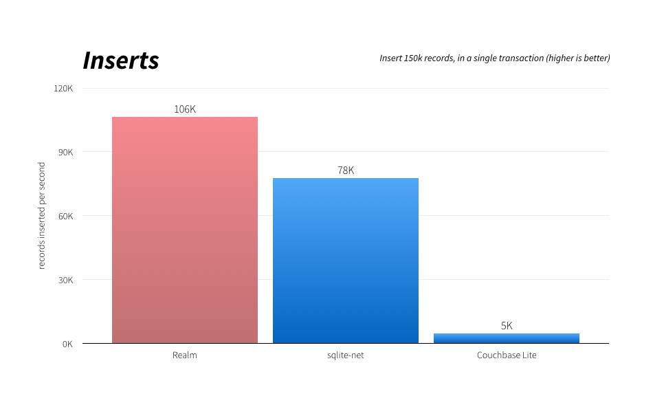

May 10, 2016

# Introducing Realm Xamarin

A reactive database for .NET developers

- - 514
  - 74
  - 40
- - 98

Today we’re launching a new Realm mobile database, this time built specifically for Xamarin. It offers easy object persistence and full query capabilities, with a performance profile that’s faster than existing options.

Like the other editions of Realm, it is designed from the ground up to enable reactive app development, with [live objects](https://realm.io/docs/xamarin/latest/#auto-updating-objects), [change events](https://realm.io/docs/xamarin/latest/#notifications), and support for [unidirectional data flows](https://realm.io/news/unidirectional-data-flow-in-swift/).

[Get Started with Realm Xamarin](https://realm.io/docs/xamarin/latest/) - or check out the source [on GitHub](https://github.com/realm/realm-dotnet).

```
public class Dog : RealmObject
{
    public string Name { get; set; }
    public int Age { get; set; }
    public Person Owner { get; set; }
}

var realm = Realm.GetInstance();

// Query with LINQ
var puppies = realm.All<Dog>().Where(d => d.Age < 2);
puppies.Count(); // => 0 because no dogs have been added yet

// Writes in a transaction
realm.Write(() =>
{
    var mydog = realm.CreateObject<Dog>();
    mydog.Name = "Rex";
    mydog.Age = 1;
});

// Queries are updated in real-time
puppies.Count(); // => 1
```

**Realm** is a database built from the ground up for the unique challenges of mobile app development, that runs directly inside phones, tablets or wearables. We launched for Java, Objective‑C, & Swift in 2014, and for React Native earlier in 2016. We are already used on hundreds of millions of devices today by appmakers including Twitter, Starbucks, Cisco, Walmart, Google, Amazon, & eBay, plus [many many others](https://realm.io/users/).

Today, we’re launching for [**Xamarin**](https://www.xamarin.com/), Microsoft’s mobile framework that lets developers write C# code that becomes native iOS & Android apps.

**Realm Xamarin** brings the modern design & simplicity you expect from Realm, and will allow you to target both iOS and Android with the same codebase. We currently support Xamarin.iOS and Xamarin.Android, and look forward to supporting Xamarin.Mac in the future, as well as UWP and Unity.

### What is Realm?

Realm is not an ORM, and is not built on top of SQLite. Instead we’ve built a full database for mobile app developers, one that uses native C# objects that are dynamically mapped to a full, custom database engine (not just a key-value store). This allows us to provide a simple API while even enhancing performance. With Realm, you can model complex data, link objects in a graph, and compose advanced queries.

 - [Models & Writes](https://realm.io/news/introducing-realm-xamarin/#c-models)
- [Queries](https://realm.io/news/introducing-realm-xamarin/#c-qw)
- [Relationships](https://realm.io/news/introducing-realm-xamarin/#c-relationships)
 

```
public class Dog : RealmObject
{
    public string Name { get; set; }
    public int Age { get; set; }
    public Person Owner { get; set; }
}

var realm = Realm.GetInstance();

realm.Write(() =>
{
    var mydog = realm.CreateObject<Dog>();
    mydog.Name = "Rex";
    mydog.Age = 9;
});
```

You can see more examples of how to use these APIs in our [sample apps](https://github.com/realm/realm-dotnet/tree/master/component/samples).

### Why use Realm?

#### Easy

Realm’s primary focus has always been ease of use, and as you can see from the samples above, Realm Xamarin has the same overall goal. After that, we’ve been working on some of the same advantages our other products are known for…

#### Fast

Realm’s ease of use doesn’t come at a performance cost. Because of its memory mapping, lazy loading, and custom storage engine, Realm is usually faster than SQLite despite offering a rich object-based API. Although we always recommend everyone test their own use-cases, we usually see huge speedups when porting code to Realm. See [benchmark results](https://realm.io/news/introducing-realm-xamarin/#benchmarks) below.

#### Cross-platform

This should go without saying, but Realm Xamarin obviously allows you to write your app once in C# and target both iOS & Android. Please note the Realm file format is also completely cross-platform, allowing data to be shared across iOS & Android easily. For debugging, `.realm` files can be opened via the [Realm Browser](https://itunes.apple.com/us/app/realm-browser/id1007457278?mt=12).

#### Advanced

Realm objects are [always up-to-date with the underlying data](https://realm.io/docs/xamarin/latest/#auto-updating-objects), making it trivial to follow reactive patterns or a unidirectional data flow. You can link Realm objects in [graphs](https://realm.io/docs/xamarin/latest/#relationships), query any property combination via [LINQ](https://realm.io/docs/xamarin/latest/#queries), and even easily integrate Realm data in Xamarin.Forms.

#### Trusted

Realm Xamarin is built on top of the same core as Realm Java, Objective‑C, React Native, and Swift, which is trusted by hundreds of millions of people around the world, and used by e‑commerce applications, banks, healthcare providers, and even governments.

#### Community-driven

Realm Xamarin is built in the open [on GitHub](https://github.com/realm/realm-dotnet). Features are prioritized based on user requests and we welcome [contributions](https://github.com/realm/realm-dotnet/blob/master/CONTRIBUTING.md).

#### Supported

Realm prioritizes support & bugfixes above all else. You can get answers about your database directly from the people that build & maintain it, via [StackOverflow](https://stackoverflow.com/questions/tagged/realm?sort=newest), [GitHub](https://github.com/realm/realm-dotnet/issues) or [Twitter](https://twitter.com/realm).

 - [iOS: Inserts](https://realm.io/news/introducing-realm-xamarin/#ios-inserts)
- [iOS: Counts](https://realm.io/news/introducing-realm-xamarin/#ios-counts)
- [iOS: Queries](https://realm.io/news/introducing-realm-xamarin/#ios-queries)
 

[](https://realm.io/assets/benchmarks-xamarin/benchmarks-xamarin.001.png)

Tests conducted on May 9, 2016, using the latest versions available of Realm, sqlite-net and Couchbase Lite. Measurements taken on an iPhone 6S Plus with 128GB memory running iOS 9.3.1. [Source](https://github.com/realm/realm-dotnet/tree/master/examples/Benchmarkr). We recommend you perform your own benchmarks that represents your usecases as any synthetic benchmarks can only provide rough indicators.

### What’s Next

We’d love your feedback on what we can improve, and we’re particularly interested in [bug reports or feature requests on our GitHub repository](https://github.com/realm/realm-dotnet/blob/master/CONTRIBUTING.md). Expect the API to improve significantly over the next few weeks, especially as we polish advanced features like migrations and queries.

If you are a fan of .NET and want [UWP support](https://github.com/realm/realm-dotnet/issues/509) or [Unity support](https://github.com/realm/realm-dotnet/issues/141), please speak up — we’d love to add that in the future.

We can’t wait to see what you will build with Realm!

[Get Started with Realm Xamarin](https://realm.io/docs/xamarin/latest/) - or check out the source [on GitHub](https://github.com/realm/realm-dotnet).
