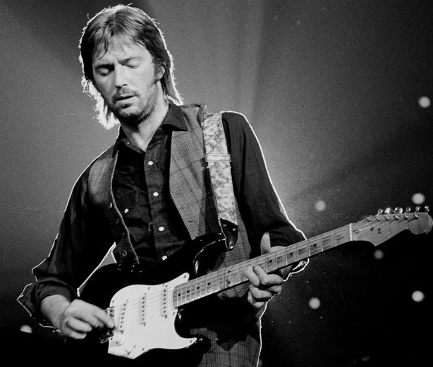
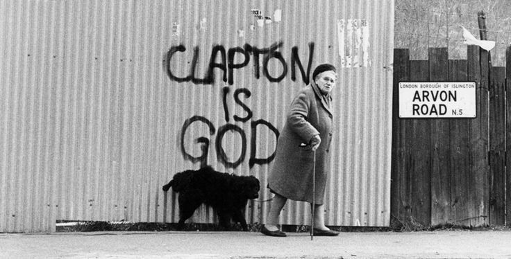
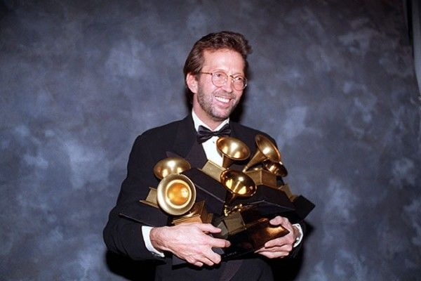

# Eric Clapton | Homens que você deveria conhecer #57

Por trás do guitarrista genial que brincou de ser Deus, uma vida inteira de romances e dramas

As circunstâncias do nascimento de Eric Patrick Clapton em 30 de agosto de 1945 já servem para dar o tom da vida que um dos maiores guitarristas da história da música teria pela frente. Filho de Patricia Molly Clapton com o soldado canadense Edward Walter Fryer, Eric só descobriu seus verdadeiros pais aos 9 anos de idade.

Quando, em 1944, o sul da Inglaterra foi inundado por tropas americanas e canadenses, a pequena cidade de Ripley recebeu milhares de soldados e sua mãe se envolveu com o aviador canadense de quem engravidou aos 15 anos.

Mas a guerra acabou logo depois, as tropas retornaram para seus países e a família voltou à convivência típica de uma pequena comunidade rural. Na tentativa de esconder a gravidez precoce dos vizinhos, Eric nasceu em segredo, sendo criado como irmão de sua verdadeira mãe e filho de seus verdadeiros avós.

ADVERTISING

[inRead invented by Teads](http://inread-experience.teads.tv/)

A descoberta tornou o pequeno Ric um garoto introspectivo, tímido, solitário e distante da família. Impedido de falar sobre o assunto, sua personalidade foi abalada, as dificuldades no estudo surgiram e Eric encontrou nas artes uma forma de se expressar.

Os livros viviam rabiscados com desenhos e a música floresceu ao ouvir Elvis Presley pela primeira vez. O contato com os cânticos ingleses na catequese e com as canções de blues fizeram Eric insistir até ganhar sua primeira guitarra – de plástico.

O brinquedo não tardou a se tornar insuficiente. Vieram a flauta e o violão, instrumentos que, aliados ao tempo sozinho e a um gravador, fizeram ele desenvolver o hábito de treinar até que fosse capaz de tocar cada música exatamente igual aos artistas originais. Era o começo da apuração de uma técnica que mais tarde lhe tornaria tão reconhecido.

### As amizades

Aos 18 anos de idade, Clapton já tinha certeza de que queria seguir carreira na música, e suas amizades foram fundamentais para fazê-lo chegar lá.

Por indicação de uma colega de classe no curso de artes que ambos faziam na Kingston School of Art, Eric entrou na sua primeira banda. A garota era namorada de Tom McGuinness, guitarrista do *The Roosters*.

A parceria, porém, não durou muito tempo e Eric dependeu da indicação de um outro amigo para entrar na sua segunda banda. Dessa vez, alguém bem mais conhecido: Keitch Richards – da recém-formada Rolling Stones.

Apesar dos [*Yardbirds*](https://www.youtube.com/watch?v=k_GsOQ3Zgw8) serem considerados promissores na Inglaterra da época, Clapton foi ficando descontente com os rumos que a banda tomava em direção ao pop. Fiel a suas raízes no blues, acabou optando por deixá-la em março de 1965 e ficou certo tempo em empregos temporários até ter uma nova oportunidade na música.

Foi na [*John Mayall and the Bluesbreakers*](https://www.youtube.com/watch?v=bg4sNbgNLMk) que Clapton alcançou a fama pela primeira vez. Estabelecendo-se como expoente da música blues e conquistando muitos fãs, ele viu a frase "Clapton is God" se espalhar em pichações por toda a cidade de Londres e a fama ganhar todo o Reino Unido.

Mas mesmo com o sucesso alcançado, as amizades voltaram a falar mais alto. Ao lado de Jack Bruce e Ginger Baker, formou um dos primeiros *power trios* do rock e batizou de *Cream*. Nessa fase, apesar de Bruce ser o vocalista oficial, Eric desenvolveu-se como cantor assumindo o vocal de algumas músicas.

Destacando-se como guitarrista, ele vê, porém, a chegada de ninguém menos que Jimi Hendrix à Inglaterra. Com a técnica e a irreverência inigualável do norte-americano, Eric se viu ofuscado ao mesmo tempo que o trio começava a ir mal, muito por conta das brigas internas entre Bruce e Baker. Decididos a dar fim à parceria, os três lançaram um último álbum chamado *Goodbye* que apresentava a versão de estúdio da música "[Badge](https://www.youtube.com/watch?v=gSpW6MePb10)" composta por Eric e seu grande amigo, o *Beatle*, George Harrison.

Do outro lado, ele também participou de [While My Guitar Gently Weeps](https://www.youtube.com/watch?v=rj4J6i_vw0w), composição de Harris no álbum branco dos Beatles.

A proximidade, porém, fez com que Eric se apaixonasse pela esposa do melhor amigo: [Pattie Boyd](http://papodehomem.com.br/inspire-se-com-pattie-boyd/).

Angustiado com o relacionamento proibido, ele compôs uma das canções mais conhecidas de sua carreira: Layla.

*[Link Youtube](https://www.youtube.com/watch?v=fX5USg8_1gA) – Dá play e segue o jogo.*

Com a desordem emocional e profissional, sucedeu-se uma das fases mais difíceis de sua carreira. Ele só voltou a compor e cantar por insistência de um outro amigo do ramo: Delaney Bramlett. Depois de um disco solo, Eric começou a se sentir incomodado pela fama e resolveu montar novamente um power trio que batizou de [*Derek and The Dominos*](https://www.youtube.com/watch?v=RRVkGpVWf6g).

Mas as mortes dos amigos Jimi Hendrix e Duane Allman no intervalo de um ano mudaram novamente o rumo de sua vida. A banda, esfacelada, partiu para uma turnê pelos Estados Unidos que justificou à máxima: sexo, drogas e rock'n roll.

### Os vícios

Tudo acontecia muito rápido na vida do músico no começo dos anos 1970. Enquanto *Derek and The Dominos* fazia sucesso mundial, a vida pessoal desandava completamente: Clapton entrou num período que ele mesmo chama de "anos perdidos".

Entre desilusões, perdas e desencontros, abusou das drogas em turnês internacionais, se tornou viciado em heroína e chegou a gastar o equivalente a R$ 30 mil por semana com substâncias ilícitas. A maneira sóbria com que ele avalia essa fase, no entanto, impressiona:

> “As drogas foram o começo do fim da *Derek & The Dominos*. Não conseguíamos fazer nada. Não conseguíamos trabalhar. Ficamos paralisados. E isso levou a uma hostilidade crescente entre nós. Foi um período de sério declínio em minha vida. A heroína levou também minha libido por completo, de modo que não tinha atividade sexual de nenhum tipo, e vivia cronicamente constipado.”

Anos depois, o rumo dos integrantes da banda revelaram um pouco do convívio danoso que eles compartilhavam. Bobby Whitlock se tornou desafeto de Clapton após uma briga feia a ponto de ambos nunca mais terem tocado juntos. Carl Radle morreu em 1980 devido à complicações renais associadas ao abuso de álcool e drogas. Já Jim Gordon se revelou um esquizofrênico não-diagnosticado em 1983 ao matar a própria mãe a marteladas durante um surto psicótico e passou a viver internado num hospital psiquiátrico.

Eric caiu em depressão, passou a abusar ainda mais das drogas e interrompeu sua carreira. Durante o hiato, só reapareceu tocando publicamente em dois momentos: no Concerto para Bangladesh – organizado por George, em 1971; e no Rainbow Concert – organizado por Pete Townshend, em 1973, na tentativa de ajudá-lo a largar as drogas.

Relativamente limpo novamente, Eric formou uma nova banda ainda com seu parceiro Radle para lançar, em 1974, mais um álbum famoso de sua carreira. *461 Ocean Boulevard* incluía até uma música de autoria de outro amigo, Bob Marley, chamada "I Shot The Sheriff".

[*Link Youtube*](https://www.youtube.com/watch?v=APWhx97QvxE) *– Se liga na introdução que ele faz com a guitarra.*

Mas mesmo com a turnê e os lançamentos, Eric se envolveu novamente com drogas: dessa vez o álcool.

Num episódio marcante em 1976, Eric fez apologia ao racismo durante um show na Inglaterra e pediu votos que impedissem a Grã-Bretanha de se tornar uma "colônia negra". Naturalmente, críticas a ele ganharam o mundo e Eric só foi assumir anos depois que estava alcoolizado. Colegas relataram que era comum vê-lo bêbado no palco a ponto de esbarrar nos instrumentos.

Os anos seguintes também não reservaram calmaria. Os problemas com o álcool seguiram e ele precisou ser internado em clínicas de reabilitação várias vezes para tentar se livrar do vício. Sem sucesso. E mesmo o que parecia um alento em 1979 se tornou um problema que se arrastaria por toda a década seguinte.

> “Certa noite estávamos sentados na sala grande de minha casa em Hurtwood quando ele [George Harrison] disse: ‘Bem, suponho que seja melhor eu me divorciar dela’, ao que retruquei: ‘Bem, se você se divorciar dela, isso significa que terei que me casar com ela!’.”

Era o amor proibido por Pattie Boyd finalmente revelado. O Beatle e a modelo se separam em 1977 e em 1979 Eric e Pattie já estavam casados. A união tão aguardada prometia ser duradoura, mas o vício e as traições encurtaram o matrimônio.

Em 1984, ainda com problemas com o álcool, eles se separaram. Eric se envolveu com a modelo Yvone Khan Kelly – com quem teve uma filha chamada Ruth – e com a modelo Lory Del Santos – que lhe deu um filho chamado Conor. Apesar dos filhos, os relacionamentos foram tão breves que ainda na década de 1980, houve tempo para um breve retorno com Pattie e um namoro polêmico com a modelo Carla Bruni, de quem o então amigo Mick Jagger a roubou.

> "Eu fiquei mentalmente perturbado. Queria matá-lo. Passei um bom tempo tramando maneiras de destruí-lo ou simplesmente fazê-lo desaparecer. Foi aquele tipo de fantasia insana, típica de um alcoólatra em recuperação".

No período, Eric revelou que chegou a pensar em suicídio num cena que ele mesmo descreve: segurando uma garrafa de vodka numa mão e um revólver na outra. O pior, no entanto, ainda estava por vir.

Em 1990, o amigo e também guitarrista, Stevie Ray Vaughan, participou de uma apresentação ao lado de Eric e outros ícones do blues em Londres. Ao final do show, Stevie resolveu pegar uma carona no helicóptero de membros da equipe de apoio de Clapton, mas um acidente provocado pelo mal tempo derrubou a aeronave num pista artificial de ski e tirou a vida de todos os passageiros.

Os traumas pareciam acompanhar Eric por toda a parte.

Ainda não totalmente recuperado do acidente, ele se vê obrigado a lidar logo na sequência com o fato mais trágico de sua vida. Em 20 de março de 1991, seu filho Conor morre aos 4 anos de idade após cair da janela do apartamento que morava com a mãe e despencar 49 andares.

O que tinha tudo para ser o fim definitivo foi justamente o estopim do recomeço. Eric largou as drogas e, como na infância, libertou seus sentimentos através da música compondo, em homenagem ao filho, "Tears in Heaven".

*[Link Youtube](https://www.youtube.com/watch?v=1qb8xDfPmFo) - Eric já com sua famosa técnica afiada num violão.*

### Os prêmios

Reabilitado, ele se tornou porta-voz da luta contra a dependência química no mundo. Em 1997, fundou o [Crossroads Center](http://crossroadsantigua.org/history_letter/) na ilha de Antígua, frequentada tantas vezes por ele durante seus tratamentos.

Famoso por usar diversas guitarras nas apresentações, Eric fez uma série de leilões de itens pessoais e passou a organizar o Crossroads Guitar Festival para arrecadar fundos e tornar o tratamento mais barato e acessível.

Também nos anos 1990, lançou alguns de seus álbuns mais famosos como *24 Nights*, *Unplugged* e *From The Cradle*, resgatou suas raízes no blues, reviveu o apelido de "slow hand" e empilhou prêmios.

Com mais de 40 anos de carreira, se tornou o único artista nomeado três vezes ao Rock & Roll Hall of Fame, por seu trabalho nos *Yardbirds*, no *Cream* e por sua carreira solo. Venceu 18 Grammy Awards por suas composições, participações e contribuições para outros músicos. Foi condecorado com o título de Comandante da Ordem do Império Britânico (CBE), casou-se novamente, dessa vez com a artista gráfica Melia McEnery, teve três filhas, Julia Rose, Ella May e Sophie e em 2007 publicou uma autobiografia reeditada em 12 idiomas que se tornou um livro quase obrigatório para os fãs de música.

Hoje, aos 71 anos, Eric sofre de neuropatia periférica. Uma doença originada do consumo excessivo de álcool que afeta o sistema nervoso, os movimentos dos pés e das mãos e provoca dificuldades para tocar guitarra. Mesmo assim, se diz grato por estar vivo e não deixa de reconhecer os erros do passado.

> "Tive muita dor ao longo do último ano, mas tive que descobrir como lidar com isso e outras coisas que vêm com o envelhecimento. Eu não sei como sobrevivi – aos anos 1970, especialmente. Como estou recuperado do alcoolismo e do vício, acho uma coisa incrível estar vivo. Pela lógica, eu deveria ter batido as botas muito tempo atrás."

É, Clapton, ainda bem que a vida não é lá tão boa em seguir a lógica.

---

*publicado em 16 de Setembro de 2016, 19:39*
