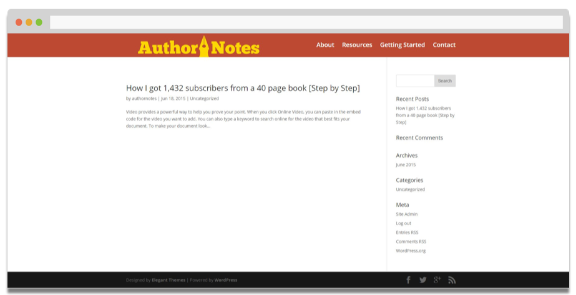
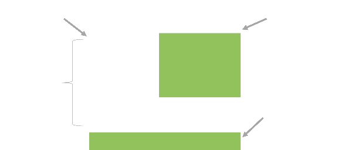
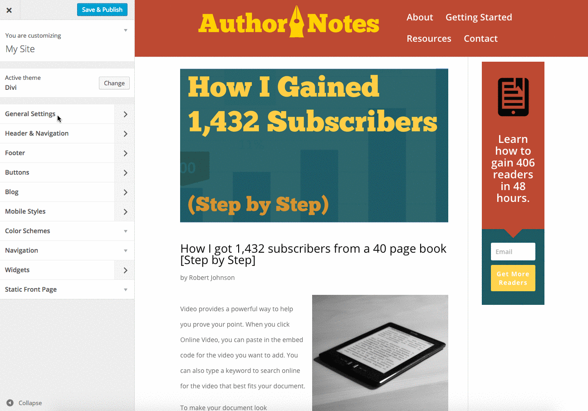
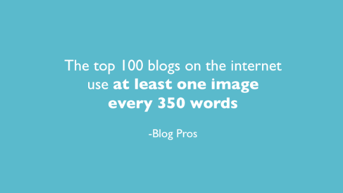

# The Anatomy Of A Perfect Divi Blog Post

by

## By default Divi’s blog posts are TERRIBLE.

This is what the first post from my [authority site](http://www.diviguide.com/design-an-authority-site/) article looked like:



I think we can all agree that layout is underwhelming.

**But, what constitutes the perfect post?**

If you search the internet (like I did) you will find a lot of conflicting styles. Some sites have minimalist posts, some have inline advertisements, some have images every other sentence, and some have 10,000 words with no images.

The information I ended up using comes form a variety of what I consider to be industry experts. After reading a bunch of these articles I compiled the following list of attributes that comprise the perfect blog post ([Click To Download The Checklist](#)):

- Font Size: 16-22px
- Line Height: 1540-170%
- Font Color: #000;
- Line Width: ~70 Characters
- Start With A Dropcap
- Right Aligned Image To Start
- One Image Every 350 Words

Here’s a nifty graphic I created that illustrates these concepts for the visually inclined:



## Implementing The Perfect Post

Of course, it’s easy to make a graphic. What we need to do now is get Divi to cooperate with our vision.

Almost all of our required changes can be done in the “Divi Customizer.” Under the “Divi Customizer” choose “General Settings–>”Layout Settings” and check “Use Custom Sidebar Width.” Increase the width to 30. This adjustment will reduce our line length to approximately 70 characters.

Under “General Settings”–>”Typography” make the following adjustments:

- Set “Body Line Height” to 2
- Switch Text Size to 20
- Increase Header Text Size to 38
- Adjust the Header line height until it is 1.3
- Under Header Font Style toggle “Bold” on
- Adjust Body Text color to #000

Finally, you should adjust the meta font size to be 18. This option is found under the “blog” panel in the Divi Customizer.

I know that’s a lot of steps so I created a gif that you can use if you get stuck:



## Using Dropcaps

Dropcaps are a breeze to implement with the Divi Theme. Just add the shortcode around the letter you wish to style. For example to achieve the dropcap in this paragraph I used the following shortcode:

```
[dropcap style="font-size: 60px;"]D[/dropcap]ropcaps
```

## Images

Creating compelling graphics is crucial to a readers experience. According to a study by “marketing pros:

> The top 100 blogs on the internet use an image every 350 words.

If you would like to see a little more proof that images are important flip through these facts I compiled:

[](https://www.diviguide.com/wp-content/uploads/2015/07/Slide5.png "Slide5")

Creating images is time consuming and difficult but that does not mean you should settle for no images or crappy clip art.

I suggest checking out the resource page to find a bunch of free image tools. In my work, in a pinch I rely heavily on [Stocksnap](http://stocksnap.iop/) and [Canva](http://canva.com/).

## Wrapping Up

At this point you know the anatomy of a perfect Divi blog post. I put together a checklist so that you can easily remember all the different attribute settings. ([click here to download it](#)).

[Download The Checklist](#)

Thanks for reading! Send me a link if you implement this recipe on your site! I’ll likely share it…
