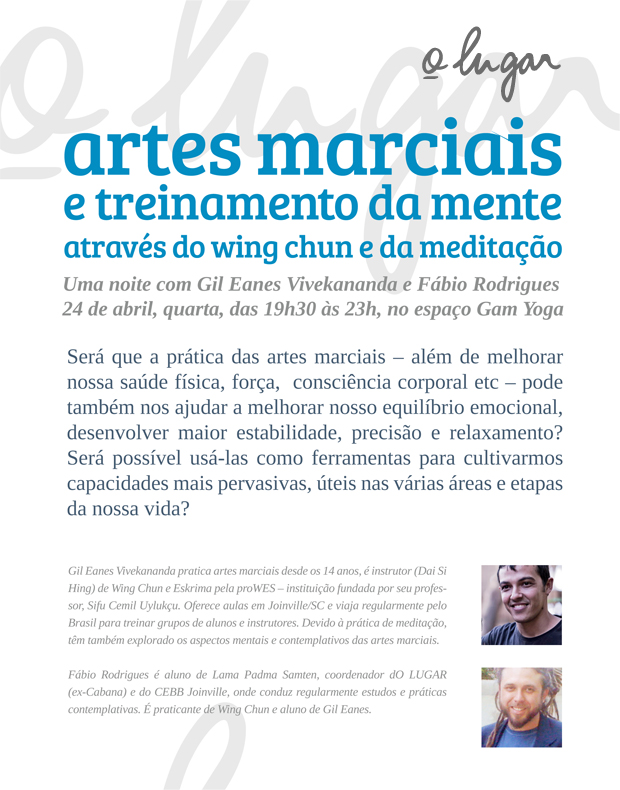
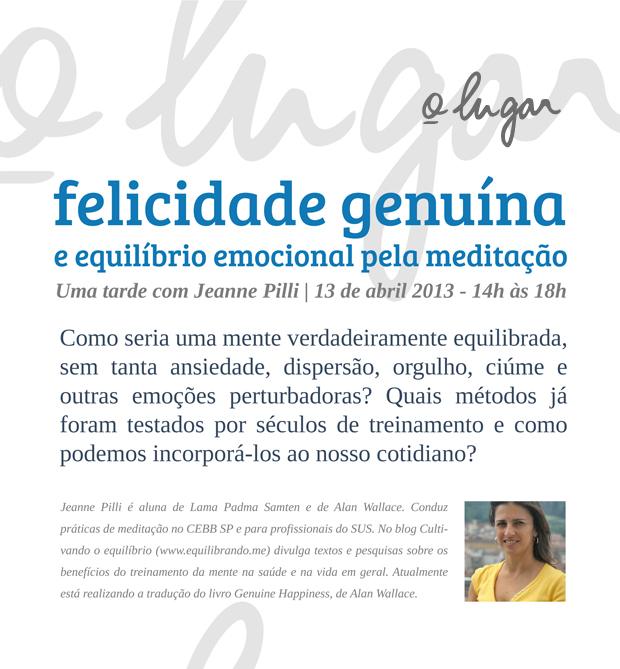

# Equilíbrio emocional, artes marciais, meditação: os primeiros encontros dO LUGAR

> "Não falta sabedoria à humanidade; a questão é como incorporá-la em uma prática na vida cotidiana." —[Alain de Botton](https://papodehomem.com.br/alain-de-botton-no-twitter-pare-tudo-3/)

É muito fácil montar um evento: convidamos alguém, pagamos a locação de um espaço, divulgamos com um cartaz bem feito... Mas é muito difícil chegarmos, em rede, até o ponto de um evento fazer sentido.

Quando olhar para os eventos descritos abaixo, sugiro imaginar quantas vezes e quantas pessoas por quantos anos viajaram para receber orientações de prática de um grande professor durante dias em um retiro de shamatha ou em um treino de wing chun, quanto tempo foi dedicado para testar práticas, para trabalhar com o corpo e com a mente, para conversar, compartilhar insights em posts no PdH, acompanhar percursos dos outros, bater cabeça, errar, perguntar...

PUBLICIDADE

[inRead invented by Teads](http://teads.tv/inread-outstream/)

Imagine também uma comunidade cada vez maior de curiosos, interessados, gente perguntando sobre isso, sobre aquilo, pedindo indicações de livros e lugares. E uma rede de praticantes aplicando métodos em sua vida cotidiana, relatando pequenas ou grandes mudanças, se preparando para encontros e explorações cada vez mais profundas. Sem essa comunidade, chamar um grande professor é inútil: ninguém vem, ninguém consegue entender ou colocar em prática.

É por isso que **estamos muito felizes em convidá-lo** para os primeiros encontros dO LUGAR. Mesmo antes do lançamento do novo site olugar.org já vamos direto ao que interessa.

O terceiro encontro será nacional, um intensivo de sexta a domingo, [divulgado aqui](https://papodehomem.com.br/transformacao-pelo-encontro/).

Eis o segundo encontro:

Clique na imagem para se inscrever

### Artes marciais e treinamento da mente

*Uma noite com Gil Eanes Vivekananda e Fábio Rodrigues | Encontro #2*

Será que a prática das artes marciais – além de melhorar nossa saúde física, força, consciência corporal etc – pode também nos ajudar a melhorar nosso equilíbrio emocional, desenvolver maior estabilidade, precisão e relaxamento? Será possível usá-las como ferramentas para cultivarmos capacidades mais pervasivas, úteis nas várias áreas e etapas da nossa vida?

**Público:** Pessoas interessadas e praticantes de qualquer arte marcial que tenham interesse em aprofundar os aspectos mentais, psicológicos e comportamentais do treinamento. Pessoas interessadas e praticantes de meditação que desejam usar o treino físico como prática complementar.

**Programação:**

> 19h30  
> **Introdução** | Qualidades pervasivas, arte marcial como meio hábil, relaxamento, diminuição de responsividade  
> **Introdução à meditação** | Shamata com foco na energia, relaxamento, vivacidade e estabilidade  
> **Prática de meditação guiada**  
> **Prática de meditação autoguiada**  
> 21h00  
> **Aspectos sutis da base e postura** | IRAS (Internal Rotation Adduction Stance), Hao Ma, equilibrio, estabilidade e responsividade  
> **Aspectos sutis da guarda e dos golpes** | Man-Sao, Wu-Sao, Hao Ma, equilíbrio, relaxamento e responsividade  
> **Siu Nin Tao** | Introdução à primeira parte da forma Siu Nin Tao, com foco em aspectos mentais e contemplativos

**Gil Eanes Vivekananda** pratica artes marciais desde os 14 anos, é instrutor (Dai Si Hing) de Wing Chun e Eskrima pela proWES – instituição fundada por seu professor, [Sifu Cemil Uylukçu](https://www.youtube.com/watch?v=zQRJJ_1jXBI). Oferece aulas em Joinville/SC e viaja regularmente pelo Brasil para treinar grupos de alunos e instrutores. Devido à prática diária de meditação, recentemente têm explorado mais a fundo os aspectos mentais e contemplativos das artes marciais.

**Fábio Rodrigues** é aluno de Lama Padma Samten, coordenador dO LUGAR (ex-Cabana) e do [CEBB Joinville](http://www.cebb.org.br/centros/sc/joinville/), onde conduz regularmente estudos e práticas contemplativas. É praticante de Wing Chun e aluno de Gil Eanes.

**Quando:** 24 de abril, quarta, das 19h30 às 23h.

**Onde:** Espaço Gam Yoga | Rua Fradique Coutinho, 1004 - Vila Madalena - São Paulo, SP ([rota no Google Maps](http://goo.gl/maps/aYbcp)).

Valor: R$ 60,00. Ao se inscrever, saiba que essa contribuição apoiará as atividades dO LUGAR e de Gil Eanes Vivekananda.

Limite de participantes: 25 pessoas.

**[Faça sua inscrição online →](https://docs.google.com/forms/d/1USWqRIrqyxL28Sl-7oRX0riB3VEMnWUegajEC9M7Di0/viewform)**

...

E o primeiro encontro já foi realizado:

Clique na imagem para se inscrever

### Felicidade genuína e equilíbrio emocional pela meditação

*Uma tarde com Jeanne Pilli | Encontro #1*

Durante algum tempo, a psicologia clínica focou principalmente o diagnóstico e o tratamento das doenças mentais. Apenas recentemente a atenção tem se voltado à compreensão e ao cultivo de uma saúde mental positiva. William James, que estabeleceu as bases da psicologia ocidental, declarou: "A cada momento, aquilo a que prestamos atenção é a realidade". Se nosso mundo vivido é inseparável de nossa presença mental, investigar o funcionamento da mente e cultivar qualidades como relaxamento, estabilidade e vivacidade podem transformar radicalmente nossas experiências.

Como seria uma mente verdadeiramente equilibrada, sem tanta ansiedade, dispersão, orgulho, ciúme e outras emoções perturbadoras? Quais métodos já foram testados por séculos de treinamento e como podemos incorporá-los ao nosso cotidiano?

Neste encontro de quatro horas, vamos alternar entre conversa e prática orientada para descobrir se é possível estabilizar nosso fluxo mental e nossos ânimos sem depender tanto de estímulos externos.

**Jeanne Pilli** é aluna de [Lama Padma Samten](https://papodehomem.com.br/para-comecar-a-meditar/) e de [Alan Wallace](http://en.wikipedia.org/wiki/B._Alan_Wallace). Conduz práticas de meditação no CEBB SP e para profissionais do SUS. No blog Cultivando o equilíbrio ([www.equilibrando.me](http://equilibrando.me/)) divulga textos e pesquisas sobre os benefícios do treinamento da mente na saúde e na vida em geral. Atualmente está realizando a tradução do livro *Genuine Happiness*, de Alan Wallace.

**Quando:** 13 de abril 2013, sábado, das 14h às 18h

**Onde:** Casa Jaya | Rua Capote Valente, 305 - Pinheiros, São Paulo - SP ([rota no Google Maps](http://goo.gl/maps/3SLJM))

**Valor:** R$ 100,00. Ao se inscrever, saiba que essa contribuição apoiará as atividades dO LUGAR e os movimentos de Jeanne Pilli ao divulgar e orientar práticas e estudos sobre a importância do treinamento da mente.

Limite de participantes: 25 pessoas.

**[Faça sua inscrição online →](https://docs.google.com/forms/d/1nt-xpNMDiw1f4az4yWdqg4XOTTB-wGowbGapoWQPnAk/viewform)**

### Quer participar de outros encontros de transformação?

Já sabemos que dá para mudar o mundo, mas como fazer o trabalho sujo? Como criar um espaço com potencial real de transformação para testar e aprimorar métodos e treinamentos que potencializem nossas vidas em uma rede, em um lugar capaz de beneficiar qualquer um que se aproximar?

Vamos abrir o novo site olugar.org no fim de abril. Além de práticas sugeridas, artigos de aprofundamento e conversas em uma comunidade online, teremos eventos e encontros presenciais. Quer ser avisado?

## O LUGAR | Interessados

\* indicates required

Seu nome \*

Seu sobrenome \*

Seu email \*

Se tiver alguma dúvida em relação aos eventos e se pudermos ajudá-lo em alguma questão logística, por favor nos escreva: coordenacao@olugar.org.

Deixo novamente aqui os links para os formulários de inscrição:

Espero encontrá-lo em breve. Abração!

---

*publicado em 03 de Abril de 2013, 17:07*
