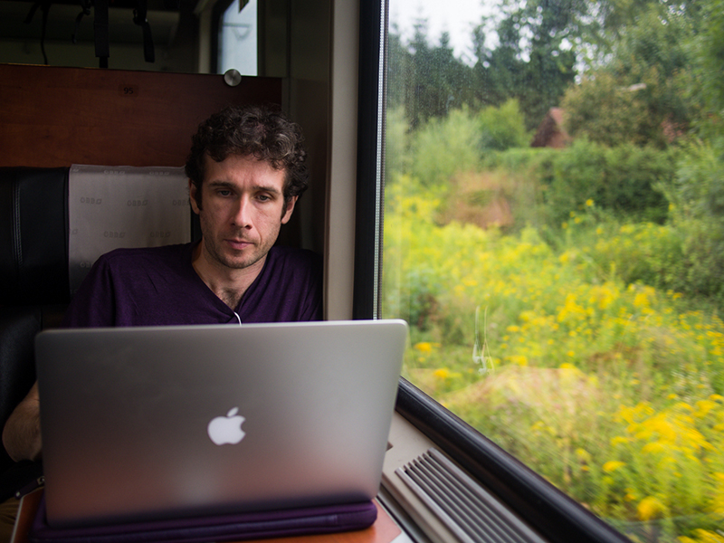

# 5 Advantages Of Using Remote Life Program On Your Trip

[anexo ausente]

5 Advantages Of Using Remote Life Program On Your Trip

Remote life is a program conducted which focuses on bringing the entrepreneurs, freelancers, professionals to travel, live and work together. This program takes care of all the stuff that will be needed for the businessmen such as booking of the room, organizing, researching, travel tickets and desk space. You can do this without missing any work and without leaving the job. If you are a [workaholic person](https://en.wikipedia.org/wiki/Workaholic) and want a week or month vacation, but you can’t leave your work on hold, then a remote life program is the best option for you.

In Remote life program, you will be getting the best service and amenities. If you have to write a book or complete a project, then you can join this program, and then you can do work at peace, and you will enjoy the whole process.

The following are the points about the advantages of taking this trip:-

1.    You Can Work At Peace:-

If you are staying in a busy city which functions day and night, there will be a time where you will be exhausted with kind of life, and you will want to take a vacation. You can take this remote life program and do your project or work at peace without any worldly chaos. Such remote life program focus in taking the people to places where there is a beach and [beautiful landscape to enjoy](https://www.behance.net/gallery/18713417/75-Mountain-Landscape-Images).

2.    Great Service Provided:-

Remote life program focuses on giving exceptional services with all the amenities provided at their footstep. There are many testimonies that they had the best time of their lives without leaving their work. Sometimes going for a vacation alone leaving the work as it is can very frustrating but in this program, you can do work at ease with 24/7 high-speed the Internet and desk space provided.

3.    Working Under No Pressure:-

When you work in your regular office, there are deadlines and peer pressure always troubling you. But when you take this trip you will not have any pressure whatsoever. You will have a perfect to work at with all the services provided to you. Many people take up this program if they have family pressure or stress going on in life. This program helps in providing a [stress-free environment](http://www.forbes.com/pictures/lmj45mmjj/9-ways-to-create-a-stress-free-work-environment/).

4.    Vacation Without Work Tesnion:-

Think about a vacation where you can work and have fun at the same time. Remote life program serves that necessity where you can have fun and complete your project or job at ease without any tension. Most of the businessmen, professional or freelancers opt for such time off from their normal and [go for a vacation](https://www.quora.com/Whats-the-difference-between-go-on-vacation-and-take-a-vacation) and can work at the same time.

5.    Reasonable And Affordable:-

If you are doing great at your business but you have a lot of pressure, and you want to take a time out then sign up for [remote work program](http://www.theremotelife.com/). There are some programs which are totally affordable with all the amenities provided right at their doorstep.

Add to Collection

Follow Following Unfollow
