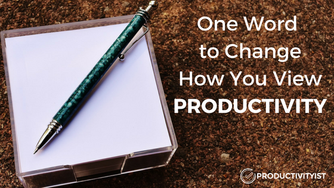

# One Word To Change How You View Productivity

> *Today’s guest post is from Johan D’Haeseleer. Johan is a writer, speaker, and the founder of [Extra Time](http://extratime.club/). Johan’s passion is helping people make the most of their time and reduce their stress levels.*

Productivity can get confusing at times, right? But at its core, productivity is actually simple.

To be productive, you have to do the right things in the right way. And doing the right things is the key to being effective. When you do those right things in the right way, that’s how you’re efficient.

You want to do both of these things. While you may be effective checking your email inbox many times during the day, it’s not efficient.

I’d like to present to you a simple formula of sorts:

**Personal Productivity = Output/Input**

Your productivity depends on this simple equation. Your output is the work you do; the projects and tasks that you accomplish. When you do not finish a project, there is no output, so you are not productive.

On the other side, the more projects you deliver, the greater your output. And the fewer projects you have, the faster you can finish your work. The more output you’ll have.

### One Word That Changes Everything

Now, let’s talk about input. Input is made up of your resources. What are your resources?  You can think of the word TEAM.

T.E.A.M. is an acronym for time, energy, attention and money. These are by far the most valuable things you have. And each of these resources is limited. Once they are gone, they’re gone. So you want to be sure that you maximize each one and use them on what matters most to you. So how can you become more efficient (and effective) with these valuable resources?

Let’s look closer at each resource.

## 1. Time

While you can’t have more than 24 hours in a day, you can work smarter to maximize each one of those hours. One of the best strategies to give yourself more time is to eliminate things that are not worth your time or do not add value.

Here are a few strategies to gain extra time (in no particular order):

- Say no to anything you are not excited about or do not consider to be [essential](https://productivityist.com/essentialism-get-work-done/).
- Automate your work or processes.
- Reuse some already existing work. For example, if you have a podcast, you can use the transcriptions to create other content. Have video content? You can take the audio from that to create a podcast or even an audio course.
- Use the 80/20 rule to refocus where you spend your time.
- Outsource work to others who can do a better job in less time.
- Delegate work to your co-workers.
- Systematize.

## 2. Energy

Physical energy is an important tool for knowledge workers. And it is often grossly underestimated. Giving yourself more physical energy will help your productivity immensely. Your physical energy is directly related to your mental energy (that you tap into all day long).

Strategies that can help:

- Optimize your sleep. Knowing your chronotype is very helpful with this. I highly recommend you [take this free test](https://thepowerofwhenquiz.com/) and learn more about [your sleep chronotype](https://productivityist.com/podcast-michael-breus/).
- Eat healthy foods that boost your energy.
- Regular exercise. (If you’re on a treadmill, that’s a great time to watch the news or a television show.)

## 3. Attention

When you concentrate on one task, not only do you use less mental energy, but you also save time because tasks do not take as long to complete. I know, this isn’t easy at first. You’re probably used to [multitasking](https://productivityist.com/essentialism-get-work-done/) right?

One way you can better focus your attention is to know more about [how your brain works](http://extratime.club/brainpower-decision-fatigue/).

One of the best books I’ve ever read about this topic is [Brain Rules](https://www.amazon.com/Brain-Rules-Updated-Expanded-Principles/dp/098326337X/ref=dp_ob_title_bk). I recommend you put it on your reading list.

A few more strategies to focus your attention include:

- Make [fewer decisions](https://productivityist.com/5-essential-tips-tackling-decision-fatigue/) throughout your day.
- Spend time in meditation.
- Try using the Pomodoro technique as it can help you focus on one task.
- Mindful multitasking such as listening to an audiobook on your commute.
- Reduce the number of distractions.
- Reduce the number of interruptions.

## 4. Money

Money is something we all use every day. We make it, and we spend it. Once it’s gone, it’s gone. Money can be one of the most important resources you have. However, whenever given the option, I find it best to use any extra money for extra time.

What do I mean? Having someone do my yard work for me which allows me to spend more time with my family.

Here are a few other ways you can make the most of your money:

- YNAB (You Need A Budget) is a helpful way to track your money.
- Calculate the ROI (Return on Investment) for the activities you’re doing. Just figure out the time required for a task and how much money your time is worth. This is a great way to figure out if a task should be outsourced or not.
- Invest in good bookkeeping/accounting software if needed (especially for business owners). You’ll save both money and stress in the long run.

## Next Steps

Focus on one of these four resources and think about how you can maximize that area of your life. In many cases, time is a good place to start. When you have more free time (I like to call this extra time), you can then use that time to maximize your energy, attention or money.

I’d like to help you on this journey by [giving you my Productivity Toolkit](http://eepurl.com/cCAMvj) which includes a short ebook, a closer look at the concept of TEAM and also The 10 Commandments of Productivity. Each tool will help you maximize your time, energy, attention, and money.

Do you have any tips for how you maximize your time, energy, attention, or money? Please share in the comments.
