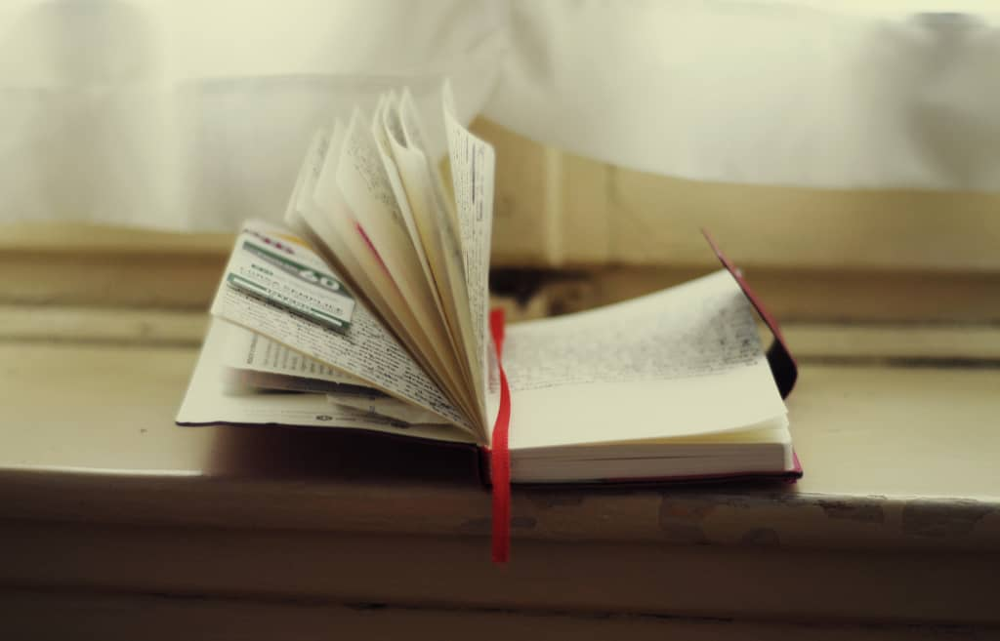
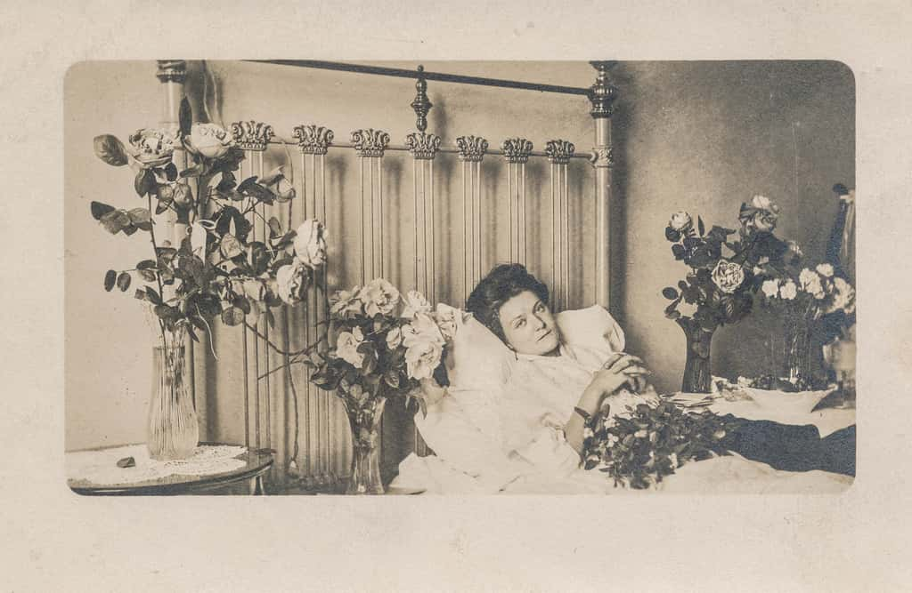
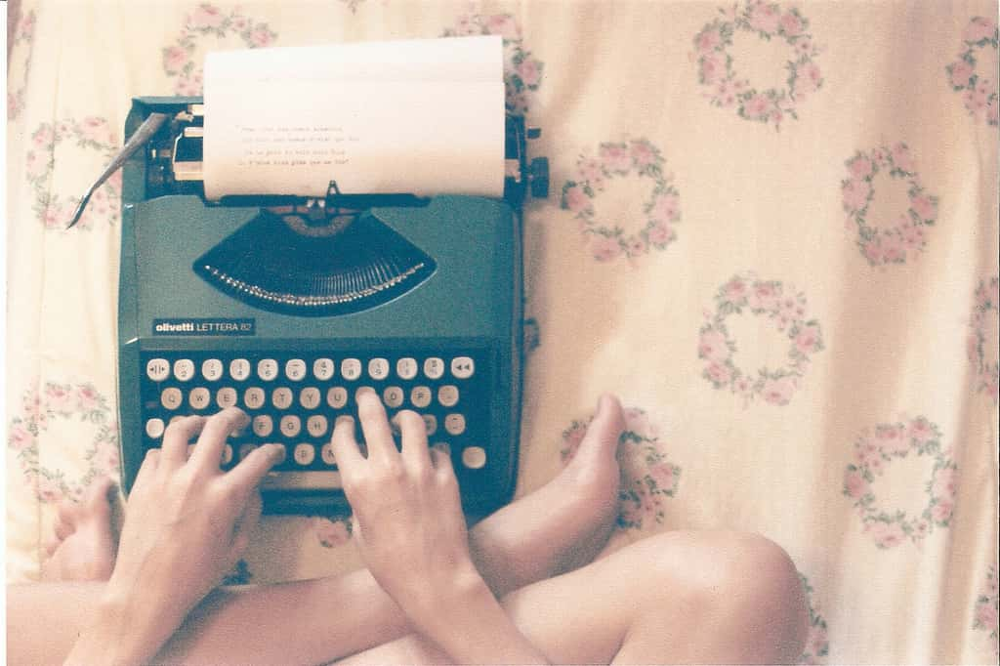
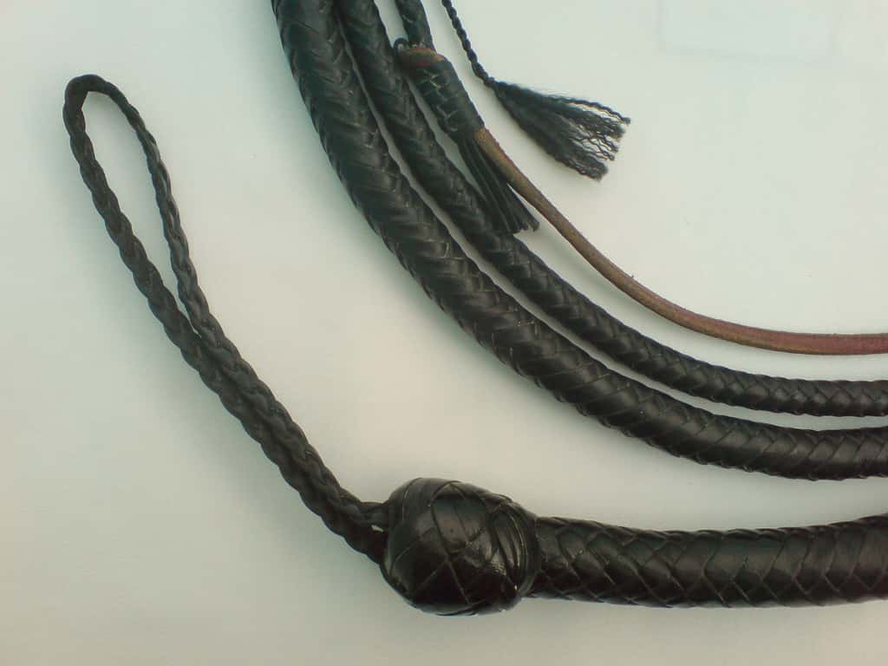
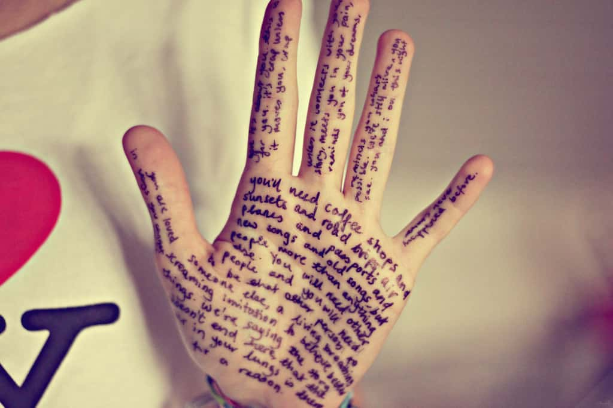
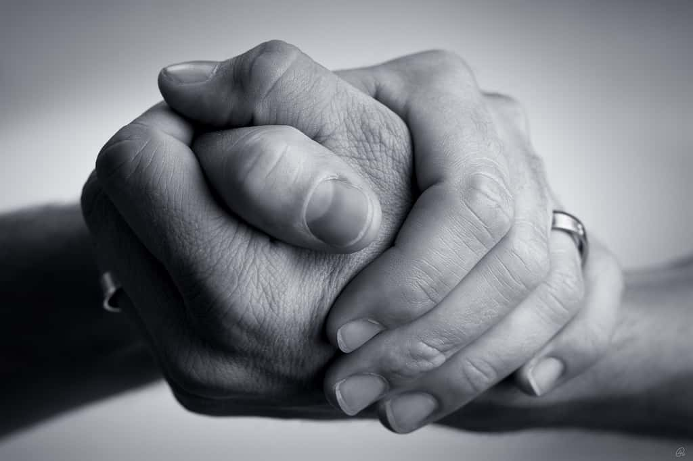
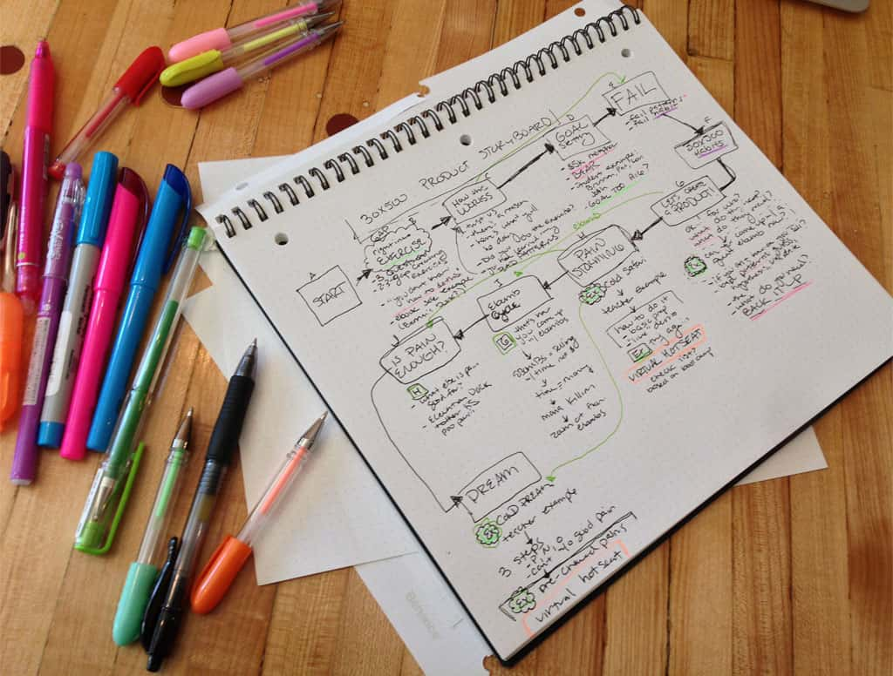

# Don't Write 1,000 Words a Day

Amy Hoy

November 28, 2014

> “How do you motivate yourself to write 1,000 Words a Day when you don’t feel like it?”
>
> “I don’t.”
>
> — *Chris Guillebeau, author [How to Write 300,000 Words in 1 Year](http://chrisguillebeau.com/how-to-write-300000-words-in-1-year)*

Apparently it was morning. 10…30?

I patted down all the major parts: face, chest, thighs, upper arms. Man, my arms were freezing, though I’d slept in a long sleeve shirt. The rest of me was warm, at least. A good sign. I lay still for another few moments, then rolled over, sat up. Waited a few more minutes before I stood…I’ve learned the hard way not to rush. Mentally ran through my closet: *yoga pants, sweat pants, flannel shirt, chenille cardigan, fleece sloth pajamas*…How cold was I? Cold-ish. So I pulled on & buttoned up my sloth PJs. (Yes, I’m an adult.)

Most mornings I feel like boiled-over crap, so my wonderful husband brings me my first coffee in bed. Today, I felt only moderately crap-like! So I gingerly picked my way down our antique staircase to make my own damn coffee for myself.

First: hot water in the cup, then espresso capsules one, two, three into the Nespresso machine. Finally — coffee! A long black.

And ooh, the coffee helped.

I cracked my laptop. Wrote a little. Read my emails. Made a couple phone calls (contractors for our new office build-out, you know). Caught up with my team. Made a few minor 30x500-y decisions with Alex, since he’d been waiting on me for a few days. For an hour or two, I got shit done.

And then…

Thomas was trying to tell me something across the dining table. What, what I don’t know. I desperately needed him to JUST… **STOP**… **TALKING**. My skin steamed, I was so hot I was *angry* — and dizzy. I wanted to clap my hands over my ears and scream.

### I really *looked* at my MacBook and realized I hadn’t been doing anything, just going in circles for the last half hour.

I *had* to get horizontal. I climbed the stairs. My heart raced. I gasped for air.

Our housekeeper, Maria, was just getting a fresh flat sheet on the bed when I stumbled in, but I couldn’t stand upright any longer so I sat down awkwardly on the bed. Suddenly I wasn’t hot any more; I shivered and my nail beds were white and purple, and there was a pile of warm blankets not 8 feet away on a chair, but it might have been a mile because I couldn’t stand up to get one. So I waited for Maria to make the bed with me in it. I didn’t have the energy to help.

And…that was the end of my day. Two, maybe three hours of being vertical at my own dining room table. The rest was TV reruns.

### I’m 30 years old.

I don’t have asthma, a heart condition, nor am I desperately out of shape. There’s nothing wrong with my component parts. I have dysautonomia, which basically means my integrated control board is a piece of shit.

## So. Let’s talk about 1,000 Words a Day.

A couple months ago ago, [Chris Guillebeau](http://chrisguillebeau.com/) stopped here in Philly on tour for his newest book, [The Happiness of Pursuit](http://www.amazon.com/The-Happiness-Pursuit-Finding-Purpose/dp/0385348843). I’ve always loved his way of thinking, so I loaded up on salt water & dragged my butt over to [Indyhall](http://www.indyhall.org/).

Chris opened by asking us all if we’d ever played Super Mario Brothers. (Surprise!) He then told a little story about the things that keep us going in part because they can never be totally achieved. *The princess is in another castle.* It was awesome.

Then it was Q&A time, and an audience member asked that question:

***How do you motivate yourself to write when you don’t feel like it?***

And Chris replied, “I don’t.” Just two words — that said it all.

In case you were there, I was the weirdo who laughed out loud. OK…maybe it was more like a snort.

Snort, because: I often write about how mastery & growth & success comes from showing up & doing the things you don’t especially want to do, day after day, month after month, year after year. [Of practicing a craft like a grown ass adult](https://stackingthebricks.com/why-blacksmiths-are-better-at-startups-than-you/). And all that is true.

But “I don’t” is funny because it’s also true.

## I couldn’t write 1,000 words a day if my life depended on it

On my worst days it’s all I can do to spit out one word, or three, the disjointed struggle of a seized brain. Just ask my husband, Thomas, or [30x500](http://30x500.com/) partner, Alex. They’ve gotten very good at reading my mind.

*This* essay has taken me over a month to write & rewrite, in fits in starts.

And yet, could anyone truly claim, “Well, Amy, you’re not a writer!”?

Wellll, sure, anyone can say anything and they often do. But the facts are in: I’m a writer. I’ve written a JavaScript book, a book’s length of 30x500 lessons (over 100,000 words), and all the blog posts you see here which are certainly another book or two. Not even counting the scripts for many, many hours of video lessons, live workshops, and conference talks.

### I’ve written hundreds of thousands of words over the past few years…

…despite being utterly incapable of conforming to a schedule, not writing a thing for weeks at a time.

Chris coined the [1,000 Words a Day model](http://chrisguillebeau.com/how-to-write-300000-words-in-1-year) for himself, and he’s a *monster* for doing: he’s written 3 books in the past 4 years, started & run a huge conference, traveled the world, and on and on and on. Just writing out a list of all the shit he’s done makes me tired.

Chris doesn’t have dysautonomia. But even he doesn’t always hit 1,000 Words a Day. Sometimes he just doesn’t feel like it.

## So clearly, it’s not about 1,000 Words a Day.

Yet I see a lot of good, smart folks grabbing onto the X Words a Day meme like it’s gonna save their life. Finally turn them into a Real Writer. Make them finish that book.

Let me tell you, from painful first-hand experience: The secret to achievement isn’t an arbitrary number of notches on your professional bed post. It’s not an accountability metric. It’s definitely not peer pressure.

It’s not even “showing up every day.”

It’s something else.

Yes, “Writers write.”

Yes, “Chop wood, carry water.” All those zen monks can’t be wrong.

That’s what makes 1,000 Words a Day so seductive, and so dangerous. That’s what leads to that question…

## *How do you motivate yourself to write when you don’t feel like it?*

I’m a huge fan of [close reading](http://en.wikipedia.org/wiki/Close_reading) of people’s natural language — the words we use are important, and can sometimes tell you more individually than the sentences they string together. One of the ways to understand people is to ask, “What would lead a person to say or ask that in the first place?”

What would bring a person to ask, “How do you motivate yourself…”?

*Looks totes sustainable, amirite? Looks totes sustainable, right?*

The worldview hidden in this question, the premise behind it, is exhausting. Let me decode it for you:

When someone uses a phrase like “motivate yourself” — that phrase is actually quite [weaselly](http://rationalwiki.org/wiki/Weasel_word) — that’s a warning bell. Wait a second, what do they really mean?

They say “motivate” but clearly mean to make, or force.

This question presumes that You are not a single entity, but a split one: a cart driver, and a donkey.

The cart driver is trying to flog the donkey and the donkey is digging in its heels. If only the cart driver can figure out how to overcome the stubborn donkey, ***Writing Will Ensue***.

**The very idea focuses on the \*battle of wills**, not the actual…you know…writing.

## The writing got lost in the whipcracking.

The dude in the audience didn’t ask, “How can I learn to finish a book? How can I be a good writer?” — or better yet, “How can I reach people? How can I move them? How can I help them?”

**He asked, “How can I get better at forcing myself?”**

Is that why you got into writing…to beat yourself up? To measure your word-dick every day? To say “Welp, I got it done”?

Is that what makes a thing worth doing? Is what what makes a life?

## Why the fuck do you care about writing, anyway?

That’s the right question to ask. Why do *you* care?

I adore words, I love reading, and I get a thrill every time I turn out a beautiful sentence or an elegant structure… but none of that compares to the feeling I get when someone writes me an email to tell me what they’ve done with my writing, or asks to hug me at a conference because they’re grateful.

I write because my writing helps people change their lives, and I know this because they tell me so.

My words, my effort, helped them, and my words will stand so that they can help people for years to come.

That’s why I pick up the pen again, every time, no matter how sick I’ve been, no matter how long I’ve been away, no matter how hard it is to get back into it at first. That’s how I’ve been able to do so much with so little. I don’t waste time or energy feeling bad about what I can’t do — or, hell, what I don’t feel like doing, whether it’s a day or a month. I don’t waste precious energy beating myself up. I take the time I need, or want, and don’t worry about it because I know I’ll be back.

**I trust in myself.**

I *definitely* don’t set arbitrary rules for myself so that, when I break them, I have a handy excuse to give up entirely.

## Because writing isn’t a system of punishments and rewards.

I don’t write in order to Be A Real Writer. I don’t write to pat myself on the back for having written. I don’t write to hit a daily goal. I don’t write to watch the clicks roll in.

If I don’t write, I don’t help people. If I do write, I help people. That’s it. Cause and effect. No moralizing, no self-congratulation, no self-denigration. There is no donkey.

## Why do you care?

When you can answer that truthfully…

…you’ll keep writing. Or programming. Or working on your product. Or marketing. Or whatever it is that you’re guilting yourself over.

You’ll trust yourself to keep doing without strict regimens and force.

You’ll trust that your reason for doing is more powerful than whatever might knock you off your game for a day, a week, a month, a quarter.

You’ll understand that *you don’t have to work constantly to be real*. You’ll feel safe taking a few days, or a week, or a month off…just because you want to. Your self-worth won’t capsize over something so silly.

You care, and you’ll be back.

## If you love writing 1,000 Words a Day, by all means, do it.

It’s a tool like any other. Use it well in the service of a bigger, more vital reason.

But don’t tell yourself you’ve *got* to because you *said so*. Don’t beat yourself up. Take sick time, take relax time, and let yourself feel good about it. Life *will* interfere, so there’s no point in pretending that says anything about your worth or your work.

You’re not a donkey or a cart-driver…and good thing, too, because if a house divided against itself cannot stand, a mind certainly can’t.

You’re a full-blown human being, a singular, all-in-one package.

More importantly, guilt and self-recriminations don’t work…[this is proven fact](http://digest.bps.org.uk/2010/05/cure-for-procrastination-forgive.html), and again, lemme tell you, I learned this the hard way.

## You can find a better way.

Here’s how:

And, as Chris closed his original essay, **“Most important: Love your art and it will love you back.”**

### How do you make your first sale?

#### Follow our FREE roadmap from $0 to $10k and start your product business one small, achievable win at a time.

[Get the FREE Year of Hustle Roadmap!](https://stackingthebricks.com/dont-write-1000-words-a-day/#)
