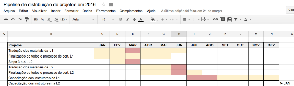

# Como organizar uma pipeline de projetos para o ano — Vida Organizada

Outro dia eu comentei em um [post](http://vidaorganizada.com/o-que-eu-gosto-de-fazer-quando-entra-um-novo-mes/) que este ano estou implementando uma pipeline de projetos gerenciados por mim e como isso tem me ajudado a organizar a vida. Muitos leitores vêm me pedindo desde então para falar mais sobre essa ideia, então o post de hoje é sobre isso.

Vou começar esclarecendo alguns termos:

**Pipeline:** Uso aqui no sentido de encadeamento, sequência, fluxo. “Pipe” é “tubo” em inglês, então pensem no encanamento da casa, que a gente vai ligando um tubo no outro para chegar em algum lugar. A ideia de uma pipeline é ter uma linha, um encadeamento de coisas na sequência, uma coisa depois da outra, e é um termo usado em negócios com essa finalidade também.

**Projetos:** Uso o conceito de projetos do David Allen (autor do [método GTD](http://vidaorganizada.com/gtd/)), que é: todo resultado desejado que você quer concluir em até um ano e que demanda mais de um passo para ser realizado.

### Minha motivação

Eu gerencio muitas áreas de foco no meu trabalho. Sou empresária, gerencio a capacitação dos instrutores e toda a operação do produto GTD na [Call Daniel](http://www.calldaniel.com.br/), ministro treinamentos e palestras, sou professora dos [cursos aqui no blog](http://vidaorganizada.com/cursos/), sou editora de conteúdo, estou me formando em um processo de coaching e sou [escritora](http://vidaorganizada.com/livros/). Dentro de todas essas áreas, eu tenho projetos em andamento.

Em 2016, tenho grandes entregas e sentia necessidade de equacionar não apenas quando elas aconteceriam (seus prazos), mas o tempo que eu me dedicaria a elas. Afinal, poderia acontecer de, em um determinado mês, eu estar envolvida em vários projetos grandes e ser convidada a participar de eventos, viagens etc. Eu precisava me organizar para esse cenário.

### A solução

Montei uma planilha simples (não gosto de soluções complicadas) no Google Drive apenas listando os meus projetos mais robustos (aqueles que me dedicaria meses) e os meses nas colunas. Então, pintei as colunas para cada projeto, de acordo com o mês onde eu começaria a me dedicar a ele, quando terminaria e, nos meses mais intensos, com uma cor mais forte.

Isso já me ajudou a ver, de cara, que alguns projetos poderiam ser remanejados, se houvesse a possibilidade. Consegui colocar alguns um pouco mais para a frente e me organizar melhor para que eles não ficassem tão estressantes na produção.

### Na prática

Na prática funciona assim: eu organizo as entregas por trimestre. Isso foi totalmente inspirado no Steve Jobs, que fazia os lançamentos da Apple por trimestre. Tem dado muito certo e eu consigo organizar toda a minha vida para os próximos três meses sem percalços: cursos, projetos, viagens, entregas, eventos.

Quando um trimestre chega, eu já começo a planejar o próximo. Chega a ser divertido. Logo, o planejamento é feito trimestralmente – ou sazonalmente, a cada estação.

Mensalmente, eu vejo essa planilha para ajustar o foco para o mês. A ideia é estabelecer metas. Falei mais sobre isso [aqui](http://vidaorganizada.com/o-que-eu-gosto-de-fazer-quando-entra-um-novo-mes/).

Já fiz alguns ajustes em alguns projetos, esticando o prazo ou começando antes, por entender que precisaria de mais antecedência na produção, mas tudo bem. Também já acrescentei projetos novos. Porém, ter montado essa pipeline foi fundamental para distribuir os grandes projetos ao longo do ano, pois assim eu garanti que não sobrecarregaria os meus meses.

Aí teve um acontecimento bem interessante que foi o seguinte: agora em junho eu teria um evento que me tomaria duas semanas, mas cujo planejamento era robusto e intenso. Tanto que eu não estava marcando nada para este mês e antes, deixando todos os outros compromissos que aparecessem para depois (julho, agosto). Bem, o tal evento foi adiado para o ano que vem. Resultado? Um mês livre, que vou dedicar a outros projetos, adiantar o que eu faria apenas mais para a frente, com bastante tranquilidade. Por outro lado, se tivesse acontecido, seria tranquilo da mesma forma, pois eu tinha me planejado para isso.

Outra vantagem da pipeline: as pessoas me perguntam qual é a previsão para a entrega de tal projeto ou quando acontecerá determinada coisa, e eu sei responder por causa dessa planilha. Eu digo: tal fase acontecerá em agosto, depois em setembro e a entrega final em tal época. Isso traz uma tranquilidade imensa a todos, mas principalmente para mim, porque sei que consigo gerenciar esses prazos. Tem funcionado muito bem.

Se tiverem dúvidas, por favor, postem nos comentários. Obrigada!
