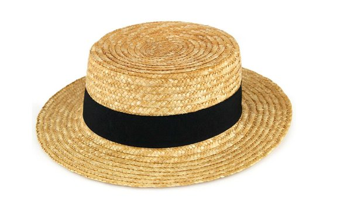
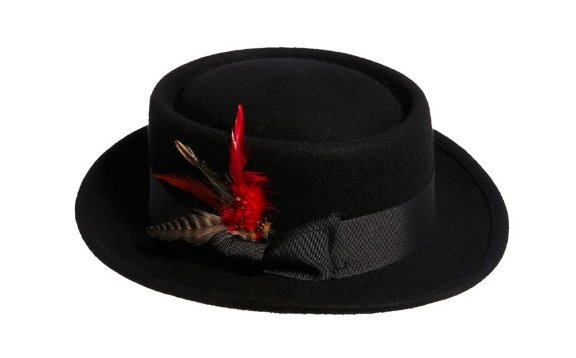
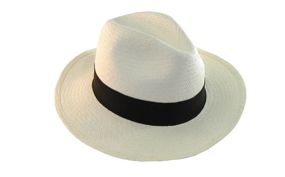
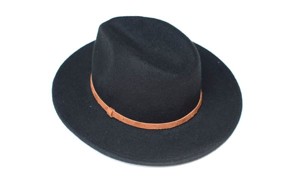
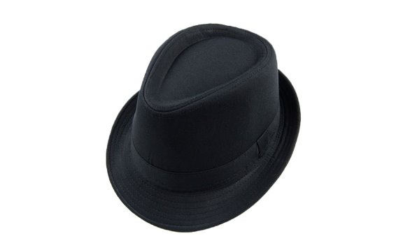

# Como usar chapéu masculino e modelos para variar o look | Moda para homens

11 de novembro de 2015 *by* [Júlio Fernandez](http://juromano.com/author/julio-fernandez/ "Posts de Júlio Fernandez")

Oi gente, tudo bem? O assunto de hoje é um pedido de um leitor que sugeriu o tema: **como usar chapéu masculino**. Eu gostei da sugestão, pois sou um fã assumido de chapéus e **resolvi trazer um guia básico para vocês.**

O **chapéu masculino é uma ótima alternativa  para quem não se adapta ao boné**, além de deixar o visual muito mais descolado e chique, ele também **funciona para disfarçar o cabelo amassado e/ou sujo.**

Eu tenho três tipos de chapéus que eu uso sempre e procuro comprar cada vez um estilo diferente. Os modelos que tenho são o Panamá, o Fedora e Homburg ou Gelot (você vai ver a diferença mais para baixo). Ultimamente **o Panama tem ganhado mais espaço nos meus looks, porque ele combina com tudo** e é um Panama tamanho grande, com uma aba maior e um entrelaçamento de palha muito bonito –  foi chapéu que usei no SPFW do post da semana passada veja **[nesse post aqui](http://juromano.com/home/looks-masculinos-plus-size-no-sao-paulo-fashion-week)**.

Antigamente eu usava o chapéu apenas para fotos, mas hoje em dia eu **tomei coragem e tenho conseguido adaptar os meus looks** – sem contar que ele tem me ajudado muito com o sol escaldante que tá fazendo aqui na minha cidade.

Se você acha que a aba larga do Panamá pode ser um empecilho, **você pode optar pelo Homburg pois ele tem a aba mais discreta e ainda sim pode te proteger do sol**, sem falar do conforto: ele tem um ótimo encaixe. O estilo do Fedora é mais do tipo coco, ou seja, ele pega apenas o topo da minha cabeça e **é mais como um acessório estiloso mesmo**, ele não oferece tanta proteção.

Agora, listei 5 tipos de chapéus  dicas de uso para todos:

## ♠ **Como usar chapéu masculino** e *modelos para variar o boné*♠

#### **Chapéu #1: Boater ou Chapéu Palheta**

**Este é o chapéu dos cariocas, da praia e dos boêmios.** Chapéu masculino para usar à beira mar, para tomar uma cerveja com os amigos, para ficar mais descolado e chamar atenção. É um chapéu feito de palha, porém o entrelaçamento da palha é firme, fazendo com que o chapéu fique mais denso. Uma opção de **look para lugares fechados com ele é camisa listrada, as calças de corte mais reto e oxford**. Agora, para beira mar prefira **bermudas coloridas, camisa polo e um chinelo birken ou alpargatas para manter o estilo descolado e de verão.**

#### **Chapéu #2:** Porky Pie

Este **é o chapéu do inverno**, usado muito por celebridades, compondo looks com casacos super pesados. Ele tem um acabamento em feltro e pode ser encontrado também em couro, as vezes. Antes eram apenas encontrados em cores que remetiam ao inverno, do marrom ao cinza, hoje vocês já podem encontrar com cores mais vibrantes já que o público jovem adora esse modelo. O **look ideal para esse estilo de chapéu são os trench coats e coturnos ou tênis mais descolados**. Ele não é um chapéu muito comum no Brasil, então **se você quiser ousar este é o chapéu indicado para você.**

#### **Chapéu #3:**Chapéu Panamá

Este chapéu é **fácil de encontrar e mais fácil ainda de usar**, você reconhece um Panamá pela fita que envolve a coroa dele. Sempre feito de palha, você terá facilidade em encontrar este chapéu em lojas de moda praia, mas vale dizer que a palha se não for bem cuidade perde o formato e se molhar estraga! Então todo cuidado é pouco com um Panamá verdadeiro. Ele está disponível em três cores principais: bege, preto e marrom. **Esse chapéu tem mil utilidades, ele não se limita a looks tropicais e é possível usar até mesmo em looks formais** – menos o social, é claro. Minha sugestão é que você **use com t-shirt, short ou bermudas, tênis e um colete,** para compor um look mais street, mas ele também dá um up em looks casuais e, claro, na praia haha. **Curiosidade: o chapéu Panamá na verdade é do Equador 😉**

#### **Chapéu #4: Fedora**

**O Fedora e o chapéu de cowboy se parecem entre si.** O Fedora é um chapéu apropriado para o outono-inverno, tem uma aba média, que pode te proteger tanto dos raios solares quanto proteger seu rosto do frio. É um chapéu muito usado na Itália – e você pode reconhece-los em filmes sobre máfia facilmente. Já que entramos nessa vibe, o look ideal seria com certeza **um terno muito bem cortado, já para nós jovens modernos, uma calça jeans com camisa e blazer, digamos um sport fino**. Ele pode ser usado em um look formal, embora não para ambientes formais fechados, não se esqueça de tirá-lo ao chegar ao local.

#### **Chapéu #5: Homburg ou Gelot**

Este é um chapéu modelo pequeno, **pode ser confundido com o Panama de aba pequena**, porém fique atento pois o que o distingue do Panamá de aba pequena é que **o Homburg é feito de feltro**. Ele **é muito confortável por seu encaixe perfeito, facilmente combinado com looks básicos ou até mesmo com looks para a noite**, pra você fazer o descolado na balada. Ele também é bom para disfarçar a calvície no topo da cabeça se for um incomodo para você.

Enfim, gente, estes foram os cinco chapéus que eu mais gostei e achei super legal para passar para vocês. Do verão ao inverno, não tem desculpa para não aderir o chapéu nos seus looks hahahaha. Espero que vocês tenham gostado, como sempre, fico a disposição para quaisquer dúvidas que vocês tenham sobre chapéus masculinos.

Beijos e até semana que vem.

[Me segue no Istagram: @juliofz](https://www.instagram.com/juliofz/)

**Tags:**
[chapéu](http://juromano.com/tag/chapeu/), [como usar](http://juromano.com/tag/como-usar-2/), [estilos](http://juromano.com/tag/estilos/), [Fedora](http://juromano.com/tag/fedora/), [gelot](http://juromano.com/tag/gelot/), [homburg](http://juromano.com/tag/homburg/), [homem](http://juromano.com/tag/homem/), [moda masculina](http://juromano.com/tag/moda-masculina/), [Palheta](http://juromano.com/tag/palheta/), [Panamá](http://juromano.com/tag/panama/), [plus size](http://juromano.com/tag/plus-size/), [Porky Pie](http://juromano.com/tag/porky-pie/), [roupas](http://juromano.com/tag/roupas/), [tipos](http://juromano.com/tag/tipos/)
