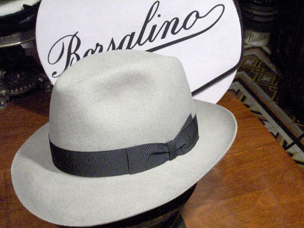
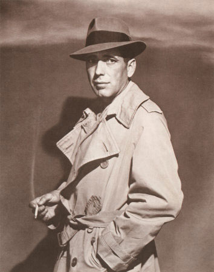
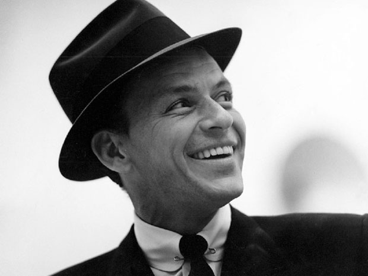
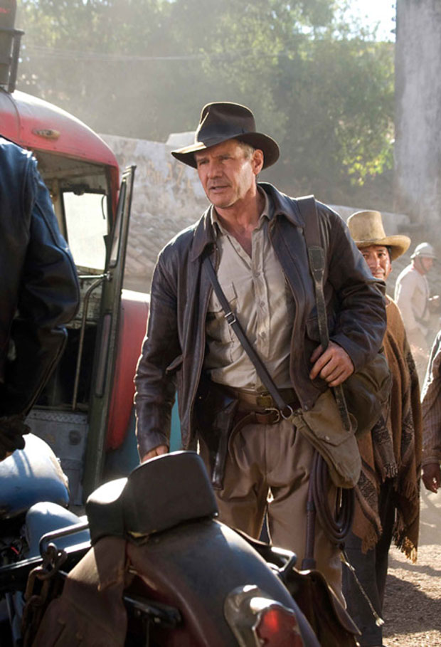
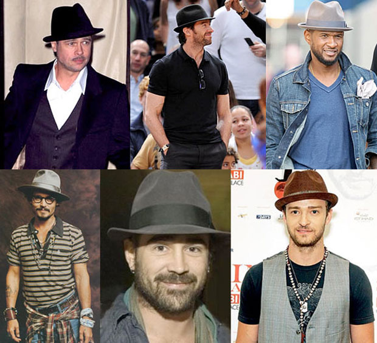
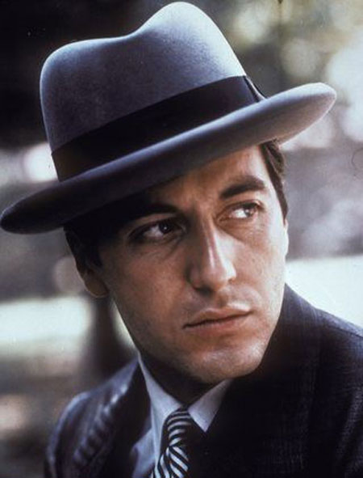
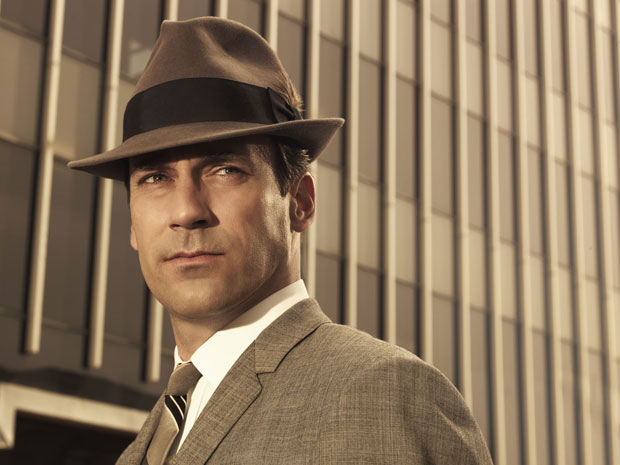

# Fedora: cinco dicas para ficar estiloso de chapéu

Vestir-se bem é uma arte ainda não completamente dominada pela maioria de nós, homens. No caminho desse aprendizado, nos espelhamos em ícones de estilo à nossa escolha.

Você pode ter uma identificação maior com Justin Timberlake ou Frank Sinatra, com Johnny Depp ou Don Draper, com Humphrey Bogart ou Indiana Jones. Não importa. Se você quer ter seu estilo influenciado por qualquer um desses homens, vai ter contato com chapéus [fedora](http://pt.wikipedia.org/wiki/Fedora_(chap%C3%A9u)).

### O que é um Fedora?

A marca Borsalino é tão conhecida que o seu nome virou sinônimo para o chapéu em países como Brasil e França

Ao contrário do que pode parecer, o termo Fedora não descreve um tipo específico de chapéu. Pelo contrário, ele é um termo usado para descrever qualquer tipo de chapéu que já não tenha um nome. Apesar de ter sido criado como acessório feminino e popularizado ao ser usado por uma personagem mulher em uma [peça de teatro russa](http://pt.wikipedia.org/wiki/Fedora_(pe%C3%A7a)), o fedora aos poucos foi se estabelecendo como acessório masculino.

Bem masculino.

Humphrey Bogart como Rick Blaine no filme Casablanca (1942). Apenas um dos maiores clássicos do cinema

Homens importantes, reais ou fictícios, para o bem ou para o mal, dificilmente saíam em público sem um desses na cabeça. Além dos já citados no primeiro parágrafo, a lista inclui **Ernest Hemigway, Frederico Fellini, John Belushi, Rorschach, Chico Buarque, Orson Welles, Winston Churchill, Al Capone, Dick Tracy e Fred Astaire**, entre muitos outros. Ícones do cinema, da música, da dança, da literatura e de diversas disciplinas da arte.

Um fedora clássico é feito de feltro (se for de palha, convencionou-se chamar de Panamá). A dobra em estilo "beliscão" no topo não o define, mas também é uma constante – assim como a queda/subida na parte da frente/trás da aba. O auge da popularidade do fedora foi nas décadas de 40 e 50, mas agora ele está com popularidade renovada.

Existe um Tumblr dedicado a esse chapéu, com vários exemplos de uso interessantes: [Heck Yes Fedoras](http://heckyesfedoras.tumblr.com/).

### Como usar?

Achei no site [Essential Style For Men](http://www.essentialstyleformen.com/style/style-six-rules-for-wearing-a-fedora/) um guia rápido e referencial com dicas para usar esse tipo de chapéu de modo certeiro. Como é um conhecimento útil para a nação saco-roxo lusófona, fizemos uma pesquisa mais completa e adaptamos as dicas para o uso moderno do fedora.

### 1. Compre um chapéu de respeito

Preferencialmente, você deveria estar usando um exemplar feito 100% de feltro de boa qualidade. Um desses custa meio caro (dá para achar por menos de R$ 100, mas alguns passam de R$ 200 ou R$ 300), mas pode durar o suficiente para você repassá-lo para o seu filho.

Borsalino, Stetson, e Lagomarsino são boas marcas.

Frank Sinatra (1959)

### 2. Compre o chapéu que fica bem em você, não no manequim

Por mais que você veja um chapéu na vitrine e fique imediatamente tentado a comprá-lo, isso não significa que ele seja a sua melhor.

Assim como caras baixinhos não devem usar paletós longos, o seu chapéu precisa ser escolhido levando em consideração o formato da sua cabeça. Se ela for longa e magra, comprar um chapéu de coroa alta vai te fazer parecer um alienígena. Da mesma forma, se você tem uma cabeça mais larga e arredondada, comprar um com a aba larga não vai ser legal.

Em termos de tamanho, o fedora certo vai abraçar a sua cabeça sem cobrir nada da sua orelha e sem deixar uma marca vermelha na sua testa quando você tirá-lo.

Encontre uma loja bacana, experimente vários, brinque com as proporções e peça ajuda se você achar que precisa.

Harrison Ford como Indiana Jones em O Reino da Caveira de Cristal (2008)

### 3. Cores: sim ou não?

Se o seu objetivo for um visual mais clássico *badass*, como o dos figurões que ilustram esse texto, prefira cores sóbrias: cinza, oliva, marrom, azul-marinho ou bege-escuro ou preto.

Se você pensa em emular um [Justin Timberlake](http://www.denimblog.com/wp-content/uploads/2010/01/justin-timberlake-2.jpg) da vida, ou algum outro exemplo de visual mais atual, escolher um chapéu colorido ou estampado já não é tão proibido. Mesmo assim, vale a regra de ouro de 90% das situações da vida: tenha bom senso.

Fedoras modernos

Lembre-se que, quando for combinar a cor do chapéu com a do paletó/jaqueta, existem duas possibilidades:

**A) casar as duas cores o mais perfeitamente possível**, como nos dois primeiros exemplos da imagem acima, onde tanto as jaquetas quanto os chapéu são pretos; ou

**B) escolher duas cores que contrastem minimamente,** como no exemplo da direita: jaqueta jeans azul e chapéu cinza.

### 4. Use com confiança

Pare de se preocupar com o seu chapéu e simplesmente use o negócio.

Coloque-o na cabeça e encontre um ângulo que fique bom. A menos que ele esteja completamente reto e simétrico, você está indo bem.

Al Pacino como Michael Corleone, em O Poderoso Chefão (1972)

### 5. Seja um cavalheiro

Quando estiver na casa de alguém, em um restaurante ou em alguma parte de um prédio maior que não seja um lobby ou corredor, tire o chapéu. Quando o hino nacional de qualquer país estiver sendo tocado, cantado ou assoviado profissionalmente, tire o chapéu.

Don Draper, da atual série Mad Men

\* \* \*

Você, leitor do PdH consciente do seu estilo, usa chapéu? Jogue uma foto aí no comentários pra gente ver. Alex Castro e Jader Pires estão convocados desde já.

---

*publicado em 08 de Maio de 2012, 18:16*
