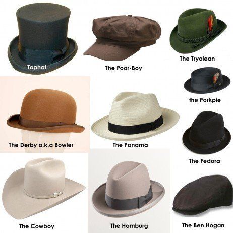

# Tipos de chapéus masculinos e como combinar!

Se é inverno, primavera, verão ou outono, chapéus são um acessório que muitos homens usam todo o ano. Por esta razão, é importante que os homens escolham a forma e estilo de [chapéu para usar para muitas ocasiões diferentes](https://www.belezamasculina.com.br/voce-estiloso-faca-teste/ "Você é estiloso? Faça um teste!"). Use as 12 dicas para escolher a forma certa para os homens a seguir para garantir que você está sempre no estilo e na tendência, com todas as suas compras de chapéus.

### Qual é a ocasião?

Ao escolher o estilo eo ajuste certo com chapéus, primeiro você deve considerar a ocasião. Obviamente, você não vai usar e chapéu informal para uma ocasião formal. Casamentos e festas proporcionam a oportunidade perfeita para usar um chapéu preto e branco elegante.

### Chapéus por idade

A geração mais jovem está se preparando para chapéus com abas planas. Enquanto chapéus mais planos são apropriados para todas as idades, os desenhos sobre o chapéu, muitas vezes, separam as idades. Ao escolher o chapéu certo, considere sua idade. Tenha certeza de que você não está usando um chapéu que é projetado para uma geração mais jovem.

### Você tem uma chapeutitude?

Ao escolher o estilo e o ajuste certo, considere a sua razão para usá-lo. Se você está fazendo um esforço para olhar “cool”, você é mais do que provável que escolhe um chapéu pela marca. E isso nunca é legal.

### Vista-se para a temporada

Chapéus, assim como outros itens de vestuário, são sazonais. Durante os meses de inverno poderá escolher um chapéu que está feito de um material mais pesado. Durante os meses de primavera e verão, material mais leve pode ajudá-lo a manter o calor longe enquanto continua a dar-lhe o olhar que você deseja.

### Chapéus que correspondem à sua roupa

Ao escolher o chapéu certo, você quer garantir que ele corresponda a roupa que você está vestindo. Um chapéu de esportes vai melhor com uma calça jeans e um pólo que um chapéu extravagante de jantar. Escolha sua roupa e, em seguida, encontre um chapéu que complementa a roupa bem.

### Preto nem sempre é a escolha certa

Há chapéus disponíveis em opções de cores infinitas. Se você quiser ficar elegante, no entanto, considere chapéus que são neutros em tons de modo que você não chamam a atenção para o seu chapéu. Você quer que as pessoas sejam atraídas para você, não o seu chapéu.

Existe um tipo de chapéu que com certeza combina com seu estilo. Mas o mais importante é encontrar um chapéu que combine com o formato do seu rosto. (Foto: vintagenorth.wordpress.com)

### Menos é mais quando se escolhe a opção certa

Modelados chapéus pode ser muito altoa e também chamar a atenção indesejada. Ao escolher um chapéu, vá com a mentalidade de que menos é mais. Menos decoração no chapéu, mais atraente ele estará em sua cabeça. Escolha um padrão que vai ser fácil com a roupa que você possui.

### Considere o seu formato de rosto

Não deixe de experimentar chapéus para ter certeza de que o chapéu parece bem com o seu formato de rosto. Um chapéu de abas planas pode fazer seu rosto parecer mais redondo. Se você tem um rosto gordinho redondo, evite usar esses chapéus.

### Escolha o ângulo direito de usar o chapéu

Enquanto usar um chapéu para a frente é a forma mais popular para usá-lo, algumas pessoas optam por inclinar o chapéu em um pequeno ângulo. Se esta for a sua preferência, não deixe de experimentar este ângulo antes de comprar o chapéu. Chapéus de abas planas são muitas vezes difíceis de usar como um ângulo.

### Questões de conforto

Ao escolher o chapéu certo, sempre considere o conforto. Um chapéu que é demasiado apertado pode realmente dar-lhe uma dor de cabeça. Conforto é fundamental quando se compra um chapéu.

### Entrando em estilo vintage

A nova tendência com chapéus é o estilo vintage. Sempre considere a tendência na compra de um chapéu. Se ficar em grande estilo é o seu objetivo, você não pode dar errado com chapéus na moda.

### No final, a escolha é sua

Não importa muito o tipo de chapéu: panamá, caubói, boné. O que realmente importa é escolher um chapéu que você gosta. Independentemente do que as outras pessoas pensam, que você gosta do chapéu, use-o.

Ao escolher o chapéu perfeito para os homens, as 12 dicas listadas acima pode ser muito benéficas. Chapéus são provavelmente uma tendência para os homens que nunca vai desaparecer. A escolha de estilos clássicos que você pode usar uma e outra vez [vai dar o máximo de seu dinheiro](https://www.belezamasculina.com.br/como-vestir-para-tipo-corpo/ "Como se vestir para seu tipo de corpo?").

Quais tipos de chapéus vocês conhecem? Como vocês combinam eles com suas roupas? Compartilhem conosco abaixo seus conhecimentos sobre chapéus!
