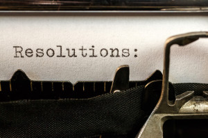

# Resolutions: Changing Habits & Personal Kaizen

Black Friday and Cyber Monday have come and gone. All the necessary holiday shopping is (hopefully) done. Presents have been delivered and stashed away in a favorite hiding spot… and are ready to be put out under the tree or into that stocking hung with care. So what’s left to do? Why not get a jump on New Year’s resolutions!

What? You don’t make those because you are already perfect? I’m sure you are. But as [Shunryu Suzuki Roshi](https://en.wikipedia.org/wiki/Shunry%C5%AB_Suzuki) said, “…there is always room for improvement.”

## Opposed to New Year’s Resolutions?

[I don't make New Year's Resolutions. Perfection is overrated.](https://twitter.com/intent/tweet?url=http://www.andycleff.com/?p=134&text=I%20don%27t%20make%20New%20Year%27s%20Resolutions.%20Perfection%20is%20overrated.&via=justsitthere&related=justsitthere) [Click To Tweet](https://twitter.com/intent/tweet?url=http://www.andycleff.com/?p=134&text=I%20don%27t%20make%20New%20Year%27s%20Resolutions.%20Perfection%20is%20overrated.&via=justsitthere&related=justsitthere)

Maybe you don’t make New Year’s resolutions at all. Why bother get started? Something always seems to derail you best intentions. Or maybe you get started but never get as far as you thought you would and then beat yourself up for not getting all the way. Why would you want to do that again?

## Perfection is Overrated

Over the past year my personal candidate for change was to exercise more restraint in speaking up. I have a tendency to step in. Be it an slack thread, a conversation, a stand up. I like to put my $0.02 in. Yes, I have an urge to provide solutions.

My goal for 2015 was to change that habit. Instead of jumping in: Pause and observe. See how things develop. Really listen. And then when I do chime in, I strive to ask more probing questions first.

I got about 80% of the way to Done.

## Changing a Habit in 4 Simple, but Not Always Easy, Steps

How did I change what felt like a lifelong habit? I started with awareness and a whole lot of forgiveness:

- Step 1: I caught myself after the fact (“Damn, I just did it again…”)
- Step 2: I caught myself in the act (Typing… getting ready to hit send…)
- Step 3: I thought about it before I acted (“Feeling the need to say something here..is that really is what’s best?”)
- Step 4: Saying and acting (or in my case not acting) without thinking about it.

I continue to dance with steps 3 and 4. And for me, that’s good enough for now. I’m moving that card to Done and pulling the next one from my backlog and moving it to In Dev.

## Personal Retrospectives

So what’s at the top of my backlog? Co-creation of change: Utilize collaboration and consensus building where possible. This is a natural extension of “Keep asking questions, do less telling.” (Plus it felt a lot closer to acheivable than say “Six-Pack Abs.”)

How did I get to that? Simple. I asked the people I work and play with to give me their feedback via a KALM retrospective.

And you can do the same. Pick any [retrospective exercise](http://www.andycleff.com/2014/08/retrospective-exercises-a-toolbox/) you like – Sailboat, 4L’s, Start-Stop-Continue. No matter what you choose, you’ll come up with some action items, some candidates for change, AKA “New Year’s resolutions.”

## JFDI

Why is it so hard to change, to keep those resolutions? Because old habits die hard.

But the good news is that with a bit of conscious effort (and maybe the support of a few friends) you can make changes that stick.

Will I succeed in reaching my goal in 2016? Maybe not at first. But it’s only failure if I stop trying.
