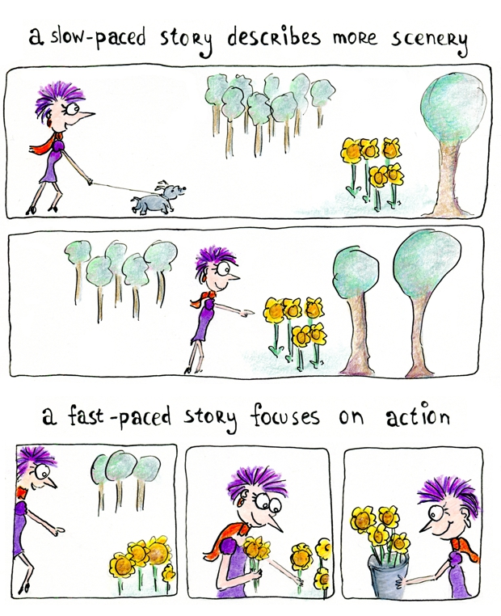

# A 5-Minute Guide to Fast-Paced Storytelling

by Henneke | [34 enchanting opinions, add yours? :)](https://www.enchantingmarketing.com/story-pacing/#comments)

Have you ever thought about this strange concept called time?

You’d like to think a second is a second, an hour is an hour, and one day is one day.

But that’s not how it feels, right?

Remember when as a kid, there were days you were bored?

Time seemed to slow down—as if boredom was stretching each minute. An hour felt like a never-ending amount of time.

Scientists may tell us that one minute is one minute, and it’s exactly 60 seconds, or 60,000 milliseconds.

But you and I know better.

Sometimes time slows down. Sometimes it speeds up.

## Pace in storytelling is about the reader’s experience of time

The reader’s experience is not just about the time line in your story—whether your story describes an hour, one day, or three decades. It’s about how fast or slow the time *seems* to pass. It’s subjective.

A fast-paced story keeps readers on the edge of their seats, eager to know what’s happening. There’s a lot of action. The storytelling is vivid and dramatic.

In contrast, a slow-paced story is more atmospheric. An author takes ample time to describe the scenery. Scenery descriptions can be beautiful and engaging, but if the description isn’t compelling or the sentences jar, readers start yawning.

## How to vary the pace of your story

The example below comes from the book “Personal” by Lee Child. Child heightens the drama of the story by taking a whole paragraph to describe a few seconds.

The “she” in this story is Casey Nice, a partner of Jack Reacher, and together they’re trying to access critical information on a laptop. This is a matter of life and death.

But first they need to get two passwords right. Can they do it with the hints they’ve received?

> She held down a button and the screen lit up with a dialog box. She dabbed it with a fingertip and a cursor started blinking on the line, and a picture of a keyboard came up below it. She typed Archibald, nine letters, with a capital A and the rest in lower case. She checked it for spelling, A-r-c-h-i-b-a-l-d, and then she looked at me with eyebrows raised, and I nodded a confirmation, and she touched Submit, and there was a pause, and then a green check mark appeared at the end of the typed name, and the dialog box rolled away, and was replaced by a second box that looked just the same. She dabbed a button that changed the keyboard letters to numbers, and she typed three digits, and a hyphen, and two more digits, and another hyphen, and then four more digits. She checked it over, and touched Submit, and the green check mark showed again, and the dialog box rolled away, and was replaced by ranks of thumbnail images.

Child heightens the tension by describing every tiny detail of what’s happening. The time slows down, but the drama increases.

The scene is full of action: She held down a button, she dabbed at it, the cursor started blinking, she typed, she checked, she raised her eyebrows, I nodded, she touched, the check mark appeared.

A few pages later, there’s a similar scene. Again, Reacher and Nice have to enter two passwords:

> Then they left, and as before we carried the computer up to Nice’s room, and we entered the private information, and the screen opened up with a long list of files and folders.

In this scene, Child doesn’t give us much detail. In half a sentence, he explains they’ve entered the passwords, and there’s no drama at all. The first scene of password entering was dramatic. But writing a second scene like that would be boring. So, Child speeds up the time.

Good storytelling slows down at dramatic moments, then skips through boring events.

## Business storytelling relies on the same principles of pacing

Here’s an example of a business founding story—the story of mattress seller [Tuft and Needle](https://www.tuftandneedle.com/about/story/):

> JT had just gotten married and he and his wife set out to buy their first piece of furniture together–a new mattress. The search began at local mattress showrooms; vast fields of mattresses neatly laid out under the buzz of fluorescent lights. Pushy salesmen pushed them to buy a fully loaded, feature-rich memory foam mattress. For $3,300 it should have been the pinnacle of comfort, but it wasn’t. To make matters worse, the return policy rendered it impossible to return. It was like car shopping. Actually it was worse than car shopping.
>
> At work the next day, he shared his story with Daehee. The two friends from college had been working together at a company in Palo Alto, and unsurprisingly had similar experiences. There was work to be done.
>
> We believe that business can be honest and premium products don’t need remote controls and payment plans. Especially not mattresses.

When telling the story of our business, we’re tempted to share all details. We want to tell the whole story.

But the key to good storytelling is to decide what you want to communicate first. In the founding story of Tuft and Needle, the authors don’t want to share the struggles of a new start-up as most of their customers aren’t interested in that. Their story serves one purpose: to explain how Tuft and Needle take away the hassle of buying a new mattress. This purpose guides the pacing and selection of details in the story:

- How JT got married is irrelevant, so we only hear about their marriage because it’s the reason they go mattress shopping
- The story slows down in the store to showcase the pain of mattress shopping—this part includes most details
- The story speeds up to the next day when JT and Daehae decide to start a business, and they share their mission

Readers don’t need to know everything to follow your story. Give them the details that matter, and let them imagine the rest.

Here’s the story of [Hiut Denim](https://hiutdenim.co.uk/blogs/story/5156362-our-town-is-going-to-make-jeans-again):

> **Our town is going to make jeans again**
>
> Cardigan is a small town of 4,000 good people. 400 of them used to make jeans. They made 35,000 pairs a week. For three decades.
>
> Then one day the factory closed. It left town. But all that skill and knowhow remained. Without any way of showing the world what they could do.
>
> That’s why we have started The Hiut Denim Company. To bring manufacturing back home. To use all that skill on our doorstep. And to breathe new life into our town.
>
> As one of the Grand Masters said to me when I was interviewing: “This is what I know how to do. This is what I do best.” I just sat there thinking I have to make this work.
>
> So yes, our town is going to make jeans again.
>
> Here goes.

This story is completely different from Tuft and Needle’s founding story. It feels slower, because there’s little action. The time line, however, is much longer. In just a few lines, the story summarizes three decades—how 10% of the town’s people work at the jeans factory, and then one day, the factory closes down.

With sparse details, the story hints at the town’s desperation and explains the company’s mission: “to breathe new life into our town.” Only then does the story slow down:

> As one of the Grand Masters said to me when I was interviewing: “This is what I know how to do. This is what I do best.”

The story shows how Hiut uses the town’s best talents to manufacture denim, and they don’t need much action to explain that.

## Good stories can be slow or fast

The best storytellers think about their audience and how their story transforms them.

Their story has a purpose. The action, the details, the pacing all serve that purpose.

So, think about your reader: Why would he care about your story? What do you want him to feel while reading? What do you want him to remember of your words?

Happy storytelling!
