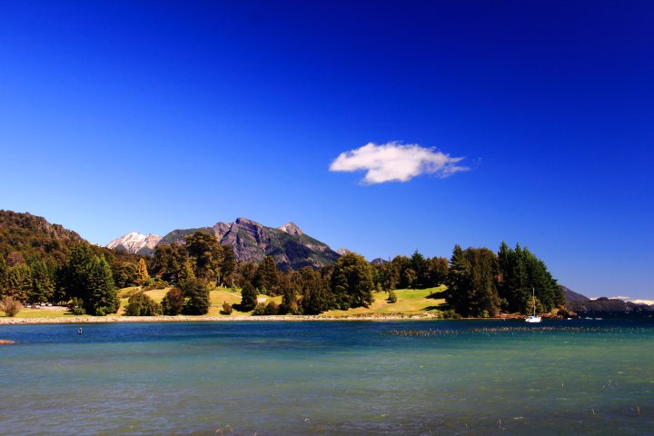
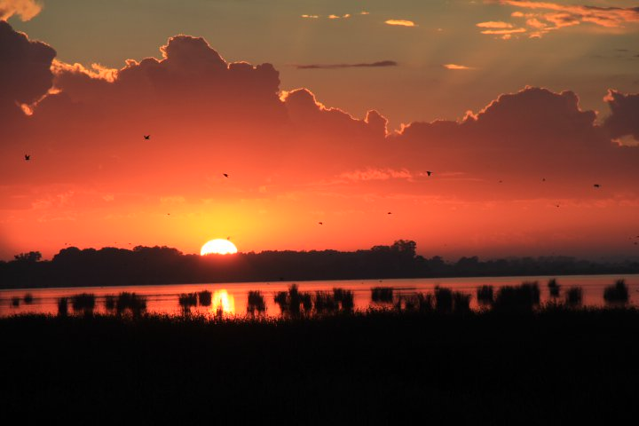

# Roteiro de carro: Brasil/Uruguai/Argentina/Chile

###

Prezados amigos,

Quero dividir com vocês o roteiro da viagem de carro que fiz em julho de 2008, partindo de Florianópolis...

Foram 21 dias de viagem, com passagem pelo Uruguai, Argentina e Chile (mapa anexo).

\_\_\_\_\_\_\_\_\_\_Saída\_\_\_\_\_\_\_\_\_\_\_\_\_\_\_\_\_\_\_\_\_\_Chegada\_\_\_\_\_\_\_\_\_\_\_Distância\_\_

12.07.08 Fpolis 9:00h\_\_\_\_\_\_\_\_\_\_\_\_\_\_\_\_\_Pelotas 17:40h\_\_\_\_\_\_\_\_\_741Km\_\_

13.07.08 Pelotas 8:00h\_\_\_\_\_\_\_\_\_\_Colônia Sacramento 18:00h\_\_\_\_810Km\_\_ (BUQUEBUS p/B.Aires - 18:45/22:00h)

14.07.08 Buenos Aires 10:00h\_\_\_\_\_\_\_\_Bahia Blanca 18:00h\_\_\_\_\_\_\_650Km\_\_

15.07.08 Bahia Blanca 7:30h\_\_\_\_\_\_\_\_\_Vila Él Chocón 17:00h\_\_\_\_\_\_740Km\_\_

16.07.08 Vila Él Chocón 10:00h\_\_\_\_S.Martin d. Los Andes 14:30h\_\_365Km\_\_

17.07.08 S.Martin d. Los Andes (passeios)

18.07.08 S.Martin d. Los Andes 9:30h\_\_Bariloche 12:30h\_\_\_\_\_\_\_\_\_260Km\_\_ (por Junin de Los Andes)

19.07.08 Bariloche (passeios)

20.07.08 Bariloche 10:00h\_\_\_\_\_\_\_\_Vila La Angostura 11:00h\_\_\_\_\_\_800Km\_\_

21.07.08 Vila La Angostura 14:00h\_\_\_ Puerto Varas 18:30h\_\_\_\_\_\_\_\_477Km\_\_

22.07.08 Puerto Varas/Puerto Montt/Puerto Varas (passeios)

23.07.08 Puerto Varas 12:30h\_\_\_\_\_\_\_\_\_\_\_\_Pucón 18:00h\_\_\_\_\_\_\_\_\_400Km\_\_

24.07.08 Pucón (passeios)

25.07.08 Pucón 9:30h\_\_\_\_\_\_\_\_\_\_\_\_\_\_\_\_\_Santiago 18:00h\_\_\_\_\_\_\_\_600Km\_\_

26.07.08 Santiago (passeios)

27.07.08 Santiago/Viña del Mar/Valparaíso/Santiago\_\_\_\_\_\_\_\_\_\_\_\_250km\_\_

28.07.08 Santiago 12:00h\_\_\_\_\_\_\_\_\_\_\_\_\_\_Mendoza 18:30h\_\_\_\_\_\_\_380Km\_\_

29.07.08 Mendoza (passeios)

30.07.08 Mendoza 8:30h\_\_\_\_\_\_\_\_\_\_\_\_\_\_Buenos Aires 19:30h\_\_\_\_\_1075Km\_\_

31.07.08 Buenos Aires 9:30h\_\_\_\_\_\_\_Santana Livramento 17:00h\_\_\_700Km\_\_

01.08.08 Santana Livramento 11:30h\_\_\_\_Araranguá 21:00h\_\_\_\_\_\_\_800Km\_\_

02.08.08 Araranguá 8:30h\_\_\_\_\_\_\_\_\_\_\_\_\_\_Fpolis 11:30h\_\_\_\_\_\_\_\_\_\_220Km\_\_

Resumo dos custos:

Combustível:.......................................R$ 1.400,00

Hospedagens:......................................R$ 2.740,00

Refeições:..........................................R$ 1.000,00

Pedágios:...........................................R$ 210,00

Balsa (um carro + duas pessoas):................R$ 280,00

**TOTAL:......................................... R$ 5.630,00**

Apesar de considerar TODO o passeio um espetáculo, destaco quatro cidades imperdíveis:

1- Pucón (Chile): a mais bonita de todas, à beira do vulcão Villarica, com estações de esqui, etc.

2- San Martin de Los Andes (Arg): mesmas atrações de Pucón... com tudo mais barato que no Chile!

3- Villa Él Chocón (Arg): pequena vila, onde foram encontrados fósseis de dinossauros... muito charmosa! Local pra fazer a mulherada se apaixonar novamente por nós!(dica de hospedagem: Pousada El Dinossaurio - indescritível!! servem uma truta e um vinho branco deliciosos)...

4- Villa La Angostura (Arg): uma vila pequena também... muito aconchegante!

É isto!

Basta um pouco de coragem e colocar o carro na estrada para curtir esta aventura!

Um abraço,

Alexandre

Lelê Floripa

*Page 2*

### **[Nilo](https://www.mochileiros.com/profile/58146-nilo/ "Ir para o perfil de Nilo")**    0

- Membros
- 0
- 14 posts

Olá, estou pensando em passar esse Natal em Buenos Aires, saindo de SP, tenhoa alguma duvidas, então o PID (permissão internacional de dirigir), Carteira de Vacina Internacional, cabo de aço, dois triangulos, quebra matos (a sua palio tinha ?), engates, insul film, e até saco para morto (essa é fod..) são necessários ou não ?

Estava pensando sair de SP, e entrar na argentina por Foz de Iguaçu, ou seja, Norte da Argentina, onde vc disse q. os policiais são mais exigentes (corruptos), é isso ?

Dê- me alguma dica ou sugestão,

Grato

#### Compartilhar este post

---

##### Link para o post

##### Compartilhar em outros sites

### **[Rlamenza](https://www.mochileiros.com/profile/58207-rlamenza/ "Ir para o perfil de Rlamenza")**    0

- Membros
- 0
- 1 post

Prezado,

estou planejando fazer a viagem de Sao Paulo para Santiago agora em Janeiro. Gostei muito das suas dicas. Vcs foram e voltaram de carro, certo? Alguma dica especial quanto a documentaçao necessaria para o carro na ARG, Uruguay e Chile? Pretendo na ida ir parando em lugares para conhecer mas a volta faze-la quase que direto sem paradas. Quanto tempo vc acha que deveria planejar para esta volta?

Abraço

#### Compartilhar este post

---

##### Link para o post

##### Compartilhar em outros sites

### **[carlanog](https://www.mochileiros.com/profile/58405-carlanog/ "Ir para o perfil de carlanog")**    0

- Membros de Honra
- 0
- 580 posts

Olá!

Vc foi a Vila La Angostura nos dias entre Bariloche e Puerto Varas?

Não entendi esse trecho do trajeto...

Obrigada!

Carla

#### Compartilhar este post

---

##### Link para o post

##### Compartilhar em outros sites

Lelê,

Sou de Florianópolis, e estoou querendo ir até Villa La Angostura e região com minha mulher

só não sei se vou agora final de Fevereiro inicio de março ou em Junho.

Gostaria de ver mais fotos e se vc tem alguma dica em especial somente para este roteiro

Achei barbaro as dicas e detalhes dados por vcs.

Sempre quis fazer uma viagem de carro para lá inclusive meu primeiro projeto era ir até

Uschuaia. Tenho uma Caminhonete L200 e acho que ela irá fazer bem este trajeto.

Vc acha que devo levar alguma peça sobressalente para o carro

Abçs,

Matheus

[[email protected]](moz-extension://bc0388a1-45bb-49e5-ac46-d4044f270a8a/iframe_stub.htmlmoz-extension://bc0388a1-45bb-49e5-ac46-d4044f270a8a/cdn-cgi/l/email-protection#90fdf1e4f8f5e5e3bef3f1fdf1e2f1d0f7fdf1f9fcbef3fffd)

#### Compartilhar este post

---

##### Link para o post

##### Compartilhar em outros sites

### [eniobeier](https://www.mochileiros.com/profile/12479-eniobeier/ "Ir para o perfil de eniobeier")    6

### **[eniobeier](https://www.mochileiros.com/profile/12479-eniobeier/ "Ir para o perfil de eniobeier")**    6

- 
- Membros de Honra
- 6
- 1.610 posts

> Lelê,
>
> Sou de Florianópolis, e estoou querendo ir até Villa La Angostura e região com minha mulher
>
> só não sei se vou agora final de Fevereiro inicio de março ou em Junho.
>
> Gostaria de ver mais fotos e se vc tem alguma dica em especial somente para este roteiro
>
> Achei barbaro as dicas e detalhes dados por vcs.
>
> Sempre quis fazer uma viagem de carro para lá inclusive meu primeiro projeto era ir até
>
> Uschuaia. Tenho uma Caminhonete L200 e acho que ela irá fazer bem este trajeto.
>
> Vc acha que devo levar alguma peça sobressalente para o carro
>
> Abçs,
>
> Matheus
>
> [[email protected]](moz-extension://bc0388a1-45bb-49e5-ac46-d4044f270a8a/iframe_stub.htmlmoz-extension://bc0388a1-45bb-49e5-ac46-d4044f270a8a/cdn-cgi/l/email-protection#355854415d5040461b565458544754755258545c591b565a58)

Matheus

A única coisa que vc precisa para fazer esta viagem é gostar de viajar de carro e ter disposição para ficar muitas horas dirigindo. Não há necessidade de levar peças sobressalentes. O que vc irá necessitar de fato é ter os documentos em dia e possuir os equipamentos solicitados pela legislação Argentina: 2 triangulo, kit de pirmeiros socorros, cambão para reboque e seguro carta-verde.

Se o seu veículo possuir engate fixo para reboque (tipo bola) deverá ser retirado, bem como parachoque de impulsão (quebra-mato). Este equipamento só é permitido se for equipamento original do veículo. A legislação argentina não permite equipamentos/acessórios que excedam as dimensões originais do veículo.

Se o veículo não estiver em seu nome ou for financiado (principalmente leasing) vc necessitará de autorização do proprietário para saír do país com ele.

Abraço!

#### Compartilhar este post

---

##### Link para o post

##### Compartilhar em outros sites

### **[Alexok](https://www.mochileiros.com/profile/61216-alexok/ "Ir para o perfil de Alexok")**    0

- Membros
- 0
- 4 posts

Muito bacana sua viagem.

Acabei de fazer uma trip parecida, um pouco mais longa.

Saímos de SP de carro, descemos pelo litoral do Brasil e fomos até Ushuaia passando por Uruguai e Argentina.

Subimos pela Argentina e Chile e regressamos por Foz do Iguaçu até São Paulo.

34 dias no total e 15 mil km.

O relato completo está no nosso blog diário:

[http://ushuaia2008.wordpress.com](http://ushuaia2008.wordpress.com/)

abs

Alex

#### Compartilhar este post

---

##### Link para o post

##### Compartilhar em outros sites

Também estou pensando em fazer uma viagem de Porto Alegre a Buneos Aires (ou Mendoza)...Já me informei sobre tudo o que precisa e até as informações do fórum foram extremamente úteis (muito bacana mesmo). Nunca fiz uma viagem dessa de carro. Estava pensando em comprar um GPS, mas não sei se ele poderá servir para alguma coisa na Argentina ou no Uruguai...alguém tem uma informação sobre isso?

Anotei muitas dicas relatadas e pretendo conhecer o máximo que puder.

Abraços,

Leonardo

#### Compartilhar este post

---

##### Link para o post

##### Compartilhar em outros sites

### [eniobeier](https://www.mochileiros.com/profile/12479-eniobeier/ "Ir para o perfil de eniobeier")    6

### **[eniobeier](https://www.mochileiros.com/profile/12479-eniobeier/ "Ir para o perfil de eniobeier")**    6

- 
- Membros de Honra
- 6
- 1.610 posts

> Também estou pensando em fazer uma viagem de Porto Alegre a Buneos Aires (ou Mendoza)...Já me informei sobre tudo o que precisa e até as informações do fórum foram extremamente úteis (muito bacana mesmo). Nunca fiz uma viagem dessa de carro. Estava pensando em comprar um GPS, mas não sei se ele poderá servir para alguma coisa na Argentina ou no Uruguai...alguém tem uma informação sobre isso?
>
> Anotei muitas dicas relatadas e pretendo conhecer o máximo que puder.
>
> Abraços,
>
> Leonardo

Leonardo,

O GPS ajuda bastante, na minha última viagem fiz uso dele e foi de gande ajuda para não ficar rodando a toa procurando a saída nas grandes cidades (Montevideo e Buenos Aires). Além disso é uma fonte de informações bem legais. Para Uruguai e Argentina vc encontra ótimos mapas roteáveis para aparelhos da linha Garmin no site: [http://www.proeyctomapear.com.ar](http://www.proeyctomapear.com.ar/)

Abraço!

#### Compartilhar este post

---

##### Link para o post

##### Compartilhar em outros sites

Beier,

Não conheço muito sobre GPS (quase nada). Estou pesquisando alguns modelos pela internet e em lojas. Ouvi falar de aparelhos da marca AIRIS, não sei se é bom, nem se vale a pena...Será que com esse aparelho eu posso baixar mapas da Argentina e do Uruguai? Estou procurando alguns modelos da linha Garmin também, como sugerido...não consegui entrar no site indicado...

Pensei mesmo em comprar um GPS porque vou viajar com um Astra e ele não é lá tão econômico..então, gostaria de saber sobre a localização de postos de gasolina na Argentina e no Uruguai (além dos mapas das grandes cidades)...agora decidi fazer o trajeto Porto Alegre - Mendoza. Sou um amante de vinhos, logo não poderia perder essa chance! Risos..

Vou ver se converso com alguém sobre essa questão dos mapas e dos modelos.

Agradeço a colaboração.

Abraços,

Leonardo

#### Compartilhar este post

---

##### Link para o post

##### Compartilhar em outros sites

### [eniobeier](https://www.mochileiros.com/profile/12479-eniobeier/ "Ir para o perfil de eniobeier")    6

### **[eniobeier](https://www.mochileiros.com/profile/12479-eniobeier/ "Ir para o perfil de eniobeier")**    6

- 
- Membros de Honra
- 6
- 1.610 posts

> Beier,
>
> Não conheço muito sobre GPS (quase nada). Estou pesquisando alguns modelos pela internet e em lojas. Ouvi falar de aparelhos da marca AIRIS, não sei se é bom, nem se vale a pena...Será que com esse aparelho eu posso baixar mapas da Argentina e do Uruguai? Estou procurando alguns modelos da linha Garmin também, como sugerido...não consegui entrar no site indicado...
>
> Pensei mesmo em comprar um GPS porque vou viajar com um Astra e ele não é lá tão econômico..então, gostaria de saber sobre a localização de postos de gasolina na Argentina e no Uruguai (além dos mapas das grandes cidades)...agora decidi fazer o trajeto Porto Alegre - Mendoza. Sou um amante de vinhos, logo não poderia perder essa chance! Risos..
>
> Vou ver se converso com alguém sobre essa questão dos mapas e dos modelos.
>
> Agradeço a colaboração.
>
> Abraços,
>
> Leonardo

Leonardo,

Sou suspeito para falar pois o meu aparelho é Garmin mas eu considerarira esta a minha primeira opção em GPS devido a facilidade de se conseguir mapas.

Abraço e boa sorte.

#### Compartilhar este post

---

##### Link para o post

##### Compartilhar em outros sites

### **[danilobretas](https://www.mochileiros.com/profile/56347-danilobretas/ "Ir para o perfil de danilobretas")**    0

- Membros
- 0
- 12 posts

bom dia lele,

Suas dicas vao me ajudar muito, pretendo fazer uma viajem como a sua saindo no mes de julho de belo horizonte-mg, gostaria de saber como voce fez dom dinheiro e se tem mais alguma dica qeu considere importante para uma primeira viajem.....

valeu

#### Compartilhar este post

---

##### Link para o post

##### Compartilhar em outros sites

### [Lelê Floripa](https://www.mochileiros.com/profile/54295-lel%C3%AA-floripa/ "Ir para o perfil de Lelê Floripa")    2

### **[Lelê Floripa](https://www.mochileiros.com/profile/54295-lel%C3%AA-floripa/ "Ir para o perfil de Lelê Floripa")**    2

- 
- Membros
- 2
- 10 posts

Danilo,

Indico que você leve algumas opções de pagamento de despesas... Um pouco de dólar, um cartão de crédito internacional (não esqueça de verificar se realmente é internacional!!!), um pouco de pesos (uruguayos, argentinos e chilenos)... Importante ter um pouco de dinheiro em mãos... pois alguns postos de gasolina não aceitam cartão de crédito... Quanto a mais dicas... acho que tudo está neste tópico... dê uma revisada no que já foi dito aqui... e uma excelente viagem!!!!!!

abç

#### Compartilhar este post

---

##### Link para o post

##### Compartilhar em outros sites

### **[danilobretas](https://www.mochileiros.com/profile/56347-danilobretas/ "Ir para o perfil de danilobretas")**    0

- Membros
- 0
- 12 posts

lele valeu mesmo pelas dicas

#### Compartilhar este post

---

##### Link para o post

##### Compartilhar em outros sites

### **[danilobretas](https://www.mochileiros.com/profile/56347-danilobretas/ "Ir para o perfil de danilobretas")**    0

- Membros
- 0
- 12 posts

lele novamente gostaria de pedir sua ajuda,

Gostaria de saber se voce sabe como é a viagem de buenos aires ate santiago???? pois estou saido de bh e to achando meio longe ir ate bariloche.

porem mesmo sendo longe estou repensando em realizar a sua roto pois achei ela muito boa mesmo.

Gostaria de saber tambem do clima assim como vc ??w

Na rota ainda brasileira nao conheco nada da sua regiao, os sul, ai gostaria de saber se vale a pena passar pelo litoral ou pelo interior, serra gaucha. Ouvi falar que floripa

é lindo dai mesmo no inverno gostaria de conhecer, oque vc acha ???

Valeu demais

#### Compartilhar este post

---

##### Link para o post

##### Compartilhar em outros sites

### [Lelê Floripa](https://www.mochileiros.com/profile/54295-lel%C3%AA-floripa/ "Ir para o perfil de Lelê Floripa")    2

### **[Lelê Floripa](https://www.mochileiros.com/profile/54295-lel%C3%AA-floripa/ "Ir para o perfil de Lelê Floripa")**    2

- 
- Membros
- 2
- 10 posts

Danilo,

Fiz o sentido contrário ao que você planeja... fui de Santiago a Buenos Aires...

Sugiro a seguinte programação para o trajeto Buenos Aires - Santiago:

Um dia para o trajeto Buenos Aires - Mendoza (aproximadamente 1075 km).

Quando partires de Mendoza a Santiago (aproximadamente 380 km), saia bem cedinho... Para aproveitar o lindo cenário da Cordilheira dos Andes... Vá com muita calma... a estrada mais escorregadia que enfrentei foi neste trecho... Mas, depende da época da viagem... Não esqueça, também, que perderás algum tempo na aduana...

Quanto a ir a Bariloche ou não, tudo é questão de escolha... Pra mim as melhores cidades (e melhores passeios)foram na região de Bariloche, San Martin (Arg) e Pucón (Chile)... Por outro lado, Mendoza também é lindíssima! Só que tem mais cara de cidade grande... Se pretendes visitar vilas menores... mais aconchegantes... daí opte pelo sul da Argentina... (Bariloche, San Martin e Pucón...)

Por fim, Floripa ou Serra Gaúcha... Novamente uma escolha difícil!

Sou suspeito pra falar em Floripa... É a minha terra!!! Acho tudo muito lindo aqui!!!

No entanto, a região de Gramado e Canela (por exemplo) também é lindíssima!!!! Fui lá na páscoa do ano passado... Curti muito a viagem!!!

Ah! Vc perguntou sobre o clima (certo?)...

Não sei se em relação a minha terra ou o do trajeto...

Enfim, aqui em Floripa o clima de verão é de dezembro a março... depois, esfria um pouco... mas, não tanto quanto na Serra Gaúcha...

No trajeto, fui em julho... Época bem fria... Desde Pelotas (RS) peguei frio... Mas, sempre com tempo limpo... aquele sol durante o dia... e friozaço a noite... Muuuuuuiiiittttoooooooo frriiiiioooooo na região da Cordilheira dos Andes... Prepare bons casacos e blusas de lã... Em outras épocas, não sei se faz tanto frio assim...

Falow!

#### Compartilhar este post

---

##### Link para o post

##### Compartilhar em outros sites

### **[danilobretas](https://www.mochileiros.com/profile/56347-danilobretas/ "Ir para o perfil de danilobretas")**    0

- Membros
- 0
- 12 posts

Lelê,

mais uma vez muito obrigado, foi de grande valia suas dicas.

Valeu mesmo

#### Compartilhar este post

---

##### Link para o post

##### Compartilhar em outros sites

### **[flaviamoc](https://www.mochileiros.com/profile/65344-flaviamoc/ "Ir para o perfil de flaviamoc")**    0

- Membros
- 0
- 1 post

ola pessoal, tambem penso em fazer esta viagem. preciso sair de montes claros/mg em março de 2010. sou professora de espanhol e participarei de um congresso em valparaiso/chile. preciso de ajuda para traçar um roteiro, o congresso sera no dia 02/03/2010 e pretendo ir de carro com meu noivo. qualquer ajuda sobre a rota, hospedagem sera bem vida.

#### Compartilhar este post

---

##### Link para o post

##### Compartilhar em outros sites

### **[JueTiti](https://www.mochileiros.com/profile/65735-juetiti/ "Ir para o perfil de JueTiti")**    0

- Membros
- 0
- 1 post

Olá Alexandre, td bem?

Este ano em Janeiro fiz o roteiro de Porto Alegre pelo litoral Uruguaio até Buenos Aires de BuqueBus. Concordo com tudo que disseste, é muito lindo e vale muiito apena. Montevidéu, Colônia, Punta, Forte Santa Teresa ... Férias inesquecíveis.

Nas férias de 2010 eu e meu esposo queremos ir para o Chile, e adorei este teu roteiro com custos e hospedagem.

#### Compartilhar este post

---

##### Link para o post

##### Compartilhar em outros sites

### **[danilobretas](https://www.mochileiros.com/profile/56347-danilobretas/ "Ir para o perfil de danilobretas")**    0

- Membros
- 0
- 12 posts

ooo lele novamente vou pedir sua ajuda ...

minha primeira parada eeee em floripa gostaria de saber se vc conhece algum hotel/pousada ai que seja bom e nao muito caro .... nao conheço ai seria bom um local facil de deslocar...

valeu

#### Compartilhar este post

---

##### Link para o post

##### Compartilhar em outros sites

Olá Alexandre,

Eu, minha esposa e um casal de amigos decidimos ir a Buenos Aires de carro no próximo feriadão de junho e, quando iniciei uma pesquisa de dicas logo encontrei seu relato que se encaixou que foi uma beleza na nossa proposta de viagem.

Como sou o responsável pela organização do roteiro de viagem fiquei contente e logo já planejei a ida até Buenos Aires seguindo o seu roteiro.

E como vi que você voltou por Santana do Livramento gostaria que me desse algumas dicas se possível.

Penso em seguir o seu roteiro na ida e na volta também, aí passando por Rivera e te pergunto, é tranquilo o deslocamento de Buenos Aires até Rivera (polícia, sinalização, ...)? E sabe me dizer se vale passar em branco nas compras em Buenos Aires para aguardar chegar em Rivera?

Outra coisa, estou falando para o pessoal que vamos passar por Punta Del Leste e tal, mas vejo pelo seu roteiro que as distâncias são grandes nas escalas em Pelotas e Colônia, tem alguma sugestão em relação ao tempo para visitas no caminho?

Pretendemos sair de Imbituba/SC na quarta pela manhã e dirigir até Pelotas, na quinta até Colônia, atravessar para Buenos Aires e ficar lá até domingo, retornar na segunda até Rivera/Santana do Livramento (sugere algum hotel?) e terça seguir de volta para casa.

Esse vai ser um estágio para no próximo ano ir até o Chile como vocês fizeram.

Desde já agradeço,

Abraços,

Jean

#### Compartilhar este post

---

##### Link para o post

##### Compartilhar em outros sites

*Page 3*

### **[paulaalves](https://www.mochileiros.com/profile/69072-paulaalves/ "Ir para o perfil de paulaalves")**    0

- Membros
- 0
- 1 post

Olá Augusto,

Tudo bem?

Sou nova aqui no site e gostaria de algumas informações.

Eu e meu noivo estamos planejando em fazer uma viagem parecida com a sua..

Sairemos de São Paulo..conheceremos algumas cidades do Sul do Brasil como Joinville, Blumenau, Bento Gonçalves, Gramado,Canela, São Joaquim entre outras, até Punta del Leste no Uruguai...teriamos aproximadamente 10 a 12 dias - ida e volta...o carro seria um Fox 1.0 nvo..

Como nunca fizemos isso, gostaria de dicas de roteiro..por onde passar para conhecer..o que ver...vale a pena estenter até a argentina?

São muitas dúvidas...me ajudem...Obrigada desde já.

Paula

#### Compartilhar este post

---

##### Link para o post

##### Compartilhar em outros sites

### **[buiu07](https://www.mochileiros.com/profile/69554-buiu07/ "Ir para o perfil de buiu07")**    0

- Membros
- 0
- 1 post

E ai Alexandre,

Estou planejando uma viagem muito similar a sua. Tambem sou de floripa e pretendo sair no inicio de Julho de 2009. Estava pensando em cruzar a fronteira por Foz do iguaçu e passar por Cordoba. O que acha?

É necessário portar o Passaporte?

Com relação ao carro, voce utilizou algum oleo para o motor diferente, fluido pro radiador...?

Abraços,

Bruno

#### Compartilhar este post

---

##### Link para o post

##### Compartilhar em outros sites

### **[caueiseu](https://www.mochileiros.com/profile/69669-caueiseu/ "Ir para o perfil de caueiseu")**    0

- Membros
- 0
- 1 post

Olá,

Agradeceria se vocês pudessem me mandar mais detalhes sobre o carro. O quão necessário vocês acham que viajar com um carro 1.8 off road é? Lendo seus relatos me pareceu que meu carro (Ka 1.0) não "aguentaria o tranco". E também vi vocês falarem de certos equipamentos que são exigidos pela legislação argentina... se meu carro não tiver aqueles itens não conseguirei entrar no país?

Obrigado

#### Compartilhar este post

---

##### Link para o post

##### Compartilhar em outros sites

### [eniobeier](https://www.mochileiros.com/profile/12479-eniobeier/ "Ir para o perfil de eniobeier")    6

### **[eniobeier](https://www.mochileiros.com/profile/12479-eniobeier/ "Ir para o perfil de eniobeier")**    6

- 
- Membros de Honra
- 6
- 1.610 posts

> Olá,
>
> Agradeceria se vocês pudessem me mandar mais detalhes sobre o carro. O quão necessário vocês acham que viajar com um carro 1.8 off road é? Lendo seus relatos me pareceu que meu carro (Ka 1.0) não "aguentaria o tranco". E também vi vocês falarem de certos equipamentos que são exigidos pela legislação argentina... se meu carro não tiver aqueles itens não conseguirei entrar no país?
>
> Obrigado

Amigo, o seu KA dá conta do recado sim desde que vc não queira fazer um "off-road" [anexo ausente] . Estes equipamentos mencionados vc tem que providenciar antes da ingressar no território argentino. Ir sem eles vc pode arrumar uma grande dor de cabeça com a caminera argentina e ser vitima de extorsão de alguns policiais corruptos que vez por outra alguns viajantes topam por lá 

Os equipamentos são simples e não vale a pena correr o risco. Eles são:

- 2 triângulos

- Kit primeiros socorros

- cambão para reboque

Não esqueça que é obrigatório também o seguro carta-verde, que vc consegue junto a sua seguradora. Fora isso tem algumas coisinhas que é bom lembrar como: sempre rodar pelas estradas com o farol baixo aceso e se o seu veículo possuir engate para reboque tipo bola é bom retirar. Na Argentina eles não são permitidos. Verifique também a validade e a carga do seu extintor de incêndio.

Abraço

#### Compartilhar este post

---

##### Link para o post

##### Compartilhar em outros sites

### **[lopesciscador](https://www.mochileiros.com/profile/70844-lopesciscador/ "Ir para o perfil de lopesciscador")**    0

- Membros
- 0
- 1 post

Olá parabens pela aventura;

Janeiro 2010 estou indo a Pucon competir Ironman 70.3 e irei de carro com esposa e filho 12 anos, a rota que planejei é justamento igual.

de ante, já agradeço pelas dicas.

só gostaria de saber qual a moeda que usou nos três paises? com o Real se consegue transitar nos três paises?

sabe dizer se em janeiro é frio em pucon?

Os postos de combustives são Próximos, estarei indo de D20 o diesel é facil?

obrigado e qualquer dica sera bem vinda

#### Compartilhar este post

---

##### Link para o post

##### Compartilhar em outros sites

### [eniobeier](https://www.mochileiros.com/profile/12479-eniobeier/ "Ir para o perfil de eniobeier")    6

### **[eniobeier](https://www.mochileiros.com/profile/12479-eniobeier/ "Ir para o perfil de eniobeier")**    6

- 
- Membros de Honra
- 6
- 1.610 posts

lopesciscador

Sempre levei dólar, nas pequenas cidades o real pode tornar dificil a troca. Em fevereiro/08 peguei em Pucón temperaturas por volta do 28º graus por lá, mas o normal é um pouco mais baixo mas não é muito frio não. Vc encontra postos de combustível com regularidade. No ano passado estava havendo, na Argentina, um contingenciamento onde estavam limitando a quantidade por veículo. Não tenho lido mais nada a respeito, acredito que já tenha normalizado a situação

#### Compartilhar este post

---

##### Link para o post

##### Compartilhar em outros sites

Olá pessoal,

Já postei um tópico, mas só obtive uma resposta da Junia, então vou aproveitar aki para tirar minhas dúvidas tbm, pois devo fazer o mesmo roteiro!

Esse é o link [http://www.mochileiros.com/ajudem-roteiro-uruguai-argentina-chile-t36368.html](https://www.mochileiros.com/ajudem-roteiro-uruguai-argentina-chile-t36368.html)

\*Resumindo Dúvidas:

- O valor que o site do Buque tem para carros, é só aquele valor ou se paga algum valor a mais pelo numero de pessoas? respondida

- Oque é necessário no carro, além dos 2 triângulos, kit 1 socorros, carta verde ? respondida

- Tiveram problemas com a policia nesse trecho (B.As- Mendoza)?

- Qto tempo leva mais ou menos para fazer o trecho das cordilheiras até santiago?

- Preço médio da gasolina na argentina e no chile (atualmente)? Não se esta abastecendo gnv por lá né, pelo que li? respondida

-Alguma sugestão de cidades no caminho de Buenos Aires até Mendoza que valham a pena a visita?

Bom pessoal desculpe pelas muitas perguntas!

Desde já agradeço a atenção!

#### Compartilhar este post

---

##### Link para o post

##### Compartilhar em outros sites

### [eniobeier](https://www.mochileiros.com/profile/12479-eniobeier/ "Ir para o perfil de eniobeier")    6

### **[eniobeier](https://www.mochileiros.com/profile/12479-eniobeier/ "Ir para o perfil de eniobeier")**    6

- 
- Membros de Honra
- 6
- 1.610 posts

Marcelinho

- Tiveram problemas com a policia nesse trecho (B.As- Mendoza)?

Nunca fui importunado pela caminera, acredito também que este não é o trecho mais critico para esta situação

- Qto tempo leva mais ou menos para fazer o trecho das cordilheiras até santiago?

Este trecho é muito interessante, eu recomendo faze-lo sem pressa. Se possível reserve o dia inteiro e vá curtindo o visual, vc vai, com certeza, fazer diversas paradas para fotos ou simplesmente apreciar a paisagem. Neste trecho vc encontra o Parque do Aconcágua, Puente del Inca, Los Caracoles, Tunel Cristo Redentor, Cemitério Andinista, Cerro Cristo Redentor, etc.

-Alguma sugestão de cidades no caminho de Buenos Aires até Mendoza que valham a pena a visita?

Não existem muitas cidades interessantes nesta trecho. Talvez, saindo um pouco da Ruta 7, passar por Córdoba, Alta Gracia, Mina Clavero, só que isso aumentária a distância a ser percorrida em torno de 500km.

#### Compartilhar este post

---

##### Link para o post

##### Compartilhar em outros sites

### **[fpardo](https://www.mochileiros.com/profile/75691-fpardo/ "Ir para o perfil de fpardo")**    0

- Membros
- 0
- 1 post

> Marcelinho
>
> - Tiveram problemas com a policia nesse trecho (B.As- Mendoza)?
>
> Nunca fui importunado pela caminera, acredito também que este não é o trecho mais critico para esta situação
>
> - Qto tempo leva mais ou menos para fazer o trecho das cordilheiras até santiago?
>
> Este trecho é muito interessante, eu recomendo faze-lo sem pressa. Se possível reserve o dia inteiro e vá curtindo o visual, vc vai, com certeza, fazer diversas paradas para fotos ou simplesmente apreciar a paisagem. Neste trecho vc encontra o Parque do Aconcágua, Puente del Inca, Los Caracoles, Tunel Cristo Redentor, Cemitério Andinista, Cerro Cristo Redentor, etc.
>
> -Alguma sugestão de cidades no caminho de Buenos Aires até Mendoza que valham a pena a visita?
>
> Não existem muitas cidades interessantes nesta trecho. Talvez, saindo um pouco da Ruta 7, passar por Córdoba, Alta Gracia, Mina Clavero, só que isso aumentária a distância a ser percorrida em torno de 500km.

Caro amigo, eu fiz o trajeto São Paulo / Mendoza / Santiago / São Pedro do Atacama / São Paulo.

Gostaria de contar algumas coisas:

- Quanto à polícia argentina (caminera) eles tem uma característica interessante: fazem bloqueios nas estradas e questionam de onde as pessoas vêm e para onde vão.

Por esse motivo, em quase todos os bloqueios fomos questionados e ao dizer que estávamos vindo de São Paulo com destino a Mendoza, sempre havia um certo espanto. Na maioria da vezes, nos liberaram e seguimos viagem. Nas demais, pediram nossos documentos (carro, habilitação, seguro carta verde) e somente uma vez pediram para ver se estávamos com o 2º triângulo, com a fita de reboque e ainda com o Kit primeiros socorros (aquela caixinha tosca... sabe?!). Não tivemos problemas com corrupção ou extorsão.

No Chile fui parado somente uma vez. As estradas são ótimas e os policiais super respeitosos... Outro mundo!!!

Nas estradas preste atenção à algumas coisas interessantes: Sempre trafegar com faróis baixos e o mais importante, na Argentina, os sinais de seta costumeiros para se ultrapassar ou aguardar atrás são invertidos, ou seja, quando um caminhão ligar a seta para a esquerda, ou seja para o lado da ultrapassagem, significa que a pista está livre e que poderá seguir. Para a direita, significa para você esperar.... Parece uma bobagem, mas pode trazer um risco enorme de acidentes.

No geral as estradas são boas, e com infinitas retas...

- Atravessar a Cordilheira (Mendoza - Santiago do Chile)

Se puder faça essa travessia em um dia inteiro mesmo... O cenário é maravilhoso, indiscritível. Eu fiquei hospedado em "Los Penitentes" bem no alto da cordilheira, há poucos quilômetros da Aduana Argentina/Chile.. Subi a cordilheira num sábado bem cedo, passei o dia, dormimos num Apart Hotel chamado "Lomas Blancas", muito bom pois fica praticamente dentro da pista de Ski, e fomos embora no domingo após o almoço em direção a Santiago... Tem até banhos termais nesse trajeto. Reserve um tempo especial para ele que não irá se arrepender.

- Quanto ao carro, eu já vi postado aqui informações bem corretas, e o que precisei para transitar nos dois países foram:

\* Seguro Carta Verde - que a maioria das seguradoras fazem;

\* Carro sem reboque, com 2 triângulos, uma fita de reboque (que aqui no Brasil ela até é proibida), Kit 1º socorros.

\* Na Argentina dizem que é necessário tirar uma autorização especial para dirigir no Consulado argentino. Eu tirei mas nunca me pediram nada. Acho que é balela.

\* Tirei a Carteira de Habilitação Internacional e quando apresentei ao policial rodoviário (caminera) ele pensou que era o Passaporte. Nem sabia que era aquilo. Também acho que é balela. Foi a minha CNH que ele olhou e me liberou.

\* Farou baixo sempre aceso.

\* E saibam que não pode transportar vegetais e derivados de leites ao atravessar as "aduanas" entre os estados argentinos. Eu tinha um monte de queijo no meu isopor mas eles não olharam nada. Fiquei sabendo porque ele me perguntou se tinha eu disse que não, mas na verdade só entendi depois que já tinha passado... kkkkkk.....

Se tiver um passaporte eles vão carimbá-lo na entrada e saída e será efetivamente o seu "passaporte" para transitar entre os países. Se não, apresentará o seu documento de identidade "RG" e eles lhe darão uma "papelzinho" no ingresso. CUIDADO!!! Não perca esse "papelzinho" por nada no mundo, senão terá um trabalhão na hora de sair do país.....

Tem uma outra coisa importante: Ao entrar com o seu carro nesses países, eles lhe darão um "palpezinho" também para o carro, e se perdê-lo também terá um baita trabalho na saída...

A gasolina de lá é boa, mas eu pensei que o meu carro viaria uma Ferrari (um Palio 1.0) rs.... Andou muito bem e não teve problemas. A diferença foi que o rendimento é muito superior ao daqui. Com um tanque cheio do Palio de gasolina de alta octanagem (98) eu rodei 800 Km de estradas no Chile, contra aproximadamente 550 no Brasil.

Enfim, tenho mais um montão de histórias e informações, e ficou à sua disposição no que eu puder ajudar...

Boa viagem...

Abraços

Fábio

#### Compartilhar este post

---

##### Link para o post

##### Compartilhar em outros sites

### **[Morecos](https://www.mochileiros.com/profile/76814-morecos/ "Ir para o perfil de Morecos")**    0

- Membros
- 0
- 1 post

Bom dia!!!

Estamos planejando fazer uma viajem no proximo dia 02/10, saindo de sampa para foz, de foz até Buenos Aires e voltar por montevideu, ja me orientei quanto a equipamentos, documentações e trajetos, porem meu carro é financiado pela GE e estou tendo dificudades quanto a autorização deles para sair do pais, me falaram que saiu uma normativa do Detran dizendo que não se pode mais emitir este tipo de autorização.

Alguem sabe me dizer se isso procede, e se sim qual saida tenho para fazer essa viajem, ah realmente a necessidade desta autorização?

Obrigado a todos

Morecos

[[email protected]](moz-extension://bc0388a1-45bb-49e5-ac46-d4044f270a8a/iframe_stub.htmlmoz-extension://bc0388a1-45bb-49e5-ac46-d4044f270a8a/cdn-cgi/l/email-protection#88ebe4e9fdece1e7d7fbedfaefe1e7c8e0e7fce5e9e1e4a6ebe7e5)

#### Compartilhar este post

---

##### Link para o post

##### Compartilhar em outros sites

Olá

Gostaria de dicas sobre viagem de carro também para Argentina voltando pelo Uruguai. Será que alguem tem dicas de roteiro?

Agradeço, adorei o forum

Priscila

#### Compartilhar este post

---

##### Link para o post

##### Compartilhar em outros sites

### [eniobeier](https://www.mochileiros.com/profile/12479-eniobeier/ "Ir para o perfil de eniobeier")    6

### **[eniobeier](https://www.mochileiros.com/profile/12479-eniobeier/ "Ir para o perfil de eniobeier")**    6

- 
- Membros de Honra
- 6
- 1.610 posts

> Bom dia!!!
>
> Estamos planejando fazer uma viajem no proximo dia 02/10, saindo de sampa para foz, de foz até Buenos Aires e voltar por montevideu, ja me orientei quanto a equipamentos, documentações e trajetos, porem meu carro é financiado pela GE e estou tendo dificudades quanto a autorização deles para sair do pais, me falaram que saiu uma normativa do Detran dizendo que não se pode mais emitir este tipo de autorização.
>
> Alguem sabe me dizer se isso procede, e se sim qual saida tenho para fazer essa viajem, ah realmente a necessidade desta autorização?
>
> Obrigado a todos
>
> Morecos
>
> [[email protected]](moz-extension://bc0388a1-45bb-49e5-ac46-d4044f270a8a/iframe_stub.htmlmoz-extension://bc0388a1-45bb-49e5-ac46-d4044f270a8a/cdn-cgi/l/email-protection#c6a5aaa7b3a2afa999b5a3b4a1afa986aea9b2aba7afaae8a5a9ab)

Morecos

Para carros financiados a autorização é emitida pela instituição financeira. Faça contato com o agente financeiro informando o período da viagem e a quais países pretende ir e peça o documento. De posse do documento procure os consulados dos países que pretende visitar e peça para vistá-lo. Não sei onde o Detran entra nisso pois este documento não precisa do visto deles.

#### Compartilhar este post

---

##### Link para o post

##### Compartilhar em outros sites

### [eniobeier](https://www.mochileiros.com/profile/12479-eniobeier/ "Ir para o perfil de eniobeier")    6

### **[eniobeier](https://www.mochileiros.com/profile/12479-eniobeier/ "Ir para o perfil de eniobeier")**    6

- 
- Membros de Honra
- 6
- 1.610 posts

> Olá
>
> Gostaria de dicas sobre viagem de carro também para Argentina voltando pelo Uruguai. Será que alguem tem dicas de roteiro?
>
> Agradeço, adorei o forum
>
> Priscila

Oi Priscila,

Tente ser mais específica para que possamos ajudá-la. Que cidades pretende conhecer, de quanto tempo dispõe, etc...???

#### Compartilhar este post

---

##### Link para o post

##### Compartilhar em outros sites

Ola

Sairemos de São Paulo e pelo que li iremos optar pela rota por Ourinhos ate Foz, partindo para Buenos Aires para passar Reveillon. Depois partiremos para Uruguai pela ferrboat, Montevideo, Punta del Leste e retornando a São Paulo por Gramado, ScC e Curitiba.

Pensamos entre 15 a 20 dias. Gostaria de saber se esse roteiro é bom nesta epoca e queria saber sobre dicas de hospedagem, nada de luxo. Sobre a documentação já nos informamos.. Quanto a travessia para o Uruguai, precisa ser agendada e se funciona nesta epoca. Estamos pensando em reservar somente Buenos Aires, pois ficariamos uns 4 dias. E Montevideo e Punta não conhecemos, quantos dias podiamos ficar?

Agradeço o contato e espero ansiosa pelo retorno.

Abraços

Priscila

#### Compartilhar este post

---

##### Link para o post

##### Compartilhar em outros sites

### **[wilsinhorp](https://www.mochileiros.com/profile/35818-wilsinhorp/ "Ir para o perfil de wilsinhorp")**    0

- Colaboradores
- 0
- 95 posts

> Ola
>
> Sairemos de São Paulo e pelo que li iremos optar pela rota por Ourinhos ate Foz, partindo para Buenos Aires para passar Reveillon. Depois partiremos para Uruguai pela ferrboat, Montevideo, Punta del Leste e retornando a São Paulo por Gramado, ScC e Curitiba.
>
> Pensamos entre 15 a 20 dias. Gostaria de saber se esse roteiro é bom nesta epoca e queria saber sobre dicas de hospedagem, nada de luxo. Sobre a documentação já nos informamos.. Quanto a travessia para o Uruguai, precisa ser agendada e se funciona nesta epoca. Estamos pensando em reservar somente Buenos Aires, pois ficariamos uns 4 dias. E Montevideo e Punta não conhecemos, quantos dias podiamos ficar?
>
> Agradeço o contato e espero ansiosa pelo retorno.
>
> Abraços
>
> Priscila

Olá, Priscila, td bem??

Sou de S.J.Rio Preto-SP e fiz um roteiro parecido com esse, a diferença é q seguimos viagem para mais adiante...

Saímos por Ourinhos tbém, a estrada estava boa, agora está ainda melhor depois das concessões das rodovias, recapearam tudo e os pedáguios não são lá uma fortuna!!

Esse roteiro é ótimooo nessa época do ano, inclusive o trecho brasileiro (Gramado fica linda nesta época do ano por causa do Natalluz).

Fizemos a travessia sem comprar com antecedência... compramos num shopping em Montevidéu no mesmo dia em q fizemos a viagem de Colônia a BsAs no Buque, mas nunca é demais precaver comprando com pelo menos um dia de antecedência...

Montevidéu não tem nada demais. Um dia é o suficiente. A não ser q goste de história e queira visitar igrejas, museus e locais históricos. Daí 2 dias tá de ótimo tamanho...

Já Punta del Este eu gostei bastante...2 ou 3 dias são bem aproveitados por lá, mas uma coisa importantíssimaaaaa: RESERVE ESTADIA COM ANTECEDÊNCIA!!! Não sei se já não está tarde pra fazer reservas agora, quanto mais se deixar pra fazer mais pra frente... (PS - VEJA NO MEU RELATO Q FIZ ISSO E ACABEI TENDO Q ME HOSPEDAR EM PIRIÁPOLIS: [http://www.mochileiros.com/30-dias-no-cone-sul-pr-rs-uruguai-argentina-chile-paraguai-t33778.html...ah,](https://www.mochileiros.com/30-dias-no-cone-sul-pr-rs-uruguai-argentina-chile-paraguai-t33778.html...ah,) no relato tem fotos e mais informações sobre os passeios, hospedagem e outros...)

Um abraço e qquer coisa estamos aé... Té+

#### Compartilhar este post

---

##### Link para o post

##### Compartilhar em outros sites

Agradeço as dicas, foram de grande valia. Nós faremos o trajeto inverso, gostaria de saber se foi de Gramado direto para Punta? Estavamos pensando em ficar em Montevideo, ir conhecer Punta no outro dia e voltar para a mesma hospedagem. Curiosidade: com qual carro você dirigiu o 1000Km, pois pretendemos ir como uma Eco Sport. Pela experiencia, o que acha?

Até mais

Priscila

#### Compartilhar este post

---

##### Link para o post

##### Compartilhar em outros sites

### **[wilsinhorp](https://www.mochileiros.com/profile/35818-wilsinhorp/ "Ir para o perfil de wilsinhorp")**    0

- Colaboradores
- 0
- 95 posts

Olá Priscila.

Fui no fim de 2007 então pode ser q as distancias não sejam exatamente estas, mas creio q de Chuí a Gramado dá uns 650 km... de Montevidéu até Chuí, dá uns 350km e de Punta até Chuí dá uns 210 km... então creio q não faz sentido vc ficar em Montevidéu, rodar 140 km pra Punta, rodar mais 140 km na volta a Montevideu e depois rodar 1000km direto pra Gramado... O ideal seria vc ir de BsAs para Montevideu de Buquebus (ferry), fica lá 1 ou 2 dias de acordo com sua preferência, parte pra Punta cedinho, fica lá uma noite (ou duas, como preferir) e na manhã seguinte segue pra Gramado, aí vc economizaria 280 Km de viagens entre Punta e Montevidéu e teria uma perna menor até Gramado, seria cerca de 860 entre Punta e Gramado!!

Qdo eu fui, rodei de Gramado a Punta diretão, sem problemas... O trecho engtre Montevideu e Punta é bom, entre Punta e Chuy é melhor ainda, a estrada vai ficando deserta e dá pra desenvolver uma boa velocidade. Entre Chuí e Poa, no começo é bem deserto e rende bem, depois qdo vai aproximando de Porto Alegre o transito vai aumentando, e depois de Poa, mais próximo a Gramado, tem a serra q faz render menos a viagem... mas são só poucos kilometros, vcs tiram de letra!!

Fomos numa Ecosport tbém... Não tenho do q reclamar... Minha viagem toda deu 11.290 Km e a única coisa q tive q fazer foi trocar óleo (qdo estava em Mendoza-ARG), do resto, só encher o tanque e rodar... Qto a isso vc pode ficar tranquila, ok!!?

Qquer outras duvidas estou a disposição.

Té+

#### Compartilhar este post

---

##### Link para o post

##### Compartilhar em outros sites

Ficamos muito felizes com as novas dicas. Gostaria de saber se a estrada de Foz para Buenos Aires é boa e dá para ir direto. Quanto ao cambão, é aquele de 2m???

Até mais e muito obrigada,

Priscila

#### Compartilhar este post

---

##### Link para o post

##### Compartilhar em outros sites

### **[wilsinhorp](https://www.mochileiros.com/profile/35818-wilsinhorp/ "Ir para o perfil de wilsinhorp")**    0

- Colaboradores
- 0
- 95 posts

Olá Priscila.

As estradas argentinas em geral são muito boas, melhores que as brasileiras!!

O caminho entre Puerto Iguazu (Lado argentino de Foz) e BsAs é bom, porém a distância é muito grande: são 1385 Km, então creio q não vai conseguir fazer direto!!

Faz assim: entra no site [http://www.ruta0.com.](http://www.ruta0.com./) Este site possibilita vc fazer roteiros de viagem pela argentina.

Na página inicial no quadrinho "BUSCADOR DE RUTAS" no campo "Desde" coloca Puerto Iguazu e no campo "Hasta" coloca Buenos Aires. Depois clica em "Buscar Rutas".

A página seguinte vai abrir um quadrinho do lado esquerdo. Basta vc clicar em "Buscar Rutas" novamente, aí na página seguinte vai aparecer o mapa detalhado da rota, com kilometragem, custo de pedágio e combustível e vc poderá ver as cidades do caminho e quais estradas vai usar.

Quanto ao cambão, sim ele tem cerca de 2m, mas ele fica menor, cerca de 0,50m qdo está fechado. Na Argentina é obrigatório levar o cambão, o kit de primeiros socorros e 2 triangulos, bem como Seguro Carta Verde e autorização da financeira para vc fazer a viagem (caso o carro seja financiado).

Se tiver outras dúvidas sinta-se a vontade em perguntar.

Um abraço.

#### Compartilhar este post

---

##### Link para o post

##### Compartilhar em outros sites

### **[fibralonga](https://www.mochileiros.com/profile/78469-fibralonga/ "Ir para o perfil de fibralonga")**    0

- Membros
- 0
- 1 post

Estou querendo fazer uma viagem muito parecida pela américa do sul, a diferença é que ao invés de ir para o Sul do Chile quero ir em direção ao Atacama.

Minha maior preocupação é com a qualidade da gasolina: os nossos carros conseguem aceitar a gasolina da Argentina, Chile e Uruguai sem ratear o motor ou provocar outros problemas quaisquer?

#### Compartilhar este post

---

##### Link para o post

##### Compartilhar em outros sites

*Page 4*

### [wilsinhorp](https://www.mochileiros.com/profile/35818-wilsinhorp/ "Ir para o perfil de wilsinhorp")    0

### **[wilsinhorp](https://www.mochileiros.com/profile/35818-wilsinhorp/ "Ir para o perfil de wilsinhorp")**    0

- 
- Colaboradores
- 0
- 95 posts

Olá fibralonga,

O combustível para nossos veículos funcionam bem, sim...

Usei gasolina do Uruguai, Argentina e Chile num carro flex q só tava "acostumado a ver" álcool e foi tudo perfeito.

A gasolina deles tem alta octanagem, sem mistura de álcool o q faz os carros ficarem mais econômicos... rodam muuuito mais por litro de combustível.

Um abraço.

#### Compartilhar este post

---

##### Link para o post

##### Compartilhar em outros sites

### **[mram29](https://www.mochileiros.com/profile/51054-mram29/ "Ir para o perfil de mram29")**    0

- Membros
- 0
- 13 posts

Pessoal,

Pretendo ir do Rio até Puerto Montt, saindo por Uruguaiana, Mendoza e atravessando o Túnel Cristo Redentor, com a volta via Paso Cardenal Samoré, Buquebus entrando por Jaguarão. O projeto para 2010 é fazer esses 9800 Km numa Frontier na primavera, dirigindo uma média de 600 Km/dia, as dúvidas são:

- alguém já atravessou os Andes com essa pickup, o que achou do desempenho, conforto, consumo?

- o gasoil (diesel) também é de boa qualidade e mais barato assim como a gasolina de lá?

- dá para conseguir hospedagens para casal tipo BBBG (bom, bonito e barato com garagem) ?

Desde já agradeço a todos que perguntaram e os que responderam com tantos detalhes as boas postagens desse tópico.

Abraços,

Marcos - Rio.

P.S: Essa da seta invertida para indicar pista livre para ultrapassagens foi show de bola.

#### Compartilhar este post

---

##### Link para o post

##### Compartilhar em outros sites

### **[mariminney](https://www.mochileiros.com/profile/79905-mariminney/ "Ir para o perfil de mariminney")**    0

- Membros
- 0
- 1 post

Dirigi em estrada pouquissimas vezes, todas por apenas 30km  mas vou praticar bem até lá.

Pretendemos em julho de 2010 pegar um carro e fazer Cuiaba - MS, PR, SC, RS - Chuí - Uruguai - Punta - Buenos aires - Mendoza - Santiago - Pucón - Bariloche.

Porém por enquanto só possuímos um motorista com carteira além de mim e ficaria muito pesado, então pergunto: Para quem já fez rota semelhante de carro, as estradas são muito perigosas para alguém com pouca experiência como eu *ajudar* na direção?

obrigada!

#### Compartilhar este post

---

##### Link para o post

##### Compartilhar em outros sites

### [wilsinhorp](https://www.mochileiros.com/profile/35818-wilsinhorp/ "Ir para o perfil de wilsinhorp")    0

### **[wilsinhorp](https://www.mochileiros.com/profile/35818-wilsinhorp/ "Ir para o perfil de wilsinhorp")**    0

- 
- Colaboradores
- 0
- 95 posts

Olá mariminney...

Fiz um roteiro bem parecido com o seu, mas parte dele, invertido!

Vc parou em Bariloche então não sei por onde vcs vão voltar...

Mas vou opinar em relação aos trechos conhecidos.

Alguns trechos inclusive no Brasil (como o extermo sul do RS) é bem tranquilo dirigir, a estrada é boa, reta, plana e pouco movimento.

Uruguai tbém é bem tranquilo.

BsAs tem muito transito, assim como as grandes cidades todas do percurso, mas as estradas em si, em geral são tranquilas.

De Mendoza a Santiago creio q seja o local mais perigoso pelo excesso de curvas, aclives e declives dos Andes...ali não acho bom alguém sem experiencia dirigir...

No Chile descendo de Santiago, vc vai pegar uma rodovia super bem sinalizada e de ótima qualidade, mas em alguns trechos tbém é bem movimentada...

Ah, enfim, creio q para AJUDAR, desde q vc realmente treine até lá, rsrsrs, vc pode ir tranquila pq não vai ter maiores problemas.

Dirigi sozinho 11290 km por esses trechos, minha mulher sabe dirigir, tem carta, mas nem ela tinha coragem e nem eu quis deixar...

Em 30 dias, posso dizer q cansa um pouco sim...as costas e o tornozelo doem um pouco, mas é só chegar no destino q esquecemos tudo e curtimos à beça.

Espero q curtam muito... boas viagens!!

#### Compartilhar este post

---

##### Link para o post

##### Compartilhar em outros sites

### **[zaponga](https://www.mochileiros.com/profile/81240-zaponga/ "Ir para o perfil de zaponga")**    0

- Membros
- 0
- 10 posts

Boa tarde a todos,

Eu e minha namorada também estamos planejando uma viagem Argentina/Chile/Uruguai para o próximo ano. Ainda não decidimos se iremos em Março/Abril ou em Julho/Agosto. Esta dúvida vem do fato que gostaríamos de ver a neve caindo, mas ao mesmo tempo não queremos pegar muita chuva, especialmente na região de Purto Montt/Chile e San Martin de los Andes/Arg.

Por favor, quem já esteve por lá nestas duas épocas, nos ajude com alguns esclarecimentos:

Há neve nos montes altos em Março/Abril?

Realmente chove muito em Julho/Agosto?

As estradas de passagem pelos Andes são fechadas constantemente no inverno ou não?

Nos descrevam algumas experiências, por favor.

Desde já agradeço.

Isoé.

#### Compartilhar este post

---

##### Link para o post

##### Compartilhar em outros sites

### **[Drika-Chile](https://www.mochileiros.com/profile/87198-drika-chile/ "Ir para o perfil de Drika-Chile")**    0

- Membros
- 0
- 1 post

Bom dia a todos...

Eu to vivendo no Chile e como vi que algumas pessoas já fizeram e outras ainda farao esta viagem Brasil/Chile de carro, gostaria se possivel que alguem me ajudasse com o roteiro.

Eu andei olhando o mapa e nao sei quais sao as estradas para o percurso.

Alguem pode me dar umas dicas???

Muito obrigada desde ja...

Drika-Chile

#### Compartilhar este post

---

##### Link para o post

##### Compartilhar em outros sites

### **[ajpctba](https://www.mochileiros.com/profile/119151-ajpctba/ "Ir para o perfil de ajpctba")**    0

- Membros
- 0
- 2 posts

Olá, pessoal,

Motivado pelos inúmeros relatos deste fórum, tracei minha rota e estou em viagem pela Argentina há 20 dias, já. Pretendo ficar mais 10 dias, ir para o Uruguai, e voltar para o Brasil perto do reveillón.

Gostaria de compartilhar a experiência com aqueles que estão se preparando e dizer que está sendo uma viagem fantástica. Tenho postado algumas fotos em [http://daquiaofimdomundo.blogspot.com.](http://daquiaofimdomundo.blogspot.com./)

Quando concluir a viagem, vou organizar o material que tenho coletado e postar as dicas. Mas, se alguém quiser perguntar algo, fique à vontade e use a seção de comentários do blog, que estou vendo todos os dias.

Abraços.

#### Compartilhar este post

---

##### Link para o post

##### Compartilhar em outros sites

### **[ajpctba](https://www.mochileiros.com/profile/119151-ajpctba/ "Ir para o perfil de ajpctba")**    0

- Membros
- 0
- 2 posts

Olá pessoal, comecei a organizar os dados e postar as dicas da viagem.

<http://daquiaofimdomundo.blogspot.com/2011/01/combustiveis.html>

*COMBUSTÍVEIS*

*Na Argentina não existe etanol combustível nos postos. Você terá gasolina (nafta), diesel (gasoil) ou GNV (GNC). Nas províncias de Entre Rios, Corrientes e Misisones encontramos vários postos "bandeira branca". Porém, a imensa maiora dos postos é da estatal YPF ou da Petrobrás. Você também encontrará alguns Esso ou Shell.*

*O GNV está presente em poucos postos, geralmente próximos a cidades maiores. Se você pretende abastecer com GNV, verifique o site* [*http://www.ruta0.com,*](moz-extension://bc0388a1-45bb-49e5-ac46-d4044f270a8a/iframe_stub.htmlmoz-extension://bc0388a1-45bb-49e5-ac46-d4044f270a8a/iframe_stub.html) *que possui uma opção para GNV no roteador. Se você for abastecer com gasolina, saiba o seguinte:*

*A gasolina argentina não possui mistura de álcool anidro existente no Brasil; é pura. Normalmente, os motores andam muito bem com ela, mas verifique as especificações do seu veículo.*

*Você vai encontrar, normalmente, uma ou duas opções de gasolina em cada posto, todas sem chumbo:*

*YPF Super XXI (nafta grado 2): 95 octanas*

*YPF Premium Fangio XXI (nafta grado 3): 97,5 octanas*

*Petrobrás Super (nafta grado 2): 95 octanas*

*Petrobrás Podium (nafta grado 3): 100 octanas*

*Em todos os postos que abasteci havia nafta grado 2 (Super) e grado 3 (Premium), exceto alguns lugares mais remotos e Tierra del Fuego, em que havia somente*

Qualquer dúvida é só perguntar!

Abraços.

#### Compartilhar este post

---

##### Link para o post

##### Compartilhar em outros sites

Gostaria de receber uma indicação de hospedagem em cada local de perneite que vcs fizeram nesta linda viagem. Estou muito a fim de fazer a mesma viagem, poderia me fornecer esta dica de todos as hospedagem?

Sds.

#### Compartilhar este post

---

##### Link para o post

##### Compartilhar em outros sites

### **[4llan](https://www.mochileiros.com/profile/116852-4llan/ "Ir para o perfil de 4llan")**    0

- Membros
- 0
- 49 posts

Estou pensando em fazer algo parecido saindo de SP, algm ja fez pode me dizer +- em o gasto? Pensei em ir com alguns amigos

#### Compartilhar este post

---

##### Link para o post

##### Compartilhar em outros sites

### **[4llan](https://www.mochileiros.com/profile/116852-4llan/ "Ir para o perfil de 4llan")**    0

- Membros
- 0
- 49 posts

Estou pensando em fazer algo parecido saindo de SP, algm ja fez pode me dizer +- qt irei gastar? Pensei em ir com alguns amigos

#### Compartilhar este post

---

##### Link para o post

##### Compartilhar em outros sites

### **[ceciliagw](https://www.mochileiros.com/profile/361916-ceciliagw/ "Ir para o perfil de ceciliagw")**    0

- Membros
- 0
- 1 post

Rapazes,

Com que frequência encontramos postos de combustível na rota para a Patagônia de carro? É necessário levar galão de gasolina na bagagem?

#### Compartilhar este post

---

##### Link para o post

##### Compartilhar em outros sites
