# Viagem de carro pela América do Sul

**Viagem de Carro – Brasil, Uruguai, Argentina e Chile**

Se você é aventureiro e não tem frescuras, ao ler este post você vai se organizar para fazer esta viagem. A melhor viagem de sua vida - pode acreditar. Nosso continente é lindo. Precisamos saber viver isto.

Vamos contar um pouco da viagem!

Sempre tivemos a vontade de viajar de carro ou moto pela América do Sul e em 2015 resolvemos colocar o pé na estrada e viajar durante 19 dias conhecendo parte do Brasil, Uruguai, Argentina e Chile. Abaixo relato o roteiro completo.

Já havia realizado uma outra longa viagem de carro (na Europa em 2003/2004) com cerca de 3.500 km percorridos, mas desta vez resolvemos ir além. Desta vez planejamos uma viagem de 9.500km e acabamos andando (em função dos passeios além do caminho principal) cerca de 10.050 km.

Vamos resumir o nosso relato em duas partes: **pré-viagem (o que é importante ter em mente) e a viagem.**

Primeiro, nos apresentando: meu nome é [Leonardo dos Reis Vilela](https://www.linkedin.com/in/leoreis) e viajei com a minha namorada na época, Jôyce Kézia entre os dias 19/12/2015 e 05/01/2016. Se quiser conversar sobre a viagem e/ou precisar retirar alguma dúvida, pode me contactar pelo @leoreis no [MyPush app](http://www.mypush.com.br/) ou pelo LinkedIn.

No meu relato abaixo cito alguns locais que eu fui, todavia deixo um dica para saber o que fazer e onde ir. Recomendo que você instale o [MyPush app](http://www.mypush.com.br/) em seu smartphone e selecione o canal "Melhores Destinos". Quando você chegar em diversas cidades da América do Sul, então você receberá via push notification o guia de destino do local "O que fazer, onde ir, como gastar etc". Aproveite. No aplicativo você também poderá acessar mais informações dos guias do Melhores Destinos.

**1. Pré-viagem**

Uma viagem para ser bem aproveitada ela precisa ser bem planejada e quando se fala em viajar de carro atravessando vários países então esta atenção precisa ser redobrada.

Portanto, foram cerca de três meses entre sonhar, planejar e realizar a viagem.

**Definindo o roteiro**

O primeiro passo foi definir o roteiro que queríamos fazer, pesquisamos muito na internet e vimos vários roteiros, mas preferimos apenas entender o que as pessoas faziam e planejamos o nosso roteiro.

Nós moramos em São Paulo, portanto definimos sair por São Paulo e queríamos ir até o sul do Chile (Puerto Varas). Portanto o nosso roteiro foi: Sair de São Paulo, passar por Punta del Este, Montevideo e chegar até Buenos Aires (de balsa). De Buenos Aires ir até San Carlos de Bariloche, conhecer a Rota 40 (na Argentina) e suas cidades/vilas. Então cruzar os Andes, conhecer Puerto Varas/Ensenada/Lago de Todos los Santos (Petrohué) e depois subir até Pucón, Santiago, Viña del Mar e a partir daí retornar para o Brasil passando por Mendoza e entrando no Brasil por Foz do Iguaçu.

Só voltamos por Foz do Iguaçu pois tínhamos outros compromissos em Minas Gerais e Goiás, e resolvemos vir por Foz do Iguaçu para facilitar a viagem.

**Segue o roteiro final que realizamos:**

**Viagem America do Sul Chile Argentina Uruguai Brasil**

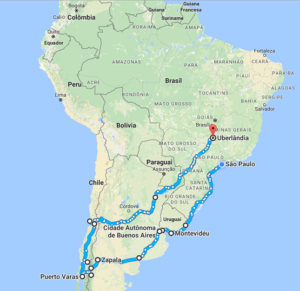

**Acesse o roteiro**: <https://goo.gl/maps/pwHU9DsuGbP2>

**Reservar hotel ou ir dormindo em qualquer lugar?**

No início ficamos na dúvida se iríamos reservar os hotéis ou se iríamos chegar e procurar hotel em cada cidade que fôssemos parar. Analisamos e decidimos já reservar os hotéis. Se a gente não tivesse feito isto, ou teríamos gasto uma quantidade enorme de dinheiro ou teríamos perdido muito tempo procurando hotel nas cidades. Portanto, dos 19 dias na estrada, nós reservamos hotel para 17 dias, deixamos apenas dois dias sem reservar pois eram dias entre trechos longo de viagem e não sabíamos quando o cansaço chegaria.

Todos os hotéis foram reservados no Booking. Cerca de 90% pagamos no local e apenas 3 hotéis nos cobraram no cartão de crédito informado no Booking. Todas as reservas funcionaram 100%, sem nenhum problema.

Após reservar, enviei e-mail individual (quando faltavam cerca de 10 dias para a viagem) a cada hotel com o objetivo de confirmar a hospedagem. Todos retornaram e-mail e foram muito atenciosos.

**Hotel ou hostel?**

Hotel ou Hostel? Para quem não quer gastar muito, pode ficar em hostel. Nós ficamos em hostel em dois locais: Bariloche (Argentina) e também em Pucón (Chile). Não tivemos nenhum problema, e o hostel no Chile (Pucón) mais parecia hotel do que realmente um hostel.

Entre Buenos Aires até Bariloche (passamos por Bahia Blanca/Neuquén) não tínhamos efetuado reserva e sabíamos que precisaríamos repousar em algum lugar, pois a viagem era muito longa. Decidimos procurar hotel durante a estrada, quando chegou às 01h a.m, estávamos tão cansados que fomos no primeiro hotel (beira da estrada) e o custo era alto, resolvemos então neste dia arriscar e dormimos dentro do carro durante 4h e depois seguimos viagem.

No retorno para o Brasil nós também tínhamos um trecho longo e precisaríamos de um hotel no meio do caminho. Achamos um hotel (barato) em Bela Vista (Argentina) e dormimos. O restante dos hotéis foram todos reservados no Booking e segue a nossa lista:

Florianópolis: Hotel Valerim Plaza

Porto Alegre: Hotel Continental Business

Punta del Este: Hotel Ajax

Montevideo: Apart Hotel Massini Suites

Buenos Aires: ARC Recoleta

Rio Colorado: Dormimos em um posto de combustível, dentro do carro.

San Carlos de Bariloche: Kospi Boutique Guesthouse

Puerto Varas: Cabañas Bosque Sur

Pucón: Pucon Hostel

Santiago: Hotel Bonaparte Boutique

Mendoza: Hotel Ibis Mendoza

Bella Vista: Hotel El Triangulo

Foz do Iguaçu: Hotel Mirante

Documentação para a viagem. Este passo é muito importante.

**Documentos pessoais:**

Embora seja permitido entrar nos países do Mercosul sem estar munido de Passaporte, a minha recomendação é sempre levar o passaporte, pois o processo é muito mais simples para dar entrada e saída de qualquer país.

Para dirigir fora do Brasil, é necessário a PID (Permissão Internacional para Dirigir). Como a minha CNH é de MG, então acessei o site do Detran-MG, paguei a guia e em menos de uma semana a minha PID chegou via correios. A PID é um manual em vários idiomas que fala que você é condutor de carro. Em anexo uma imagem da PID.

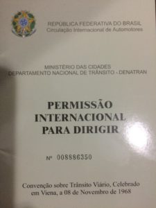

**Documento para o carro:**

Providenciamos a Carta Verde (seguro obrigatório contra terceiros) que é obrigatória para entrar veículos estrangeiros na Argentina, Uruguai e também no Chile. Fizemos a nossa pela HDI Seguros no Brasil. A apólice veio em português mesmo (uma única folha). O custo que tivemos foi de 76 dolares ou R$ 297,06 para 17 dias. Para os dias que você estiver no Brasil não precisa, mas preferi pegar 2 dias a mais por questões de segurança – vai que acontecia algo de errado com o carro lá.

Caso o carro não esteja em seu nome ou esteja financiado, então você precisará de uma autorização. Esta autorização precisa ser ‘legalizada’ junto ao Ministério das Relações Exteriores (MRE) do Brasil e depois ‘legalizado’ nos consulados do Uruguai (para entrar no Uruguai) e no consultado do Chile (para entrar no Chile). Para entrar com o carro na Argentina, basta o carimbo do próprio MRE, pois o Brasil-Argentina tem um acordo mútuo que não requer uma legalização específica no consultado da Argentina. Em nosso caso, o carro estava em nome da empresa, não financiado, e portanto tivemos que ter uma autorização da empresa para dirigirmos o carro. Documento com firma reconhecida, envia-se para o MRE (enviamos para Brasília) e depois buscamos o carimbo nos consulados do Uruguai e também do Chile. Veja em anexo o documento que vocês podem usar como exemplo.

Os carimbos dos consulados é um meio do consulado falar que reconhece o documento (uma vez que o documento está em português). Funciona como se fosse um cartório, ou seja, o consulado do Uruguai reconhece o documento, coloca-se um carimbo, e então o documento (que no caso é uma autorização da empresa para dirigir o carro) é válido no território estrangeiro. Isto vale também para o Chile.

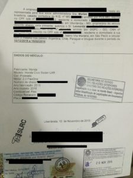

O nosso carro tinha placa de MG (Uberlândia-MG) portanto poderíamos enviar para MRE de Belo Horizonte ou de Brasília. Resolvemos enviar para Brasília. Ao pegar o documento, como moramos em São Paulo, fomos ao Consulado do Chile em São Paulo, e pegamos a legalização neste consulado. Porém, ao ir no Consulado do Uruguai, nossa grande surpresa. Eles não aceitavam pois o documento era de MG. Fiz um apelo formal ao Consulado, mas enquanto eles estavam ainda analisando o meu pedido, resolvi enviar outro documento para o Consulado em Belo Horizonte e em 1 (um) dia eles já me enviaram novamente legalizado e pronto via Sedex.

Observação: No Consulado do Chile houve um custo de R$ 51,00 e no Consulado do Uruguai um custo de R$ 156,00 (em Dezembro/15). No caso do Uruguai, como eu enviei por correios (Belo Horizonte) tive que enviar também um valor para retorno do documento (você já tem que enviar o dinheiro dentro do envelope para eles postarem para você de volta). Antes de fazer isto - caso você precise - é melhor falar com o consulado.

Se o carro estiver financiado, então o procedimento é o mesmo. A financeira precisa autorizar você a sair com o carro e este documento precisa ser legalizado nos devidos consulados, exceto Argentina, em função do acordo Brasil-Argentina.

**Qual é o melhor carro para viajar?**

Queríamos realizar uma viagem longa de 10.000 km e o nosso tempo (devido a outros compromissos) não poderia passar de 19 dias. Em nosso caso tínhamos a opção de ir em um Honda Fit 2008 ou em um novo Honda Civic 2016.

No início eu estava em dúvidas, pois como não conhecia as estradas, se iria em um carro mais novo ou mais velho. Este é um dos motivos pelos quais fiz vários videos das estradas, para que outras pessoas em dúvidas como a minha (os homens irão se preocupar com isto!) possam tomar a decisão. A minha decisão foi ir com um carro mais novo, em função do conforto. E não arrependi.

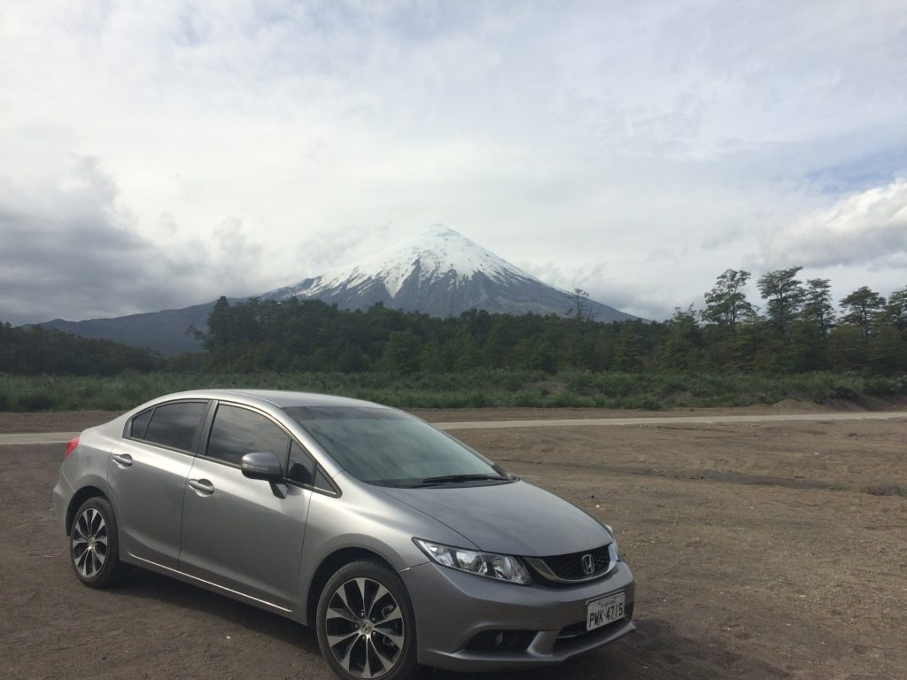

Este (acima) foi o nosso grande companheiro de viagem. Não nos deixou na mão em nenhum momento. Este carro é flex, mas nos países da América do Sul não tem Etanol. Em contrapartida a gasolina na Argentina, Chile e Uruguai é da melhor qualidade. Eu ficava super feliz ao completar o tanque e ver a autonomia próxima de 1000 km (enquanto no Brasil fica em torno de 600 km).

**Quanto gastamos na viagem ao todo?**

Gastamos cerca de 12 mil reais considerando documentação, hotel, alimentação, transporte e combustível. Quando nós fomos (Dez15/Jan16) o dólar estava cerca de R$ 4,10 por 1 dólar. Azar nosso ou não, mas agora em Agosto/16 o dólar está em R$ 3,20. Mas paciência, quem for agora terá um custo menor.

**Fazer revisão do carro fora do Brasil é um problema. Veja o que eu tive que fazer.**

No meu caso, o Civic estava com 4.000km e iria completar 10.000 km quando chegasse ao Chile. Consegui falar com duas concessionárias Hondas no Chile para realizar a revisão lá, pois a Honda Brasil não estava autorizando fazer a revisão com 14.000 km (que seria a minha kilometragem quando retornasse). Em suma, entrei em contato com a Honda (Fábrica) e consegui uma autorização para realizar uma revisão antes, porém me exigiram que fizesse na última concessionária autorizada antes de sair no Brasil. Assim, a minha opção foi realizar a revisão em Pelotas-RS. Chegando lá, era uma segunda-feira pré Natal, e gastei cerca de 5h na concessionária para conseguir falar na Honda (telefones congestionados) e então liberaram a minha revisão. Fiz a revisão com 5.300 km.

Quando retornei ao Brasil já tive que ir direto para outra revisão, pois tem que fazer de 10 em 10 mil km.

**Acessórios para o carro.**

Atenção. As regras fora do Brasil são mais severas do que por aqui. Na Argentina é obrigatório kit de primeiros socorros no carro, cambão (é um cabo de aço ou barra de ferro que permite um carro puxar o outro, caso o seu carro tenha problemas e precise ser rebocado), 2 triângulos de sinalização (carros brasileiros vêm com um apenas) e ainda um jaleco refletor (para você utilizar a noite caso o seu carro tenha problemas e precise sair do carro no estacionamento). Onde compramos tudo isto? Na Argentina, em um posto. Mais para baixo relatamos os perrengues disto.

**Câmbio, troca de dinheiro e como levar o dinheiro.**

Sempre que se faz câmbio se perde e na minha opinião trocar aqui no Brasil os reais por pesos uruguaios, pesos argentinos e chilenos não compensa. Na internet eu pesquisei na época as taxas de câmbio e vi que compensava mais levar os reais e fazer o câmbio lá (e toda casa que se faz câmbio de dólares também faz de reais, pois tem muitos turistas brasileiros nestes países). Portanto, o que eu fiz? Levei R$ 4.000 em dinheiro e US$ 1.000,00 em espécie. Preferi levar um pouco de dólares, pois embora possa fazer câmbio de reais lá, os dólares são bem mais aceitos em hotéis (não todos), restaurantes etc. Mas atenção, geralmente a taxa não é atrativa para se pagar em dólares. Mas levei por ‘segurança’. Além do dinheiro, levamos ainda dois cartões de crédito, os quais evitamos ao máximo utilizar, pois na minha experiência sempre que utilizamos o cartão a taxa de câmbio cobrada pelo banco foi muito ruim, na verdade utilizei o cartão apenas 2x no retorno já para o Brasil, pois na Argentina já estava praticamente sem pesos argentinos no retorno e eu não queria fazer mais câmbio (para não sobrar pesos argentinos), então abasteci duas vezes o carro utilizando o cartão de crédito mesmo.

Antes de fazer o câmbio a gente fazia uma conta da quantidade de dias que iríamos ficar no país. O dinheiro que ia sobrando de um país para o outro a gente aproveitava para abastecer o carro, assim entrávamos com o tanque mais cheio e evitava sobrar dinheiro do Uruguai (quando já estávamos indo para a Argentina), do Chile (quando já estávamos saindo do Chile) e assim por diante.

Cuidado: As estradas podem ter pedágio. Quando entrei no chile eu tinha apenas reais e dólares. Passei no primeiro pedágio, mas a sorte é que ele aceitava reais (taxa de conversão altíssima, mas aceitava).

**Telefone em roaming internacional e pacote de dados**

Durante a preparação olhamos como funcionaria o roaming internacional e os custos. Como iríamos visitar vários locais, ter um GPS funcionando no carro seria essencial. Então contrataríamos roaming internacional ou compraria um chip em cada país. Resolvemos que iríamos comprar um chip para usar nestes países, porém quando chegamos lá uma grande surpresa: havia WIFI em tudo quanto era lugar, por exemplo, em qualquer posto de combustível no Uruguai, Argentina ou Chile tem wifi grátis. Em Buenos Aires tinha wifi nas ruas gratuitamente... em resumo, utilizamos essencialmente WIFI grátis p/ navegar.

**Mapas. Minha namorada teve uma ótima ideia e isto salvou a nossa viagem várias vezes.**

Outro ponto positivo é que o Google Maps há algumas semanas antes já tinha lançado o Maps offline. O que fizemos? Sempre baixávamos os mapas que iríamos utilizar nos dias seguintes para um smartphone. Assim, nossos maps do Google funcionavam perfeitamente. Isto foi uma "mão na roda" para a viagem, sem isto certamente teríamos os perdido algumas vezes.

**Cuidado com as comidas!**

Na Argentina e Chile tem muitas barreiras sanitárias, principalmente na Argentina. Estas barreiras tem como objetivo proteger a disseminação de doenças, sobre tudo nas plantas e frutas. Portanto, toda vez que passávamos por alguma barreira, lá se iam nossas frutas e comidas. Você pode comer tudo ali ou jogar fora. Chegamos um momento que comprávamos nossas frutas de pouco em pouco.

**Frutas, vinhos e carne!**

Se você gosta de frutas, então aproveite, as frutas na Argentina são as melhores. Se você gosta de carne, não deixe de comer no Uruguai e na Argentina. Se você gosta de vinhos, então Argentina e Chile irá te surpreender.

**2. A viagem. Vamos viajar!!**

Depois de tudo organizado, documentação, roteiro, carro e malas, então partimos para a nossa viagem. A melhor viagem da nossa vida! É diferente viajar de carro, conhecer inúmeros locais, paisagens, animais e muitas pessoas.

**1º dia: 19/12/2015**

Viagem: São Paulo até Florianópolis.

O primeiro dia de viagem saímos de São Paulo em torno de 5am e tínhamos como destino Curitiba para o almoço. Aproveitamos para conhecer um pouco mais a cidade e fazer pequenos passeios como na Opera de Arame (foto abaixo). Depois almoçamos e partimos para Florianópolis que seria o local que iríamos fazer o primeiro pouso.

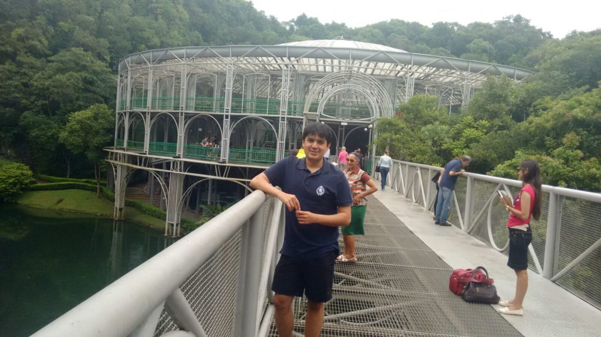

Neste primeiro dia ficamos hospedados no hotel Valerim Plaza em Florianópolis.

**2º dia: 20/12/2015**

Viagem: Florianópolis até Porto Alegre

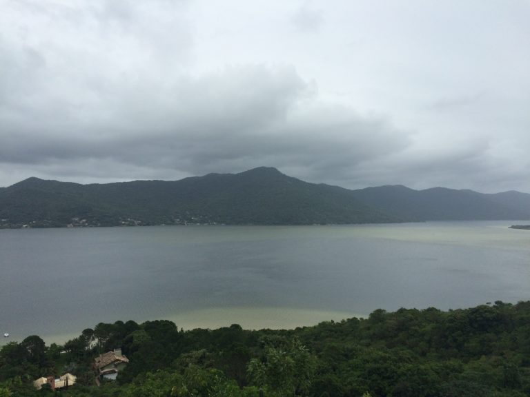

Acordamos muito cedo e fomos conhecer a ilha de Florianópolis e as suas diversas praias (foto acima). Em torno de 15h pegamos a estrada rumo a Porto Alegre.

Florianopolis para Porto Alegre

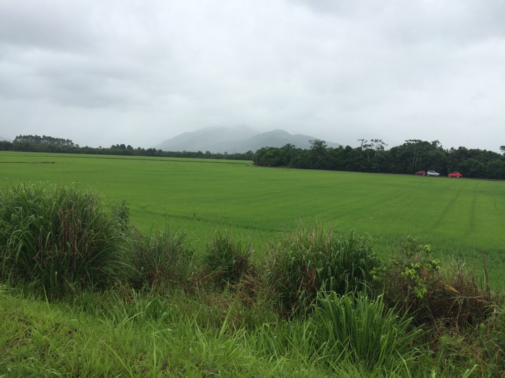

Foto acima é no caminho entre Florianópolis e Porto Alegre.

Neste segundo dia de viagem fomos dormir em Porto Alegre, Hotel Continental Business. A ideia em Porto Alegre era apenas dormir, não estava em nossos planos conhecer ou visitar algo, pois no dia seguinte eu tinha que estar cedo em Pelotas-RS para a revisão na Honda.

**3º dia: 21/12/2015**

Viagem: Porto Alegre até Punta del Este.

Saímos de Porto Alegre bem cedo, pois eu precisava fazer revisão no carro em uma concessionária em Pelotas (última cidade do Brasil que tinha uma concessionária). Já estava reservado desde início de Dezembro esta revisão. Eu consegui uma autorização na Honda para fazer a revisão dos 10.000km no carro antecipada, pois senão iria dar 10.000km quando eu estivesse no Chile e lá seria bem complicado fazer a revisão. E se não fizesse a revisão, perderia a garantia do carro. Passamos a manhã e o almoço em Pelotas aguardando a revisão. Mesmo com tudo autorizado pela fábrica (pois eu tinha que fazer a revisão com 5.300 km apenas) foi um século conseguir a revisão lá em Pelotas, mas depois de 5h, tudo resolvido.

Saímos de Pelotas e rumo ao Uruguai. Passamos por Chuy para entrar no Uruguai. Foi um choque para mim. Uma confusão enorme sem saber o que era Brasil e onde já era Uruguai. Imagina aquelas cidades de fronteira - que bagunça! A barreira é um pouco depois de Chuy, portanto não se preocupe você irá entrar no Uruguai e depois de uns 10 km você passará pela barreira. É bem simples lá.

Na barreira tivemos que parar o carro e ir até um guiché levando a documentação (pessoal) e do carro. Tudo aprovado, entramos no carro e fomos passar. Tem uma pequena revista no carro, mas nada que se compara a revista que sofremos da Argentina para o Chile nos Andes. Observação: Foi solicitado a "carta verde" (seguro obrigatório para nossos carros lá) duas vezes: uma aqui na entrada do Uruguai e uma outra vez retornando para o Brasil em uma rodovia na Argentina, próximo a Bellavista de Corrientes.

Antes de chegarmos a Punta del Este, nós passamos na Playa Punta del Diablo, já do lado Uruguaio. Foto abaixo.

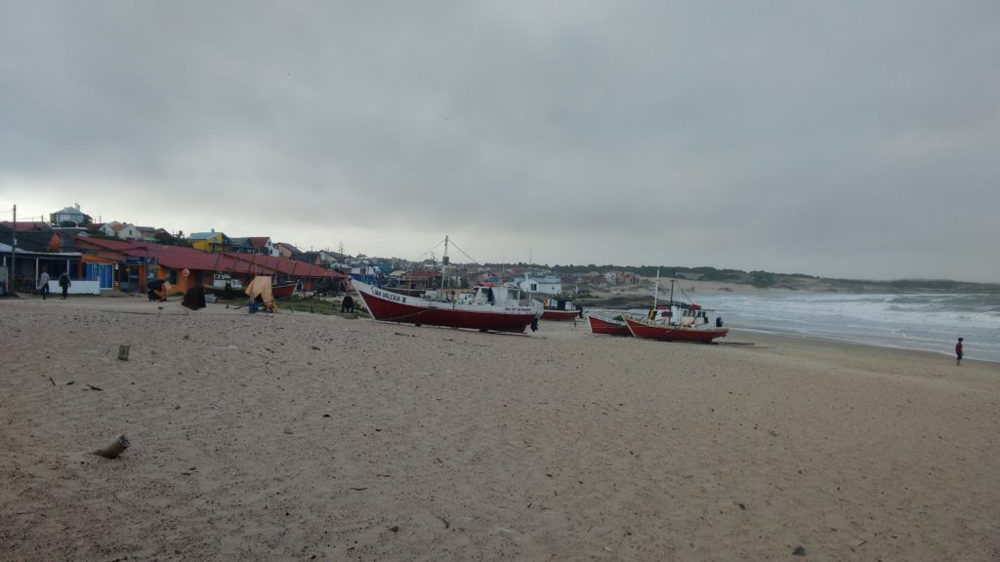

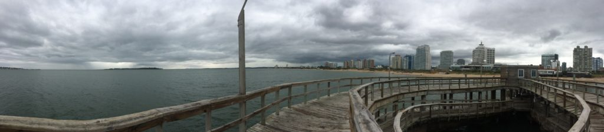

Punta del Este (foto acima): Importante conhecer a praia, cassinos e shoppings da cidade. Linda cidade.

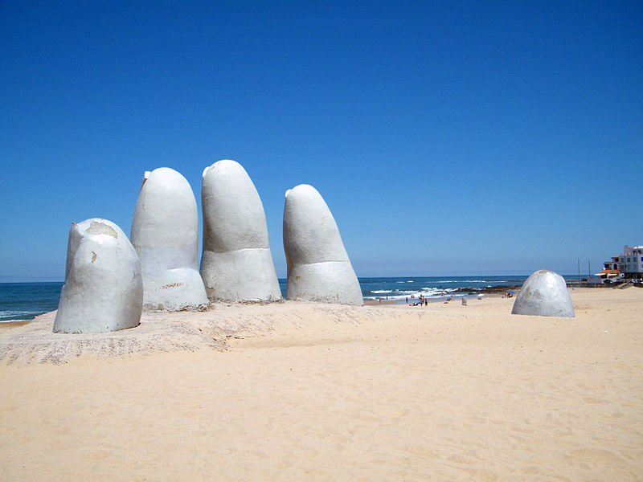

Foto acima (Los Dedos). É uma atração que fica na praia e estava próxima de nosso hotel. Não pode deixar de ir e tirar uma foto.

Neste terceiro dia dormimos no Hotel Ajax em Punta del Este, Uruguai.

**4º dia: 22/12/2015**

Viagem: Punta del Este até Montevideo

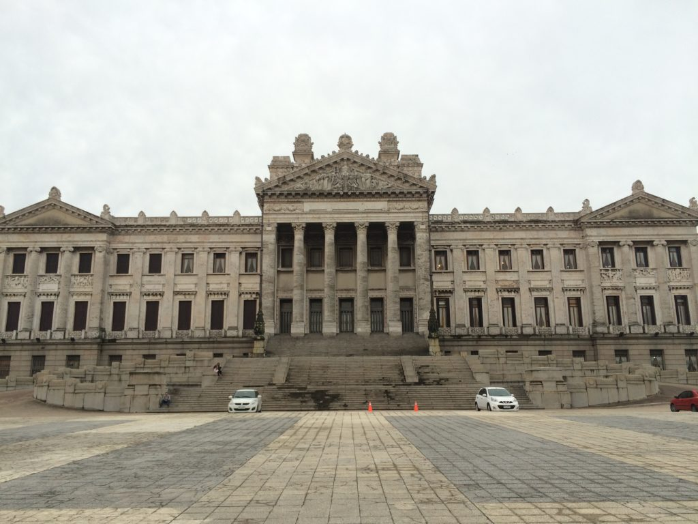

Foto acima: Centro de Montevideo. Não pode deixar de conhecer o centro histórico. Ficamos hospedados em Los Pocitos. Excelente reunião, inclusive para sair a noite.

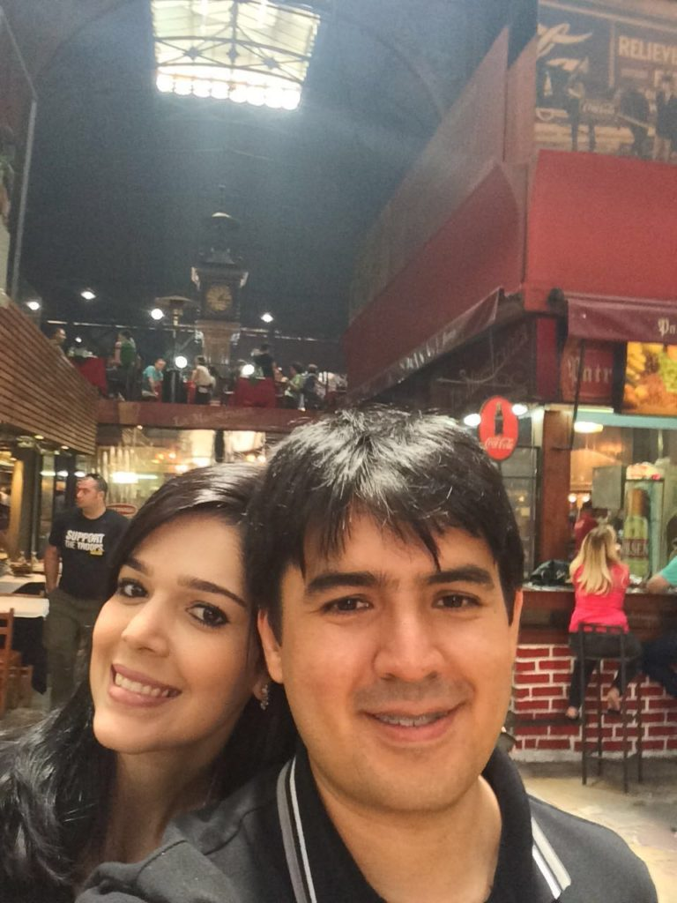

Não deixe de ir também no Mercado del Puerto. Atração para os turistas.

Neste quarto dia dormimos no Apart Hotel Massini Suites em Montevideo, Uruguai.

**5º dia: 23/12/2015**

Viagem: Montevideo para Buenos Aires, via Colonia del Sacramento.

Viajamos até Colonia del Sacramento para pegar o Buque Bus. Há duas empresas apenas que transportam os carros+passageiros entre Uruguai e Argentina. Escolhemos a Buque Bus. Deu tudo certo. Nós compramos os tickets pela internet.

Você tem a opção de ir de carro entre Montevideo e Buenos Aires, mas não conheço ninguém que tenha feito. O caminho é bem mais longo. Não compensa, em minha opinião.

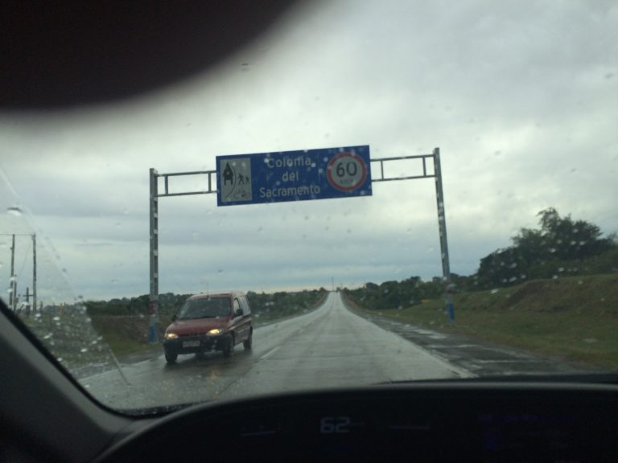

Entrada de Colonia del Sacramento, Uruguai. Viemos de carro para pegar o navio (balsa) para atravessar o "Rio de la Plata" entre Uruguai e Argentina.

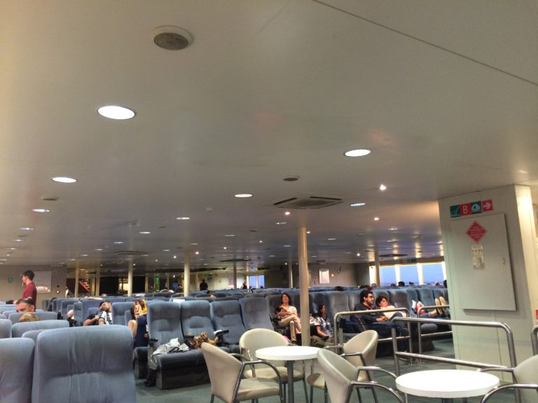

Foto acima é do Buque Bus, onde os passageiros ficam. Os carros ficam no "andar" debaixo do navio. Os carros precisam ficar engatado e com o freio de mão puxado. Ninguém pode permanecer nos carros durante a travessia.

Após atravessar o Rio de la Plata você irá desembarcar diretamente em Buenos Aires. No porto de Buenos Aires (Puerto Madero). Será avisado que os motoristas devem entrar nos carros juntamente com as suas famílias. Para sair do Puerto tem uma revista nos carros (pedem para abrir o bagageiro. Conosco não teve nada demais, coisa bem simples). Ulálá, saímos do Puerto e íamos para o nosso hotel. Pegamos algumas avenidas em Buenos Aires e era uma correria, pessoal andando a mais de 80 km/h.

Fomos então direto para o nosso hotel, o "ARC Recoleta", no bairro de Recoleta, Buenos Aires, Argentina. Excelente bairro.

**6º dia: 24/12/2015**

Sem viagem. Ficamos em Buenos Aires. Compramos o ticket (Buenos Aires Bus) para fazer o tour na cidade com o ônibus turístico. Vale a pena pois é uma maneira fácil e rápida de conhecer a cidade.

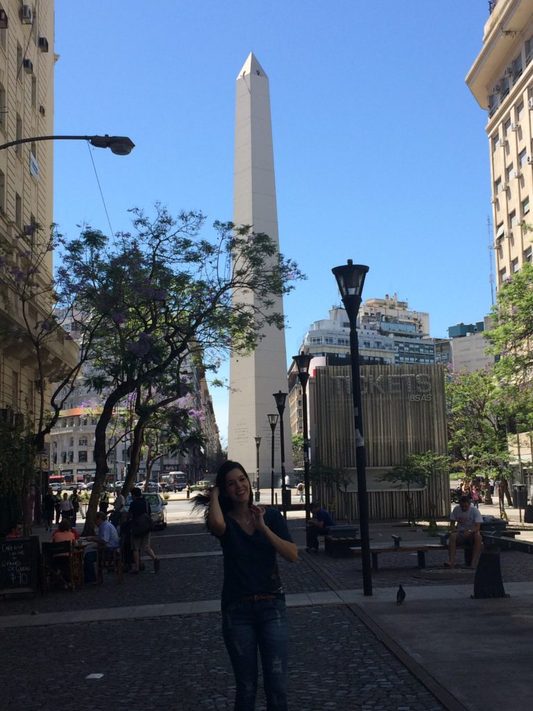

Foto acima. Joyce no Obelisco em Buenos Aires. Linda cidade.

Neste sétimo dia dormimos novamente no ARC Recoleta, Buenos Aires.

**7º dia: 25/12/2015**

Viagem: Buenos Aires até Rio Colorado, via Bahia Blanca.

Natal. Tudo fechado em Buenos Aires. Se precisar comprar alguma coisa na cidade, é praticamente impossível. Para viajar pela Argentina é preciso ter um kit de primeiros socorros, 2 triângulos de sinalização jaleco e cambão conforme relatamos no início deste artigo. Preferimos deixar para comprar tudo isto na Argentina mesmo, para evitar comprar errado no Brasil e não servir para os amigos Portenhos. O problema é que era Natal e tudo estava fechado. A nossa sorte foi encontrar um posto Shell que vendia acessórios. Compramos tudo lá. E seguimos viagem.

O nosso próximo destino seria Bariloche (é longe viu!!) e iríamos passar por Bahia Blanca - há outros caminhos, mas optamos por este. Sabíamos que teríamos que fazer uma parada para dormir, pois era 2 dias de viagem. Este foi o primeiro longo trecho que pegamos. Estrada e mais estrada. De Buenos Aires até Bariloche passando por Bahia Blanca e também por Zapala (pois queríamos pegar a rota 40) são cerca de 1750 km.

Video acima estávamos a cerca de 300km de Bahia Blanca pela Rota 3 (Argentina).

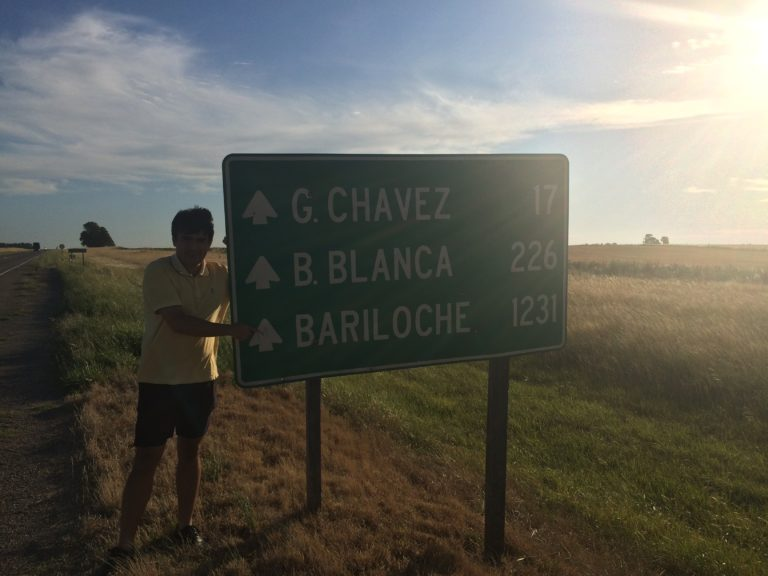

Rota 3 (Argentina) à 1231km de Bariloche.

Neste oitavo dia, como não sabíamos até onde iríamos conseguir dirigir, então não reservamos hotel. Moral da história, acabamos dormindo em um posto de combustível, em Rio Colorado, Argentina, dentro do carro. Estava muito cansado.

Passamos de madrugada pela Rota 22 (Argentina) entre Bahia Blanca e Rio Colorado, cortando a Patagônia Argentina. Nunca vi tanto coelho na minha vida. Toda hora passava um na frente do carro. Kilometros e mais kilometros dentro da Patagônia Argentina.

**8º dia: 26/12/2015**

Viagem: Rio Colorado até Bariloche, via Rota 40, passando por San Martin de Los Andes.

Acordamos o nono dia em um posto de combustível. Estávamos muito cansados, mas sabíamos que precisávamos chegar à Bariloche. Nem tínhamos ideia que a viagem estava começando a ficar muito boa! Este foi o dia mais fantástico da viagem. Você passa por um enorme deserto (rota 22 e depois rota 40) até chegar em San Martin de Los Andes. Após passar por diversos desertos (centenas e centenas de kilometros), então você chega em um lugar lindo: San Martin de Los Andes.

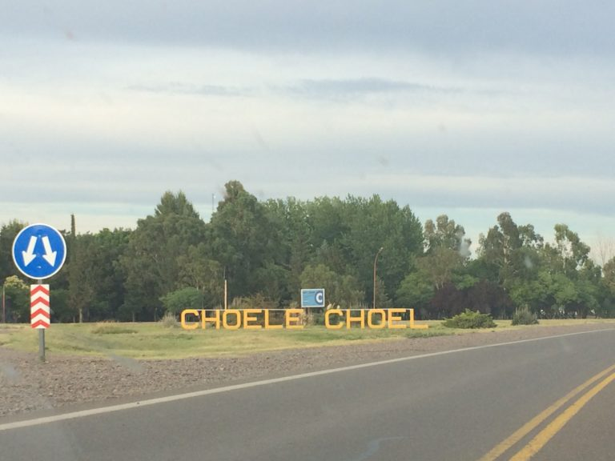

Entrada da cidade (foto acima) de Choele Choel. Rota 22, Argentina.

Video acima é da Rota 22 entre Neuquén (Argentina) e Zapala (Argentina). Bastante desértico a região.

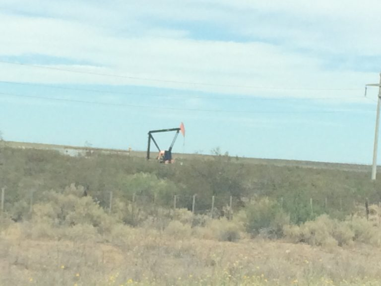

Rota 22 (Argentina). Extração de Petróleo. Nesta região vocês verão muito disto.

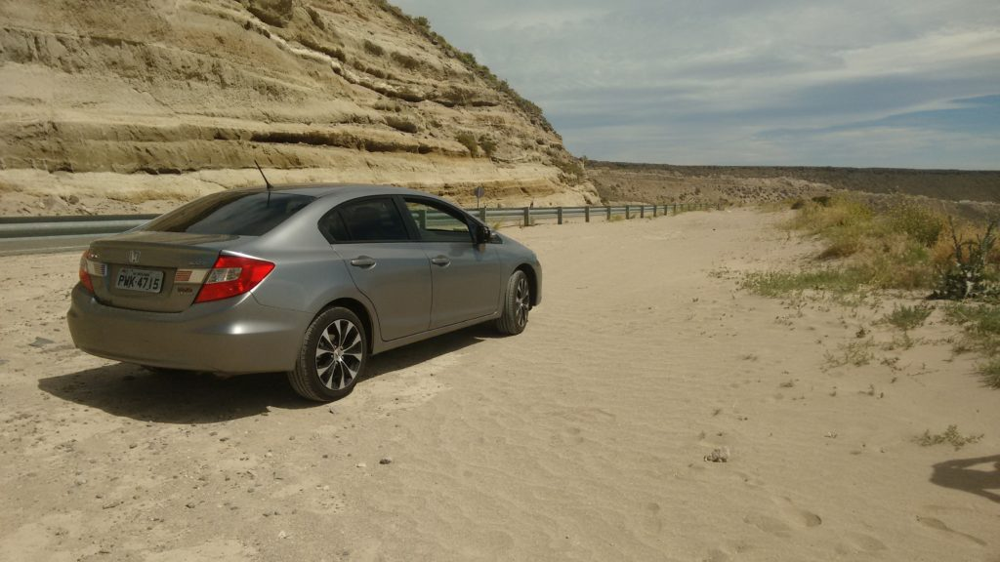

Rota 40 (Argentina). Deserto e mais deserto.

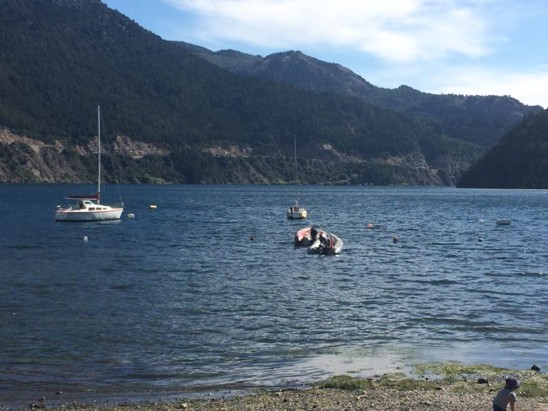

Rota 40 (Argentina). San Martin de Los Andes. Depois de horas e mais horas andando pelo deserto, de repente você se depara com San Martin de Los Andes. Paraíso. Foto acima.

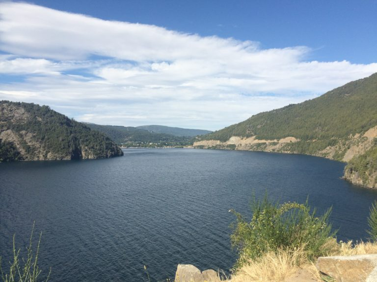

Rota 40 (Argentina). San Martin de Los Andes indo para San Carlos de Bariloche.

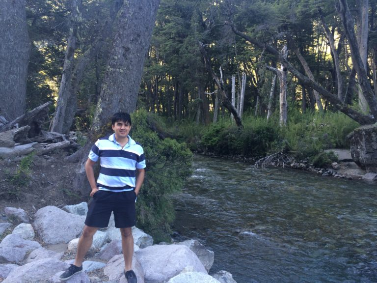

Rota 40 (Argentina). Foto acima. Diversos rios e riachos se formam nos Andes em função do degelo no verão.

Rota 40 (Argentina), KM 2122.

Rota 40 (Argentina), KM 2162, nos Andes, Entre San Martin de Los Andes e Bariloche

Vídeo acima é da Rota 40, km 2172, na Cordilheira dos Andes. Estávamos a cerca de 140km de Bariloche.

Vídeo acima é da Rota 40 (Argentina) já bem próximo a Bariloche.

Neste nono dia nós dormimos no Kospi Boutique Guesthouse, em Bariloche.

9º dia: 27/12/2015

Sem viagem.

Aproveitamos para visitar Bariloche e diversos locais.

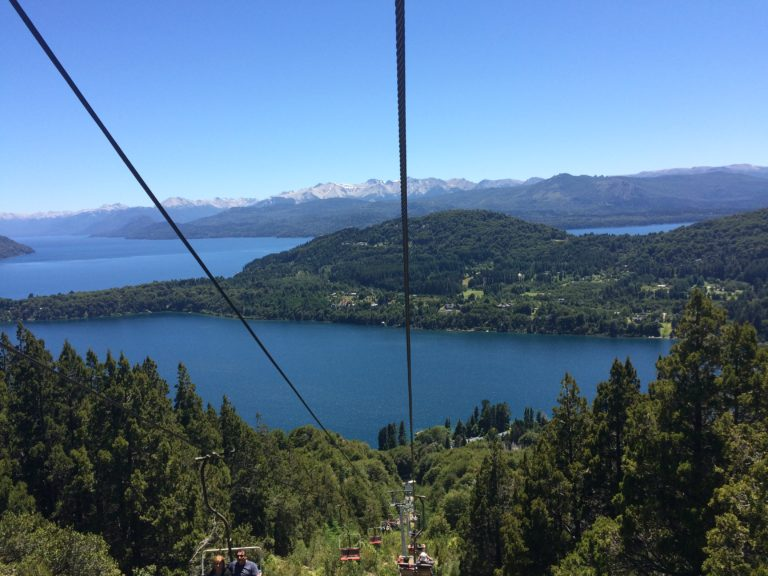

Bariloche dispensa apresentações. Subir no teleférico para ter uma vista panorâmica da região é um passeio que não pode faltar.

Neste décimo dia dormimos novamente no hostel Kospi Boutique Guesthouse.

**10º dia: 28/12/2015**

Viagem: Bariloche até Puerto Varas (Chile)

Hotel: Cabañas Bosque Sur

Video acima é da Rota 231 (Argentina) indo atravessar a fronteira da Argentina x Chile para pegar a rota 215 (Chile)

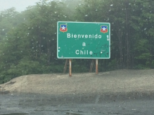

Esta foto acima é sobre os Andes na divisa entre a Argentina e Chile. Fim da rota 231 (Argentina) e início da rota 215 (Chile).

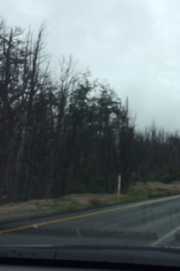

Esta foto acima é da rodovia nos Andes. Já do lado Chileno. Rota 215 (Chile).

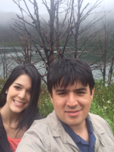

Esta foto acima é nos Andes. Após a divisa da Argentina com o Chile, mas antes da Aduana Chilena. Um lindo lago. Rota 215 (Chile).

Rota 215, km 99, Chile. Veja um pouco da estrada. Neste momento já tínhamos andado cerca de 4603km desde que saímos de São Paulo. Estradas perfeitas. Veja no video acima o video que gravamos da 215 (Chile), km 99.

Barreira entre Argentina e Chile. Bem rígida. A mais rígida que conhecemos. Ficamos cerca de 2h lá. O nosso carro foi inteiramente revistado. Tivemos que tirar tudo do carro, todas as malas. Todas as malas foram muito revistadas. Um cachorro pastor alemão da polícia chilena participa de todo o processo e o cachorro literalmente entra no seu carro (dentro) e também no bagageiro. Há muito tráfico de drogas e os países tentam controlar fortemente.

Tudo certo! Vamos ao Chile! Região de Bariloche e San Martin de Los Andes é uma das melhores do lado da Argentina e o melhor do Chile estava por vir.

Estrada U-775. Depois que saímos da 215 pegamos esta. Estávamos indo para Ensenada/Chile. Veja o video acima que gravamos de dentro do carro.

Para quem gosta (como eu) de gado. Veja o gado nas Cordilheiras dos Andes no video acima.

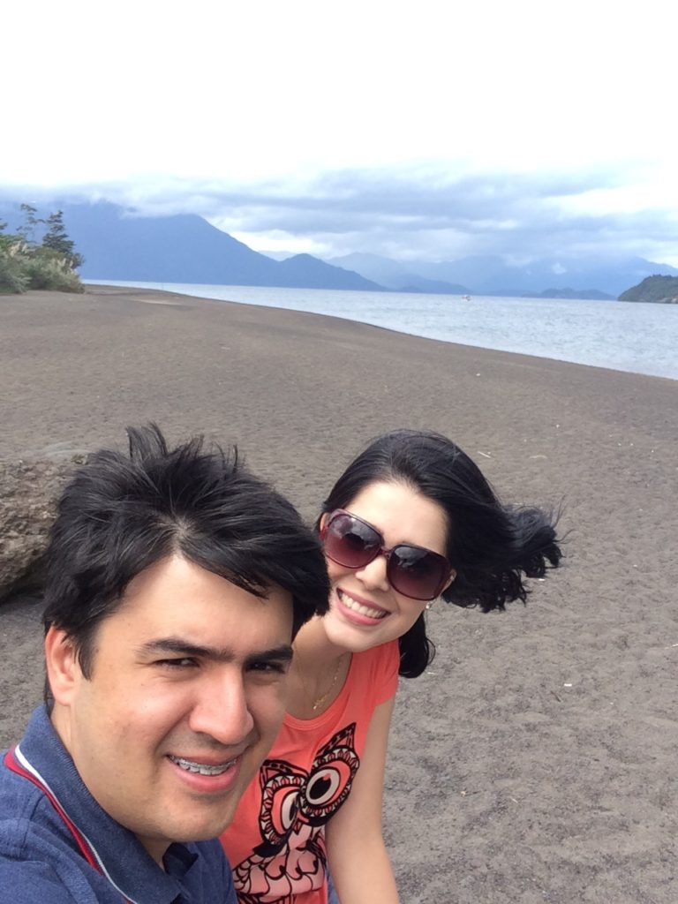

Depois que saímos de Bariloche (Argentina) fomos até Petrohué (Lago Todos los Santos). Para chegar aqui neste lago em alguns kilometros (poucos) de estrada de chão. Vá devagar que dá para chegar. Rota 225 (Chile). Ao fundo da imagem acima é o lago Todos los Santos.

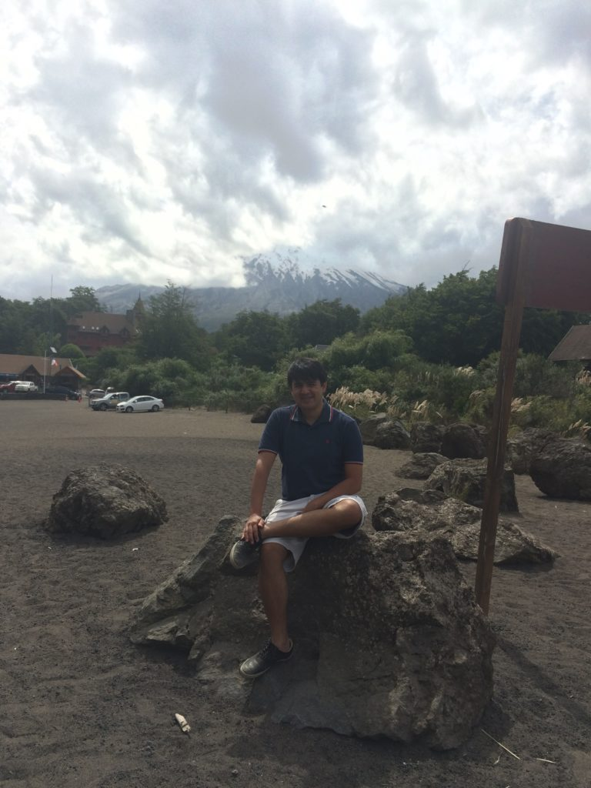

Esta foto acima é uma vista do Vulcão Osorno ao fundo. Eu estava em Petrohue (Lago Todos Los Santos).

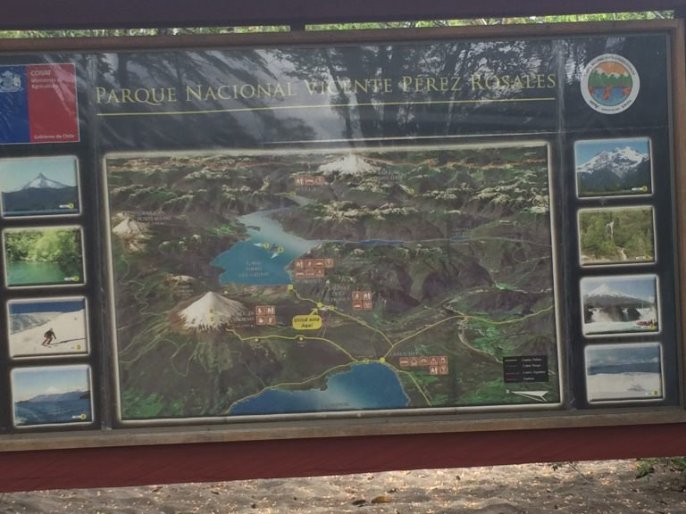

Retornando do Lago Todos los Santos (Petrohue) até Ensenada pela Rota 225. Você irá passar pelo Parque Nacional Vicente Perez Rosales acima. Vale muito a pena entrar. Lindo.

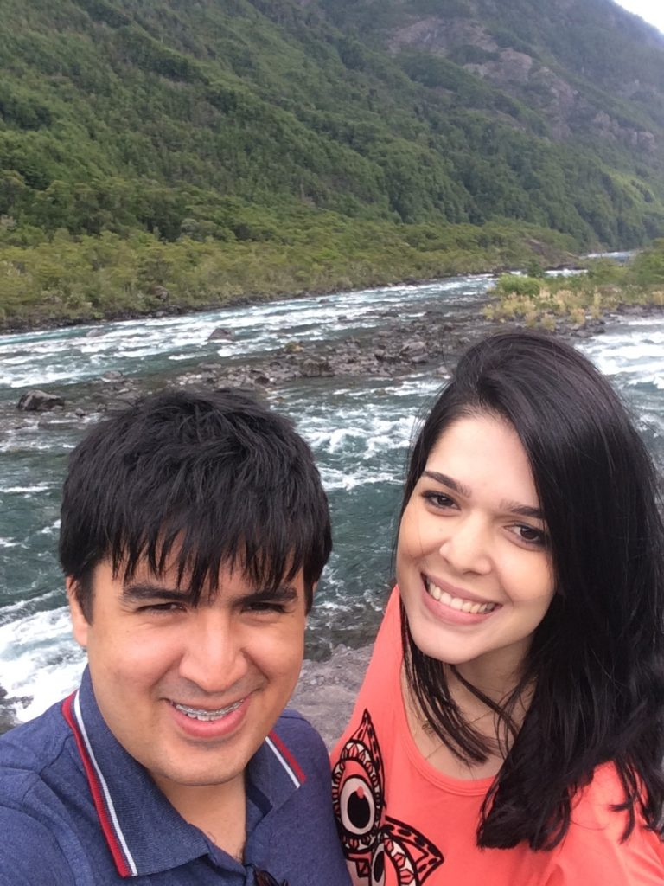

Rota 225. Ao fundo é o Rio Petrohué. Águas verdes.

<https://youtu.be/amu_AYMsseU>

Rota 225. Rio Petrohué acima dentro do Parque Nacional Vicente Perez Rosales.

<https://youtu.be/_vXi4Q9Bd5M>

Rota 225. Rio Petrohué do video acima é dentro do Parque Nacional Vicente Perez Rosales.

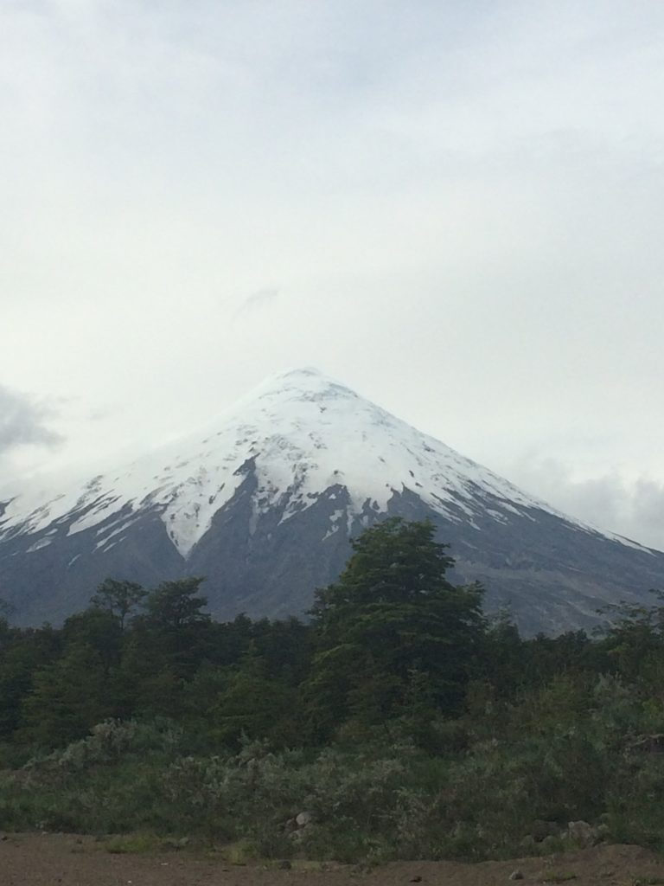

Foto acima é do Vulcão Osorno visto da Rota 225 no Chile.

Neste décimo primeiro dia dormimos em Puerto Varas.

**11º dia: 29/12/2015 em Puerto Varas**

Dormindo do dia 28 para 29/12 em Puerto Varas. Linda cidade. Veja na foto abaixo uma vista do Vulcão Osorno. O lago é o "Lago Llanquihue" em Puerto Varas, Chile

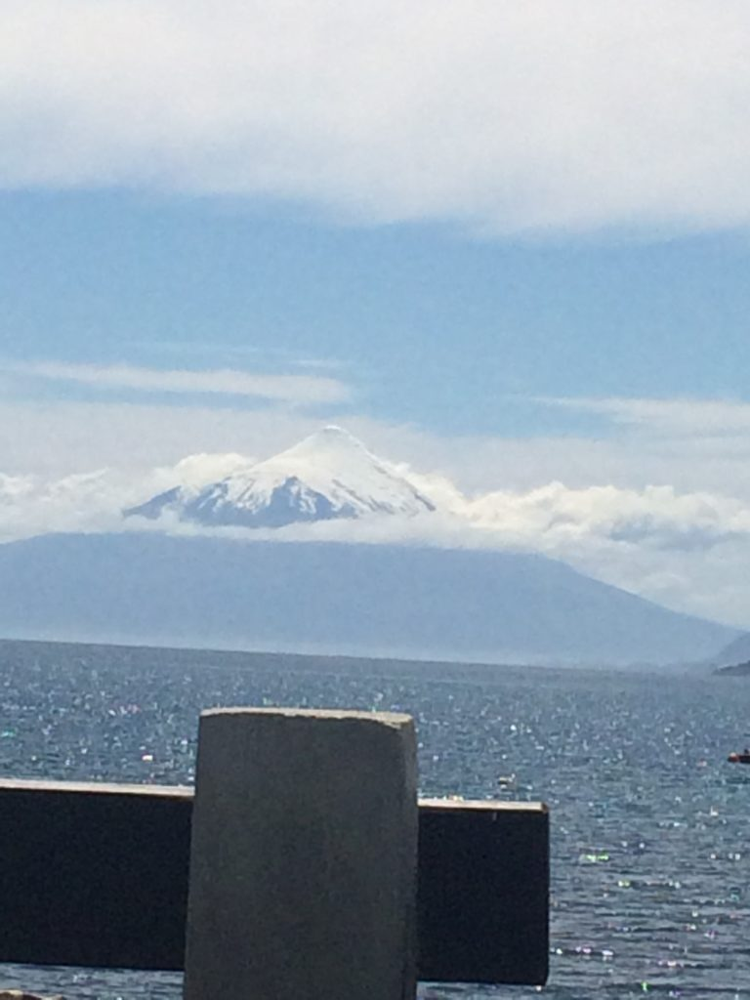

Lago Llanquihue

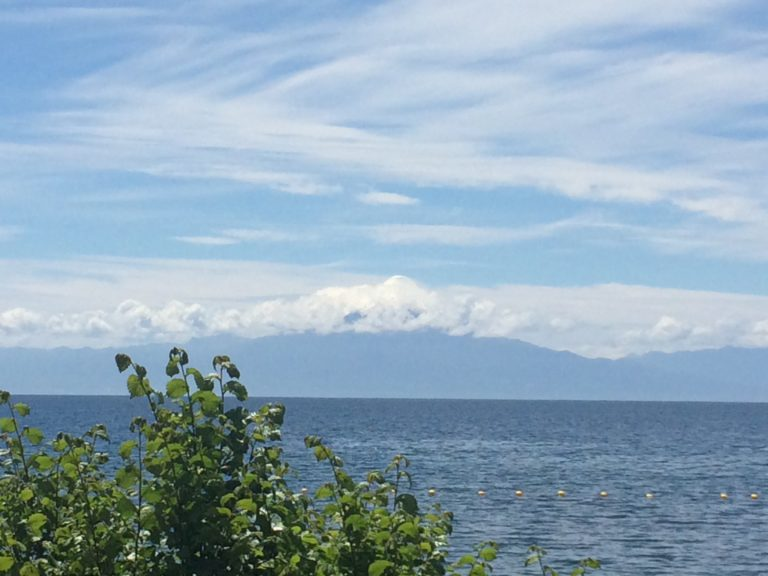

Não deixe de passar em Frutillar pela Rota 5. Esta foto acima é em Frutillar. Vulcão Osorno ao fundo.

Viagem: Puerto Varas até Pucón

<https://youtu.be/6q1LyTaAyoM>

Um pouco da Rota 5 do Chile. Já tínhamos passado Frutillar e Osorno. Indo pegar a saída para Pucón.

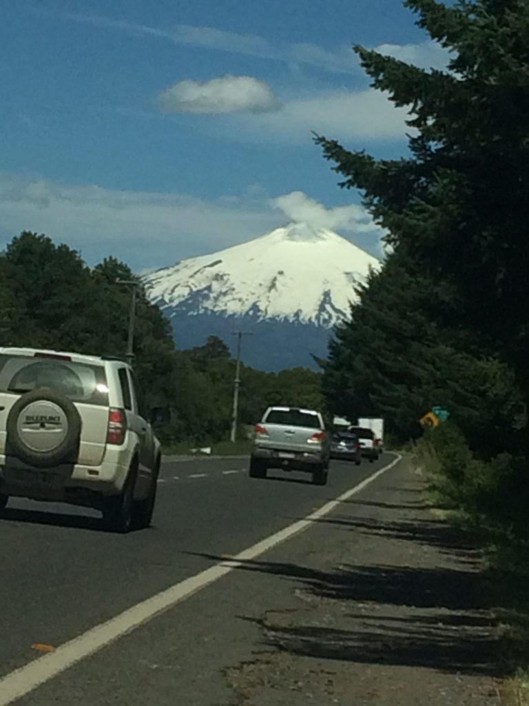

Foto acima é do Vulcão Villarrica

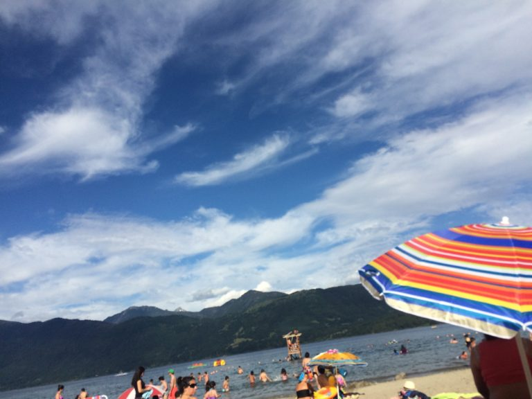

Playa Negra, Pucón. Tem que ir.

<https://youtu.be/vN5ve_bGzuM>

Este video acima fizemos ele da janela de nosso quarto (Pucón Hostel). Tinha uma ovelha no quintal da casa do vizinho. Eu berrei e ela respondeu 

No décimo segundo dia dormimos no Pucón Hostel, em Pucón.

**12º dia: 30/12/2015**

Viagem: Pucón até Santiago.

Hotel: Hotel Bonaparte Boutique

<https://youtu.be/5H0oTIOfb0I>

Conheça no video acima um pouco da Rota 5, cerca de 30km de Santiago do Chile.

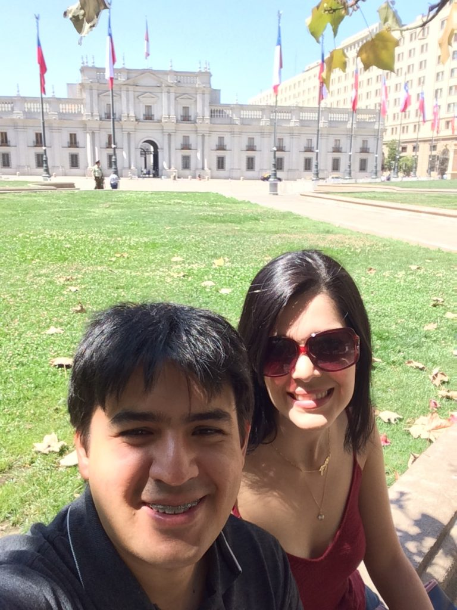

Não pode deixar de conhecer o centro da cidade de Santiago. Foto acima. Deixei o carro para lavar em um estacionamento no centro, subterrâneo. Não faça isto. Não tem água na cidade, o carro é praticamente lavado a seco. Ficou horrível e é caro.

Neste décimo terceiro dia nós dormimos no Hotel Bonaparte Boutique, em Santiago.

**13º dia: 31/12/2015**

Viagem: Santiago até Viña del Mar para passar a virada do ano e retornamos para Santiago de madrugada.

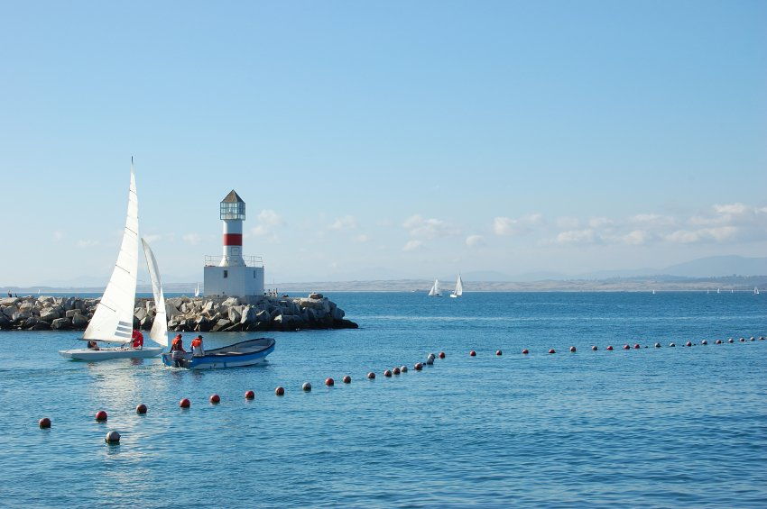

Foto acima é de Viña del Mar.

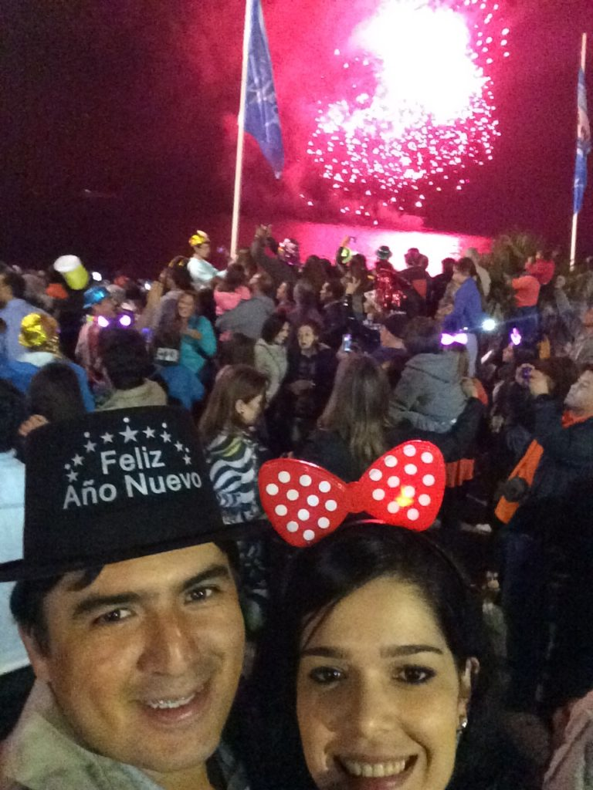

<https://youtu.be/NfzPaUYTZF4>

Queima de fotos em Viña del Mar, Chile. Passamos a virada do ano lá. Fantástico. Se conseguir ir, vá.

Eu iria aproveitar para encontrar um amigo (Ricardo Sepúlveda), porém por questões de tempo/horário acabou não conseguindo nos encontrar.

Retornamos de madrugada para Santiago.

Neste décimo quarto dia nós dormimos no Hotel Bonaparte Boutique, em Santiago.

**14º dia: 01/01/2016**

Viagem: Santiago até Mendoza

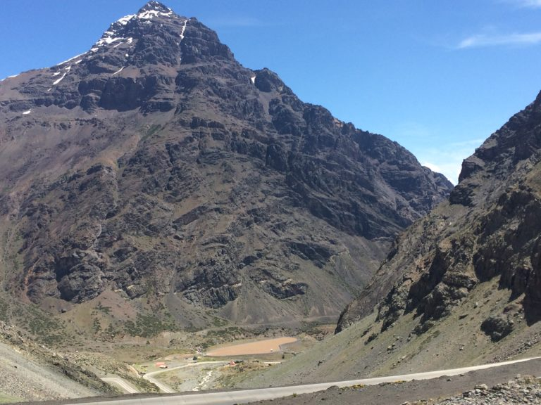

Fantástica estrada entre Santiago e Mendoza. Tudo diferente do que eu já vi na minha vida. Esta foto acima são os caracóis formados para atravessar a Cordilheira dos Andes. Rota 60 do lado do Chile e Rota 7 do lado da Argentina.

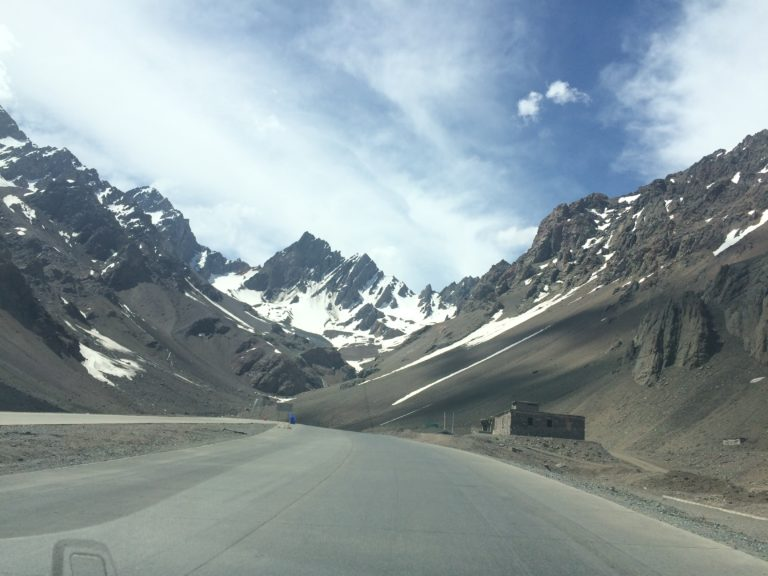

Rota 60 (Chile) no caminho para pegar a Rota 7 (Argentina) sentido Mendoza (Argentina).

Você irá passar pela Aduana Chilena, não precisa parar. Você dará saída do Chile na barreira Argentina e entrada lá.

Veja na foto acima que embora fosse verão, ainda havia neve nos Andes. Muito vento, forte e frio. Lindo tudo isto. Você precisa ir.

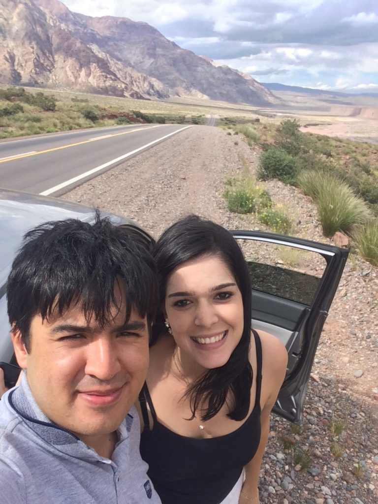

Foto acima: Parada na Rota 7 Argentina (Argentina) antes de Mendoza.

Tudo certo. Entramos na Argentina novamente e fomos direto para Mendoza em nosso hotel.

Neste décimo quinto dia dormimos no Hotel Ibis em Mendoza, Argentina.

**15º dia: 02/01/2016**

Sem viagem. Aproveitamos para conhecer a cidade e também algumas vinícolas/bodegas. Não deixe de ir em algumas. Compramos muitos vinhos nas bodegas e até mesmo no Carrefour da cidade. Estava na hora de fazer as compras e então retornar ao Brasil.

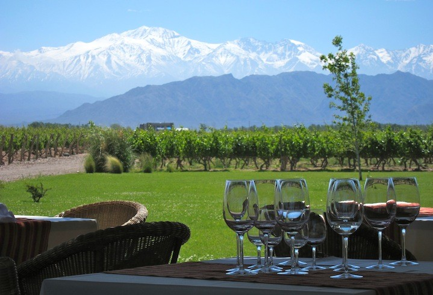

Vinícola/Bodega em Mendoza, Argentina, foto acima.

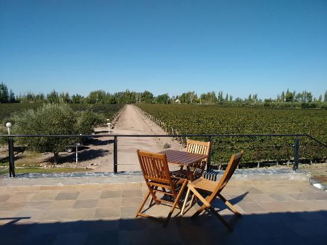

Foto acima é da Bodega Mevi. Super recomendada. Não deixe de comprar alguns bons vinhos lá.

Meu maior aprendizado em Mendoza: Quando chegamos na região logo veio aquela descrença, pois estava tudo muito seco e desértico. Mas vocês precisam ver o quanto a região é próspera, mesmo com todos os desafios climáticos. Você irá descobrir o porquê da região ser reconhecida internacionalmente por seus vinhos e azeites.

Neste décimo sexto dia nós dormimos no Hotel Ibis Mendoza

Aqui foi praticamente o fim de nosso viagem, pois a partir de agora são mais de 3000 km de viagem até retornar.

**16º dia: 03/01/2016**

Dia de viagem e retorno. Nada de passeio.

Viagem: Mendoza até Bella Vista, Corrientes

Bella Vista: Hotel El Triangulo. Não havia reservado este hotel, foi um hotel que encontramos às 01am já do dia 04/01 e paramos para dormir.

**17º dia: 04/01/2016**

Viagem: Bella Vista, Corrientes, até Foz do Iguaçu

Os planos eram visitar as cataratas, todavia teve um acidente na ponte entre Argentina e Brasil e atrasamos muito para entrar no Brasil. Estávamos tão cansados que fomos para hotel dormir.

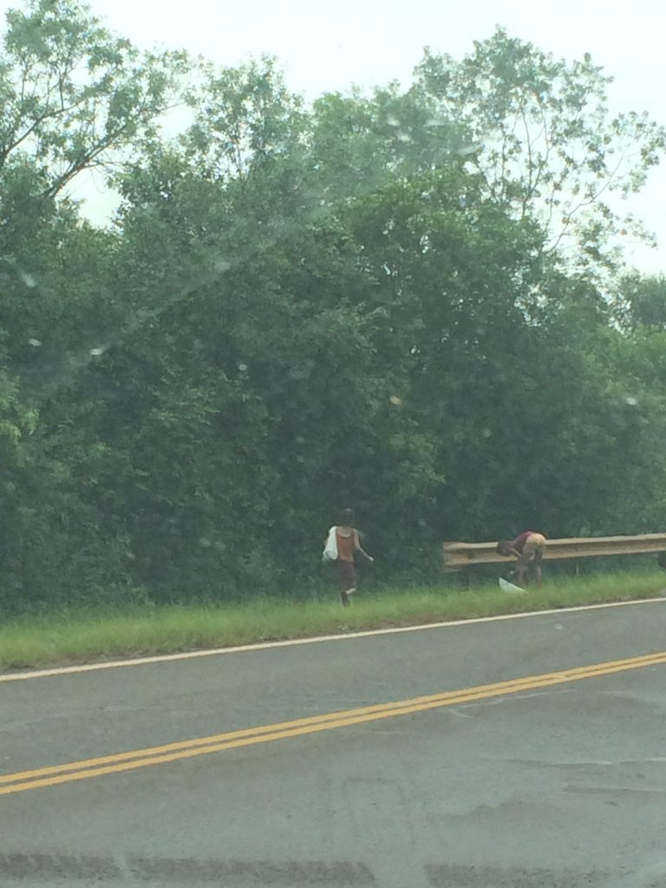

Não sabia, mas por este caminho (foto acima) passamos em regiões indígenas da Argentina.

Neste dia já dormimos no Brasil, Hotel Mirante.

**18º dia: 05/01/2016**

Último dia de viagem.

Viagem: Foz do Iguaçu até Uberlândia-MG

Foi uma excelente viagem que fizemos. Resumi poucas coisas durante a viagem. Recomendo que você instale o aplicativo [MyPush](http://www.mypush.com.br/) e assine o canal Melhores Destinos. Assim você poderá receber via push notification os guias de destino de diversas cidades ao visitá-las.

Conteúdo original também pode ser acessado: <http://www.mundociencia.com.br/leoreis/viagem-de-carro-pela-america-do-sul-brasil-uruguai-argentina-e-chile/>
