# Pensando em uma Road Trip para Argentina? Já fomos até Bariloche, e a paisagem é fantástica! 44

---

Há um tempo atrás fomos de carro até Bariloche, saindo de São Paulo – a viagem contemplou Brasil, Uruguai, Argentina e Chile, mas hoje falo aqui de um trecho em específico que é o caminho percorrido  para chegar até Bariloche.

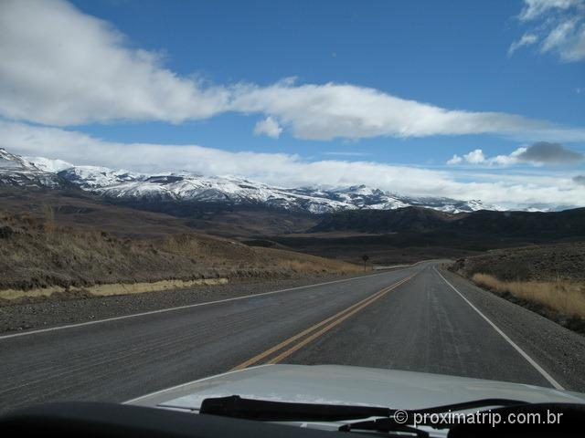

Saiba que para ir até a cidade de carro (não precisa ser carro grande não!), você só precisa de um bom tempo de férias, espírito de aventura e planejamento. É um roteiro para seguir sem pressa – para você ter um exemplo, saímos de São Paulo (capital) e chegamos em 6 dias em Bariloche, pernoitando em Florianópolis, Pelotas, Punta del Este, Buenos Aires, Trenque Lauquen e General Roca.

Mas você pode esticar em uma dessas cidades, com tantas atrações interessantes, ou de repente escolher outras cidades para pernoitar.

O caminho não oferece nenhuma dificuldade – as estradas argentinas estão em boas condições, o duro mesmo são as estradas brasileiras …mas os motoristas…jesus amado…a competição não é só no futebol não, argentinos e brasileiros também competem quando o assunto é direção perigosa e imprudente – e está difícil de saber quem são os piores motoristas!

Vou mostrar umas fotos para ver se vocês se animam com essa aventura!

Estrada em Colônia del Sacramento – Uruguai

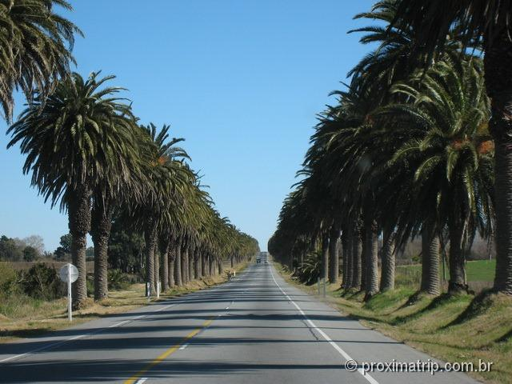

a pequena cidade argentina de Trenque Lauquen

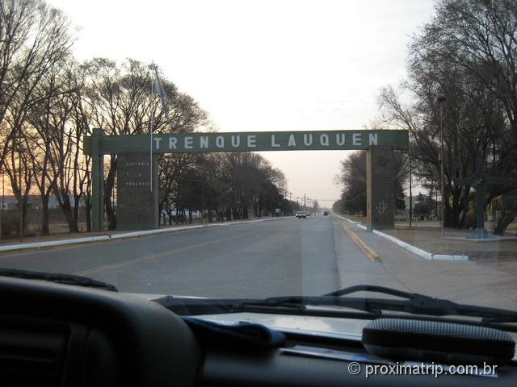

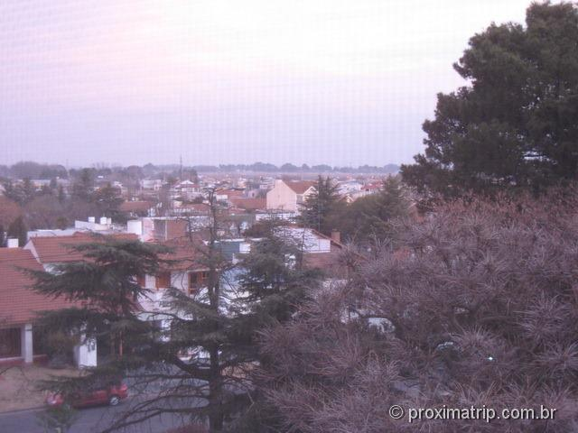

paisagens da Argentina, a região muda… o clima e a paisagem também…

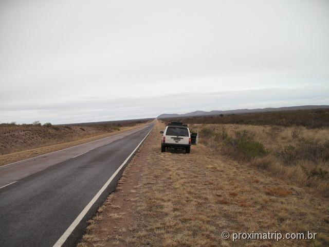

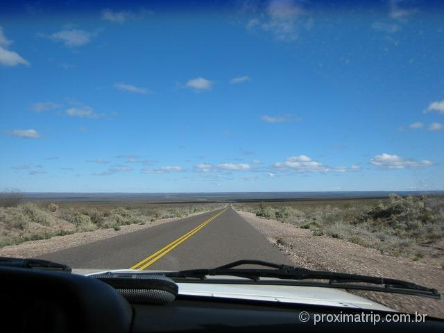

a simpática cidade argentina General Roca – nessa cidade pagamos um pequeno mico: foi aqui que descobri que na Argentina *soda* é água com gás, e não o refrigerante! 

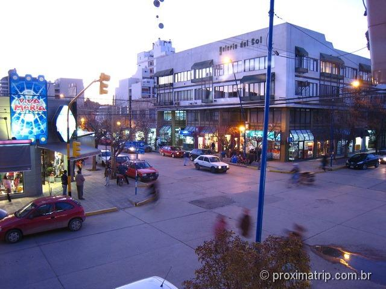

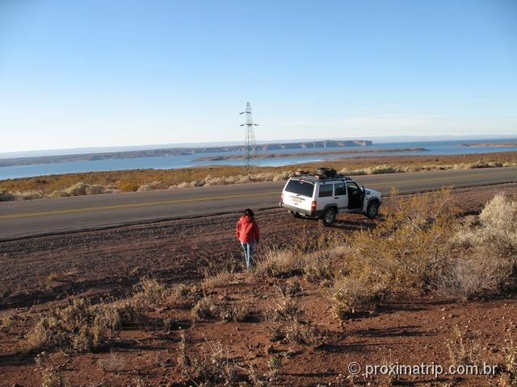

pela placa a curva é feia hein!?

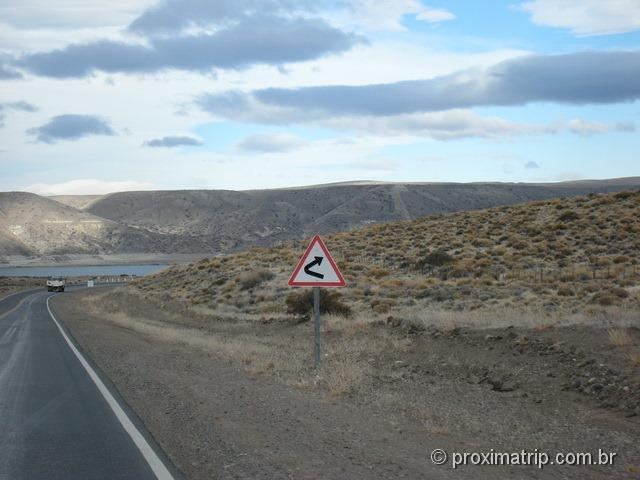

só mais 249 km…

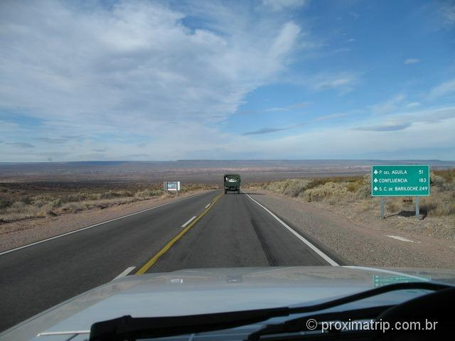

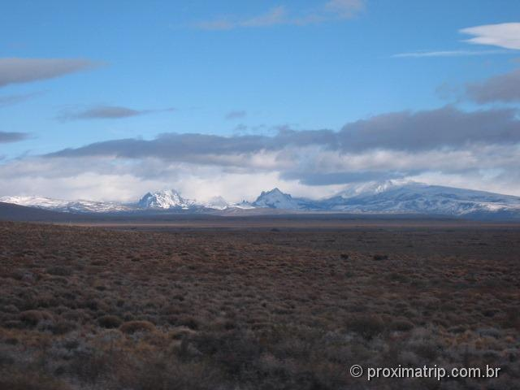

oh my god!

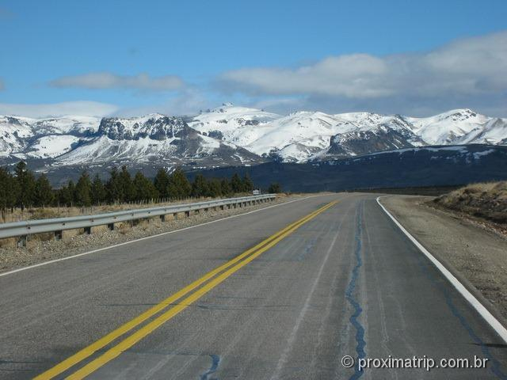

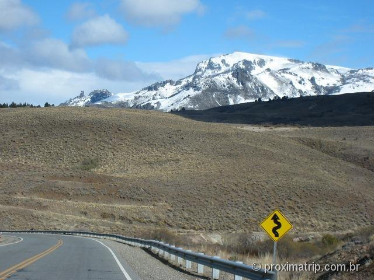

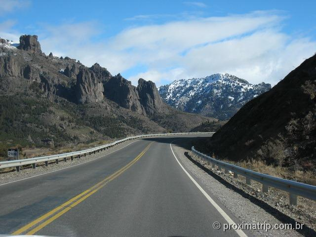

Bariloche e o lago Nahuel Huapi…

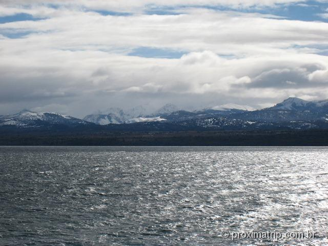

E você, vai para Bariloche? Para procurar os melhores preços de hotéis e reservar, pesquise em nosso parceiro, Booking.com:

Até a próxima trip!
