# Viagem de carro de Curitiba para Argentina e Uruguai

19 de agosto de 2011

Rafael

[Comentários (64)](http://www.rafaelfelipesantos.com.br/viagem-saindo-de-curitiba-para-argentina-e-uruguai-de-carro/#idc-container)

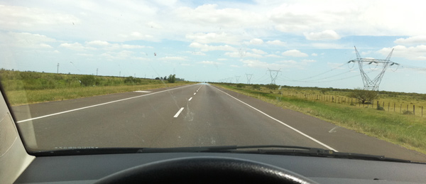

Rodovia RA-14 sentido Buenos Aires - Argentina

Segue abaixo relato da viagem de três amigos que partiram de carro em Curitiba com destino a Buenos Aires-AR e Montevideo-UR. Agradecimentos aos meus companheiros [Luiz Gustavo Arthury](http://www.facebook.com/luiz.arthury "Facebook ") e [William Rosa](http://www.facebook.com/wcroza "Facebook") que toparam a aventura de 13 dias e 4 mil km.

[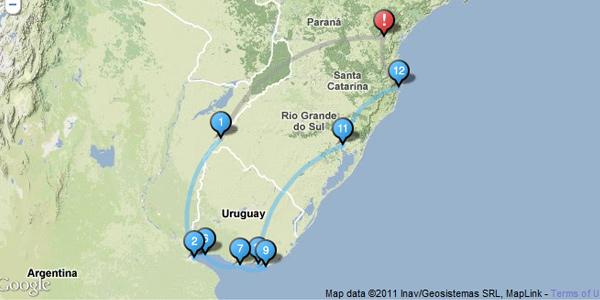](http://www.kukunu.com/trip/1269-virada-de-ano-em-buenos-aires.html)

## 1° dia – Curitiba-PR até Uruguaiana-RS

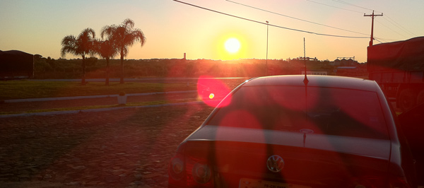

Saímos de Curitiba-PR às 06h, pegamos a BR116 e fomos até Erechim-RS, almoçamos, seguimos até Passo Fundo e durmimos em Uruguaiana-RS (fronteira com Argentina). Total 1200km e 14h de viagem, ainda era dia quando chegamos. Durmimos no [Hotel Mainardi](http://www.mainardihotel.com.br/ "Hotel Mainardi"), é barato, tem estacionamento e o café da manhã é bom, recomendo.

## 2° dia – Atravessando a fronteira de Uruguiana-RS de carro

Acordamos cedo, atravessamos a ponte da fronteira, estacionamos o carro, fizemos documentação de imigração (demora 1h mais ou menos) e seguimos sentindo Buenos Aires (+600km). A partir dae o litro de NAFTA (Gasolina ARG) vai custar R$2,10 e os postos são vagabundos, abasteça nos [YPF](http://www.ypf.com/ar_es/ "Posto YPF") que são bem parecidos com os nossos Ipirangas, de qualidade. A estrada é maravilhosa, tem GUARDEMERIA (Policia Rodoviária ARG) a cada 50km, geralmente embaixo de viadutos, mas eles não tem radar, é tranquilo. O mais tezão foi parar num desses postos, mandar o primeiro espanhol e tomar a primeira QUILMES. Uouu! sabor sem igual.

## 3°/4°/5° dias – Curtindo Buenos Aires-AR

[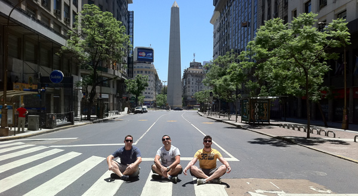](http://www.google.com.br/search?sourceid=chrome&ie=UTF-8&q=obelisco+argentina)

  
Buenos Aires é gigante, fique na região de São Telmo que é onde as coisas acontecem, é perto de tudo e 95% dos Hostels ficam por ae. Ficamo no [Hostel INN](http://www.hostel-inn.com/?idioma=2&seccion=hostels&id1=7&le2=0&id2=0&le3=0&id3=0&le4=0&id4=0 "Hostel INN Buenos Aires"), é muito bom e barato e bem localizado, custa uns R$25 por pessoa por dia. A vantagem é que tem um estacionamento 24h na esquina a R$10 reais o dia.

Ae Buenos Aires é toda sua, vale a pena sair de taxi para lugares mais complicados tipo Boca Juniors. Porto Madero é lindo de noite, comam no restaurante [Siga La VACA](http://www.sigalavaca.com/index.php?sec=locales&lng=es "Siga La Vaca"), (R$40), ganha garrafa de vinho e sobremesa. Churrizo Argentino é um tipo de filé/picanha, diferente do brasileiro que é linguiça de sangue/suina. A feira de Recoleta é muito bacana e o trâsnisto em Buenos Aires é um tezão, não tem regras, da pra fazer o que quizer! hahauha

[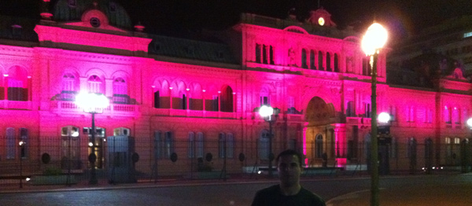](http://www.google.com.br/search?sourceid=chrome&ie=UTF-8&q=obelisco+argentina#sclient=psy&hl=pt-BR&source=hp&q=casa+rosada&pbx=1&oq=casa+rosada&aq=f&aqi=&aql=&gs_sm=s&gs_upl=89469l90610l0l94423l11l9l0l0l0l0l334l2079l0.2.6.1l9l0&bav=on.2,or.r_gc.r_pw.&fp=f9a0dd055d909153&biw=1024&bih=667)

Casa Rosada com iluminação noturna em Beunos Aires-AR

Tem um hostel chamado [Cale Florida](http://www.hostelsuitesflorida.com/ "Florida") (Rua Florida) em Buenos aires que também é bom, dizem é mais arrumadinho.

## 6° dia – Atravessando de Buquebus de Buenos Aires para Colonia-UR

[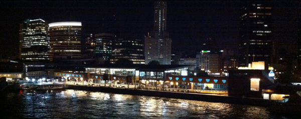](http://www.google.com.br/webhp?hl=pt-BR#hl=pt-BR&cp=9&gs_id=u&xhr=t&q=puerto+madero&pf=p&sclient=psy&site=webhp&source=hp&pbx=1&oq=puerto+ma&aq=0&aqi=g5&aql=&gs_sm=&gs_upl=&bav=on.2,or.r_gc.r_pw.&fp=f9a0dd055d909153&biw=1024&bih=667)

Vista de dentro do Buquebus de Puerto Madeiro em Buenos Aires-AR

Compramos passagens no navio BUQUEBUS daqui de Curitiba, tem que comprar para carro aé 1200kg, tem uns esquemas de navios q não levam carros. Chegue 1h30 ou 2h antes no porto, tem que fazer imigração novamente, check-in. No final das contas não paramos em Colonia e tocamos direto para Montevideo.

## 7°/8° dias – Curtindo Montevideo-Uruguay

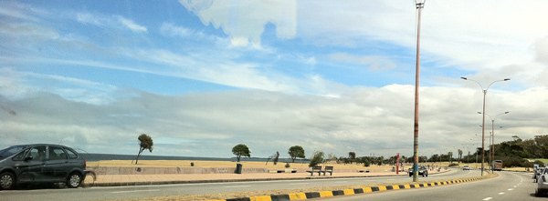

Orla da praia em Montevideo-UR

Uruguay é uma Buenos Aires menor, é mais simples mas tem seus encantos. Ficamos no Che Lagarto, é muiiiito bem localizado, mas é meio roots, ficou meio sujo no último dia. Montevideo tem mais maloqueiros e mendigos na rua, os estacionamentos são caros, mas cuide do carro. Tome uma uvita no Bar [FUN FUN](http://www.barfunfun.com/ "Bar Fun Fun"), é um tipo de Jurupinga.

Bar Fun Fun em Montevideo-UR

Já tava esquecedo de uma coisa, em Montevideo o Pôr do Sol é às 21h! Maravilha!

Pôr do sol em Montevideono Uruguay

## 9°/10°11° dias – Piriapolis-UR e reveillon em Punta del Leste-UR

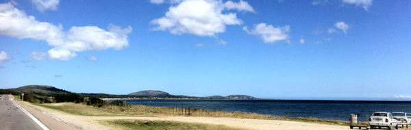

Como era Reveillon, hostel em Punta estava muito caro, dormiamos em Piriapolis (35km), mas adoramos a cidade. Recomendo passar um dia lá e se tiverem condições $ sigam para durmir em Punta mesmo, sem voltar. Em Piriapolis tivemos sem dúvidas as melhores paisangens da viagem.

Vista do mar em Piriapolis-UR

Punta é maravilhosa, tem muitos bares e baladinhas perto das praias, da pra se divertir e comer barato no centro mesmo. Lá não tem perigo, cidade bacana, policia apaisana, tranquilidade.

## 12° dia – Free Shopp e Porto Alegre-RS

Voltamos pelo litoral, conhecemos uns lugares maravilhoso como PUNTA DEL DIABLO e paramos FREE SHOP na divisa.

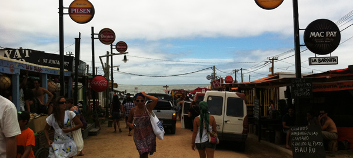

A Cota é $300 DÓLARES cada um, da pra se acabar em bebidas e perfumes. Quero 4 Jack Daniels por 150 reais ok? Absolut de Vanila também. Durmimos em um hostel PORTO DO SOL, é bom, limpo e barato também.

## 13° dia – Florianópolis-SC até Curitiba-PR

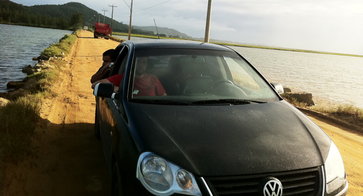

Ae ficou tudo triste, não quero mais falar sobre isso.

## Dicas – Quanto dinheiro levar para Argentina e Uruguai?

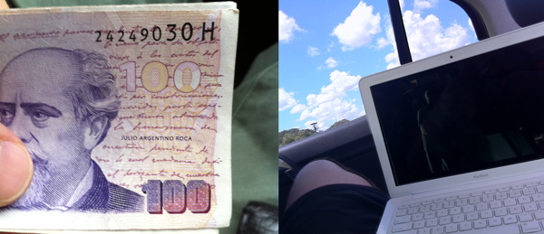

Leve um pouco de cada moeda, 200 pesos argentinos, 200 uruguaios e 150 dólares cada um. Mas é tranquilo, tem casas de cãmbio em todo lugar, cartão de crédito passa para compra, mercados, gasolina. Além disso muito lugares uruguaios aceitam até em reais.

## Dicas – O cassino de Puerto Madero em Buenos Aires – AR

Cassino em Buenos Aires, entrada grátis, da pra gastar 10 dólares e sair milionário.

## Dicas – Cuidados com o carro em viagem para Argentina e Uruguai

Cuidado ao estacionar em vagas temporárias e talz, eles guincham mesmo, nos encrencamos com um guincheiro um dia. Tem dois trechos que é perigoso ficar sem gasolina, de Passo Fundo até Uruguaiana, e da fronteira no CHUI até Porto Alegre. Mantenha o tanque cheio se possível.

## Kit para o carro na viagem

Na Argentina é exigido 2 triângulos, kit médico, cambão e CARTA VERDE (seguro internacional, custa 100 reais e pode ser feito através desse email magnaseguros@magnaseguros.com.br

## Precisa de GPS para ir pra Argentina?

Não levamos, nos perdemo na entrada de Buenos Aires. Se tiverem pra levar pode ajudar em alguns momentos, mas não tem segredo. Coloquei abaixo nossa rota e itinerário de cidades.

[Exibir mapa ampliado](http://maps.google.com.br/maps?f=d&source=embed&saddr=Curitiba+-+Paran%C3%A1&daddr=-28.2697,-52.67402+to:Uruguaiana+-+Rio+Grande+do+Sul+to:Buenos+Aires,+Capital+Federal,+Argentina&hl=pt-BR&geocode=FXz-e_4dXCYQ_SnxDwn89ePclDFHtysJsIN6PA%3BFXyjUP4dHELc_CkLblhlmsvilDF_DMMaZUcGKw%3BFQMPOv4dMOeY_CnHeRJnPltTlDGokVES19rETw%3BFd7q7_0d10uF_Cm9DPlOO8q8lTGHjuiILoGzoA&mra=dvme&mrsp=1&sz=6&via=1&sll=-29.573457,-51.811523&sspn=13.338713,18.632813&vpsrc=6&ie=UTF8&ll=-29.573457,-51.811523&spn=13.338713,18.632813&t=h)

## Compre Quilmes no Carrefour!

Carrefour salvam vidas, se você tiver um isopor, compre HIELOS e muitas QUILMES todo dia.

## Identidade x Passaporte X Carteira de Habilitação

**SÓ É PRECISO IDENTIDADES PARA ENTRAR NA ARGENTINA E URUGUAI (janeiro 2011).** Elas devem estar em boas condições (eles dizem 10 anos no máximo), mas se a foto tiver boa tá tranquilo.

## Habilitar celular para ligações internacionais

Liguem nas suas operados e peça desbloqueio internacional, é de graça mas o telefonema de lá custa $4 dólares e cada mensagem $1 dólar. O MB de internet também é caro, então vale a pena usar internet nos hostels.

## Desbloquear o cartão de crédito internacional

Também liguem e peçam desbloqueio internacional. É bom usar no exterior, vocês ganham milhas e ainda pagam 2 meses depois as compras. A taxa de câmbio do cartão é melhor do que as casas de câmbio, então vale mais a pena usar cartão do que trocar dinheiro na rua, ok?

## Duas pessoas ou quatro no carro?

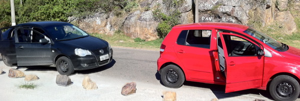

Fomos em 3, no banco de trás sempre podiamos durmir e descansar. A vantagem é que rodavamos grande trechos sem preocupação. Em 2, se a patroa não dirije, vai ficar meio pesado todo esse trecho. Em 4 reduziria bastante os custos com gasolina e seria legal para dividir a boléria (4mil km é pesado), mas dae eu economizaria nas bagagens que forem levar (É SÉRIO) pois querendo ou não vocês vão trazer bastante coisa pra cá. Vale a pena levar roupas na lavanderia em Montevideo por exemplo (1/2) da viagem.

## Quanto gasta para ir de carro até Argentina e Uruguai?

Somando 7 caixas de bebidas que trouxemos de lá, gastamos em 13 dias R$2100 cada um (janeiro 2011).

## Lista de hostels em Buenos Aires, Montevideo e Punta del Leste

Gostou do relato? Comenta ae!
