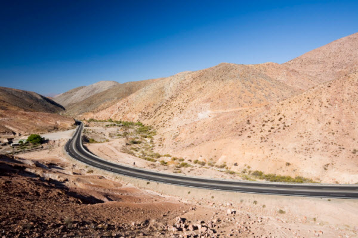
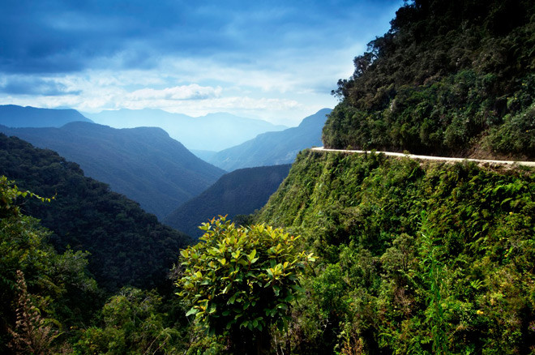
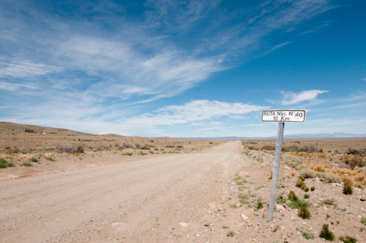
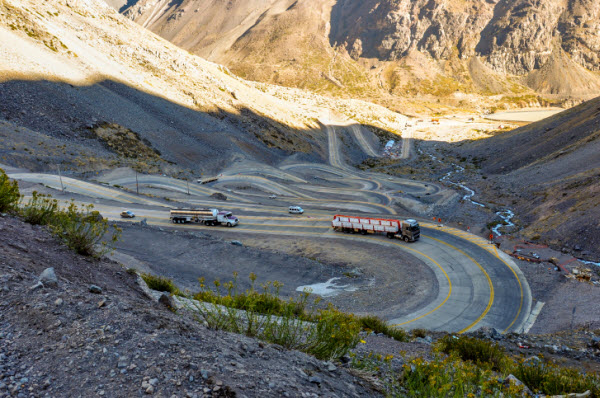
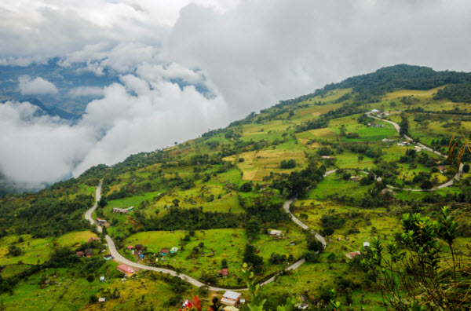
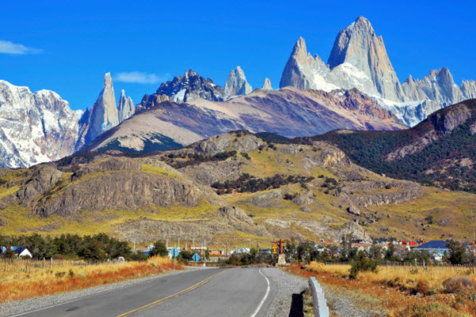
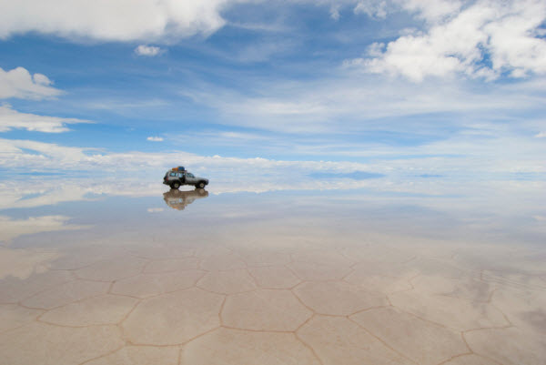

# 7 das mais belas estradas da América do Sul

terça-feira, 18 de agosto de 2015

Share to TumblrTumblrShare to TwitterTwitterShare to Google+Google+

Para você viajar de carro e descobrir lugares incríveis na América do Sul, listamos as mais belas estradas do continente.

## Para os viajantes apaixonados por estrada, selecionamos algumas das mais belas rodovias da América do Sul.

Quem ama viajar de carro está sempre à procura de um novo destino para explorar. E na América do Sul, lugares para descobrir dirigindo não faltam. Prova disso são as estradas que aparecem no post de hoje, que estão entre as melhores do continente, tanto por estarem cercadas por paisagens deslumbrantes, quanto por levarem a destinos ainda mais incríveis. Caso você não tenha um automóvel apto a percorrer esses caminhos, não deixe de viajar por causa disso. [Alugue um carro](http://www.skyscanner.com.br/aluguel-de-carros/?), elabore seu próprio roteiro e prepare-se para experiências únicas. Confira!

**1. Rodovia Pan-Americana – Do Alasca a Argentina**

A maior rodovia do mundo, com mais de 20 mil km de extensão, tem uma ponta no Alasca e outra extremidade na Argentina, mais especificamente no Ushuaia. A estrada passa por 18 países e está dividida em vários trechos. Além disso, apresenta diferentes condições dependendo do trecho – alguns são totalmente asfaltados, enquanto outros exigem melhorias. Outro detalhe importante: no eixo entre a Colômbia e o Panamá, a rodovia é inteiramente interrompida, sendo necessário recorrer a caminhos alternativos para voltar à via principal. Como não é um trajeto uniforme, já que percorre países com situações econômicas variadas, a Pan-Americana é um desafio, até mesmo para os motoristas mais experientes. Em 2006, todo o percurso foi concluído em 34 dias, em um recorde do motorista de longas distâncias Kevin Sanders.

**→ Veja também: [8 estradas para uma road trip inesquecível](http://www.skyscanner.com.br/noticias/8-belas-estradas-para-uma-inesquecivel-road-trip).**

**2. Camino a los Yungas – Bolívia**

/147025/camino-a-los-yungas "Foto: Viajar El Periodico ")

Conhecido como a estrada mais perigosa do mundo (ou o caminho da morte), o Caminho a Yungas já é uma atração turística da Bolívia. Com 64 km de extensão, a estrada tem apenas 3 metros de largura e percorre o alto de uma montanha com mais de 4 mil metros de altitude. O caminho, hoje, atrai principalmente ciclistas e motociclistas, já que dirigir pela via estreita continua sendo muito arriscado.

**[Passagens para Bolívia](http://www.skyscanner.com.br/passagens-aereas-para/bo/passagens-aereas-promocionais-para-bolivia.html)**

**3. Ruta 40 – Argentina**

Uma das rodovias mais famosas da Argentina, a Rota 40 percorre a Cordilheira dos Andes e atravessa o território argentino, de norte a sul, até chegar à Bolívia. Ao longo dos seus 5 mil km de extensão, a estrada passa por 20 parques nacionais, 18 importantes rios, conecta 27 passos de montanha na cordilheira e cruza 11 províncias. Através dela é possível chegar a lugares como El Calafete e Bariloche e, por isso, motoristas de todos os lugares do mundo a incluem como parte da rota durante sua excursão para explorar as maravilhas argentinas.

**[Passagens para Argentina](http://www.skyscanner.com.br/passagens-aereas-para/ar/passagens-aereas-promocionais-para-argentina.html)**

**4. Los Caracoles – Chile a Argentina**

Famosa pelas curvas fechadas, a estrada “Los Caracoles” liga Santiago, no Chile, à cidade de Mendoza, na Argentina. Também conhecido como o Caminho das 365 Curvas, este trecho faz parte da Rota 60 e desafia a motoristas, já que é preciso diminuir a velocidade para vencer suas curvas. No inverno, o desafio fica ainda maior por causa da neve. Nesta época do ano, os viajantes devem redobrar os cuidados e recorrer a itens obrigatórios para viajar de carro pelo Chile – como as correntes indicadas para dirigir sobre o gelo.

**→** **Veja também: [As mais belas estradas do Brasil](http://www.skyscanner.com.br/noticias/mais-belas-estradas-do-brasil).**

**5. Eixo Cafeeiro – Colômbia**

Não é uma estrada em si, mas uma rota. O Eixo Cafeeiro é uma importante região turística da Colômbia e pode facilmente ser escolhido como destino por motoristas que gostam de dirigir cercados por belas paisagens. Os caminhos percorrem três estados colombianos, que formam o também chamado Triângulo do Café. Muitas das fazendas foram transformadas em hotéis, detalhe que atrai um número ainda maior de visitantes.

**[Passagens para Colômbia](http://www.skyscanner.com.br/passagens-aereas-para/co/passagens-aereas-promocionais-para-colombia.html)**

**6. Carretera Austral – Chile**

A Carretera Austral, oficialmente nomeada Rota CH-7, é o orgulho da engenharia chilena. Isso porque liga a Região dos Lagos, onde os cenários são mais que encantadores, à parte mais longínqua da patagônia chilena. Com pouco mais de mil km de extensão, já foi percorrida por motoristas de diferentes lugares do mundo e continua desafiando os viajantes apaixonados por automobilismo.

**[Passagens para Chile](http://www.skyscanner.com.br/passagens-aereas-para/cl/passagens-aereas-promocionais-para-chile.html)**

**7. Salar de Uyuni – Bolívia**

O maior deserto de sal do mundo não é uma estrada, mas, mesmo assim, é indicada como uma das mais belas da América do Sul, por motoristas experientes, que podem, inclusive, dirigir de olhos fechados pelo caminho plano e extremamente macio. Como se perde no horizonte e no infinito, o Salar de Uyuni é uma recompensa para os motoristas que dirigiram horas a fio, enfrentando o trânsito para chegar até Uyuni.

**→ Veja também: [13 estradas incríveis para viajar de carro na Europa](http://www.skyscanner.com.br/noticias/13-estradas-incriveis-para-viajar-de-carro-na-europa).**

Quer dirigir por algumas destas estradas? Confira os nosso guias para dirigir no exterior.

#### Gostou deste artigo?

Assine nossa newsletter e receba as melhores ofertas, dicas e inspirações de viagem.

[

### 🚨 Viajando para os EUA? Fique por dentro das novas medidas de segurança

Entenda as novas normas para viajar aos EUA e descubra o significado do "temido" SSSS no seu bilhete ...

Ler mais](https://www.skyscanner.com.br/noticias/dicas/novas-medidas-de-seguranca-para-quem-vai-viajar-para-os-estados-unidos/)
[

### Ofertas para os EUA: Nova York a partir de R$ 1.812!

Voos para os Estados Unidos com até 35% de desconto: Nova York, Miami, Washington e outros destinos, ...

Ler mais](https://www.skyscanner.com.br/noticias/ofertas/passagens-aereas-promocionais-para-os-estados-unidos/)
[

### Destinos para passar o Natal com neve

Quer passar o Natal curtindo paisagens com neve? Veja 10 destinos perfeitos para uma viagem nessa ép ...

Ler mais](https://www.skyscanner.com.br/noticias/6-destinos-para-passar-natal-com-neve)
[

### Paris a partir de R$ 2.216, corra e aproveite!

Aproveite o desconto de 30% nos voos para Paris, saindo de São Paulo! Confira outros voos promociona ...

Ler mais](https://www.skyscanner.com.br/noticias/ofertas/passagens-aereas-promocionais-para-a-europa/)

Ida e voltaSó idaVárias cidades

[Mapa](https://www.skyscanner.com.br/inspire/map?outboundDate=2017-11-20&outboundPlace=BR&preferDirects=false)

Apenas voos sem conexão
