# Saiba quais são as 10 cidades mais preparadas para o futuro

Ser uma “cidade inteligente” exige muitas iniciativas, inclusive sustentáveis.

24 de novembro de 2017 • Atualizado às 09 : 47

Foto: [iStock by Getty Images](http://www.istockphoto.com/)

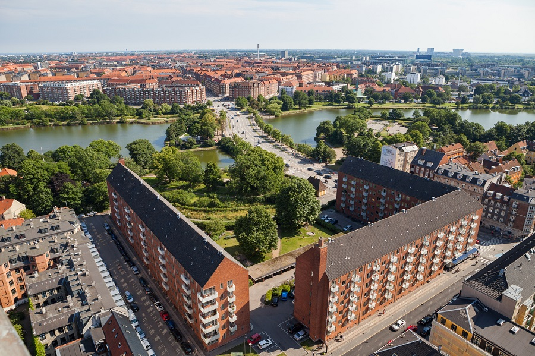

[vendo agora](http://ciclovivo.com.br/noticia/saiba-quais-sao-as-10-cidades-mais-preparadas-para-o-futuro/ "Saiba quais são as 10 cidades mais preparadas para o futuro")

Há um tempo atrás, as chamadas “cidades inteligentes” tinham em seu conceito a necessidade de uma série de inovações, mas não necessariamente ecológicas. Com as mudanças climáticas mais evidentes do que nunca, pensar no desenvolvimento sustentável tornou-se essencial para qualquer gestão que se disponha a pensar no futuro. Tendo em mente esse ponto, a startup EasyPark Group lançou o “Índice de cidades inteligentes de 2017”.

O CicloVivo já falou algumas vezes das cidades com mais qualidade de vida do mundo e dos destinos “eticamente corretos” e agora traz esse importante ranking que destaca 10 entre 500 cidades analisadas ao redor do mundo, confira abaixo:

**10 – Melbourne, Austrália**

[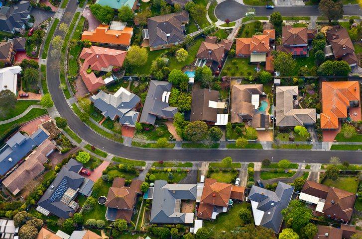](http://cdn.ciclovivo.com.br/wp-content/uploads/2017/11/iStock-627804968.jpg)

Foto: iStock by Getty Images

Recebeu uma pontuação perfeita em sua conectividade 4G. Em todo o país, a Austrália possui uma velocidade de download de internet móvel de 47,49 mbps, que foi calculada com base em milhões de testes realizados em outubro de 2017.

**9 – Genebra, Suíça**

[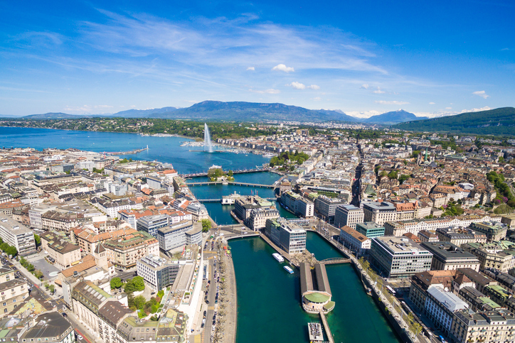](http://cdn.ciclovivo.com.br/wp-content/uploads/2017/11/iStock-530487878.jpg)

Foto: iStock by Getty Images

Priorizou a infra-estrutura eficiente energeticamente em seus edifícios e transporte público. Até 2020, a cidade planeja reduzir suas emissões de dióxido de carbono 21% abaixo dos níveis de 2005.

**8 – Amesterdam, Países Baixos**

[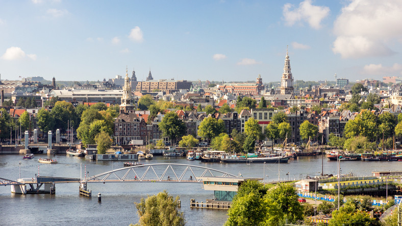](http://cdn.ciclovivo.com.br/wp-content/uploads/2017/11/iStock-476269082.jpg)

Foto: iStock by Getty Images

Tem comunidades de arranque bem estabelecidas, juntamente com programas bem sucedidos de incubadoras como StartupDelta e StartupAmsterdam.

**7- San Francisco, Califórnia**

[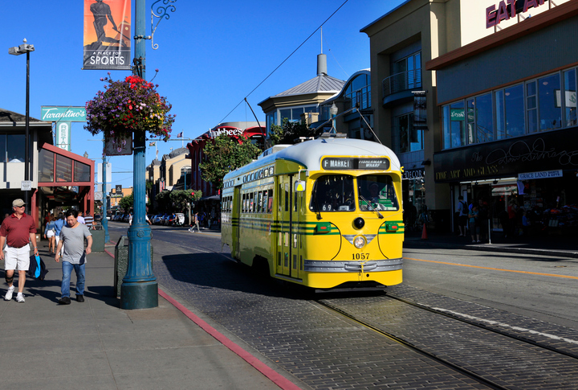](http://cdn.ciclovivo.com.br/wp-content/uploads/2017/11/iStock-697523384.jpg)

Foto: iStock by Getty Images

Também tem um alto número de startups.

**6 – Tóquio, Japão**

[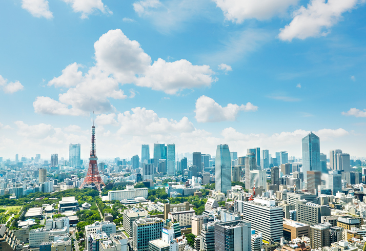](http://cdn.ciclovivo.com.br/wp-content/uploads/2017/11/iStock-695445424.jpg)

Foto: iStock by Getty Images

Por seu sistema ferroviário com mais de 100 linhas de trem e 14 bilhões de passageiros por ano.

**5 – Boston, Massachusetts**

[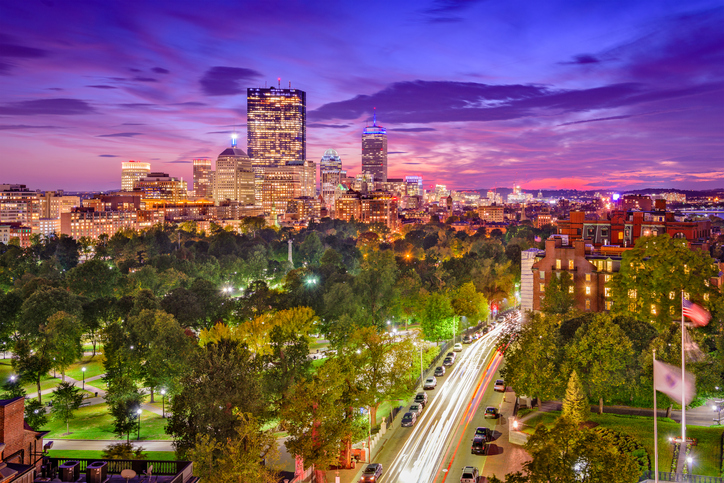](http://cdn.ciclovivo.com.br/wp-content/uploads/2017/11/iStock-636099298.jpg)

Foto: iStock by Getty Images

Por sua área metropolitana em torno de várias faculdades, incluindo MIT e Harvard, que lideram o ranking mundial de universidades.

**4 – Zurique, Suíça**

[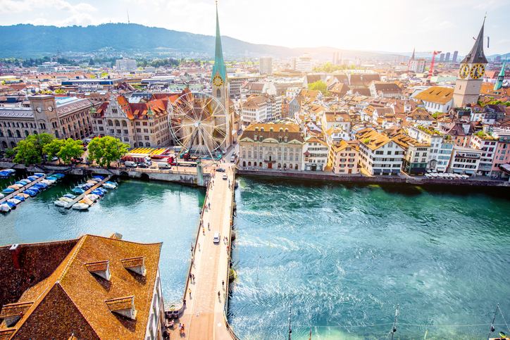](http://cdn.ciclovivo.com.br/wp-content/uploads/2017/11/iStock-615269908.jpg)

Foto: iStock by Getty Images

Por seu plano urbano que inclui uma alta porcentagem de espaço verde.

**3 – Estocolmo, na Suécia**

[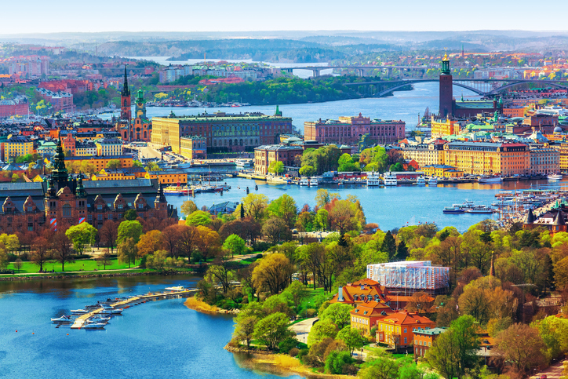](http://cdn.ciclovivo.com.br/wp-content/uploads/2017/11/iStock-491683869.jpg)

Foto: iStock by Getty Images

Uma grande parte dos ônibus e trens da cidade usam combustíveis limpos. As fontes de energia renováveis representam 52% da produção de energia sueca.

**2 – Cingapura**

[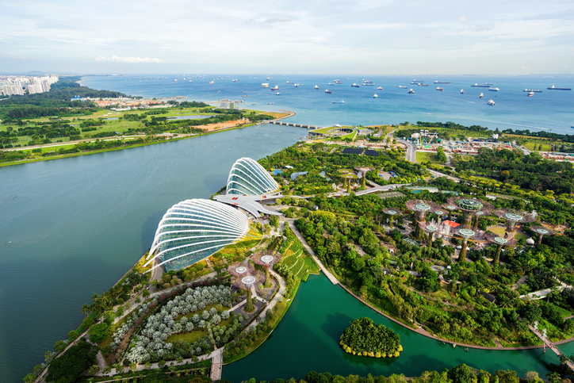](http://cdn.ciclovivo.com.br/wp-content/uploads/2017/11/iStock-638278870.jpg)

Foto: iStock by Getty Images

Possui uma das redes de transporte público mais econômicas do mundo, de acordo com um estudo da Siemens de 2014.

**1 – Copenhague, Dinamarca**

[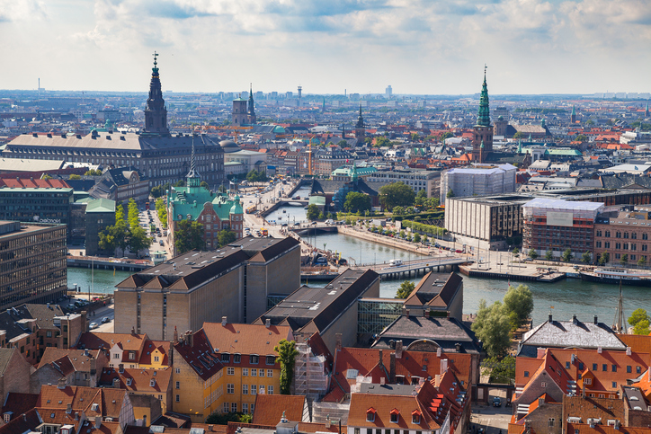](http://cdn.ciclovivo.com.br/wp-content/uploads/2017/11/iStock-675695310.jpg)

Foto: iStock by Getty Images

Possui um ecossistema saudável, já com um grande número de pontos focais Wifi e uma quantidade relativamente baixa de congestionamento de trânsito. A cidade também está investindo em energia limpa, com o objetivo de ser 100% neutro em carbono até 2025.
