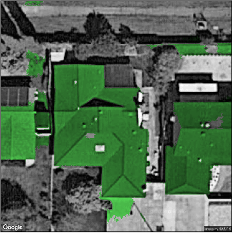

# Are you making frivolous decisions? Welcome to the Blowhard Jamboree

### The Blowhard Jamboree anti-pattern

Let’s say you’re the solution architect for a company in the solar industry. Your organization has developed an app that allows users to quickly design a solar panel installation and draw it on the roof of any house. You sit down with Steve, your CTO, and bring him up to speed by demoing the latest version. But he seems a bit distracted.

*“I’ve decided we’re going to use AI to automatically place the panels.”*, Steve says, interrupting your demo. *“We will train the system with satellite pictures and have it place each solar panel correctly on every house. Can you imagine what this will do to the industry?”*

This idea comes totally out of left field, and you’re at a loss for words. Steve continues:

*“Oh, and we should build an ARKit app for the iPhone, so our customers can see what the installation will look like on their roof. That should take care of all of those ‘how’s it gonna look’ questions, eh? Our sales conversion rate will triple!”*

Before you can say anything, Steve gets out of his chair.

*“Put the full team on this. Let’s try to build a proof of concept asap, so I can show it to the board.”*

As Steve leaves, you blink and wonder what just happened.

Well, congratulations, you’ve just encountered the **Blowhard Jamboree** anti-pattern.

### What are the symptoms of a Blowhard Jamboree?

When a patient walks into a hospital with a fever, aching joints, and a red skin rash, a good doctor will immediately recognize these symptoms and realize that a chickenpox infection is likely.

Being a tech leader is no different. Technical organizations can also get sick from afflictions like anti-patterns. Each pattern comes with its own unique list of symptoms. A good leader will recognize these symptoms, quickly identify the anti-pattern, and start working on a cure.

Here are all the symptoms from the meeting that point to Blowhard Jamboree:

First of all, notice which technologies Steve is promoting: Artificial Intelligence and Augmented Reality. These are **sexy new technologies** that have received a lot of coverage on social media and the industry press. All the media pundits are enthusiastically talking about AI and AR, and this has probably convinced Steve to adopt these technologies.

But this is a risky move because **these technologies are not mature**. There are no industry best practices for AI yet, and the only way to discover if a problem can be solved with Machine Learning is to actually try it and see if it works.

The ARKit library is only a few months old. There is no documentation yet on what the library can and cannot render, and there’s no guarantee it can reliably display a solar installation on the roof of a house.

And did you notice the **frivolous use of resources?** Steve is asking the architect to mobilize the entire team to develop a proof of concept. This will take resources away from the current app development, slow the project down, and create all kinds of scheduling problems down the line. If these new technologies fail to deliver, Steve is left with nothing.

The increased pressure on the dev team and the use of immature technologies make it very likely that the project will go off the rails due to unforeseen circumstances coming to light during implementation.

What if Machine Learning cannot create useful solar designs because the satellite photos have insufficient detail? Or what if ARKit cannot show a rendered solar installation on a roof because the library has been optimized for flat surfaces? With the regular product delayed and the entire team fighting deficiencies in the new technology, the project is bound to fail.

Here’s an example of an AI attempting to identify a roof from a satellite photo. Note the false positives and missed sections.

So in summary, this anti-pattern is characterized by a tech leader taking big risks with a cool but untested new technology.

### The three root causes of a Blowhard Jamboree

Let’s take a closer look at the root causes of a Blowhard Jamboree. Why would Steve behave like this?

It’s quite likely that Steve is an **insecure tech leader**. He does not have clear ideas on how technology can help the organization realize its vision and goals. Because of this hidden insecurity, he is easily swayed by the latest sexy technology du jour. The daily barrage of industry publications and news sites that paint an optimistic picture of these new technologies further soothes Steve’s insecurity and convince him that he is on the right track.

Steve’s insecurity doesn’t allow him to ask his team for feedback. The dev team might actually have some valuable information about the inviability of AI and AR, but Steve **does not use his team’s knowledge**. He can’t because he will perceive any objections as an attack. So Steve is using his positional power as a shield to hide his insecurity.

And finally, Steve is making lots of **assumptions that remain unchallenged**. Are AI and AR beneficial to the business? Can AI generate a useful solar design? Will the AR app really improve sales conversion? Nobody knows, and nobody is testing these assumptions by doing basic due diligence.

Because Steve is the CTO, there is nobody else in the organization in a position to challenge Steve’s assumptions. The architect is supposed to co-create the technology with the CTO, but Steve has placed himself above the architect to push his ideas through. The project is now going forward with risky unchallenged assumptions, and this is exactly what makes this anti-pattern so dangerous.

### How to fix the Blowhard Jamboree

It’s not hard to fix a Blowhard Jamboree, but Steve is going to have to step out of his comfort zone.

First of all, Steve needs to tackle his insecurity. He does not have clear ideas on how technology can help the organization realize its vision and goals, so the first thing he needs to do is team up with his solution architect and co-create a good technical architecture.

The most important responsibility of a CTO is to lead, not to control, so the next thing Steve needs to do is let go of his desire to be in control all the time. You might think good leadership requires being ‘the man or woman with the plan’, but this isn’t true. Being a leader simply means you are the one making the final decision. You are the person saying: “OK, let’s do this”, regardless of who came up with the plan in the first place.

Introducing a cool new technology into a project is perfectly okay, but Steve needs to allow the team to challenge his assumptions. There is probably a ton of knowledge about AI and AR available with the team, and a good CTO will tap into that knowledge to get the implementation under control. At the very least, he should organize a brainstorm session to identify and mitigate any risks.

This is IT we’re talking about, so even with the best preparation, the implementation could still fail. Steve needs to make sure that his regular design app stays on schedule because If the new technologies fail to deliver, this will be his fallback.

So if you really want to make a splash with a moonshot project, go right ahead. But do make sure you have a clear vision of how this will benefit your organization, ensure that the entire team is on board, allow your team to challenge your assumptions, identify and mitigate as many risks as you can, make sure you have a backup plan, and be fully prepared to back down if the new technologies fail to deliver.

**GET THE FREE ANTI-PATTERN CHEAT SHEET**Learn the symptoms and root causes of all nine patterns, and discover actionable steps on how to resolve them in your organization.

The cheat sheet is a free PDF document that describes the symptoms, causes, and resolution of each anti-pattern in detail.

We promise to not use your email for spam!

Would you like to know more? I’ve created a series of blog posts that look at each anti-pattern in detail. Each post is loosely inspired by actual events that happened during my 20-year IT career.

Take a look:

### [Is conflict wrecking your project? Welcome to The Feud](http://mdfarragher.com/2017/10/02/is-conflict-wrecking-your-project-welcome-to-the-feud/ "Is conflict wrecking your project? Welcome to The Feud")

### [Is your boss making random decisions? Welcome to Irrational Management](http://mdfarragher.com/2017/10/02/is-your-boss-making-random-decisions-welcome-to-irrational-management/ "Is your boss making random decisions? Welcome to Irrational Management")

### [Is your team hoarding knowledge? Welcome to Intellectual Violence](http://mdfarragher.com/2017/09/28/is-your-team-hoarding-knowledge-welcome-to-intellectual-violence/ "Is your team hoarding knowledge? Welcome to Intellectual Violence")

### [Are you making frivolous decisions? Welcome to the Blowhard Jamboree](http://mdfarragher.com/2017/09/14/are-you-making-frivolous-decisions-welcome-to-the-blowhard-jamboree/ "Are you making frivolous decisions? Welcome to the Blowhard Jamboree")

### [Is your team paralyzed? Welcome to Analysis Paralysis](http://mdfarragher.com/2017/09/05/is-your-team-paralyzed-welcome-to-analysis-paralysis/ "Is your team paralyzed? Welcome to Analysis Paralysis")

### [Did you fake your product demo? Welcome to Smoke And Mirrors](http://mdfarragher.com/2017/08/25/did-you-fake-your-product-demo-welcome-to-smoke-and-mirrors/ "Did you fake your product demo? Welcome to Smoke And Mirrors")

### [Is a stakeholder blocking your progress? Welcome to The Corncob](http://mdfarragher.com/2017/08/07/is-a-stakeholder-blocking-your-progress-welcome-to-the-corncob/ "Is a stakeholder blocking your progress? Welcome to The Corncob")

### [Are you killing your product? Welcome to Death By Planning](http://mdfarragher.com/2017/07/25/are-you-killing-your-product-welcome-to-death-by-planning/ "Are you killing your product? Welcome to Death By Planning")

### [Is your team sabotaging itself? Welcome to Fear Of Success](http://mdfarragher.com/2017/07/20/is-your-team-sabotaging-itself-welcome-to-fear-of-success/ "Is your team sabotaging itself? Welcome to Fear Of Success")

---

*Also published on [Medium](https://medium.com/@mdfarragher/d5caf390fae5).*
