# Como viajar mais, passo-a-passo | É hora de falar de dinheiro

Orçamento, tipos de viagem, quais gastos ficar atento e como juntar uma graninha

Ele, o dinheiro, é o vilão número 1 quando o assunto é viajar mais. Ou melhor, a falta dele. A não ser que dinheiro não seja um problema para você, é quase certo que terá que juntar uma poupança e economizar para cair na estrada.

Além disso, dinheiro também é um desafio em outros momentos da viagem. Quanto preciso levar? Como calcular um orçamento de viagem que seja real? E, também importante, como levar a grana comigo?

Perguntas simples, com várias respostas. Este é o segundo texto da série sobre como viajar mais. [No primeiro, falamos sobre questões burocráticas importantes para o turista](https://www.papodehomem.com.br/aprenda-a-viajar-o-mundo-por-um-ano-or-encontro-no-papodehomem), como passaporte, visto, vacinas e a permissão internacional para dirigir. Agora, chegou o momento de falar de dinheiro.

### Passo 1: Defina quanto dinheiro você precisa ter

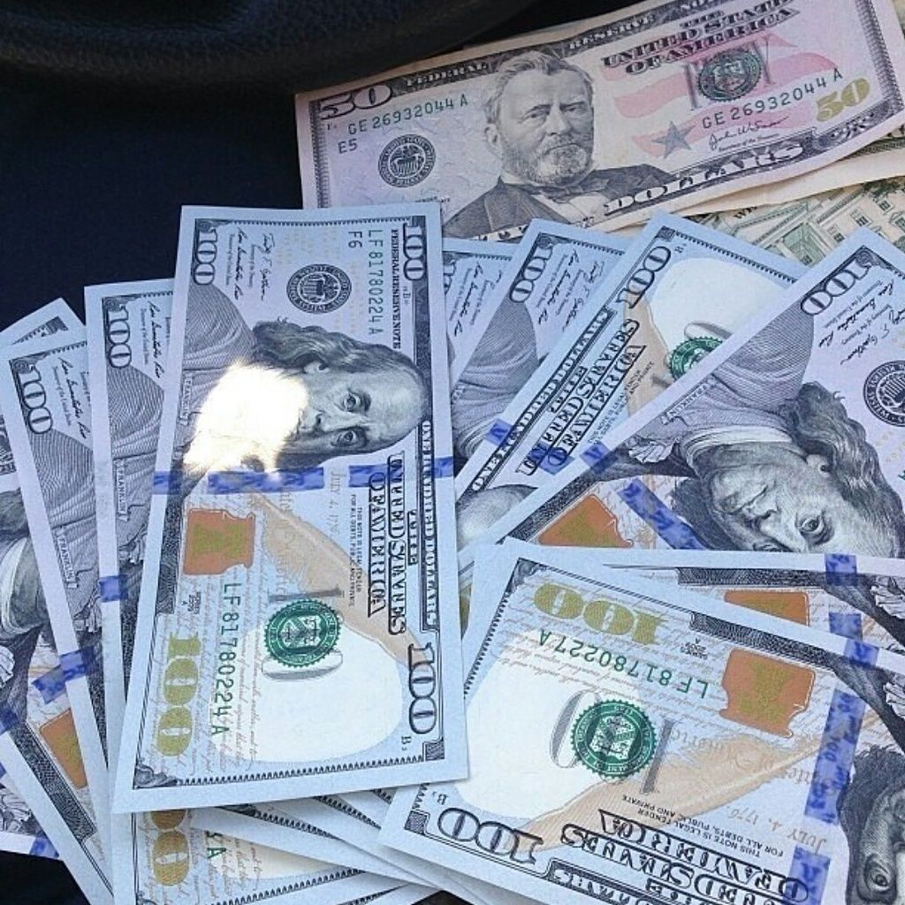

Calcular seu orçamento de viagem é tarefa complicada. Não importa o que digam para você, a sua média de gastos vai depender de uma série de fatores e pode variar bastante. Entre esses fatores, o orçamento depende do seu estilo, gostos e o que você pretende fazer.

Por isso, você não vai encontrar um modelo perfeito de orçamento de viagem na internet. O máximo que você conseguirá é saber quanto outras pessoas gastaram. Se essas pessoas tiverem um estilo e roteiro de viagem parecidos com o seu, sua vida fica um pouco mais fácil.

**Tenha em mente também que há três tipos de gastos**. O primeiro é aquele feito antes de você viajar, normalmente as passagens aéreas e o seguro de viagem, caso você vá para o exterior.

Em segundo lugar vem o orçamento durante a viagem. É desse que vou falar a seguir. Inclui hotéis, comida, bebidas, passeios, tours, enfim, basicamente tudo. É o que você gasta no dia a dia da estrada.

Por fim, lembre-se que, caso você resolva usar o cartão de crédito, terá gastos e dívidas a quitar depois que a viagem chegar ao fim. Deixe um espaço no seu orçamento para esses compromissos.

Na primeira vez que mochilei pela Europa, gastei, em média, 70 euros por dia de viagem (sem contar as passagens aéreas e seguro, ou seja, somente aqueles gastos do orçamento durante a viagem). Dois anos mais tarde, reduzi essa média para 50 euros. Conheço gente que viaja pelo Velho Continente com bem menos que isso e já li relatos de quem viajou pela Europa [gastando um euro por dia](http://m.oglobo.globo.com/estilo/boa-viagem/portugues-viaja-pela-europa-com-apenas-um-euro-por-dia-10769919) ou [sem gastar nada](http://www.janelasabertas.com/2013/11/18/como-viajar-por-tres-meses-pela-europa-sem-dinheiro/).

Por outro lado, tem muita gente que gasta mais que meu orçamento inteiro de viagem apenas com as reservas de hotéis. Nenhum desses orçamentos está errado, são apenas diferentes.

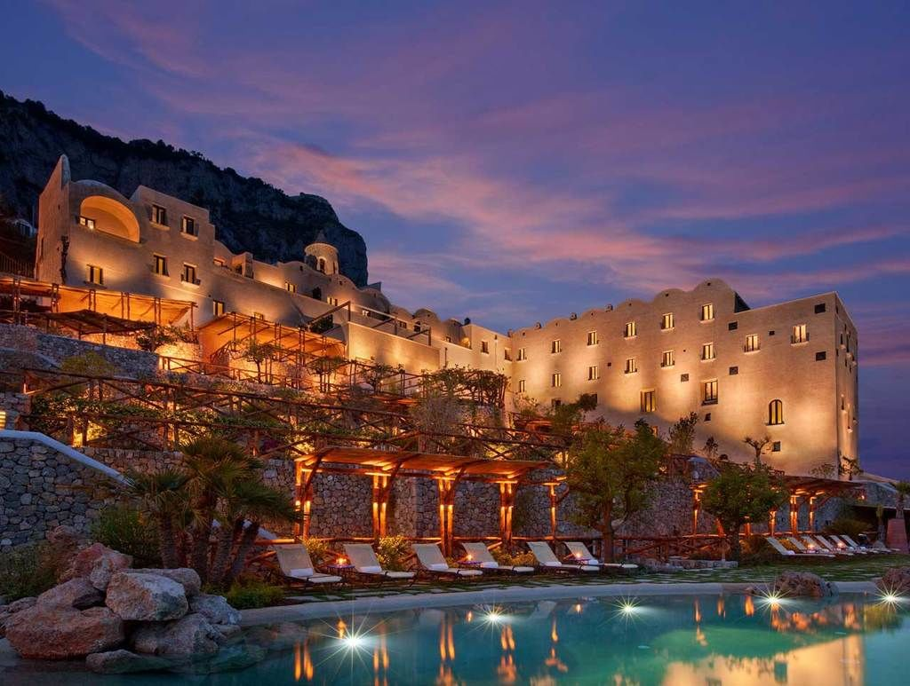

Saber qual tipo de hospedagem se está disposto a pagar é fundamental no orçamento

Mas todos possíveis.

Portanto, seus gastos dependem do tipo de viagem que você pretende fazer e dos lugares que vai visitar. Tente responder às seguintes questões:

**1.** Quais países e cidades você pretende conhecer?

**2.** Você vai viajar sozinho ou terá companhia?

**3.** Topa ficar em dormitórios de hostels ou quer um quarto privativo de hotel?

**4.** Faz questão de comer todos os dias em bons restaurantes ou pretende encarar a comida de rua (e até cozinhar)?

**5.** Tem algum passeio, tour ou atração que seja muito cara? Exemplo: um curso de mergulho.

**6.** Vai fazer compras durante a viagem?

**7.** Vai pagar pela hospedagem ou tem como ficar na casa de alguém, seja num amigo, parente ou uma pessoa que você conheceu no CouchSurfing?

Todas essas questões são importantes.

Se você pretende viajar sozinho, a forma econômica de hospedagem quase sempre é encarar um quarto coletivo de hostel. Se isso é fora de cogitação para você, prepare-se para gastar pelo menos o dobro. Já quem viaja em grupo - famílias ou amigos, por exemplo - pode alugar um quarto maior para todos, mantendo o preço por pessoa no patamar que você encontraria num hostel.

Ok, é complicado bater o martelo e definir o valor da viagem, mas vou deixar abaixo a minha média de gastos em algumas partes do mundo.

Antes de adotá-la, tenha em mente que eu costumo ficar em quartos coletivos de hostels, mas em lugares mais baratos fico num quarto só pra mim, principalmente quando não estou viajando sozinho. Faço questão de ter dinheiro para encarar todos os passeios e atrações que me interessam, mas não encho minhas viagens com bons restaurantes - só de vez em quando.

Bares e cervejas, no entanto, fazem parte do meu roteiro (e orçamento) de forma frequente. Em outras palavras, sou um viajante econômico, mas nem tanto. Você consegue gastar menos que eu (se quiser) e pode acrescentar mais dólares no seu orçamento, caso queira mais conforto.

Quanto gastei, por dia e sem contar passagens aéreas, nos lugares que já visitei:

### Europa: 60 euros

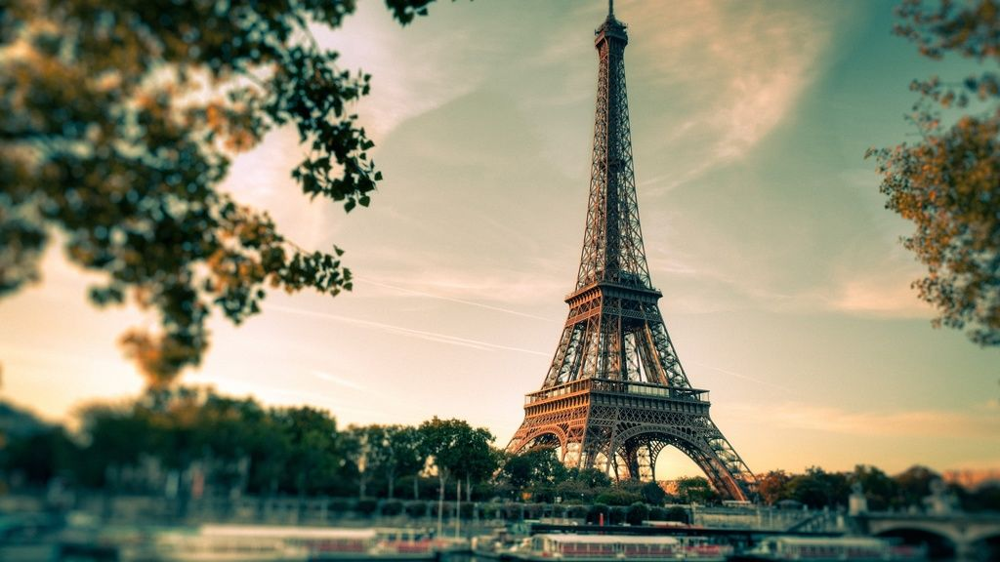

Esse valor sobe em grande capitais como Paris, Londres ou Roma, e também na Escandinávia e na Suíça. No entanto, fica mais barato em cidades menores e em países como Portugal e Espanha ou no Leste Europeu.

[Saiba detalhes sobre quanto custa viajar pela Europa](http://www.360meridianos.com/2014/04/quanto-custa-um-mochilao-pela-europa.html).

### **Sudeste Asiático: 30 dólares**

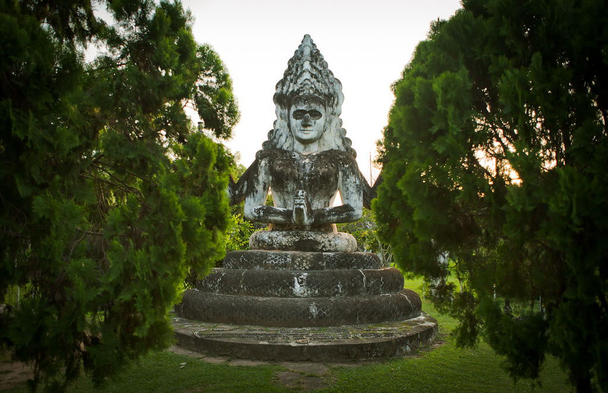

Mais que isso em Cingapura (uns 60 dólares) e na Tailândia (pelo menos 40). Camboja, Laos e Vietnã continuam econômicos.

Se tiver interesse, leia o texto sobre [quanto custa viajar pela Tailândia](http://www.360meridianos.com/2014/02/quanto-custa-viajar-para-tailandia.html).

### **Nova Zelândia e Austrália: entre 60 e 70 dólares**

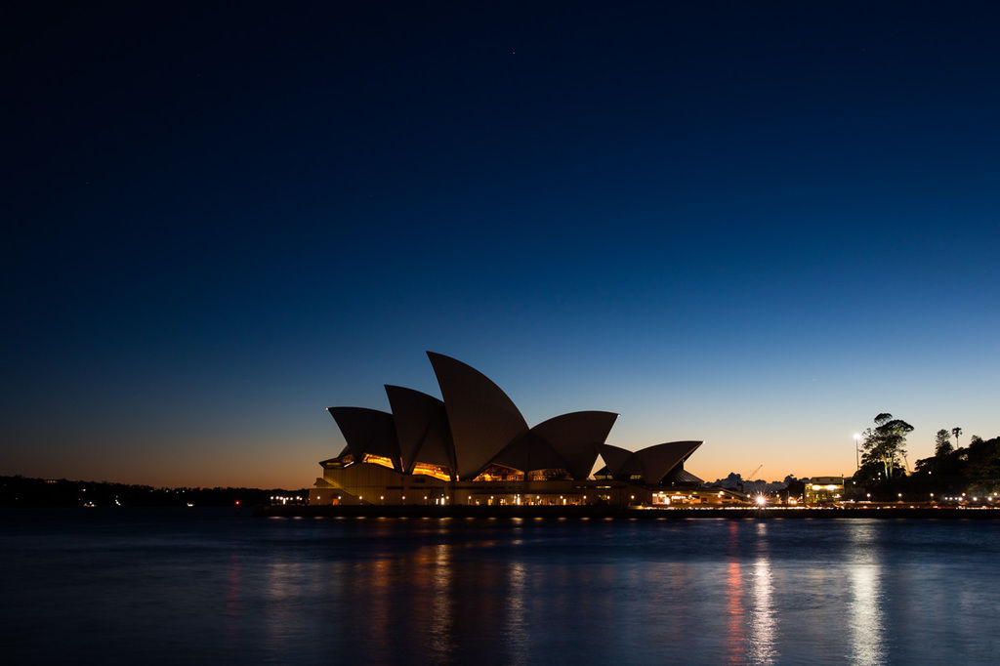

Mas é fácil gastar bem mais que isso também.

### **América do Sul: 40 dólares**

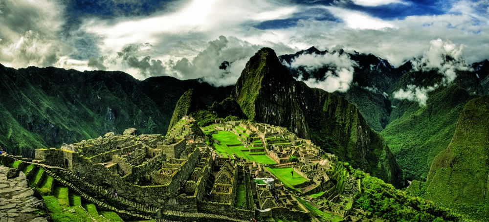

Alguns países são mais caros, casos de Brasil e Chile, outros são baratos, como a Bolívia. E alguns países nem são tão caros assim, mas um passeio específico pode quebrar seu orçamento. Por exemplo, o Peru, que não é caro, mas causa um aumento de gastos no caso de Machu Picchu, principalmente na alta temporada. A Argentina já foi mais barata, mas continua nesse patamar.

Leia o texto que escrevi sobre [quanto custa mochilar pela América do Sul](http://www.360meridianos.com/2015/03/quanto-custa-um-mochilao-pela-america-do-sul.html).

### **Canadá e EUA: 70 dólares**

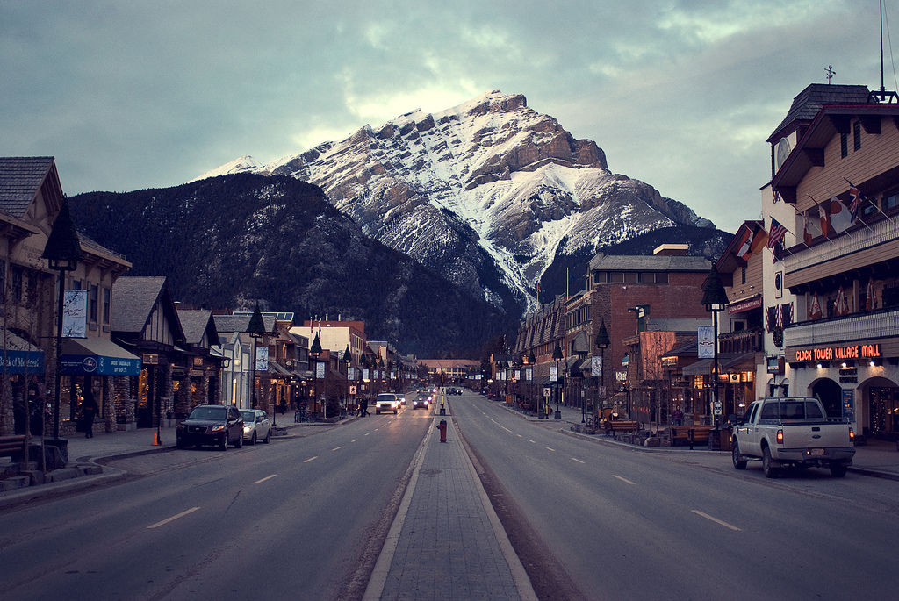

Esse valor sobe tranquilamente dependendo da viagem.

Hospedagem em Nova York causa choro e ranger de dentes, enquanto a Disney tem custos que devem ser pensados de forma separada.

### **México e Caribe: 30 – 40 dólares**

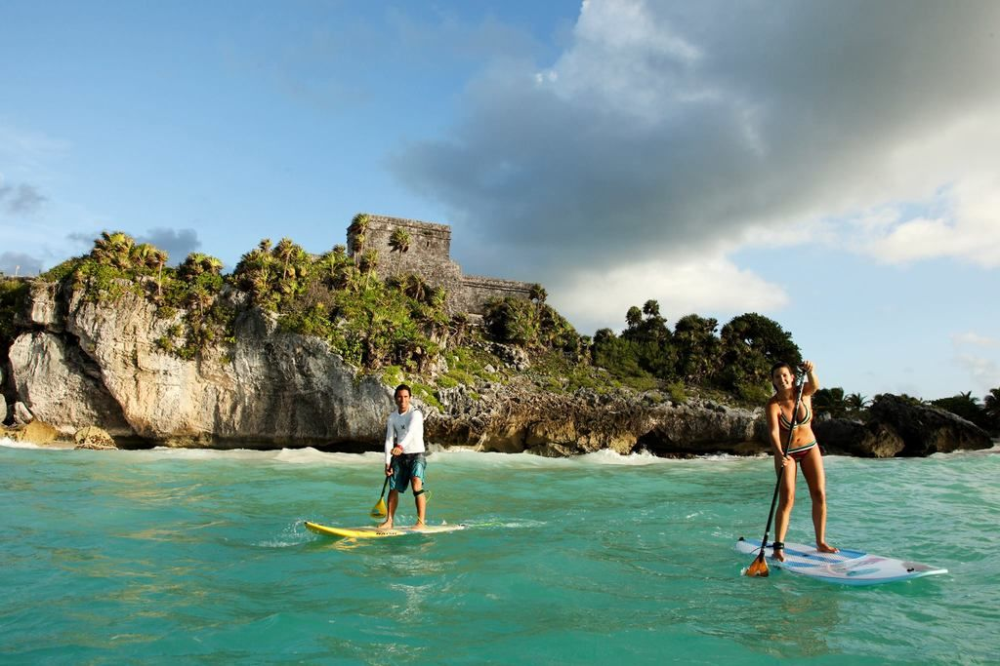

Varia de acordo com o país.

Destino de resorts de luxo, o Caribe pode causar estragos no seu bolso. Ou não.

### **África do Sul: 40 dólares**

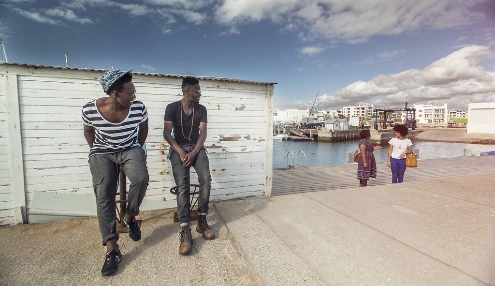

Confesso que tenho dificuldade em pensar um orçamento para a África. Por isso, deixo aqui a única média que já testei na prática, durante minha viagem pela África do Sul, um dos lugares mais incríveis que já visitei.

### Para ajudar a calcular a viagem

Dois sites interessantes para calcular seu orçamento de viagem são o [Quanto Custa Viajar](https://quantocustaviajar.com/) e o [Numbeo](http://www.numbeo.com/cost-of-living/). Use os dados de outros viajantes para planejar suas andanças pelo mundo, mas não se esqueça de adaptar os números para sua própria realidade.

Durante a viagem, anote, dia a dia, seus gastos. É uma forma de não terminar o roteiro sem dinheiro. Ou, pior ainda, economizar mais que o necessário e terminar a viagem com dinheiro na mão.

Para isso, você pode usar o app de notas do seu celular ou buscar um aplicativo especializado. Se preferir, anote tudo num caderninho. Ao fim de cada dia, some todos os gastos e veja se você se mantém no orçamento, se precisa economizar ou se pode esbanjar um pouco.

**Não entre em pânico** se os gastos de um dia específico passarem muito do previsto. Isso é normal e costuma ser compensado na média de gastos da viagem.

### Como conseguir a grana

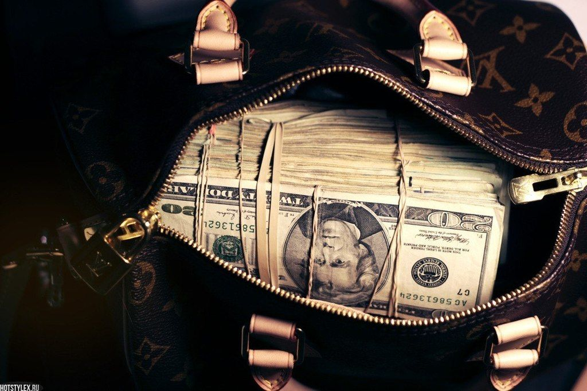

Com o orçamento calculado, some todos os gastos e veja o tamanho do desafio. Se você já tiver essa grana, ótimo, problema resolvido. Caso contrário, você terá que economizar. Monte uma poupança de viagem - um valor que seja real, possível de ser alcançado todo mês, mas não tenha medo de cortar gastos da sua vida diária para economizar.

Eu já escrevi, aqui no PdH, [um texto com dicas práticas para economizar e viajar mais](https://www.papodehomem.com.br/23-dicas-praticas-para-viajar-mais), por isso não vou me aprofundar nesse assunto dessa vez. Se você pretende viajar pelo nosso país, vale ler também o texto [sobre como viajar pelo Brasil gastanto pouco](http://www.360meridianos.com/2015/07/como-viajar-pelo-brasil-gastando-pouco.html).

### **Como levar o dinheiro**

A resposta é simples caso sua viagem seja pelo Brasil: leve seu cartão do banco e sempre tenha uma boa quantia em espécie. Não confie na onipresença dos caixas eletrônicos ou das máquinas de débito. Eu já passei dificuldades por conta disso. Tipo quando cheguei em Caraíva, Bahia, só com 20 reais no bolso - e o flanelinha queria mais que isso só pra deixar o carro ficar lá.

Por outro lado, quando a viagem for para outro país, aí a questão fica um pouco mais complicada. Existem várias formas de levar dinheiro para o exterior. O ideal é que você adote mais de uma - talvez até várias delas.

Caso um método dê errado, você tem de onde tirar dinheiro.

### **Dinheiro em espécie**

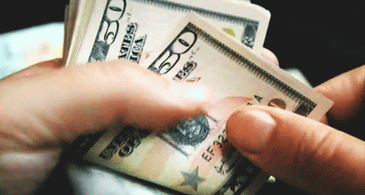

Como o IOF, imposto sobre operações de câmbio e crédito, é mais baixo para compra de moeda estrangeira em espécie (apenas 0,38%), essa é a alternativa mais econômica e prática. Procure uma casa de câmbio, compre a moeda estrangeira e pronto.

O problema, claro, é a insegurança, que não é algo típico só do Brasil. Batedores de carteira e assaltantes existem em qualquer lugar do mundo - muita gente se impressiona quando descobre a quantidade de golpistas que há em Paris, todos de olho nos bolsos dos turistas.

Por isso, eu não levaria todo meu dinheiro em espécie, pelo menos não se a viagem fosse mais longa. Se for uma viagem curta, de poucos dias, pode ser uma boa alternativa. Nesse caso, separe seu dinheiro - deixe sua riqueza em dos locais diferentes, ambos seguros.

Use o cofre do hotel e pense na possibilidade de viajar com uma doleira. Se fizer isso, não tire a doleira na frente de outras pessoas e tome cuidado para não esquecê-la em algum banheiro público - eu já vi isso acontecer.

Em países onde há câmbio paralelo, como a Argentina, é bom aumentar a quantidade de dinheiro em espécie, já que a a cotação nos cartões de crédito e débito é muito pior pra você.

### **Cartão pré-pago (ou travel card)**

Não é o cartão do seu banco, mas um feito pelas casas de câmbio. Você compra a moeda estrangeira e carrega no cartão, pagando a cotação do dia, que costuma ser um pouco mais desvantajosa (pra você) que a cotação do dinheiro em espécie. A partir daí, basta levar o cartão e pagar suas contas no débito, sem pagar taxas.

Também é possível sacar o dinheiro, mas nesse caso há uma taxa, além da taxa do próprio caixa eletrônico. O IOF dos cartões pré-pagos é de 6,38%. Ou seja, você paga R$ 63,80 de imposto para cada R$ 1000.

Mesmo que você não pretenda usar esse cartão, pode valer a pena levar um com você, principalmente em viagens mais longas. Em algumas situações, quando todos os métodos falharam e eu não tinha mais dinheiro em espécie, foi o cartão pré-pago que me salvou.

Uma pessoa autorizada pode recarregá-lo para você, do Brasil, em caso de necessidade.

### **Cartão de crédito internacional**

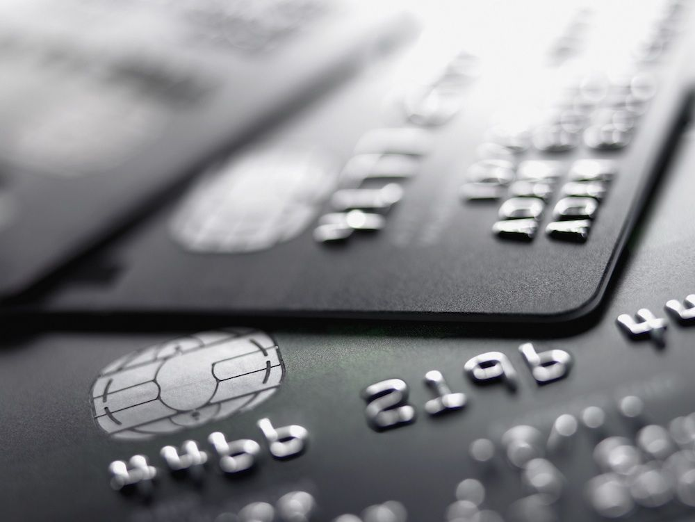

Com o mesmo IOF dos cartões pré-pagos, o cartão de crédito oferece uma vantagem e uma desvantagem. O ponto positivo é a possibilidade de juntar milhas aéreas (e viajar mais). Acredite, as milhas funcionam e garantem passagens de graça. Basta saber como acumular seus pontos. O ponto negativo é a flutuação cambial, já que a cotação da moeda será a do dia do fechamento da fatura.

Não importa se você vai usar o cartão de crédito, leve um com você, para o caso de alguma emergência. E não se esqueça de desbloqueá-lo para uso no exterior. Você pode fazer isso num caixa eletrônico ou conversando com seu gerente - depende das regras do seu banco.

### **Cartão de débito**

Use seu próprio cartão do banco, no débito e sem complicação. Você pode pagar as contas e fazer saques. Claro, pagando uma taxa para isso, que varia de acordo com o banco. A grande vantagem é a comodidade. Não ter medo da flutuação cambial é outro ponto positivo - vale a cotação do momento do débito.

Por outro lado, você não acumula milhas ou, quando acumula, faz isso em menor quantidade. Em todo caso, vale também desbloquear seu cartão de débito para uso no exterior, mesmo que você não pretenda usá-lo.

Dúvidas? Deixe um comentário. E aguarde o próximo texto, em que falaremos sobre como montar o roteiro de viagem, pensar os deslocamentos e procurar hospedagem, enfim, organizar toda a viagem por conta própria. E pela internet.

### Percurso "Como viajar mais, passo-a-passo"

[Como viajar mais, passo-a-passo | Vencendo a burocracia](https://www.papodehomem.com.br/como-viajar-mais-passo-a-passo-or-vencendo-a-burocracia?track_slug=como-viajar-mais-passo-a-passo)

[Como viajar mais, passo-a-passo | Como organizar uma viagem responsa](https://www.papodehomem.com.br/como-viajar-mais-passo-a-passo-como-organizar-uma-viagem-responsa)

[Como viajar mais, passo-a-passo | Mala ou mochilão? Como escolher e organizar sua bagagem](https://www.papodehomem.com.br/como-viajar-mais-passo-a-passo-or-mala-ou-mochilao-como-escolher-e-organizar-sua-bagagem)

[Como viajar mais, passo-a-passo | Dicas pra quando você já estiver na estrada](https://www.papodehomem.com.br/como-viajar-mais-passo-a-passo-or-dicas-pra-quando-voce-ja-estiver-na-estrada)

---

*publicado em 29 de Julho de 2015, 00:00*
