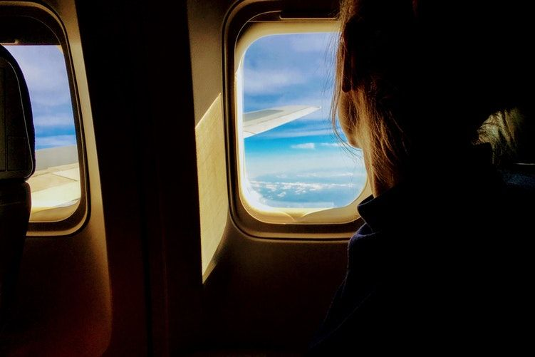

# Saia de casa e viaje o mundo

Quando chega a hora de tornar aquela ideia maluca em realidade.

Viajar o mundo deve, facilmente, ser um dos desejos mais introjetados na mente da nossa geração. Afinal, é maravilhoso saber que temos um mundo vasto para conhecer, cenários e culturas inimaginavelmente diferentes.

Não é à toa que tanta gente expresse esse como o sonho da vida.

O Rafael Sette Câmara é jornalista e configurou sua vida inteira para que viagens fizessem parte do seu cotidiano. Hoje, já viajou o mundo e fundou o blog 360 Meridianos para compartilhar suas experiências.

Aqui no Papo de Homem, já chegou a oferecer uma tarde onde ensinou como uma pessoa pode se preparar para uma viagem ao redor do mundo e vem escrevendo recorrentemente sobre o assunto.

Aqui embaixo vão seus principais textos para você também beber dessa fonte e começar a arrumar suas malas.

### [Como dar a volta ao mundo, passo-a-passo](https://papodehomem.com.br/percursos/saia-de-casa-e-viaje-o-mundo/como-dar-a-volta-ao-mundo-passo-a-passo)

*"Como muitas das coisas extraordinárias da vida, essa começou numa mesa de bar. Três amigos desanimados com a profissão discutiam o futuro. Em pauta, um intercâmbio para a Índia. Decidimos encarar o desafio e ficar seis meses por lá, mas o tamanho da aventura só foi mesmo definido quando alguém, talvez já por conta da cerveja, achou que viver na Índia não era o bastante.*

*Se o objetivo é largar tudo para viajar, melhor fazer isso direito. Decidimos dar a volta ao mundo."*

### [Como escolher destinos de viagem](https://papodehomem.com.br/percursos/saia-de-casa-e-viaje-o-mundo/como-escolher-destinos-de-viagem)

*"Como você escolhe para onde vai viajar? Seria muito mais fácil se desse para seguir aquela ideia romântica de girar um globo e ir para o país que o dedo apontasse.*

*Mas a vida não é assim e decisões costumam ser bem mais complicadas."*

### [Como viajar mais, passo-a-passo | Vencendo a burocracia](https://papodehomem.com.br/percursos/saia-de-casa-e-viaje-o-mundo/como-viajar-mais-passo-a-passo-or-vencendo-a-burocracia)

*"Já se foi o tempo em que viajar era algo complicado, uma aventura que uma pessoa normal, seja lá o que esse termo queira dizer, só encararia com ajuda de uma agência de viagens. Qualquer um, não importa a idade, pode cair na estrada. E pode fazer isso por conta própria, sozinho e organizando a viagem da sala de casa. Basta usar a Internet."*

### [Como viajar mais, passo-a-passo | Como organizar uma viagem responsa](https://papodehomem.com.br/percursos/saia-de-casa-e-viaje-o-mundo/como-viajar-mais-passo-a-passo-como-organizar-uma-viagem-responsa)

*"Essa introdução é para dizer o óbvio: não adianta, meu amigo, você não vai sair desse mundo tendo conhecido tudo que gostaria. **Portanto, é preciso fazer escolhas**. Nos outros textos da série sobre como viajar mais falamos sobre a [parte burocrática da jornada (documentos, visto, vacinas, etc)](https://www.papodehomem.com.br/como-viajar-mais-passo-a-passo-or-vencendo-a-burocracia) e [da parte, err, complicada da viagem - dinheiro](https://www.papodehomem.com.br/como-viajar-mais-passo-a-passo-or-e-hora-de-falar-de-dinheiro).*

*Neste texto, a ideia é te ajudar com outra coisa nem tão simples assim: como organizar a viagem? Como montar seu roteiro?"*

### [Como viajar mais, passo-a-passo | É hora de falar de dinheiro](https://papodehomem.com.br/percursos/saia-de-casa-e-viaje-o-mundo/como-viajar-mais-passo-a-passo-or-e-hora-de-falar-de-dinheiro)

*"Ele, o dinheiro, é o vilão número 1 quando o assunto é viajar mais. Ou melhor, a falta dele. A não ser que dinheiro não seja um problema para você, é quase certo que terá que juntar uma poupança e economizar para cair na estrada.*

*Além disso, dinheiro também é um desafio em outros momentos da viagem. Quanto preciso levar? Como calcular um orçamento de viagem que seja real? E, também importante, como levar a grana comigo?*

*Perguntas simples, com várias respostas."*

---

*publicado em 03 de Janeiro de 2018, 00:00*
