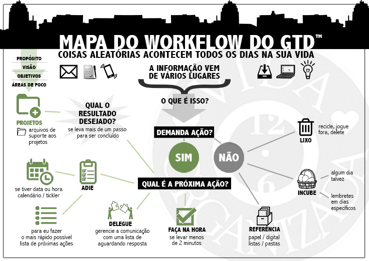
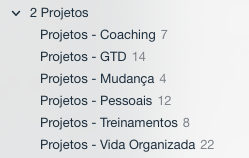
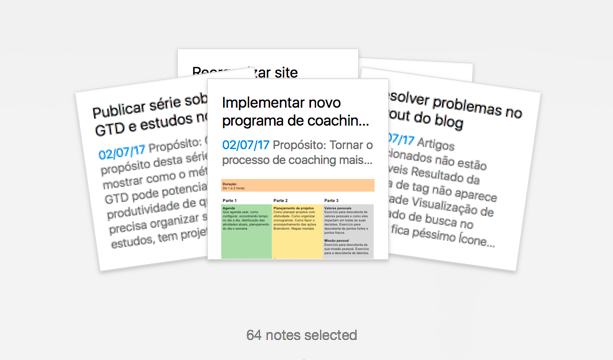
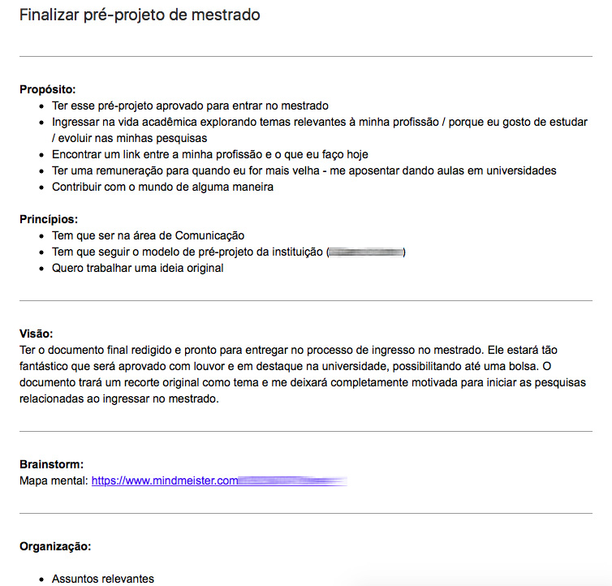
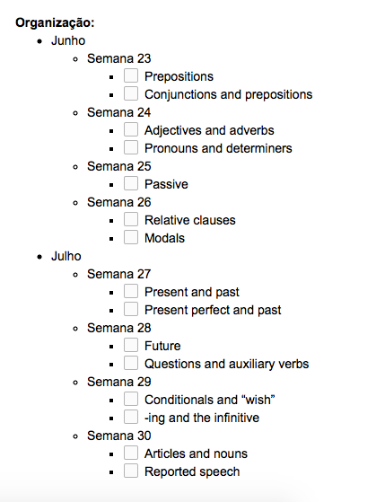
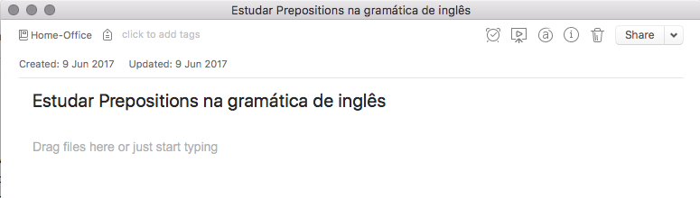
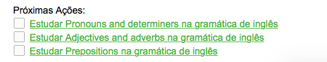
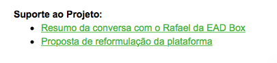

# Meu sistema GTD atual: Projetos (Julho 2017)

1383

[24](https://vidaorganizada.com/2017/07/18/meu-sistema-gtd-atual-projetos-julho-2017/#comments)

Criei uma série para mostrar meu sistema atual, pois assim cada post não fica tão grande e eu também consigo mostrar direitinho o que tem em cada elemento do meu sistema. Hoje vou falar sobre projetos, que é o assunto que mais gera dúvidas.

No fluxo acima, estamos no **Demanda ação > Sim > Qual é a próxima ação? > Delegue**e **Demanda ação > Sim > Qual é a próxima ação? > Qual o resultado desejado? > Projetos e arquivos de suporte aos projetos**.

Lembre-se da definição de projeto para o GTD: todo resultado desejado que demanda múltiplos passos para ser concluído em até um ano.

**Ferramentas utilizadas:**  
Evernote de modo geral. Porém, tenho muito material de suporte em fontes diversas, em papel e digital. Ao longo do post, vou explorar mais esse assunto.

**Como é a organização:**  
Eu tenho uma pilha de cadernos chamada “Projetos” e, dentro dela, cadernos para os projetos. Eu categorizo de acordo com o que faz sentido visualizar de maneira segmentada. Não categorizo por áreas de foco, por exemplo. Essa categorização muda com frequência, pois o sistema serve justamente para atender minhas necessidades de revisão. No momento, eu uso a seguinte categorização:

Se eu quiser visualizar quantos projetos tenho no total, basta clicar em cima da pilha “Projetos” e selecionar o total de notas.

### Uma nota por projeto

Eu uso uma nota por projeto. Faço dessa maneira porque, assim, eu consigo mover facilmente projetos entre os horizontes ou entre a lista de projetos e algum dia / talvez. Esse ponto então é importante: usar o mesmo formato para todos os resultados desejados, para tornar a logística mais fácil.

Eu já usei o formato de um caderno por projeto e não uso mais porque:

1. Nem todo projeto precisa de um caderno inteiro (tem projeto que não tem nem arquivo de suporte)
2. Fica muito caderno e o Evernote tem limite de cadernos
3. Acho que fica ruim a visualização na barra lateral

Atualmente uso uma nota por projeto e funciona bem.

### Ainda sobre a categorização

A categorização da sua lista de projetos é algo adicional, que não é necessário, a não ser que você queira. É o tipo de personalização que você aprende fazendo o [curso do Nível 2](https://vidaorganizada.com/cursos).

No meu caso, para mim faz sentido observar de maneira separada duas coisas em específico: meus processos de coaching em andamento e meus treinamentos em andamento. Vira e mexe crio categorias adicionais, como “eventos” ou “mudança”, como vocês podem conferir desta vez (estou mudando o escritório). Simplesmente pelo fato de que, para mim, faz sentido ver dessa forma (todos os projetos relacionados à mudança em um único lugar, por exemplo). Mas, de maneira geral, uma lista única de projetos funciona bem para a maioria das pessoas e frequentemente eu volto a usar uma lista única, porque é mais simples. O próprio David Allen diz que uma lista única funciona para a maioria das pessoas.

Eu reforço bastante isso porque a categorização precisa fazer sentido. Não fique tentando categorizar se for algo trabalhoso ou que você não esteja conseguindo chegar a um formato ideal. Se isso estiver acontecendo, é melhor usar uma única lista de projetos. Não force uma categorização.

### Como planejo os meus projetos

O David Allen apresenta o **Modelo de Planejamento Natural**, que serve como ferramenta para planejarmos projetos. Existem projetos que não precisam de tanto planejamento, e se desdobram apenas com a identificação das próximas ações. Por isso o Modelo é **apenas uma ferramenta**, que você pode usar caso precise de mais planejamento. O Modelo é descrito em detalhes no capt. 3 do livro do GTD (A arte de fazer acontecer) e se resume em cinco estágios:

1. Propósito
2. Visão
3. Brainstorm
4. Organização
5. Próximas ações

Basicamente, se você quiser planejar um projeto dentro do GTD, pode ser útil “verticalizar” seu pensamento e começar pelo propósito, e aí ir seguindo os estágios seguintes.

Muitas vezes, ao identificar um projeto, minha próxima ação é simplesmente “trabalhar no planejamento do projeto X”, pois efetivamente a primeira coisa que tenho que fazer é montar o planejamento. Essa é uma dúvida que muitas pessoas me perguntam. No momento em que você está esclarecendo sua caixa de entrada, você só deve executar ações que levam menos de dois minutos. Planejar um projeto não leva menos de dois minutos, então as outras opções são delegar ou adiar. Esse fluxo de pensamento precisa entrar em você para fazer as coisas acontecerem. Quando entrar, todo o seu GTD ficará muito mais fluido. Ou seja, “planejar um projeto” é uma ação em si que não dá pra ser feita na hora porque não leva menos de dois minutos. É isso.

Agora, a não ser que você queira (e possa) parar tudo o que você está fazendo para montar o seu planejamento do projeto. O que estou querendo dizer é que não precisa fazer na hora, se isso for mais te distrair e atrapalhar do que ajudar. A escolha deve ser sua, de acordo com as suas opções de coisas a fazer no dia.

Esse planejamento entra no que se chama de **plano do projeto** e eu coloco na parte de notas dentro do meu projeto. Assim:

### A importância da organização do projeto

O estágio da Organização nesse Modelo serve para você saber o status do projeto. Você não controla esse status “pelas próximas ações”, mas sim pela organização.

É aqui na organização que entram cronogramas, listas de coisas a fazer, pipeline de ações e tudo mais o que geralmente as pessoas associam a “planejamento de projetos”.

O MPN (Modelo de Planejamento Natural) serve justamente para dar suporte aos outros itens que normalmente as pessoas não fazem com relação ao projeto (pensar em propósito, visão etc). Ele não substitui planejamentos formais em empresas – tais planejamentos entram dentro do MPN, na parte da organização. Esse entendimento também é importante. Ou seja: essas coisas entram dentro do MPN. Mas o MPN não substitui essas coisas. Elas se complementam. Só ter a parte de cronogramas e organização de modo geral pode não ser o suficiente. Mais uma vezm use o MPN como **ferramenta**.

Revisar todos esses passos listados na parte da organização dos projetos serve para você identificar as próximas ações. Eu dei um exemplo em um projeto de inglês, em um [post anterior](https://vidaorganizada.com/2017/06/05/compartilhando-projetos-atuais-para-melhorar-o-meu-ingles/) aqui no blog:

Na revisão semanal, eu olho essa parte da organização e me pergunto sobre cada item: Posso definir uma próxima ação para isto? E para aquilo? Se sim, eu esclareço a próxima ação e organizo adequadamente (= nas listas por contexto, no calendário, delego e vai pra aguardando resposta ou fazer em menos de dois minutos). O andamento do projeto é acompanhado por aqui (organização). Logo, se um item ainda não foi concluído, eu continuo definindo próximas ações até ele ser. Isso que me dá o controle do projeto. As próximas ações são apenas a operacionalização de cada um desses itens.

Há itens que eu eu já posso definir próximas ações e outros não, porque são itens que dependem da conclusão de outros. Nesse caso, eu não coloco ações que não sejam próximas ações nas minhas listas de próximas ações. Esse entendimento aqui não é apenas importante – ele é chave. Se você inserir nas suas listas de próximas ações ações que não sejam “próximas” (ou seja, que ainda dependam de outros acontecimentos antes), você vai travar suas listas de próximas ações. Então esta parte aqui da organização é essencial por isso – você pode inserir ações futuras e outras categorizações, como sequências, prioridades etc.

Um exemplo de próxima ação baseada na organização do projeto acima:

A ação está lá na lista do contexto em que quero ou preciso estar para executá-la. Como eu reviso as próximas ações antes dos projetos durante a minha Revisão Semanal, eu já sei quais estão definidas quando chego na parte dos projetos.

### Pode linkar ações aos projetos?

Essa é uma das perguntas que eu mais recebo. Claro que você pode linkar. No Evernote, por exemplo, você pode copiar o link da nota das próximas ações e colocar no plano do projeto. Assim:

Agora, a pergunta é: Precisa? É necessário? Ou vai te dar mais trabalho? Avalie por aí e veja como funcionaria melhor para você.

Eu às vezes tento fazer isso (apenas para ter um registro das ações dentro do plano do projeto), mas sempre desisto porque não tem necessidade. Como faço o controle pela organização do projeto em si, as próximas ações são coisas muito voláteis e desnecessárias de se manterem registradas. Se cada vez que eu fizer uma alteração na ação (esclarecendo-a melhor, por exemplo) eu tiver que copiar e colar a nota novamente, vou perder mais tempo organizando meus projetos do que efetivamente trabalhando neles. Considere essa questão por aí também.

### E linkar os projetos às áreas de foco? Ou aos objetivos relacionados?

Tudo, tudo pode ser feito. Depende apenas de você pensar: Preciso? Qual a necessidade? Vai ser eficiente? Vai dar retrabalho?

No Evernote, se eu fosse fazer, faria por tags (para as áreas de foco). Criaria uma tag para cada área e, no projeto, inseriria a tag. Poderia inserir em outros itens se eu quisesse também (ações, objetivos etc). Isso pode ser legal para dar uma visão do que “existe” para cada uma das áreas. Mas, mais uma vez: eu não faço. As revisões regulares de todo o meu sistema garantem que esteja tudo integrado sem precisar fazer isso por meio de tags ou outros artifícios. Mas, mais uma vez: é como *eu* faço (e procuro fazer como o David Allen recomenda). Não tem problema nenhum usar tags.

### Arquivos de suporte ao projeto

Uma última coisa legal de se falar sobre projetos é sobre os arquivos de suporte.

Os projetos podem ter arquivos diversos de suporte, que servem justamente como apoio. Por exemplo: se eu for realizar uma viagem, as passagens compradas (o documento em si) são arquivos de suporte. Isso tem que ser organizado em algum lugar.

De modo geral, você pode organizar esses arquivos em qualquer ferramenta, tanto em formato de papel quanto em formato digital. Onde você vai listar onde estão esses documentos? Isso mesmo, no plano do projeto.

Exemplo de um projeto que tenho (“reformular a plataforma dos cursos online”):

Eu digitalizo bastante coisa para o Evernote, então copio e colo o link da nota no próprio plano do projeto.

Se o arquivo estiver em outra ferramenta, não há qualquer problema – eu registro onde está. Algo como:

- Suporte ao projeto:
  - Mapa mental: link
  - Cronograma da equipe no Google Drive: link
  - Caderno no Evernote: Projeto X
  - Pasta: Projeto X
  - Dropbox: Projeto X

Você pode ter arquivos de suporte literalmente em qualquer lugar! Podem ser pastas de plástico cheias de papéis sobre o projeto, podem ser pastas no Dropbox, arquivos no seu e-mail, arquivos no seu Google Drive etc. Contanto que você tenha isso listado para identificar rapidamente (como mostrei no exemplo acima), as informações ficarão organizadas.

Eu trabalho com outras pessoas e, por isso, outras pessoas usam ferramentas diversas que elas compartilham comigo. Por esse motivo, essa organização é essencial. Eu não me obrigo a passar tudo para uma só ferramenta, o que pode dar mais trabalho que apenas linkar ou fazer referência no meu plano do projeto.

Lembre-se que esses arquivos devem ser revisados na Revisão Semanal para garantir que eles em si não desencadeiem próximas ações. Cronogramas de projetos (e outros afins que entram na parte da organização do projeto) também se enquadram como arquivos de suporte aos projetos.

Vale a pena dizer que, no Evernote, tenho uma pilha de “Suporte a projetos”, onde crio cadernos para alguns projetos. Apenas para alguns, por alguns motivos: 1) compartilhar com terceiros ou 2) disponibilizar off-line. Esses são os motivos de criar cadernos a parte. Do contrário, apenas uso tags nas notas, coloco dentro do arquivo de referência normal e linko a nota no plano do projeto.

Para viagens, por exemplo, é muito útil ter o caderno off-line no meu tablet ou celular.

Bom, gente, procurei esclarecer todas as dúvidas neste post. Caso tenham perguntas, sintam-se à vontade para escrever nos comentários. Posso ir complementando o post à medida que as dúvidas forem surgindo. Muito obrigada pela leitura e espero que o post tenha ajudado de alguma maneira.
