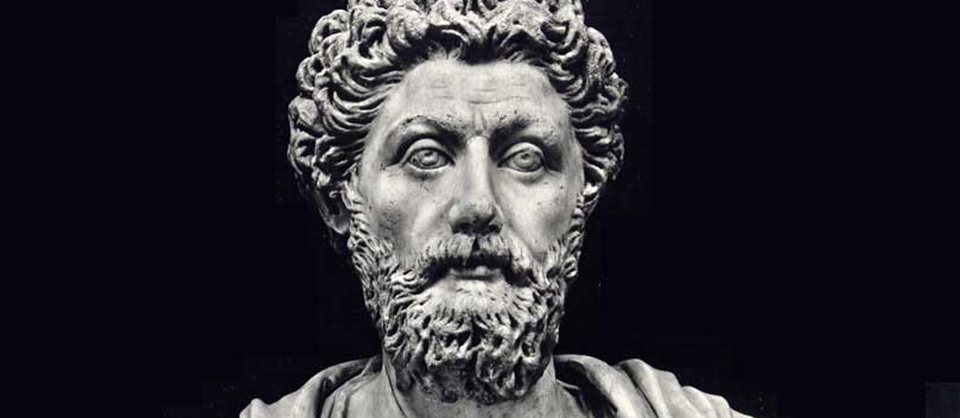
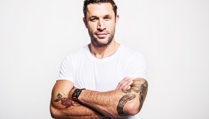

# 12 Rules for (a Stoic) Life

Jordan Peterson, a former professor at Harvard and now a professor of psychology at the University of Toronto, has become a sort of cult-celebrity for his calm, articulate dismantling of political correctness and reactionary politics on both sides. He is particularly popular with young men, in part because of his message of self-sufficiency and self-worth, which can be summarized as “Take responsibility for your own life.”

His book [*12 Rules for Life*:*An Antidote to Chaos*](https://el2.convertkit-mail.com/c/8kug7557nfoh3zzlr/dpheh0/aHR0cDovL2dlbmkudXMvMTJSdWxlcw==) is an interesting read and has spurned a meme of interesting people giving their own 12 rules for life (you can read [economist Russ Roberts’ rules](https://el2.convertkit-mail.com/c/8kug7557nfoh3zzlr/e5uph7/aHR0cHM6Ly9tZWRpdW0uY29tL0BydXNzcm9iZXJ0cy9teS10d2VsdmUtcnVsZXMtZm9yLWxpZmUtNDA0MWZiMTFhMWIz) or [author Megan McArdle’s rules](https://el2.convertkit-mail.com/c/8kug7557nfoh3zzlr/78i7h8/aHR0cHM6Ly93d3cuYmxvb21iZXJnLmNvbS92aWV3L2FydGljbGVzLzIwMTgtMDEtMzAvbWVnYW4tbWNhcmRsZS1zLTEyLXJ1bGVzLWZvci1saWZl) as well). But what would the Stoics say about this? What would their 12 rules be?

No one can say for sure, but here is a stab at it.

1. Live as if you died, but were resuscitated and every minute was a gift.
2. Every person you meet is an opportunity for kindness.
3. Don’t read for show, [read to be better](https://dailystoic.com/stoic-reading-list/).
4. Be forgiving of others, but [don’t demand forgiveness for yourself](https://dailystoic.com/give-forgiveness-dont-ask-for-it/).
5. Try to hold [as few opinions as possible](https://dailystoic.com/curse-opinion-everything/).
6. Pick a “[Cato](https://dailystoic.com/Cato)” and judge each difficult decision with: “What Would \_\_\_\_ Do?”
7. Practice good spending habits (keep in touch with poverty).
8. Always [consider the worst case scenario](https://dailystoic.com/premortem/).
9. Keep a list of what you’ve learned from other people (and remember to thank them often).
10. Get up early every day—as early as you can.
11. Take cold showers.
12. If it is not right do not do it; if it is not true do not say it.

*P.S. Sign up today for [the Daily Stoic’s email](https://dailystoic.com/start) and get our popular free 7-day course on Stoicism.*

---

**Explore Our Daily Stoic Store**

### *Related posts:*

#### [Who Were The Stoic Philosophers?](https://dailystoic.com/the-stoic-philosophers/ "Who Were The Stoic Philosophers?This article provides a short overview of the main leaders of Stoic philosophy. If you are new to Stoicism, we invite you to sign up for our free 7-day course, which offers an introduction, Stoic exercises, interviews, a free book chapter from the cult Stoic bestseller The Obstacle is the…")

 Life (a post that got a surprising amount of pushback from students of Stoicism of all things), one of the recurring questions from our audience was in regards to rule #11, the one on taking cold showers. Why…")

#### [Own the Day, Own Your Life: An Interview With Total Human Optimization Master Aubrey Marcus](https://dailystoic.com/aubrey-marcus/ "Own the Day, Own Your Life: An Interview With Total Human Optimization Master Aubrey MarcusWhen we recently published our list of 12 Rules for (a Stoic) Life (a post that got a surprising amount of pushback from students of Stoicism of all things), one of the recurring questions from our audience was in regards to rule #11, the one on taking cold showers. Why…")

#### [Stoicism in the Military: An Interview with Professor Nancy Sherman](https://dailystoic.com/nancy-sherman/ "Stoicism in the Military: An Interview with Professor Nancy ShermanMany of history’s great military leaders have naturally gravitated towards Stoic philosophy and its ready prescriptions for resilience, courage and duty. Frederick the Great rode with the Stoics in his saddlebags, George Washington put on a play about Cato at Valley Forge, and more recently General Mattis carried Marcus Aurelius’s…")

*Get Your Free* DAILY STOIC *Starter Pack*

Email Address

I'd like to receive the free email course.
Includes an introduction to Stoicism, best books to start with, Stoic exercises and much more!
[Powered by ConvertKit](https://convertkit.com/?utm_source=dynamic&utm_medium=referral&utm_campaign=poweredby&utm_content=form)
