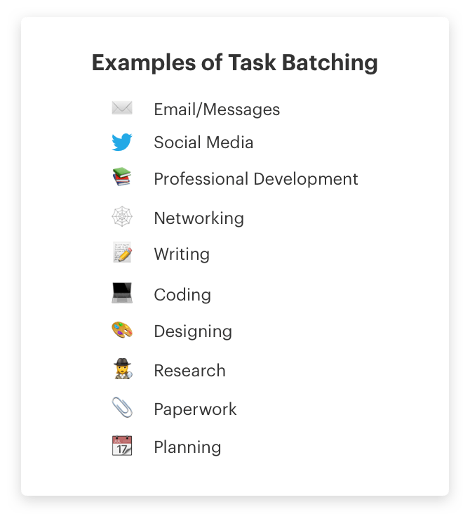
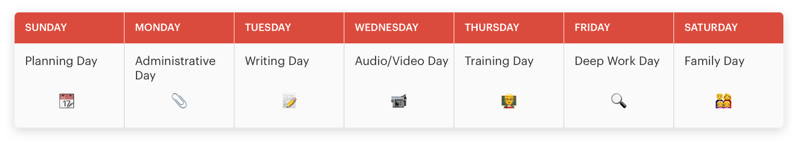
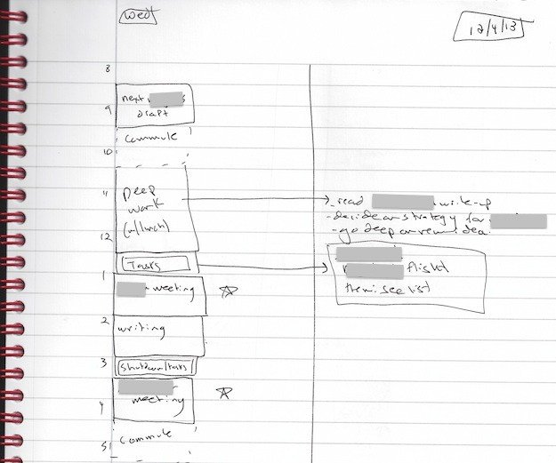
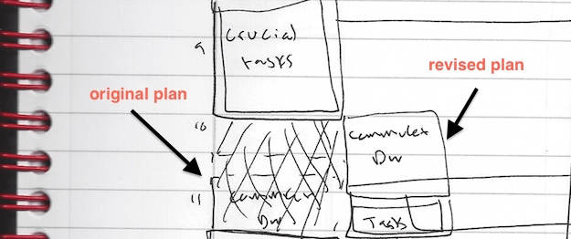
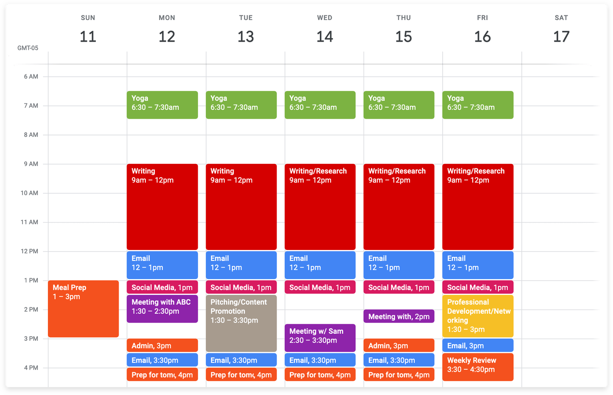
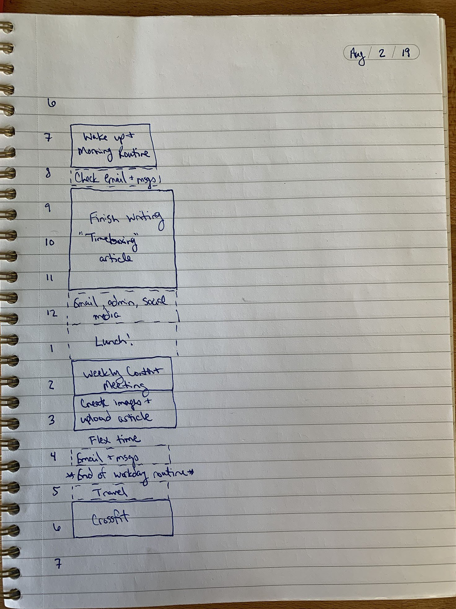
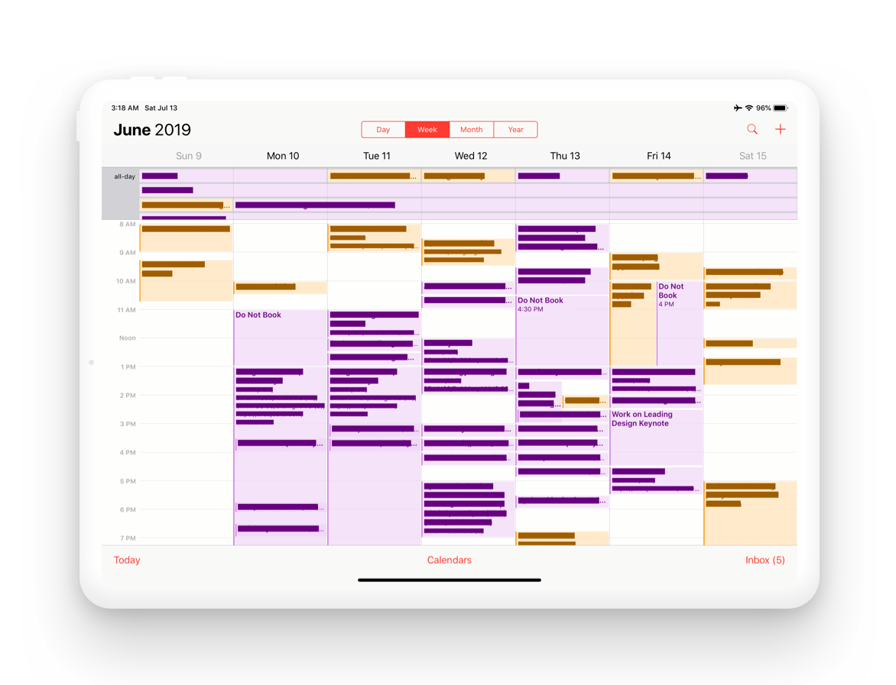
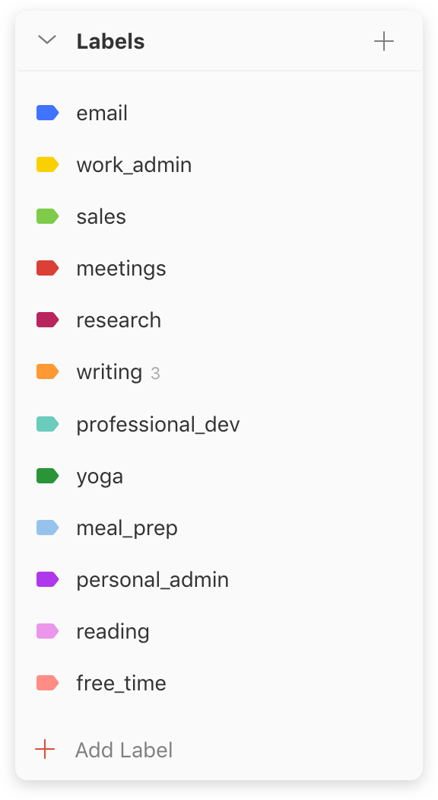
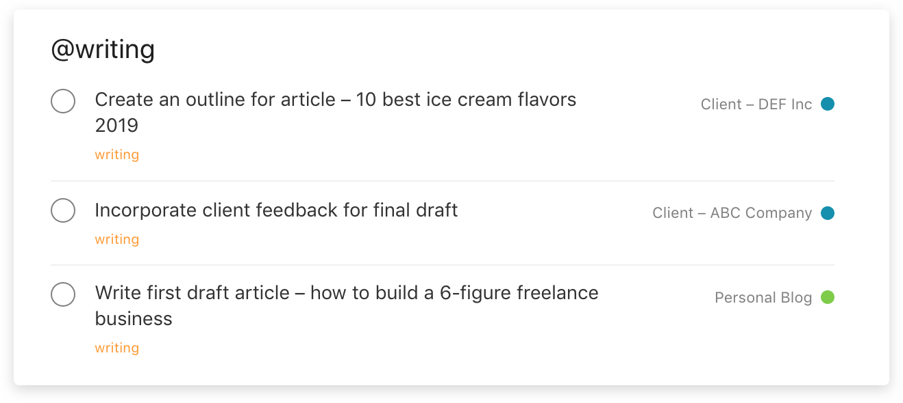
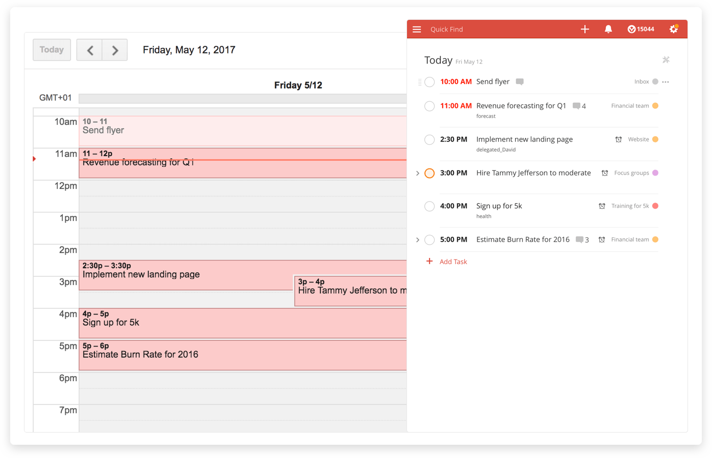

The Complete Guide to Time Blocking

Thursday, August 22, 2019

1:48 PM

Recortado de: <https://doist.com/blog/time-blocking/?utm_source=lc&utm_medium=email&utm_campaign=daily_digest>

“A 40 hour time-blocked work week, I estimate, produces the same amount of output as a 60+ hour work week pursued without structure.” – Cal Newport, Author of Deep Work

If there’s one thing that can be said about the modern workplace, it’s this: If you don’t control your schedule, it will control you.

How do you balance the necessary evils of meetings, email, team chat, and “busy work” with focused time for the things you truly care about? Since becoming a digital hermit isn’t an option for most of us, we need concrete strategies to help us focus in a world designed to distract us.

That’s where time blocking comes in.

Time blocking (and its close cousins task batching and day theming) is a simple, yet effective way to take back control of your workday. This productivity method is especially useful for people who:

- Juggle many different projects/responsibilities ([Elon Musk](https://www.youtube.com/watch?v=fbAYK4KQrso) uses this method to run two major companies at the same time)
- Spend too much time in “reactive mode”, responding to email and messages
- Find their day chopped up by meetings
- Battle constant interruptions throughout the day
- Struggle to find the time and mental space for big picture thinking

This guide will give you an overview of what time blocking, task batching, and day theming are; how a combination of these strategies can help you reclaim your schedule; and the best way to use your calendar and task manager to start time blocking yourself.

If you’re already familiar with the method, you can jump straight to [the setup guide](https://doist.com/blog/time-blocking/#setup_guide).

What is time blocking?

Time blocking is a time management method that asks you to divide your day into blocks of time. Each block is dedicated to accomplishing a specific task, or group of tasks, and only those specific tasks. Instead of keeping an open-ended to-do list of things you’ll get to as you’re able, you’ll start each day with a concrete schedule that lays out what you’ll work on and when.

The key to this method is prioritizing your task list in advance – a dedicated weekly review is a must. Take stock of what’s coming up for the week ahead and make a rough sketch of your time blocks for each day. At the end of every workday, review any tasks you didn’t finish – as well as any new tasks that have come in – and adjust your time blocks for the rest of the week accordingly.

With days that are time blocked in advance, you won’t have to constantly make choices about what to focus on. All you need to do is follow your time blocked schedule. If you get off-task or distracted, simply look at your schedule and get back to whichever task you blocked off time for.

We’ve written a separate [comprehensive guide to weekly reviews](https://doist.com/blog/weekly-review/) (with a Todoist template) that will walk you through how to create a routine that works for you.

Time Blocking Variations

Time blocking has two close cousins: Task Batching and Day Theming.

Task batching is when you group similar (usually smaller) tasks together and schedule specific timeboxes to complete all at once. By tackling similar tasks in a group, you’ll limit the amount of context switching throughout the rest of your day, saving precious time and mental energy. For example, scheduling two 20-minute blocks to process email during the day is more efficient than constantly checking your inbox throughout the day.

Time blocking pairs well with batching because it saves you from scheduling every individual task on your calendar. Just block off timeboxes each day or week when you want complete a certain batch of activities, e.g., email, invoicing, workouts, meetings, writing, coding, deep work, errands, meal prep.

Day theming is a more extreme version of task batching for people who have a lot of areas of responsibility competing for their attention. For example, an entrepreneur often has to pay attention to marketing, sales, product development, customer support, and HR all at the same time. Instead of setting aside time blocks for each area of responsibility each day, day theming dedicates a full day each week to each responsibility.

Mike Vardy, founder of [Productivityist](https://productivityist.com/theming-days-made-better-dad/), uses day theming to set his overarching focus for each day. Here is how he themes his week:

Dedicating each day to a single theme creates a reliable pattern of work and further limits the cognitive load of context switching. Vardy explains that theming offers mental clarity that allows him to focus on his family:

“Knowing what the day ‘means’ to me allows me to get the things I need and want to accomplish without seeing undetermined ‘ought to do’ items on a to do list. As a result, I have less decision fatigue and even have more energy when I spend time with my kids.”

Why time blocking is so effective

This technique seems simple on the surface, but has profound impacts on your capacity to get things done:

1. It promotes focused “deep work”

Cal Newport, author of [Deep Work: Rules for Focused Success in a Distracted World](https://www.amazon.com/Deep-Work-Focused-Success-Distracted/dp/1455586692/ref=asc_df_1455586692/?tag=hyprod-20&linkCode=df0&hvadid=312741934517&hvpos=1o1&hvnetw=g&hvrand=7753978193869239626&hvpone=&hvptwo=&hvqmt=&hvdev=c&hvdvcmdl=&hvlocint=&hvlocphy=9019660&hvtargid=pla-421604508630&psc=1&tag=&ref=&adgrpid=64940825031&hvpone=&hvptwo=&hvadid=312741934517&hvpos=1o1&hvnetw=g&hvrand=7753978193869239626&hvqmt=&hvdev=c&hvdvcmdl=&hvlocint=&hvlocphy=9019660&hvtargid=pla-421604508630), is a [big proponent of time blocking](http://www.calnewport.com/blog/2013/12/21/deep-habits-the-importance-of-planning-every-minute-of-your-work-day/). He dedicates 20 minutes every evening to scheduling out the next work day:

“Sometimes people ask why I bother with such a detailed level of planning. My answer is simple: it generates a massive amount of productivity. A 40 hour time-blocked work week, I estimate, produces the same amount of output as a 60+ hour work week pursued without structure.”

When you schedule a chunk of time to work on a single project, problem, or task, you bring all of your mental resources to bear on one thing rather than spreading your attention thin across several tasks. The more you “single task”, the more you build the mental muscles required for deep work and the easier its becomes to stay focused.

Newport uses a plain paper notebook to schedule out his timeboxes each day.

Learn more about Newport’s approach to meaningful productivity and how to incorporate more focus into your life with .

2. It helps you knock out “shallow work” more efficiently

Shallow work is the busy work that’s [urgent but not important](https://doist.com/blog/eisenhower-matrix/) to achieving your long term goals – think paperwork or responding to (most) emails. When you time block shallow work, you’re setting clear limits on how much time you’ll dedicate to it. Plus, grouping similar tasks together reduces the cost of context switching. By batching all of your shallow tasks together in a dedicated timebox, you’ll be able to power through them more efficiently and protect the rest of your workday for higher-impact work.

3. It makes you aware of how you spend your time

Most people are bad at time management. We are [terrible at estimating](https://en.wikipedia.org/wiki/Planning_fallacy) how much time tasks will take, and we have a tendency to [overcommit our future selves](https://doist.com/blog/neuroscience-achieving-long-term-goals/). Time blocking forces you to confront your current priorities and commitments and get intentional about how you spend your finite time. For each new commitment you let into your life, you’re forced to find physical space on your calendar. As a result, the opportunity cost of saying “yes” becomes more concrete, and it becomes much easier to [say “no”](http://doist.com/blog/how-to-say-no/).

4. It counteracts perfectionism

Fuzzy timelines are a perfectionist’s worst enemy. There’s always something to be tweaked and improved. It can be difficult to know when an open-ended project is finished, especially if you are aiming for perfection. At some point, you need to be able to say “good enough” and move on. Time blocking can help by imposing time limits on your projects. If you often prolong tasks by trying to get everything just right , set a strict timebox for finishing the task and stick to it.

5. It combats procrastination and helps you follow through on your goals

In the article “[Beyond good intentions: Prompting people to make plans improves follow-through on important tasks](https://scholar.harvard.edu/files/todd_rogers/files/beyond_good_intentions_-_prompting_people.pdf)” researchers Dr. Todd Rogers and Dr. Katherine L. Milkman review several studies supporting the idea that “concrete plans help people follow through on their intentions.”

“I only write when inspiration strikes. Fortunately, it strikes at nine every morning.” – William Faulkner

From following an exercise regimen to scheduling a flu shot, people were more likely to act on their intentions when they wrote down a specific place, date, and time for the activity. Yet most people rely on vague intentions rather than concrete plans:

“Paradoxically, people frequently underplan when they begin with strong intentions. They mistakenly believe that their strong intentions are enough to propel them to perform desired behaviors, and that belief keeps them from using strategies that could help translate intentions into actions.”

The takeaway: When you schedule your tasks and goals you’re more likely to follow through. Time blocking forces you to make concrete plans that ensure you’re working toward your goals every day. As William Faulkner famously quipped, “I only write when inspiration strikes. Fortunately, it strikes at nine every morning.”

But will time blocking work with my job?

One of the biggest criticisms of time blocking is that it doesn’t account for reactive jobs where it’s impossible to anticipate what will come in at any given moment. Is time blocking really a realistic strategy for a customer support specialist whose job is to respond to tickets? Or an account manager who needs to be available to respond to client requests?

We’d argue yes – asserting even a small amount of control over your schedule can be helpful no matter what your job is. Cal Newport put it this way:

“Periods of open-ended reactivity can be blocked off like any other type of obligation. Even if you’re blocking most of your day for reactive work, for example, the fact that you’re controlling your schedule will allow you to dedicate some small blocks (perhaps at the schedule periphery) to deeper pursuits.”

When your workday is run by external forces, it’s easy to lose sight of your own goals. Time blocking can help you gain a greater sense of control over even the most unpredictable of schedules.

Some common time blocking missteps and how to avoid them

While time blocking is pretty straightforward in theory, it can be hard to stick to in practice. Here are some tips to help you apply the method successfully (and not become a slave to your calendar in the process):

1. Underestimating your time

You’ll get better at estimating how long tasks take over time but until you’ve honed your instincts, err on the side of blocking off too much time for tasks rather than too little. Pad your schedule with extra time to complete and transition between tasks. You can even create “conditional blocks” of time that can be used if you fall behind.

Improve your sense of how long you actually spend on tasks with time trackers like [RescueTime](https://www.rescuetime.com/ref/1403570) or [Toggl](https://toggl.com/todoist-time-tracking/).

2. Being too rigid

Things will come up and ruin your plans. But keep in mind your plan is more of a guide to help focus your attention on what’s important, not a binding contract.

Even expert Cal Newport edits his plans throughout the day by crossing out original timeboxes and filling it with something new as circumstances demand:

Newport deals with changes in his schedule by seeing it as a game:

“This type of planning, to me, is like a chess game, with blocks of work getting spread and sorted in such a way that projects big and small all seem to click into completion with (just enough) time to spare.”

See your timeboxes as a flexible way to challenge yourself, not strict tools to punish yourself when you fall short.

3. Overscheduling your leisure time

Though [Elon Musk and Bill Gates](https://www.businessinsider.com/bill-gates-elon-musk-scheduling-habit-2017-8) have been said to schedule their days down to 5-minute increments, overscheduling your leisure time can be a self-defeating exercise. [Studies](https://www.washingtonpost.com/news/inspired-life/wp/2018/07/31/want-to-be-happier-stop-scheduling-your-free-time/?noredirect=on&utm_term=.c7b6c4e1f8d1) have shown that scheduling leisure activities has a “unique dampening effect” on the overall enjoyment of the activity.

Instead, you can block out time to disconnect and relax without a set plan for how you’ll spend that time. It will give you the flexibility to decide more spontaneously what you want to do– call friends to grab a drink? Check out that new Xbox game? Read? Whatever you decide, just remember to keep at least some of your free time free.

Time Blocking and Task Batching with Todoist

Strict time blocking – dedicating a time block to each individual task – can be tedious and hard to maintain over time. We recommend combining time blocking and task batching for a more streamlined system. Instead of one time block per individual task, you’ll assign a time block for each category of task you batch together. Here’s how that looks in practice:

First, decide on which broad categories of work need to be reflected in your daily or weekly schedule. For example, a freelance writer might have the following category list:

- Email
- Work admin
- Sales
- Meetings
- Research
- Writing
- Professional Development
- Yoga
- Meal prep
- Personal admin
- Reading
- Free time

Now, sit down with your favorite calendar app or paper planner, and create time blocks for the coming week that reflect the times you’ll work on each category. Make sure all of your priorities and commitments are given enough space on your calendar. If you find yourself struggling to find room, you may need to start cutting down on your commitments. The end result will look something like this:

If you find it difficult to stick to your digital schedule, we recommend planning your day out on paper. A paper schedule forces you to start fresh each day and makes it easy to scribble things out and adapt as the day goes on. Plus, it’s also easier to keep your paper schedule open on your desk as a visible reminder of what you had planned to focus on.

If you work at a company with shared calendars, you may find it helpful to publically block off time for “Deep Work” to keep a sufficient chunk of the day meeting free. Khoi Vinh, a [Principal Designer at Adobe](https://doist.com/blog/how-khoi-vinh-gets-things-done/), uses this strategy at his office:

“I look for blocks of time on my calendar that I can cordon off for “deep work”. Sometimes I’ll move around meetings to create longer contiguous blocks, and then I’ll create a meeting called “Do Not Book” or, if I suspect someone will ignore that, I’ll name it something like “Collaboration Session” or “Research Review.” You have to get crafty.”

Adobe designer Khoi Vinh blocks off time for deep work on his shared office calendar.

You now have time blocks for each category, but you still need to know which specific task – or group of tasks – to work on when the time comes. That’s where a task manager like Todoist comes in.

[Create a Todoist label](https://get.todoist.help/hc/en-us/articles/360000029000-How-to-best-use-labels?utm_source=dots_blog&utm_medium=referral&utm_campaign=Timeboxing_Todoist) for each batched category you came up with in step one, then review all of your current tasks and assign the appropriate label to each one.

Now when you come to a time block, all you have to do is pull up the corresponding label list and choose from the relevant tasks. Tasks with dates will automatically be sorted at the top so you’ll know when something is due soon and needs your attention first.

Tip: You can also [create a new filter](https://get.todoist.help/hc/en-us/articles/205248842-Filters) with a query like “@personal\_admin & next 7 days” to see just the tasks due in the upcoming week with that specific label.

To make sure nothing slips through the cracks, every task should have a label. However, you’ll likely find that not every category needs to be tracked in Todoist. For example, you may want to keep track of your meetings or exercise classes in your calendar rather than in your task manager. And as we said before, you don’t want to overprogram your free time. Experiment with your setup to figure out what makes sense for your specific circumstances.

Day theming

If you try time blocking and still feel too scattered and unfocused, you may want to try out day theming. We recommend this [free Skillshare course](https://www.skillshare.com/classes/Productivity-Habits-That-Stick-Using-Time-Theming/1216959000) by Mike Vardy. He walks you through setting up a day theming system, including detailed examples using both paper and Todoist.

Scheduling time blocks for individual tasks

Of course, if you want to keep a more granular schedule, you can always create separate time blocks for each task. The easiest way to do that with Todoist is via the [2-way integration with Google Calendar](https://get.todoist.help/hc/en-us/articles/115003128085-How-can-I-use-Todoist-with-Google-Calendar-?utm_source=dots_blog&utm_medium=referral&utm_campaign=Timeboxing_Todoist).

When setting up the integration:

- Create a new calendar for just your Todoist tasks so you can toggle them on and off inside your calendar as you need.
- Choose to sync your entire Todoist account rather than a single project.
- Choose to sync tasks with just a due date in addition to tasks with a due date and time.

Any Todoist task with a date and time will automatically show up as an event in your new Todoist calendar. Any task with a date but no time will show up as a day-long event.

During your weekly review, give each task you want to accomplish a date and/or start time by typing something like “Monday at noon” or “Every Friday at 9am” into the task field. Todoist will automatically recognize and highlight the date and set it when you save the task.

Now when you open your weekly view in your calendar, you’ll see each of your tasks scheduled as separate events (aka your timeboxes). You can extend, shorten, edit, and move your timeboxes inside your calendar. Any changes you make in Google Calendar will automatically sync back to your Todoist (and vice versa).

Scheduling your days and weeks in advance can seem like a waste of precious time you could be using to actually get things done. But when you aren’t controlling your calendar, it’s easy to let distractions take over. By frontloading your decision-making on what to work on for the day or week, you’ll be saving time and mental energy when it comes to actually getting to work.

Give time blocking and task batching a try for a week and see how it feels to take back control over your time and attention.

Created with Microsoft OneNote 2013.
