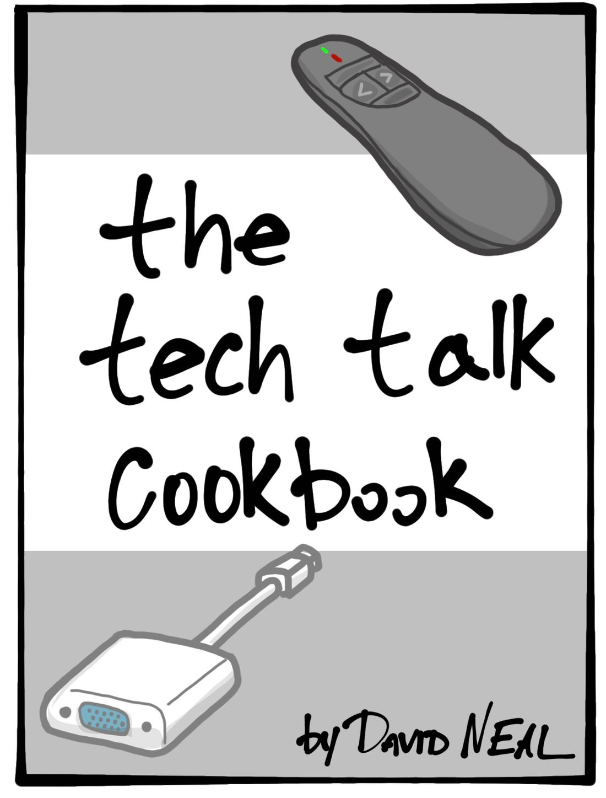

5 Essential Ingredients for an Awesome Tech Talk

Tuesday, September 24, 2019

10:08 AM

Recortado de: <https://reverentgeek.com/5-essential-ingredients-for-an-awesome-tech-talk/>

I believe one of the big reasons people are afraid of public speaking (or writing) is [impostor syndrome](https://en.wikipedia.org/wiki/Impostor_syndrome). You may think...

“I’m not an expert! I barely know anything! Everyone will know I’m a fraud!”

Psst... here’s a secret: You don’t have to be an expert!

In fact, you have something no one else in the entire world has. Your experience.

Here’s a recipe for turning your experience into an awesome presentation!

1. Why did you choose this technology?

People can argue semantics, “best practices,” architecture, speed, or “Technology A” vs. “Technology B” all day long. But, no one can dispute your experience. Tell people your story. What was your motivation for choosing this technology, or for replacing “Technology A” with “Technology B?” What problems were you trying to solve? Chances are, your reasons “why” will resonate with other people in similar situations.

2. What does this technology do?

Do some research and put together a short list of highlights, features, and capabilities. This is your opportunity to geek out and dive a little deeper into this technology beyond your particular use case. Seek to find other scenarios where this technology is a good fit. This information can help bridge gaps for your audience.

3. How did you make it work?

Give your audience more of your story. They want to hear about the challenges and issues you faced along the way. Most of all, they want your insights! You learned the hard way what worked and what didn’t work, so share the good stuff! Including…

What mistakes did you make?

“No way! I already feel like an impostor, and now you want me to remove any doubt?!”

You might think admitting your mistakes will harm your reputation or credibility. Nope! Being transparent about your mistakes and what you learned from them adds to your credibility! I don’t know about you, but I make mistakes all the time. I want to hear from real humans doing real work -- people I can relate to.

If you were to do it all over, what would you do differently? Turn your challenges and mistakes into key takeaways for your audience!

Demo, if you must

A good demo can be the final puzzle piece needed to convince someone to try this technology. A working demo is great, but so are screen shots or a recorded video!

For the love of all that is holy, don’t do any live coding unless you are specifically demoing features of an IDE!

Your demo should only exist to reinforce your “why” for choosing this technology. Make it short and to the point, and show them something awesome! Don’t waste your audience’s time showing “how.” They can easily find that information for themselves on the Internet later. Your job is to convince them to go try it!

In my opinion, no demo is better than a bad one.

4. Where to get started?

You did the research. You made it work. Give your audience links to put them on the fast track! Better yet, give them one link where they can go to get your slides, your contact information, and a list of all the resources you recommend.

5. Drop the mic\*

Wrap it up. Send them off with a call to action and high-fives!

Bake in the oven at 350 for 45 minutes

Imagine yourself in the future. You just finished giving a talk covering these five essential ingredients. Guess what?

BOOM.

You just gave an awesome talk. Your audience is now walking away with valuable information they could not have found anywhere else.

Now, go make it happen!

\*Metaphorically speaking. Real microphones are fragile, and expensive. Just ask [Kyle Welch](https://twitter.com/kylewelch).

Created with Microsoft OneNote 2013.
