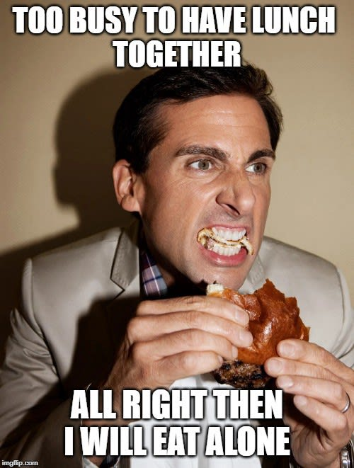
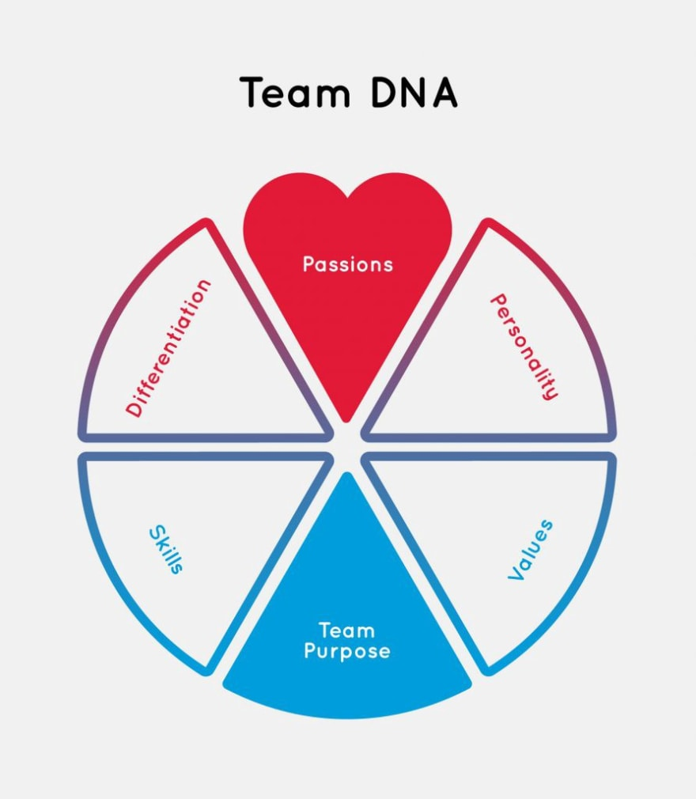
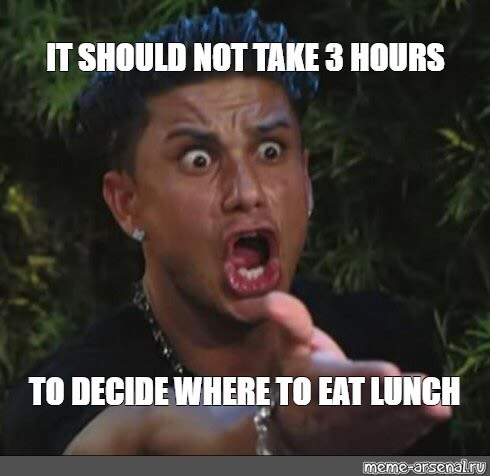
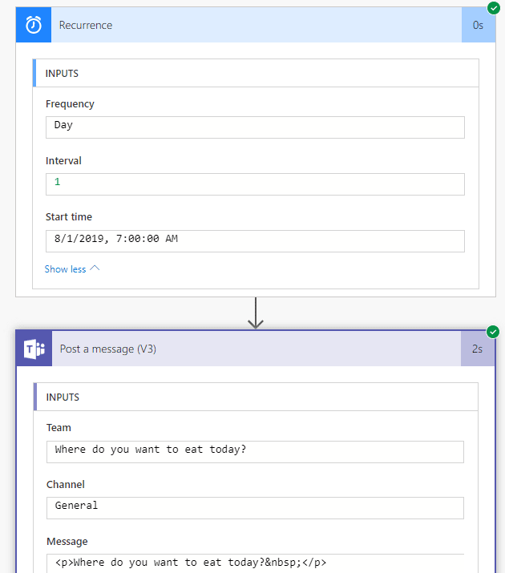

The social glue of the team’s lunch - DEV Community 👩‍💻👨‍💻

Thursday, December 5, 2019

7:23 PM

Recortado de: <https://dev.to/dejavo/the-social-glue-of-the-team-s-lunch-32ed>

Everybody has to eat, right? Families like to eat together, and friends frequently meet for dinner, and colleague regularly socialize over lunch.

Recent research by [Cornell University](http://www.tandfonline.com/doi/full/10.1080/08959285.2015.1021049) found that employees who ate meals together had significantly better team performance at work than those who didn’t.

“During the study, we noticed that not sharing mealtimes was a signal that something deeper was wrong with the way the group worked , something that was then reflected in the team’s performance.” — [according](https://www.morningfuture.com/en/article/2018/03/23/social-eating-team-building/260/) to Kevin Kniffin, Professor of Economics at Charles H. Dyson Cornell University, who published the research.

[Eat alone](https://imgflip.com/i/37r3bx) — by imgflip.com

It means that eating alone makes you less efficient. Furthermore, I deduce that the importance of a team’s lunch ritual is comparable to eating with your family. It should be ingrained into the team’s culture to take the time to sit down and have meals together.

As a result, organizations that invest in cafeterias improve employee’s performance and collaboration. The right infrastructure provides a conversation starter in a space where colleagues can share their lunch and communicate better.

By now, I’m pretty sure you’ve already noticed that most of your awaken time is shared with this group of people. Practically, you see them more than your family which, and I guess, will be more fun if you know them better.

Hence, socializing with colleagues doesn’t end with a team’s lunch. From time to time, meeting outside of work in a bar, restaurant, or whatever fits the team’s unique DNA will lead to a stronger bond between team members.

[Sculpt Team DNA](http://jodierogers.com/your-journey/sculpt-team-dna/) — by jodierogers.com

IMHO, every manager seeks for the secret of cultivating teams, that elusive chemistry which makes high achieving teams. A few years ago, a study named “[The New Science of Building Great Teams](https://hbr.org/2012/04/the-new-science-of-building-great-teams)” looked at 21 organizations and 2500 employees over seven years, concluded that the following make a great team:

- Regularly face-to-face communication.
- Psychological safety environment, where everyone can talk and listen equally. I mean everybody, not just the leaders do the talking.
- Social time is critical; it accounts for more than 50% of positive changes in communication patterns — a game-changer between high-performing and low-performing teams.
- Teams who tend to share knowledge between team-members perform better.

All of the above is facilitated simply by just eating together. A big surprise? I guess no; since it creates a fertile ground for them to flourish.

A significant hurdle to cross is deciding where to eat since each one has his own taste and food preferences. A suggested approach is using one of the collaborative tools which allow creating a Form (kind of survey) or a repetitive message where everyone shares what’s on their mind. The chosen option will be the one that the majority voted.

[Lunch](https://www.meme-arsenal.com/en/create/template/483897) — by meme-arsenal.ru

For example, a connection between the [Microsoft Teams](https://products.office.com/en-US/microsoft-teams/group-chat-software) and [Micorosft Flow](https://flow.microsoft.com/en-us/) services can be the solution. Flow generates a scheduled message into a specific Team’s channel where all team members are enlisted and can vote on their preferred choice. As can be seen below:

Flow recipe

Naturally, on regular ( up to [two-pizza size](https://buffer.com/resources/small-teams-why-startups-often-win-against-google-and-facebook-the-science-behind-why-smaller-teams-get-more-done/amp) 🍕) team, it’s easier to schedule a shared lunch. In the case of a larger group, such cadence can be hard to achieve without a proper framework in place. Where only some days are defined as whole-team lunch, otherwise it will rarely happen due to the tendency to split into smaller groups with shared preferences.

Eventually, eating together creates an open dialogue that generates an informal talk and sparks innovative ideas. The firmer the bond between fellow workers, the more prolific the team gets.

Created with Microsoft OneNote 2013.
