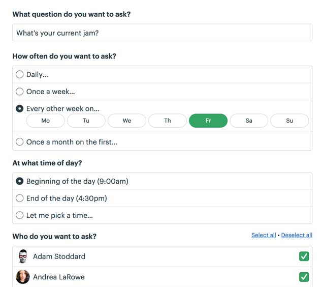
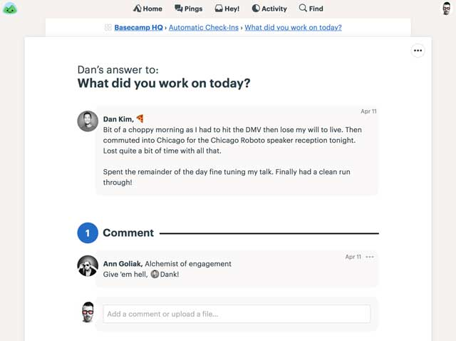

# Automatic Check-ins: Keep everyone in the know

The best of all practices is to check in with your team regularly. But the hardest of all practices is consistently doing it! Things slip, schedules slide, you get busy, and before you know it you’re out of touch. Uh oh!

Let Basecamp do some work for you! Basecamp can *automatically* ask your team any questions you want on a consistent schedule. Every day, once a week, every other week, once a month – you decide. Just set it up once, and you’re in the know forever!

---

## Examples of DAILY check-ins

Some stuff you want to keep up on every day. BTW, the faces show the people on your team who’ve answered the question so far today.

## Examples of WEEKLY check-ins

Some questions you might want to ask once a week.

Our own customer service team asks these next two:

## Examples of less frequent check-ins

Other questions may only be relevant every few weeks or once a month.

## Setting up a check-in is easy

Just tell Basecamp the question you want to ask, who you want to ask, and how often, and Basecamp takes care of the rest. Team members get a notification from Basecamp when it’s time to answer, and everyone’s answers flow back into Basecamp. Automatic, organized, nice and neat.

## Answers are just the beginning

When someone answers a check-in question, their answer serves as a kick-off point for a full discussion. This is the magic of Basecamp - discussions are in context. Any follow-ups posted about that answer will always appear directly below the original answer (which makes them easy to refer to later).

[Give Basecamp a Try](https://basecamp.com/signup)

12,759 companies signed up in the last week alone!
