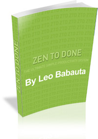

# Resumo do Livro Zen To Done (ZTD) de Leo Babauta

**Aqui você encontrará uma visão geral do conteúdo do  livro Zen To Done.**

O livro Zen To Done (ZTD) do autor Leo Babauta, tem como principal meta explicar os 10 hábitos propostos pelo sistema ZTD, dos quais podem mudar sua vida (ou a minha), ajudando à quem conseguir por em prática todos ou alguns destes hábitos, a ter uma vida mais organizada e sem estresse.

**Zen To Done** é um sistema de uma só vez simples e poderoso, e pode ajudar os leitores a desenvolver aqueles hábitos propostos no livro para manter todas suas tarefas e projetos organizados, manter seu dia de trabalho simples e estruturado, sua mesa e sua caixa de entrada do e-mail vazia, e por último nós ajudará a manter o foco em que estamos fazendo, sem distrações.

O sistema que o autor propõe me parece brilhante. Sendo simples e objetivo com a vida teria que ser para todos nós. Prometendo que se colocados em prática o sistema como um todo vamos fazer as coisas acontecerem de verdade.

## Os 10 hábitos propostos pelo ZTD:

1. **Capture:** Hábito captura onipresente: carregue um caderninho, bloco de notas ou qualquer coisa onde você possa anotar as idéias e livrar seu cérebro das informações que te surgem todo momento.
2. **Processe:** Hábito processe e decida rápido: tenha poder de decisão, para que possa selecionar as atividades mais importantes, super importantes e as simples.
3. **Planeje:** Hábito defina Tarefas Importantes, com planejamento você pode deixa sua vida mais simples e organizada.
4. **Faça:** Crie o hábito de fazer uma tarefa de cada vez, sem distrações.
5. **Sistema confiável e simples:** Adquira o hábito de manter um sistema simples e fácil de acompanhá-lo.
6. **Organize:** Hábito: um lugar para tudo. Deixe tudo em seu devido lugar.
7. **Revise:** Faça revisões semanais, mensais e anuais de seus projetos e de suas Tarefas Mais Importantes.
8. **Simplifique:** Simplifique sua vida.
9. **Rotina:** Crie uma rotina saudável e com hábitos de organização, assim você tem tudo controlado e sabe exatamente o que vai acontecer a cada dia.
10. **Encontre sua paixão:** Hábito:\*\* procure o trabalho pelo qual você é apaixonado.

Uma parte essencial do método ZTD é adquirir os 10 hábitos, um de cada vez.

Você pode também adquirir somente alguns hábitos e não todos os 10. Defina os mais importantes para você e simplifique o máximo.

O ZTD se concentra em simplificar. Tire o tanto quanto puder dos seus deveres, pra que você possa se concentrar em fazer o que é importante, e fazer bem feito. Os ensinamentos do livro (método ZTD) pede pra que você identifique as coisas grandes que você quer fazer na semana e no dia. Outro hábito doZTD é o de rever suas metas a cada semana, de modo a continuar concentrado nelas durante o ano.

Após a leitura (há mais de 3 anos) me considero muito mais produtivo. O que me permite ter tempo suficiente para procurar, estudar e compriender sobre temas financeiros e aprimorar minha vida financeira, buscando assim os melhores investimentos e as mais rentáveis diversidades de uma carteira de investimento. Minha vida agora está muito mais sã, mais simples e mais concentrada. Faço minhas coisas normalmente, porém com mais produtividade — as tarefas do meu emprego, escrevo no meu blog, escrevo em outros blogs como convidado, sou colaborador de uma revista na Irlanda, completo projetos pessoais, e ainda assim tenho tempo pra minha família. Sou mais feliz e produtivo, e tudo graças a poucas e simples mudanças de hábitos.

Leitura agradável. Recomendo !!

**Uma das versões para o nosso idioma disponíveis gratuitamente (e legalmente!) é a [tradução feita pelo Lucas Teixeira](http://lucasteixeira.com/ztd).**

No próprio site de Lucas existem diferentes formatos para download:

- [PDF](http://lucasteixeira.com/arquivos/ztd.pdf)
- [TXT (Markdown)](http://lucasteixeira.com/arquivos/ztd.txt)
- [EPUB](http://lucasteixeira.com/arquivos/ztd.epub)
- [Mobipocket](http://lucasteixeira.com/arquivos/ztd.mobi) (criado por [Diego Albuquerque](http://www.ultimolog.com/))

**Um forte abraço a todos e até a próxima.**

07 May 2011

- [Dicas financeiras](https://www.financasforever.com.br/categories#Dicas-financeiras)
- [Livros e eBooks](https://www.financasforever.com.br/categories#Livros-e-eBooks)

- [#Coaching](https://www.financasforever.com.br/tags#Coaching)
- [#Livros](https://www.financasforever.com.br/tags#Livros)
- [#coaching financeiro](https://www.financasforever.com.br/tags#coaching-financeiro)
- [#finanças](https://www.financasforever.com.br/tags#finan%C3%A7as)
- [#leo babauta](https://www.financasforever.com.br/tags#leo-babauta)
- [#produtividade](https://www.financasforever.com.br/tags#produtividade)
- [#zen to done](https://www.financasforever.com.br/tags#zen-to-done)
- [#ztd](https://www.financasforever.com.br/tags#ztd)

[« #precojusto - protesto online para a redução de impostos.](https://www.financasforever.com.br/precojusto-protesto-online-para-a-reducao-de-impostos/)
[Empreendedorismo moderno »](https://www.financasforever.com.br/empreendedorismo-moderno/)
