- [Trabalho](https://vidaorganizada.com/categoria/trabalho/)
- [Ferramentas de organização](https://vidaorganizada.com/categoria/trabalho/ferramentas/)

# Meu Bullet Journal para Janeiro 2020

Por

[Thais Godinho](https://vidaorganizada.com/author/thais-godinho-2/)

-

15/01/2020

[**8](https://vidaorganizada.com/2020/01/15/meu-bullet-journal-para-janeiro-2020/#comments)

**1340

**

Compartilhar

**

**

**

**

**

**

**

**

**

**

Eu fiz um apanhado das páginas dos cadernos que usei ano passado como Bullet Journal, então nada mais justo que mostrar a configuração para o caderno que comecei a usar no começo deste ano, em janeiro.

Nós estamos fazendo algumas manutenções no servidor do blog e, por isso, algumas vezes as imagens não estão carregando nos posts. Se isso acontecer, você pode visualizar todas as imagens do post nos seguintes painéis no Pinterest:

- [Meus Bullet Journals de 2019](https://br.pinterest.com/vidaorganizada/meus-bullet-journals-de-2019/)
- [Meus Bullet Journals de 2020](https://br.pinterest.com/vidaorganizada/meus-bullet-journals-de-2020/)

Eu publiquei um vídeo no YouTube fazendo uma resenha do modelo de caderno que eu usaria como BuJo agora, que é o Leuchtturm 1917 – um modelo de caderno bem usada lá na gringa e que eu comprei na minha última viagem para Amsterdam. Assista abaixo ou, se não estiver aparecendo para você o vídeo, [clique aqui](https://www.youtube.com/watch?v=PrLmODxMXVQ&t=3s).

Veja então como configurei o BuJo para uso este ano.

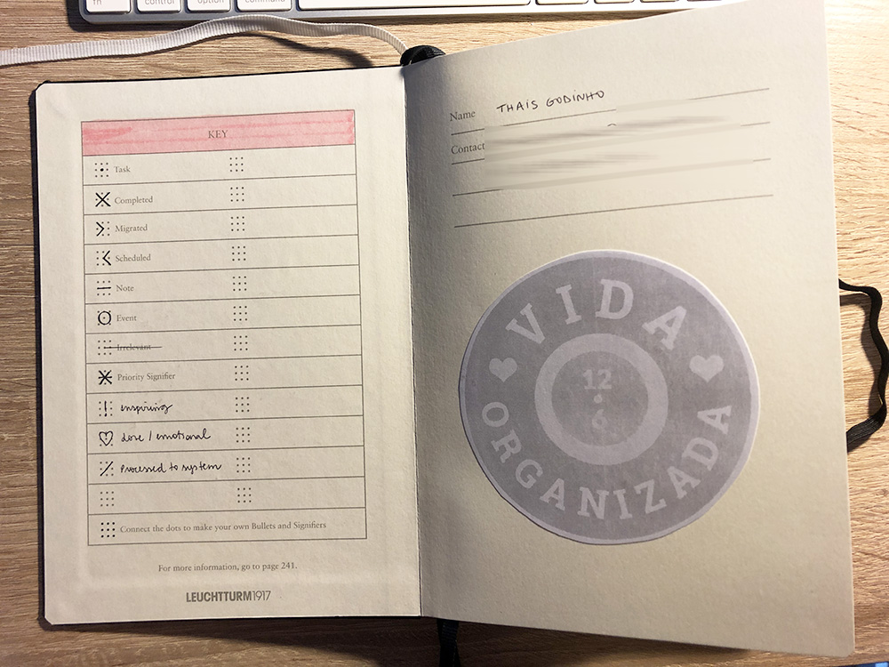

Nessa primeira página inicial dá para ver que eu tenho algumas KEYs personalizadas, que são: um ponto de exclamação para entradas inspiradoras, um coração para tudo o que for “amorzinho” e meio emocional, e um / para as entradas que eu processei e organizei no meu Trello. Nem tudo eu passo de um dia para o outro pois uso o GTD alinhado com o método do Bullet Journal. Comentei em [posts anteriores](https://vidaorganizada.com/2019/04/11/guia-definitivo-para-implementar-o-gtd-no-bullet-journal/) sobre essa distinção, que é importante.

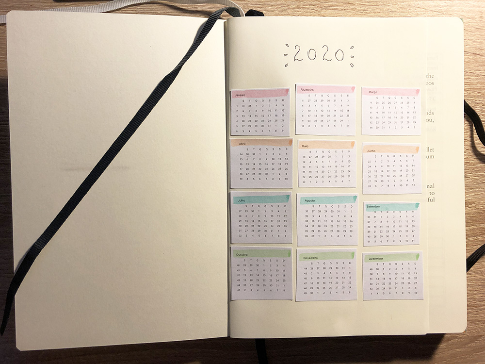

Imprimi da agenda do Google e recortei os meses para colocar nessa página. Ficou meio torto intencionalmente, mas eu esperava que o resultado ficasse um pouco melhor! kkk Mas tudo bem. O importante é ter a visão do ano inteiro sempre que eu precisar.

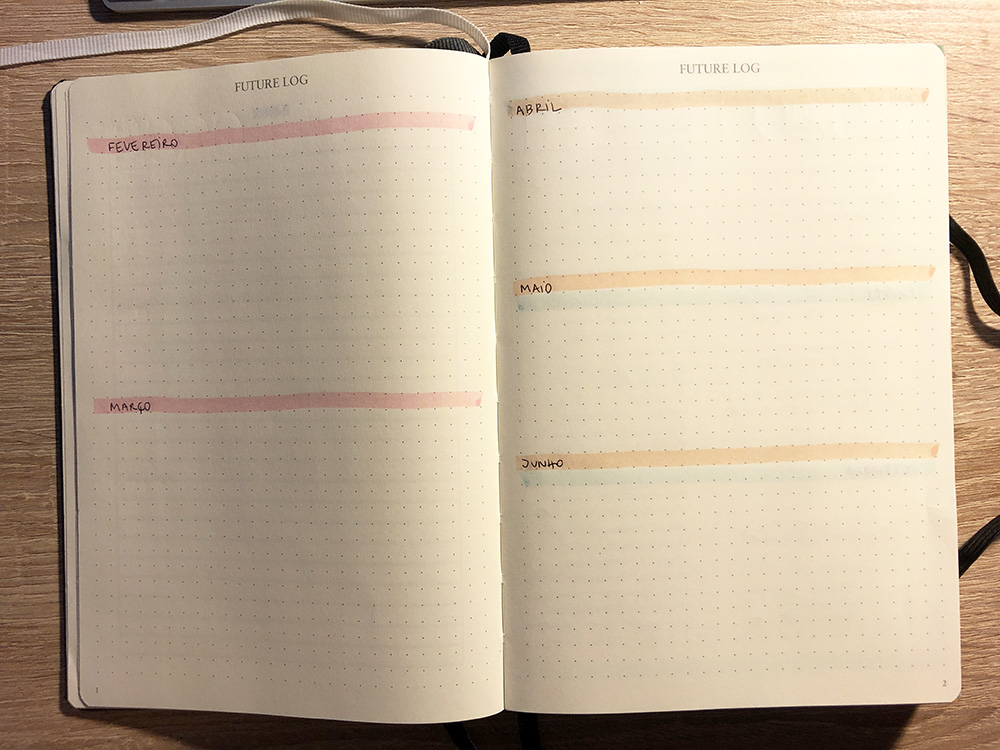 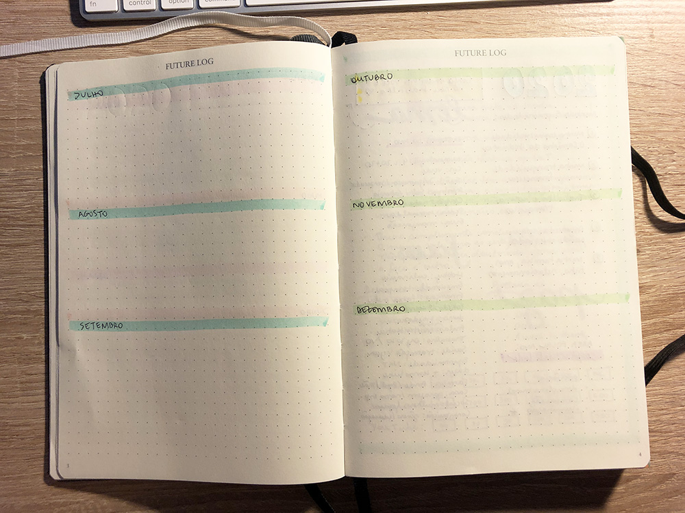

Como esse modelo de caderno só tem 4 páginas dedicadas ao log do futuro, eu dividi dessa maneira. A primeira página traz os dois outros meses do trimestre (com mais espaço por terem mais volume, por serem os próximos), e nas outras três páginas eu fiz um trimestre por página. Acho que ficou bom.

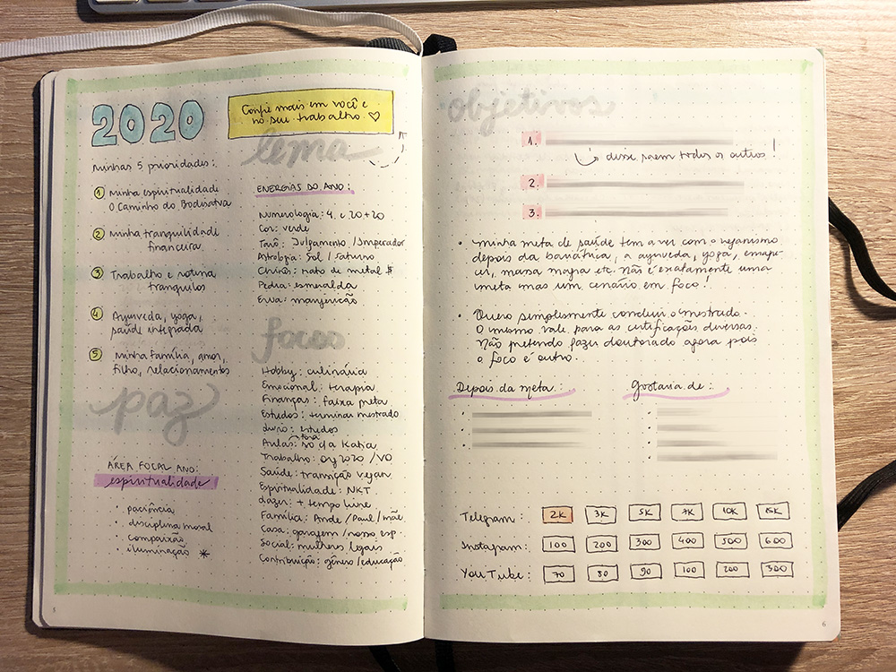

Eu adoro ter essa visão geral do ano – considero ela muito essencial porque, assim, eu consigo ver tudo o que coloquei no meu planejamento, sob um panorama geral. Tem o meu lema do ano, as 5 prioridades que escolhi, informações úteis, metas nas redes sociais e meus objetivos.

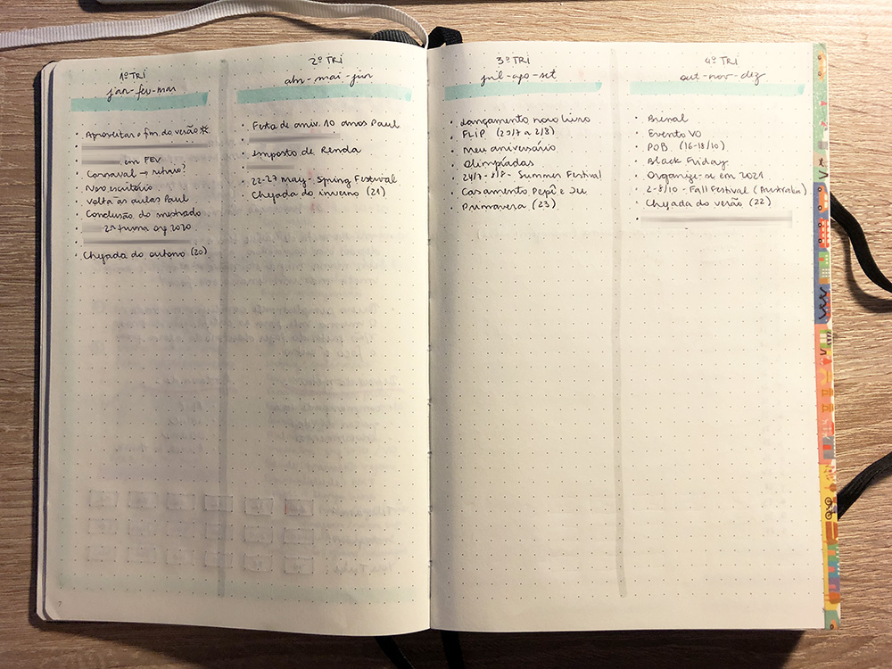

Depois da visão geral do ano eu gosto de trazer o planejamento geral dos 4 trimestres do ano, só com os eventos que eu já sei que vão acontecer.

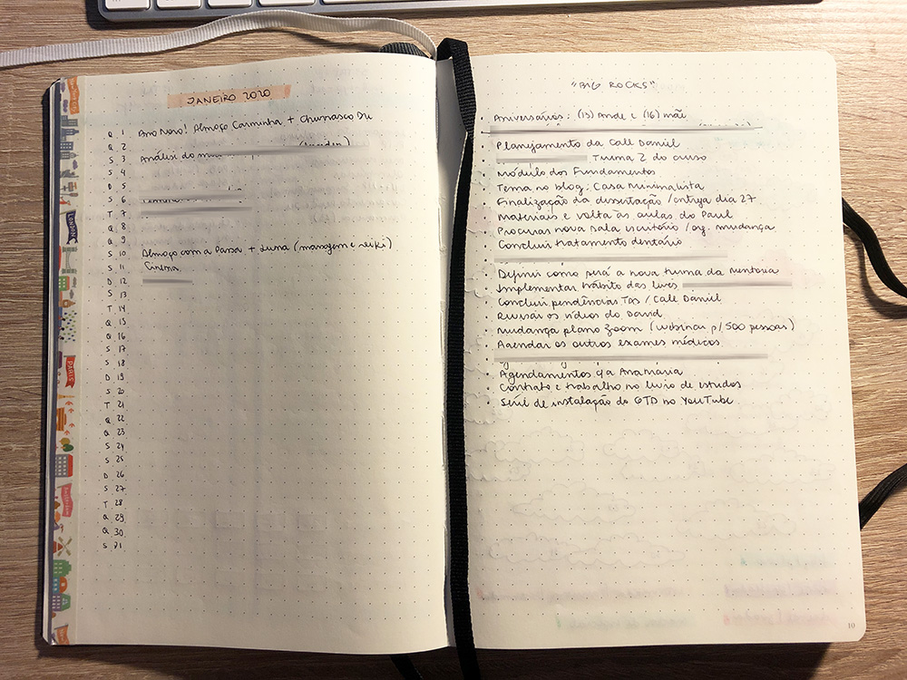

Eu preencho o log do mês à medida que ele vai acontecendo, e não como forma de “planejamento” (o planejamento é feito no log do futuro ou nos trimestres). Eu gosto de ter uma página com as big rocks do mês, que são marcos ou projetos que preciso concluir no mês em questão. Gosto de dividir os meses usando uma washi tape decorada na lateral da página.

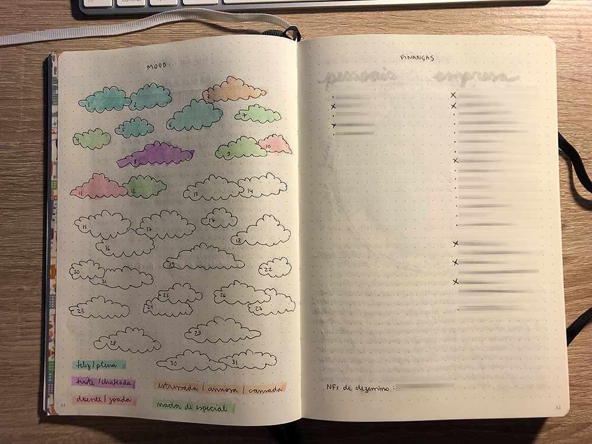

Essas duas coleções mensais são as mais úteis para mim. Apesar de eu controlar as minhas finanças pelo calendário (na agenda do Google) me ajuda demais ter essa página onde vou fazendo o registro financeiro de modo geral. A página do mood tracker eu mudo o tema todo mês para usar imagens que tenham a ver (para mim) com o mês em questão. Adoro preencher diariamente e fazer esse acompanhamento.

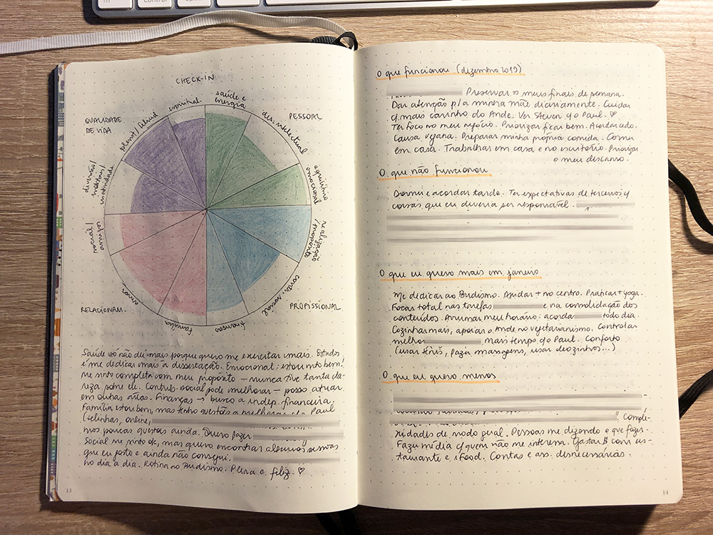

Essa é uma ideia nova! Eu pensei que seria legal, todo mês, ter uma seção que eu estou chamando de “check-in”. Por quê? Eu já tradicionalmente faço todo mês uma revisão das áreas da minha vida por causa do GTD. Logo, achei que seria bacana fazer um registro dessa análise todo mês no meu Bullet Journal. Eu desenhei a roda da vida, com as áreas da vida como quero analisar, e escrevi alguns apontamentos úteis que me trazem uma análise geral de como eu me sinto.

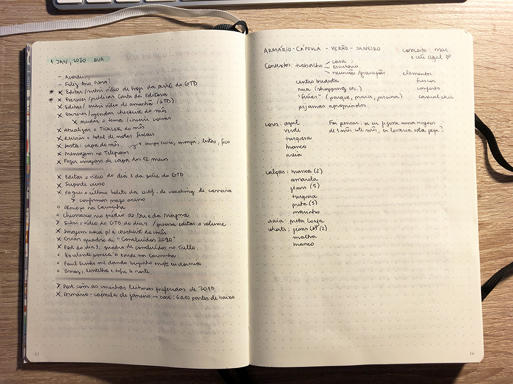

Aqui está um exemplo de como eu uso o log diario para captura e registro das atividades ao longo de um dia. Também trago uma collection super simples que criei quando estava planejando o armário-cápsula de verão (que eu deixei para fazer em janeiro mesmo).

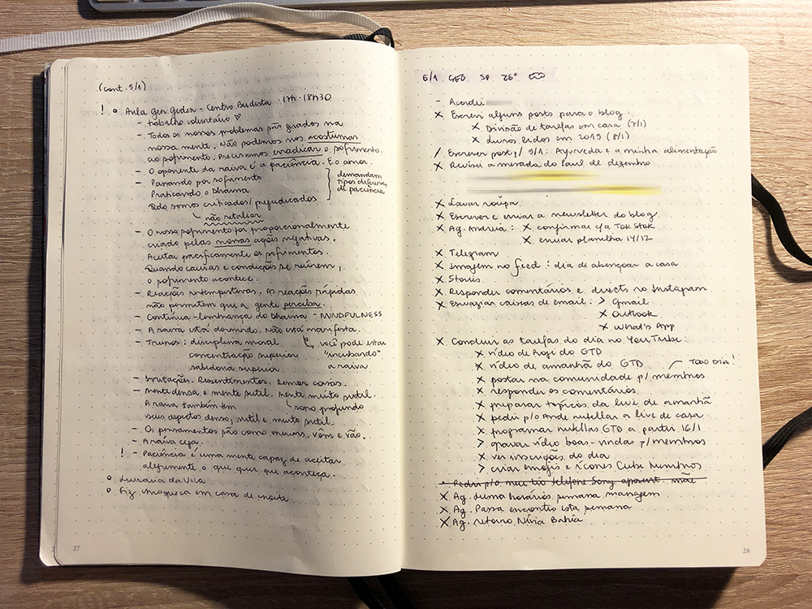

Quis trazer outro exemplo de log diário pois estou fazendo uma tentativa de trazer para o BuJo registros de aulas e reuniões que tenho feito, para marcar no dia em que fui mesmo. Ainda não sei se será o melhor formato. Estou tentando conciliar com o Commonplace Book.

Espero que tenha gostado. 
