# Moebius sends Batman to the shrink for Penthouse Comix, 1995

Moebius sends Batman to the shrink for Penthouse Comix, 1995

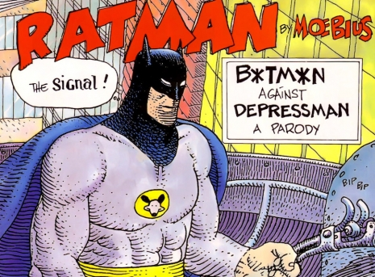

It wasn’t the usual practice for Jean Henri Gaston Giraud, a.k.a. [Moebius](https://www.amazon.com/gp/search/ref=as_li_qf_sp_sr_il_tl?ie=UTF8&tag=boxoffbof-20&keywords=moebius&index=aps&camp=1789&creative=9325&linkCode=xm2&linkId=ab3dcadbdb5f4695a60b0422fe49470d), to wade all too deeply into the superhero genre, but he did tackle a few of the well-known DC and Marvel titans, including, among others, [Superman](http://comicsalliance.com/files/2011/06/tumblrlcrc9gcri51qf0aafo11280.jpg), [Wolverine](http://comicsalliance.com/files/2011/06/tumblrlcee5qntcx1qf0aafo11280.jpg), and [Iron Man](http://comicsalliance.com/files/2011/06/tumblrliud6ul2xi1qf0aafo11280.jpg). Over the weekend, the irreplaceable comix artist Derf Backderf, author of *[My Friend Dahmer](https://www.amazon.com/gp/search/ref=as_li_qf_sp_sr_il_tl?ie=UTF8&tag=boxoffbof-20&keywords=my%20friend%20dahmer&index=aps&camp=1789&creative=9325&linkCode=xm2&linkId=d14645b1b0abe4d0cf9379f53be13b4f)*, [related](https://twitter.com/DerfBackderf/status/995458717876477952) to his Twitter followers the strange story of Moebius’ peculiar Batman parody, which readers of the publication Penthouse Comix encountered in 1995.

According to Derf, Moebius had a concept for a [Batman](https://www.amazon.com/gp/search/ref=as_li_qf_sp_sr_il_tl?ie=UTF8&tag=boxoffbof-20&keywords=Batman&index=aps&camp=1789&creative=9325&linkCode=xm2&linkId=01946946e3a88aedda504ce11301d84e) narrative that he took to DC, and “for reasons known only to them, they rejected it. That’s right. DC rejected a Moebius story. Sigh.” It ended up at [Penthouse Comix](https://www.amazon.com/gp/search/ref=as_li_qf_sp_sr_il_tl?ie=UTF8&tag=boxoffbof-20&keywords=Penthouse%20Comix&index=aps&camp=1789&creative=9325&linkCode=xm2&linkId=448755a0a2df5940d21b66f34d139b53), which seems to have had deep pockets. Penthouse Comix, which existed for 32 issues, was a pretty grim affair—Derf describes it as “a cross between [Metal Hurlant](https://www.amazon.com/gp/search/ref=as_li_qf_sp_sr_il_tl?ie=UTF8&tag=boxoffbof-20&keywords=Metal%20Hurlant&index=aps&camp=1789&creative=9325&linkCode=xm2&linkId=776929868d9ff34796972ba1cf13d74c) and [Eros Comics](https://www.amazon.com/gp/search/ref=as_li_qf_sp_sr_il_tl?ie=UTF8&tag=boxoffbof-20&keywords=Eros%20Comics&index=aps&camp=1789&creative=9325&linkCode=xm2&linkId=54ae5ae2db1f0c6e3c8a8458ec41a31f)” and notes that “the whole run was high on creep factor.” You should certainly read [Derf’s full thread](https://twitter.com/DerfBackderf/status/995458717876477952) (which is quite funny) to get a fuller picture.

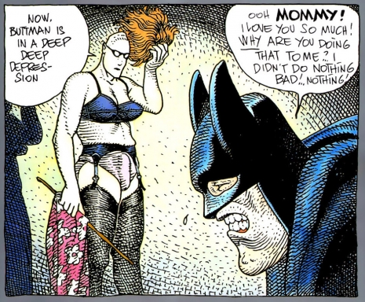

The story is a rare instance of a Batman parody that could withstand the threat of DC’s intimidating legal team. Even so, Penthouse Comix/Moebius took pains to make it clear that the hero of the tale was not the well-known crimefighter Batman, despite all of the visual evidence in the comic itself. The story sort of has three titles: the first is “I AM NOT BATMAN” (that’s what appeared on the cover)—the first page of the story itself features two titles of sorts, one being “RATMAN BY MOEBIUS” and the other being “B\*TM\*N AGAINST DEPRESSMAN: A PARODY.” I figure that just in the few words already mentioned, the premise that this *is* Batman but is *definitely not* Batman is signaled about four different ways. Attorneys duly placated and/or told to fuck off, they could proceed with the narrative.

In the story, the character variously referred to as “Beetman,” “Bootman,” “Buttman,” and “Bitman” confronts a jewel thief in what is later referred to as the “Supertherapist’s office”; this malefactor is “Depressman,” who eventually (with the use of costumery) sends the caped crusader through the gauntlet of confronting his own mother in something much like Freud’s primal scene. The entire comic is below—enjoy the sublime linework of the French master.

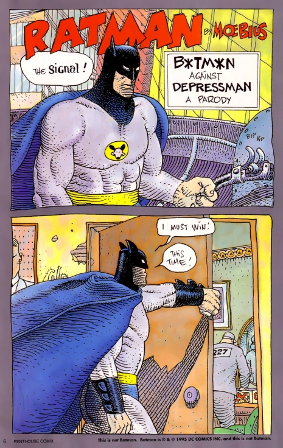

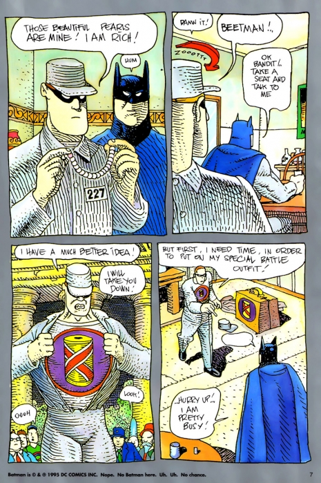

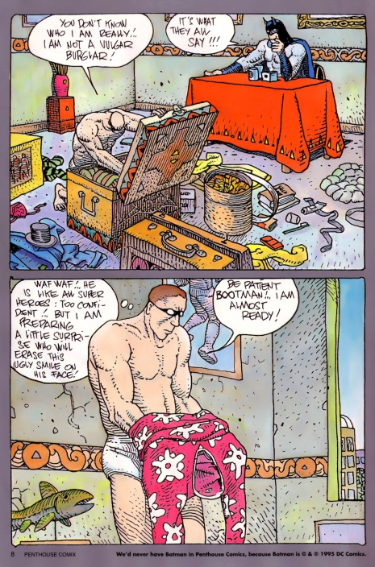

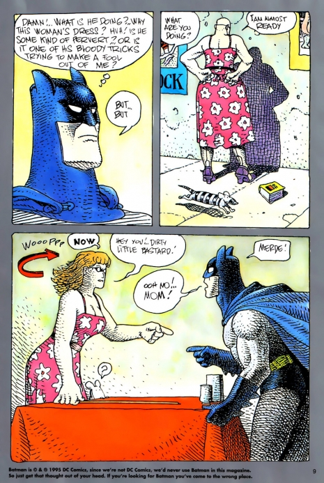

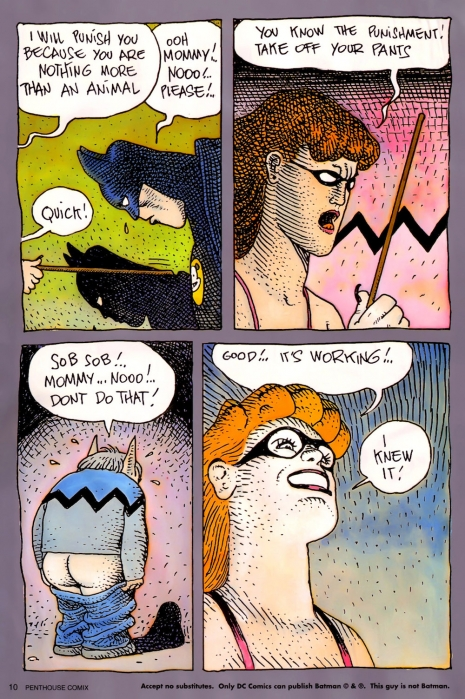

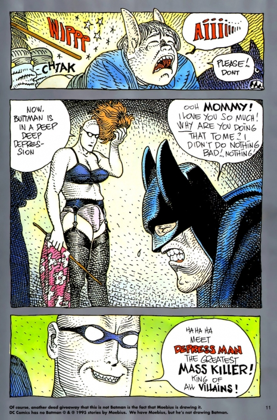

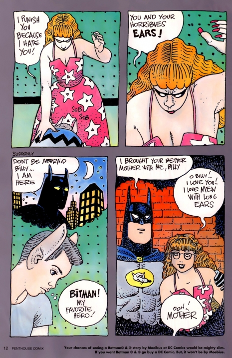

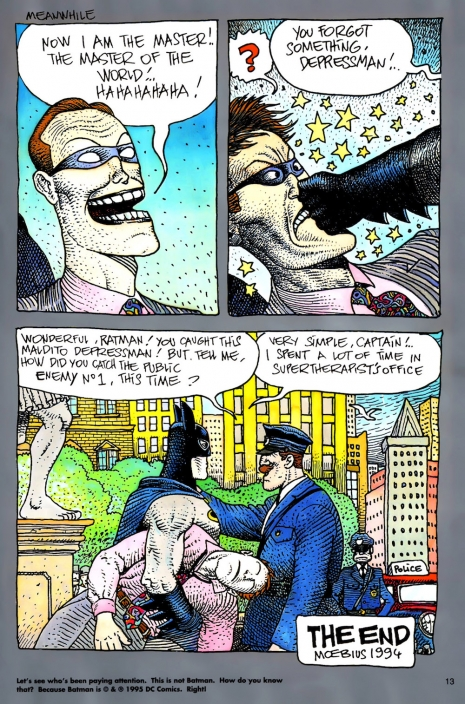

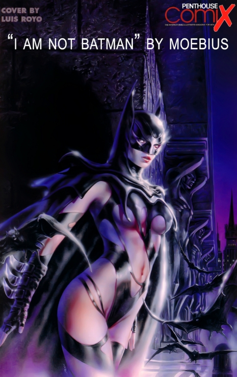
