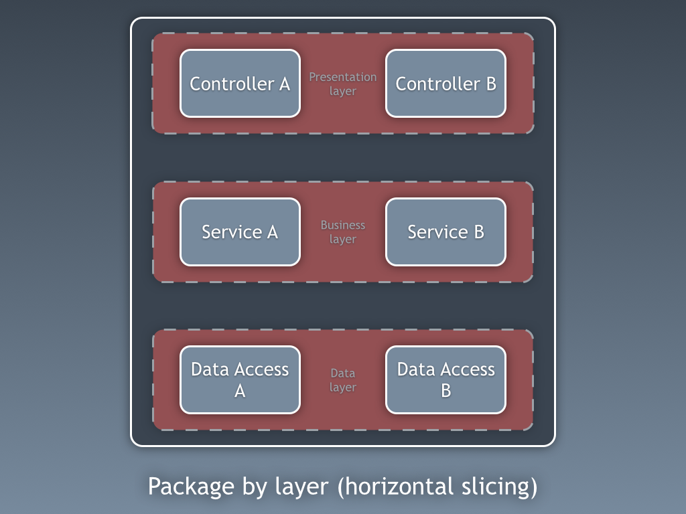
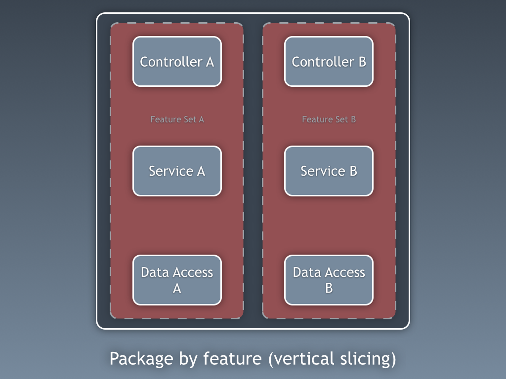
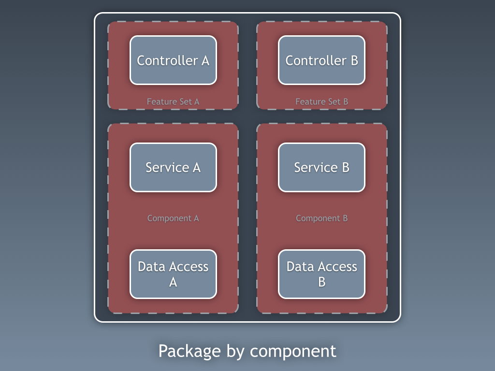
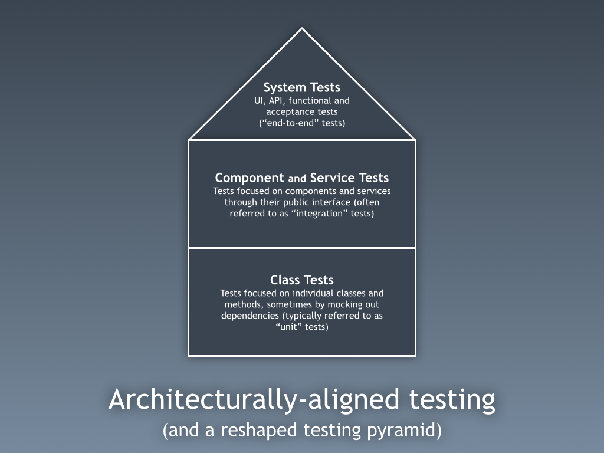

# Package by component and architecturally-aligned testing

I've seen and had lots of discussion about "package by layer" vs "package by feature" over the past couple of weeks. They both have their benefits but there's a hybrid approach I now use that I call "package by component". To recap...

### Package by layer

Let's assume that we're building a web application based upon the Web-MVC pattern. Packaging code by layer is typically the default approach because, after all, that's what the books, tutorials and framework samples tell us to do. Here we're organising code by grouping things of the same type.

There's one top-level package for controllers, one for services (e.g. "business logic") and one for data access. Layers are the primary organisation mechanism for the code. Terms such as "separation of concerns" are thrown around to justify this approach and generally layered architectures are thought of as a "good thing". Need to switch out the data access mechanism? No problem, everything is in one place. Each layer can also be tested in isolation to the others around it, using appropriate mocking techniques, etc. The problem with layered architectures is that [they often turn into a big ball of mud](http://tech.pro/blog/1498/why-the-n-layer-approach-is-bad-for-us-all) because, in Java anyway, you need to mark your classes as public for much of this to work.

### Package by feature

Instead of organising code by horizontal slice, package by feature seeks to do the opposite by organising code by vertical slice.

Now everything related to a single feature (or feature set) resides in a single place. You can still have a layered architecture, but the layers reside inside the feature packages. In other words, layering is the secondary organisation mechanism. The often cited benefit is that it's "easier to navigate the codebase when you want to make a change to a feature", but this is a minor thing given the power of modern IDEs.

What you can do now though is hide feature specific classes and keep them out of sight from the rest of the codebase. For example, if you need any feature specific view models, you can create these as package-protected classes. The big question though is what happens when that new feature set C needs to access data from features A and B? Again, in Java, you'll need to start making classes publicly accessible from outside of the packages and the big ball of mud will again emerge.

Package by layer and package by feature both have their advantages and disadvantages. To quote Jason Gorman from [Schools of Package Architecture - An Illustration](http://codemanship.co.uk/parlezuml/blog/?postid=539), which was written seven years ago.

> To round off, then, I would urge you to be mindful of leaning to far towards either school of package architecture. Don't just mindlessly put socks in the sock draw and pants in the pants draw, but don't be 100% driven by package coupling and cohesion to make those decisions, either. The real skill is finding the right balance, and creating packages that make stuff easier to find but are as cohesive and loosely coupled as you can make them at the same time.

### Package by component

This is a hybrid approach with increased modularity and an architecturally-evident coding style as the primary goals.

The basic premise here is that I want my codebase to be made up of a number of coarse-grained components, with some sort of presentation layer (web UI, desktop UI, API, standalone app, etc) built on top. A "component" in this sense is a combination of the business and data access logic related to a specific thing (e.g. domain concept, bounded context, etc). As [I've described before](http://www.codingthearchitecture.com/2014/06/01/an_architecturally_evident_coding_style.html), I give these components a public interface and package-protected implementation details, which includes the data access code. If that new feature set C needs to access data related to A and B, it is forced to go through the public interface of components A and B. No direct access to the data access layer is allowed, and you can enforce this if you use Java's access modifiers properly. Again, "architectural layering" is a secondary organisation mechanism. For this to work, you have to [stop using the public keyword by default](http://www.codingthearchitecture.com/2014/10/01/modularity_and_testability.html). This structure raises some interesting questions about testing, not least about how we mock-out the data access code to create quick-running "unit tests".

### Architecturally-aligned testing

The short answer is don't bother, unless you really need to. [I've spoken about](https://www.youtube.com/watch?v=ehH3UGdSwPo) and [written about](http://www.codingthearchitecture.com/2014/10/01/modularity_and_testability.html) this before, but architecture and testing are related. Instead of the typical testing triangle (lots of "unit" tests, fewer slower running "integration" tests and even fewer slower UI tests), consider this.

I'm trying to make a conscious effort to not use the term "unit testing" because everybody has a different view of how big a "unit" is. Instead, I've adopted a strategy where some classes can and should be tested in isolation. This includes things like domain classes, utility classes, web controllers (with mocked components), etc. Then there are some things that are easiest to test as components, through the public interface. If I have a component that stores data in a MySQL database, I want to test everything from the public interface right back to the MySQL database. These are typically called "integration tests", but again, this term means different things to different people. Of course, treating the component as a black box is easier if I have control over everything it touches. If you have a component that is sending asynchronous messages or using an external, third-party service, you'll probably still need to consider adding dependency injection points (e.g. ports and adapters) to adequately test the component, but this is the exception not the rule. All of this still applies if you are building a microservices style of architecture. You'll probably have some low-level class tests, hopefully a bunch of service tests where you're testing your microservices though their public interface, and some system tests that run scenarios end-to-end. Oh, and you can still write all of this in a test-first, TDD style if that's how you work.

I'm using this strategy for some systems that I'm building and it seems to work really well. I have a relatively simple, clean and (to be honest) boring codebase with understandable dependencies, minimal [test-induced design damage](http://david.heinemeierhansson.com/2014/test-induced-design-damage.html) and a manageable quantity of test code. This strategy also bridges the [model-code gap](http://www.codingthearchitecture.com/2014/05/29/software_architecture_vs_code.html), where the resulting code actually reflects the architectural intent. In other words, we often draw "components" on a whiteboard when having architecture discussions, but those components are hard to find in the resulting codebase. Packaging code by layer is a major reason why this mismatch between the diagram and the code exists. Those of you who are familiar with my [C4 model](https://leanpub.com/software-architecture-for-developers/read#c4) will probably have noticed the use of the terms "class" and "component". This is no coincidence. Architecture and testing are more related than perhaps we've admitted in the past.

p.s. [I'll be speaking about this topic over the next few months at events across Europe, the US and (hopefully) Australia](http://www.simonbrown.je/#speakingSchedule)

Posted by [Simon Brown](http://www.simonbrown.je/) on 08 March 2015 11:47:07 GMT
[#](http://www.codingthearchitecture.com/2015/03/08/package_by_component_and_architecturally_aligned_testing.html "http://www.codingthearchitecture.com/2015/03/08/package_by_component_and_architecturally_aligned_testing.html")

### About the author

Simon is an independent consultant specializing in software architecture, and the author of [Software Architecture for Developers](https://leanpub.com/b/software-architecture) (a developer-friendly guide to software architecture, technical leadership and the balance with agility). He’s also the creator of the [C4 software architecture model](https://c4model.com/) and the founder of [Structurizr](https://structurizr.com/), which is a collection of open source and commercial tooling to help software teams visualise, document and explore their software architecture.

You can find Simon on Twitter at [@simonbrown](https://twitter.com/simonbrown) ... see [simonbrown.je](http://simonbrown.je/) for information about his speaking schedule, videos from past conferences and software architecture training.

# Re: Package by component and architecturally-aligned testing

Comment from [Urs Enzler](http://www.planetgeek.ch/ "http://www.planetgeek.ch") on 16 April 2015 07:41:16 BST
[#](http://www.codingthearchitecture.com/2015/03/08/package_by_component_and_architecturally_aligned_testing.html#comment1429166476097 "http://www.codingthearchitecture.com/2015/03/08/package_by_component_and_architecturally_aligned_testing.html#comment1429166476097")

We had a lot of good experience with this kind of code organization. Especially in product families, where each individual product glued togethet a bunch of shared components.
Easy navigation, easy extensibility in an agile manner because of feature orientation, reuse of components possible, flexibility by glueing components together differently.

# Re: Package by component and architecturally-aligned testing

Comment from [Kevin Wittek](http://groovy-coder.com/ "http://groovy-coder.com") on 31 March 2016 22:38:01 BST
[#](http://www.codingthearchitecture.com/2015/03/08/package_by_component_and_architecturally_aligned_testing.html#comment1459460281584 "http://www.codingthearchitecture.com/2015/03/08/package_by_component_and_architecturally_aligned_testing.html#comment1459460281584")

Cool blog post, I really like your proposed test pyramid. It comes really close to my own mental model of different test classes (although I use the classic terms Unit-, Integration- and Acceptance-Tests).

I switched from package-by-layer style to package-by-feature some years ago. My problem is mostly, that I don't get my dependencies straight and this might lead to some awkward cyclic dependencies between packages.

What do you think about sub-packaging the outside layers inside the feature/component layers? I was thinking about trying something like
useCaseA: contains my business classes
useCaseA.web: contains the web layer for useCaseA
useCaseA.persistence: contains the persistence layer for useCaseA

It's a shame there is no sub-package concept in Java, I think it would allow for some interesting packaging approaches.

# Re: Package by component and architecturally-aligned testing

Comment from [Simon Brown](http://www.simonbrown.je/ "http://www.simonbrown.je") on 01 April 2016 09:21:26 BST
[#](http://www.codingthearchitecture.com/2015/03/08/package_by_component_and_architecturally_aligned_testing.html#comment1459498886331 "http://www.codingthearchitecture.com/2015/03/08/package_by_component_and_architecturally_aligned_testing.html#comment1459498886331")

Thanks! Yes, a sub-package concept in Java would open up some useful opportunities, especially if you could define classes that were only accessible by the parent package rather than being public. Java 9 modules will help with this of course, because you can make all classes public and only export those needed in the public interface of your module.
