# 10 HTML Elements You Didn't Know You Needed

[#html](https://dev.to/t/html)

18 de mar. de 2019
・4 min read

I’ve heard the sentiment “HTML is easy” more times than I can count. And while I would agree that HTML is perhaps easier to learn than other programming languages, you shouldn’t take it for granted.

HTML is a powerful markup language which can be used to give our web applications structure and provide powerful accessibility benefits, but only when used appropriately.

Thus, today we’ll discover ten HTML elements you might not have known existed in the hopes that you can create more accessible, and structurally-sound web applications.

*If you'd like to learn more about HTML, you can visit the [W3Schools](https://www.w3schools.com/tags/) for more HTML elements.*

# Audio

The `<audio>` tag defines a sound, such as music or other audio streams. There are three currently supported file formats: MP3, WAV, and OGG.

[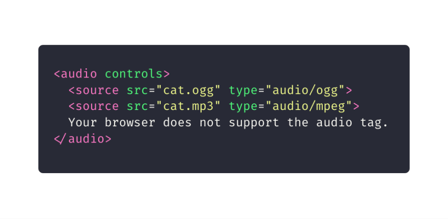](https://res.cloudinary.com/practicaldev/image/fetch/s--nGjFmT50--/c_limit%2Cf_auto%2Cfl_progressive%2Cq_auto%2Cw_880/https://cdn-images-1.medium.com/max/1600/1%2AGhqkT6tNG8M5bCYDyZUKEg.png)

# Blockquote

The `<blockquote>` tag specifies a section that is quoted from another source.

[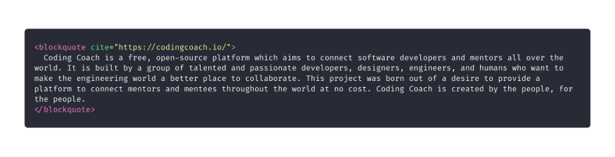](https://res.cloudinary.com/practicaldev/image/fetch/s--H3ODM9Kv--/c_limit%2Cf_auto%2Cfl_progressive%2Cq_auto%2Cw_880/https://cdn-images-1.medium.com/max/1600/1%2AKzvqrVvveN8IrdylL8tAQg.png)

# Output

The `<output>` tag represents the result of a calculation. You can use the plus sign and equal symbol to indicate that the first and second input values should be “outputted” to the output tag; you can denote this with a `for` attribute containing the ids of the two elements to combine.

[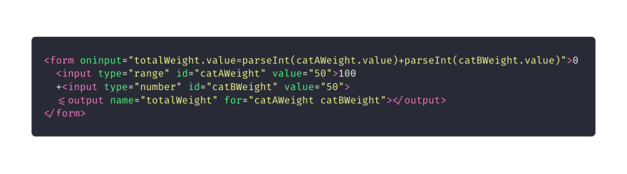](https://res.cloudinary.com/practicaldev/image/fetch/s--ZkJb36in--/c_limit%2Cf_auto%2Cfl_progressive%2Cq_auto%2Cw_880/https://cdn-images-1.medium.com/max/1600/1%2AA3MyPtKoCy7KiQfeMCTr_w.png)

# Picture

The `<picture>` tag allows you to specify image sources. Instead of having an image which you scale up and down depending upon the viewport width, multiple images can be designed to fill the browser viewport.

The picture tag contains two different tags: one or more `<source>` elements and one `<image>` element.

The source element has the following attributes:

- `srcset` (required): Defines the URL of the image to display
- `media`: Accepts any valid media query that you might define within CSS
- `sizes`: Defines a single width value, a single media query with width value, or a comma separated list of media queries with a width value
- `type`: Defines the MIME type.

The browser uses the attribute values to load the most appropriate image; it uses the first `<source>` element with a matching hit and ignores the subsequent source elements.

The `` tag is used to provide backwards compatibility if a browser doesn’t support the element or if none of the `<source>` tags match.

[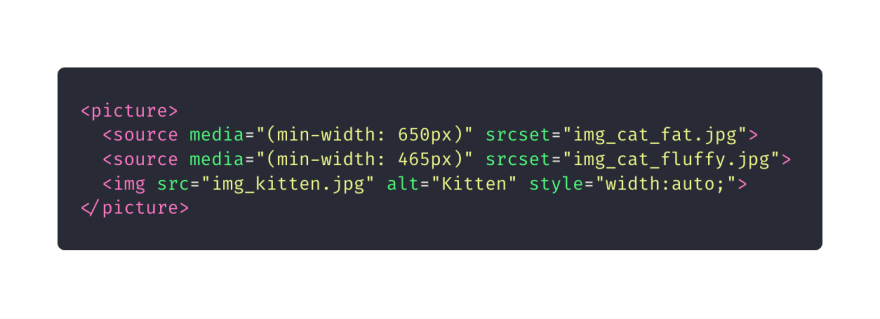](https://res.cloudinary.com/practicaldev/image/fetch/s--xcgO38wD--/c_limit%2Cf_auto%2Cfl_progressive%2Cq_auto%2Cw_880/https://cdn-images-1.medium.com/max/1600/1%2A7khhupYDoVE0cNaiykBoQg.png)

# Progress

The `<progress>` tag represents the progress of a task.

The `<progress>` tag is not a replacement for the `<meter>` tag, thus components indicating disk space usage or query result relevance should use the `<meter>` tag.

[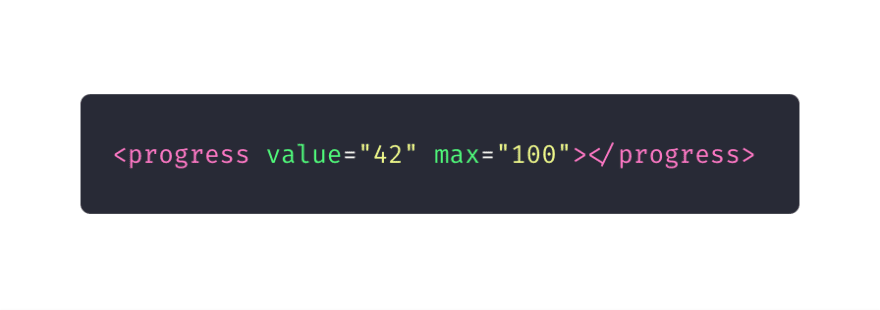](https://res.cloudinary.com/practicaldev/image/fetch/s--Oe8ETABf--/c_limit%2Cf_auto%2Cfl_progressive%2Cq_auto%2Cw_880/https://cdn-images-1.medium.com/max/1600/1%2AnQhZIYv1VDdUHvx_mZvy0g.png)

# Meter

The `<meter>` tag defines a scalar measurement within a defined range, or a fractional value. You can also refer to this tag by the name “gauge.”

You can use the `<meter>` tag to display disk usage statistics or to indicate the relevance of search results.

The `<meter>` tag should not be used to indicate progress of a task; these types of components should be defined by a `<progress>` element.

[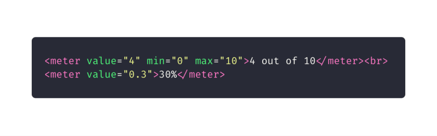](https://res.cloudinary.com/practicaldev/image/fetch/s--sZGZPtqV--/c_limit%2Cf_auto%2Cfl_progressive%2Cq_auto%2Cw_880/https://cdn-images-1.medium.com/max/1600/1%2Acsl2_IT6gtFQkCMhC09zRg.png)

# Template

The `<template>` tag contains content that is hidden from the user, but will be used to instantiate HTML code repeatedly.

[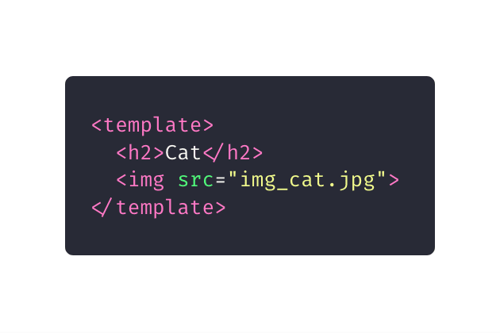](https://res.cloudinary.com/practicaldev/image/fetch/s--MCPbgQVf--/c_limit%2Cf_auto%2Cfl_progressive%2Cq_auto%2Cw_880/https://cdn-images-1.medium.com/max/1600/1%2AkXZen0gUvApkjtqNFKIF-A.png)

Using JavaScript, you can render this content with the `cloneNode()` method.

[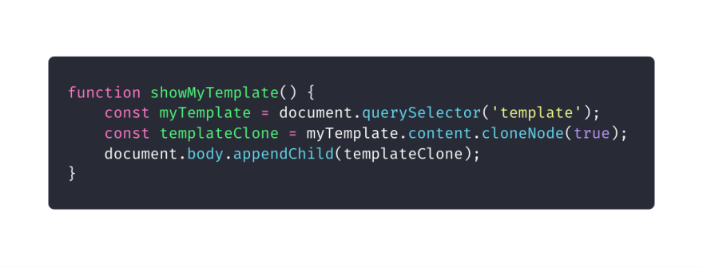](https://res.cloudinary.com/practicaldev/image/fetch/s--zcduNpgA--/c_limit%2Cf_auto%2Cfl_progressive%2Cq_auto%2Cw_880/https://cdn-images-1.medium.com/max/1600/1%2Ah7xi-8gq0SKvxKpW4L1MYg.png)

# Time

The `<time>` tag defines a human-readable date or time. This can be used to encode date and times in a machine-readable manner so that user agents can add birthday reminders or scheduled events to the user’s calendar. Additionally, this allows search engines to produce “smarter” search results.

[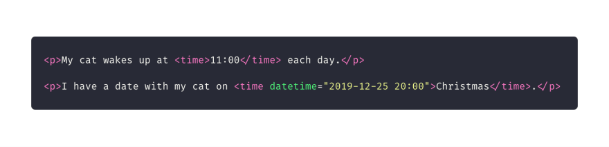](https://res.cloudinary.com/practicaldev/image/fetch/s--xk6Zu7f---/c_limit%2Cf_auto%2Cfl_progressive%2Cq_auto%2Cw_880/https://cdn-images-1.medium.com/max/2400/1%2ARMr76nCXN_a9U-7zrPnD3Q.png)

# Video

The `<video>` tag specifies a movie clip or video stream. The supported formats include MP4, WebM, and Ogg.

[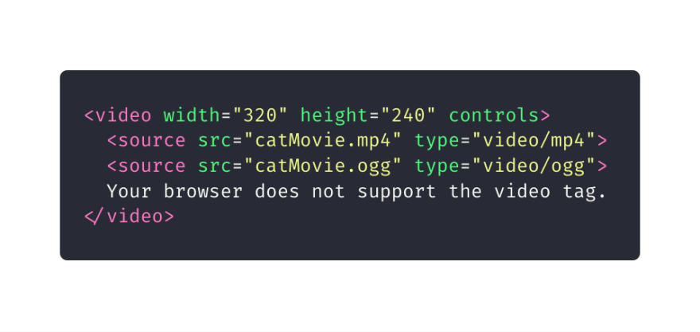](https://res.cloudinary.com/practicaldev/image/fetch/s--PVmk_JXk--/c_limit%2Cf_auto%2Cfl_progressive%2Cq_auto%2Cw_880/https://cdn-images-1.medium.com/max/1600/1%2AhJCtx4hIBAzEGY7HRwwUmg.png)

# Word Break Opportunity

If you have a long block of text, or a long word, you can use the `<wbr>` tag to specify where in a body of text it would be ideal to break. This is one way to ensure the browser, upon resize, doesn’t break your text in a strange spot.

[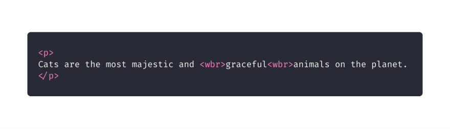](https://res.cloudinary.com/practicaldev/image/fetch/s--n-GVosrw--/c_limit%2Cf_auto%2Cfl_progressive%2Cq_auto%2Cw_880/https://cdn-images-1.medium.com/max/1600/1%2AwtEUeRTqYR0DvU-OkZ7tHQ.png)

---

I hope these ten HTML elements gave you some new tools to build awesome applications!
