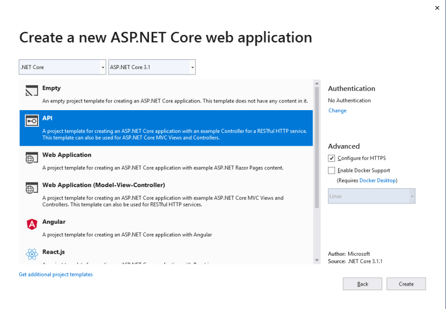
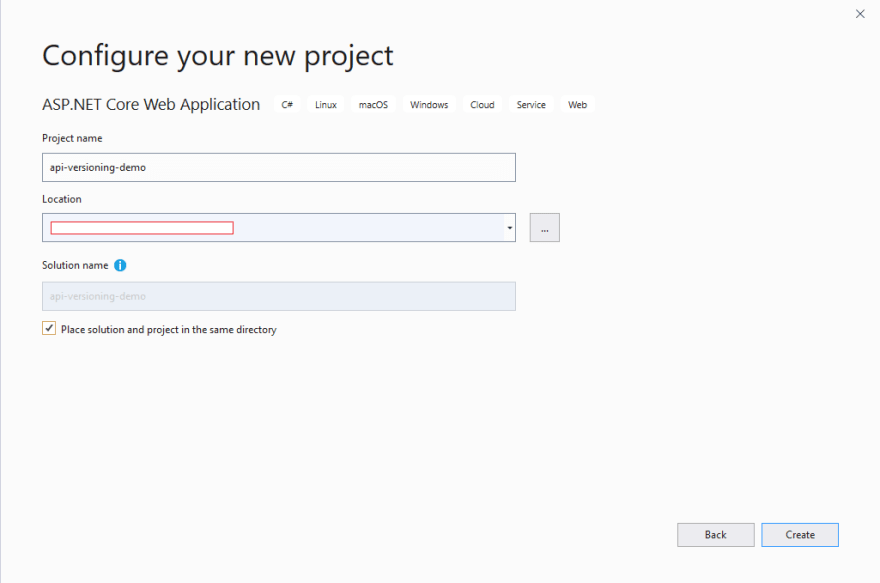
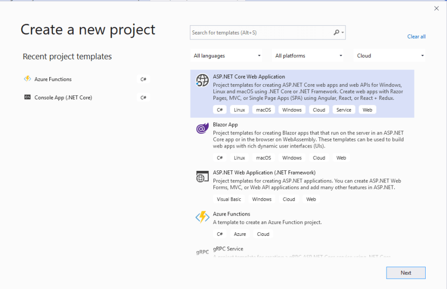
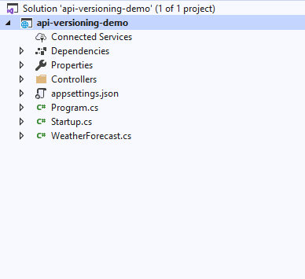
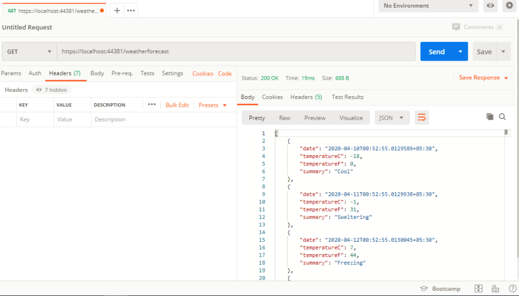
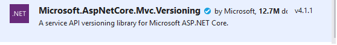
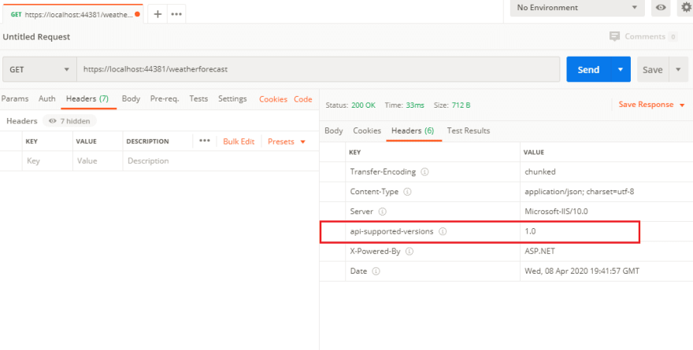

# API Versioning In ASP.NET Core

This article was originally published on [my blog](https://www.c-sharpcorner.com/article/api-versioning-in-asp-net-core-web-api/).

In this article, we will learn how to version ASP.NET Core Web API and some different ways of versioning the API. We will also create a simple Web API and implement the versioning.

Before implementing the versioning, we have to first understand why we need to version API. While working on an existing application or creating a new one, we may create multiple APIs that may be consumed by many clients. When the business has started to grow and expand, new requirements arise. Due to this, we may need to provide more functionality in the existing APIs. However, existing Web API can be consumed by many clients so how to implement the new feature without impacting the existing consumers? We can solve this problem by versioning our API.

## Create ASP.NET Core Web API

#### Prerequisites

- Visual Studio 16.4 or greater
- .NET Core 3.1 installed
- Postman for testing Web API(If you don't have already you can download it from [here](https://www.postman.com/downloads/))

Open Visual Studio and click on File -> New -> Project. Select ASP.NET Core Web Application template and click on the Next button

[](https://res.cloudinary.com/practicaldev/image/fetch/s--WSWtp-V3--/c_limit%2Cf_auto%2Cfl_progressive%2Cq_auto%2Cw_880/https://dev-to-uploads.s3.amazonaws.com/i/n77xhuvofeyraedc7bhy.PNG)

Give a name to the project and click on the Create button

[](https://res.cloudinary.com/practicaldev/image/fetch/s--58J2TIfL--/c_limit%2Cf_auto%2Cfl_progressive%2Cq_auto%2Cw_880/https://dev-to-uploads.s3.amazonaws.com/i/s1hgdvpmwvwne3u5i28d.PNG)

Since we have to create an API, select API and click on the Create button.

[](https://res.cloudinary.com/practicaldev/image/fetch/s--kayIsu_Y--/c_limit%2Cf_auto%2Cfl_progressive%2Cq_auto%2Cw_880/https://dev-to-uploads.s3.amazonaws.com/i/qpt3x5z3s4jie5p0q4bz.PNG)

That's it. You have created your Web API in ASP.NET Core.

[](https://res.cloudinary.com/practicaldev/image/fetch/s--PHm3xIRJ--/c_limit%2Cf_auto%2Cfl_progressive%2Cq_auto%2Cw_880/https://dev-to-uploads.s3.amazonaws.com/i/eea1587ztxd2te9dcw2s.PNG)

In our project, we have one controller create by default named as WeatherForecastController. The next step is to run the application and call the WeatherForecastController API using postman. Hit F5 to run the API which will open a default browser. Open a postman and type the URL "<https://localhost:44381/weatherforecast>".

[](https://res.cloudinary.com/practicaldev/image/fetch/s--jqakemV_--/c_limit%2Cf_auto%2Cfl_progressive%2Cq_auto%2Cw_880/https://dev-to-uploads.s3.amazonaws.com/i/91ynus8b5hzghfi7q6cz.PNG)

You can see that we have not implemented the versioning yet in the controller. I am going to use this API in the next part of the article where we will see different ways to implement versioning of API.

## Different ways of Versioning Web API

We can do versioning of Web API using the following methods:

- Query string
- URL
- HTTP header

There are other ways as well, like accept-header and content type, but in this article, we are going to focus on the above 3 methods.

To do versioning in ASP.NET Core Web API, first, we have to install the below the Nuget package which will provide necessary methods for versioning. Right-click on the solution and click on Manage Nuget Package and search for package "Microsoft.AspNetCore.Mvc.Versioning" and install it.

[](https://res.cloudinary.com/practicaldev/image/fetch/s--FMxgSzqC--/c_limit%2Cf_auto%2Cfl_progressive%2Cq_auto%2Cw_880/https://dev-to-uploads.s3.amazonaws.com/i/9m7evn7q92uxrysktvl5.png)

Once the NuGet package is successfully installed, then the next step is to open Startup.cs and add the below code in the ConfigureServices method.

```
public void ConfigureServices(IServiceCollection services)  
{  
    services.AddControllers();  
    services.AddApiVersioning(x =>  
    {  
        x.DefaultApiVersion = new ApiVersion(1, 0);  
        x.AssumeDefaultVersionWhenUnspecified = true;  
        x.ReportApiVersions = true;  
    });  
}
```

Let's understand the above code that we added.

Line #6 - DefaultApiVersion is used to set the default version to API

Line #7 - This flag AssumeDefaultVersionWhenUnspecified flag is used to set the default version when the client has not specified any versions. If we haven't set this flag to true and client hit the API without mentioning the version then UnsupportedApiVersion exception occurs.

Line #8 - To return the API version in response header.

So if we hit the same API, we can see the default version in the response header.

[](https://res.cloudinary.com/practicaldev/image/fetch/s--6IImdqjU--/c_limit%2Cf_auto%2Cfl_progressive%2Cq_auto%2Cw_880/https://dev-to-uploads.s3.amazonaws.com/i/ilkbaggiquztrccg5f5w.PNG)

Before discussing about different types, let's create two controllers (i.e EmployeeV1Controller and EmployeeV2Controller) as shown below.

**EmployeeV1Controller.cs**

```
using Microsoft.AspNetCore.Mvc;  

namespace api_versioning_demo.Controllers  
{  
    [Route("api/employee")]  
    [ApiController]  
    public class EmployeeV1Controller : ControllerBase  
    {  
        [HttpGet]  
        public IActionResult Get()  
        {  
            return new OkObjectResult("employees from v1 controller");  
        }  
    }  
}
```

**EmployeeV2Controller.cs**

```
using Microsoft.AspNetCore.Mvc;  

namespace api_versioning_demo.Controllers  
{  
    [Route("api/employee")]  
    [ApiController]  
    public class EmployeeV2Controller : ControllerBase  
    {  
        [HttpGet]  
        public IActionResult Get()  
        {  
            return new OkObjectResult("employees from v2 controller");  
        }  
    }  
}
```

## Query String-Based Versioning

In the case of query string based versioning, we have to specify the API version in the query string to call the specific controller. Now we mention the specific version to each controller using [ApiVersion(version\_name)] attributes. So our controller looks like the code below:

```
using Microsoft.AspNetCore.Mvc;  

namespace api_versioning_demo.Controllers  
{  
    [ApiController]  
    [ApiVersion("1.0")]  
    [Route("api/employee")]  
    public class EmployeeV1Controller : ControllerBase  
    {  
        [HttpGet]  
        public IActionResult Get()  
        {  
            return new OkObjectResult("employees from v1 controller");  
        }  
    }  
}
```

```
using Microsoft.AspNetCore.Mvc;  

namespace api_versioning_demo.Controllers  
{  
    [ApiController]  
    [ApiVersion("2.0")]  
    [Route("api/employee")]  
    public class EmployeeV2Controller : ControllerBase  
    {  
        [HttpGet]  
        public IActionResult Get()  
        {  
            return new OkObjectResult("employees from v2 controller");  
        }  
    }  
}
```

We can call controller using the below routes with the query string method.

To call EmployeeV1Controller, we have to hit as <https://localhost:44381/api/employee?api-version=1.0>

For EmployeeV2Controller we have to type: <https://localhost:44381/api/employee?api-version=2.0>

## URL based Versioning

In this type of versioning, we can define versions in a URL so that it is more readable. Most users prefer this type over other types. You can to URL based versioning by changing the routs as [Route("api/{v:apiVersion}/Values")].

Let's modify the Route attribute in our both controller, as follows.

```
using Microsoft.AspNetCore.Mvc;  

namespace api_versioning_demo.Controllers  
{  
    [ApiController]  
    [ApiVersion("1.0")]  
    [Route("api/{v:apiVersion}/employee")]  
    public class EmployeeV1Controller : ControllerBase  
    {  
        [HttpGet]  
        public IActionResult Get()  
        {  
            return new OkObjectResult("employees from v1 controller");  
        }  
    }  
}
```

```
using Microsoft.AspNetCore.Mvc;  

namespace api_versioning_demo.Controllers  
{  
    [ApiController]  
    [ApiVersion("2.0")]  
    [Route("api/{v:apiVersion}/employee")]  
    public class EmployeeV2Controller : ControllerBase  
    {  
        [HttpGet]  
        public IActionResult Get()  
        {  
            return new OkObjectResult("employees from v2 controller");  
        }  
    }  
}
```

To call EmployeeV1Controller, we have to hit as <https://localhost:44381/api/1.0/employee>

To call EmployeeV2Controller we need: <https://localhost:44381/api/2.0/employee>

## HTTP Header-Based Versioning

In this type, we have to send the version in the Http header when we call the controller. So open the Startup.cs and add the below line of code into services.AddApiVersioning method. Also, delete the version mentioned in routes.

```
public void ConfigureServices(IServiceCollection services)  
        {  
            services.AddControllers();  
            services.AddApiVersioning(x =>  
            {  
                x.DefaultApiVersion = new ApiVersion(1, 0);  
                x.AssumeDefaultVersionWhenUnspecified = true;  
                x.ReportApiVersions = true;  
                x.ApiVersionReader = new HeaderApiVersionReader("x-api-version");  
            });  
        }
```

Now enable the Http herder versioning type. When a client consumes the API, they have so send x-api-version into the header with specific version value to call the correct controller.

## Conclusion

In this article, I have explained API Versioning, why we need to versioning, and different types of versioning. Also, I demonstrated an example of each type of versioning. I really hope that you enjoyed this article, share it with friends and please do not hesitate to send me your thoughts or comments.

You can follow me on twitter [@sumitkharche01](https://twitter.com/sumitkharche01)

Happy Coding!!
