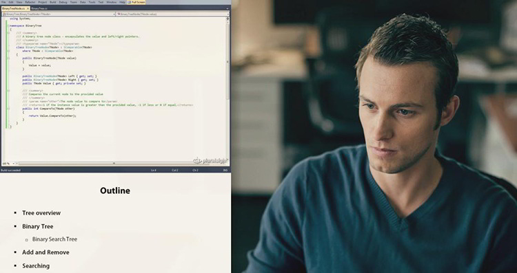
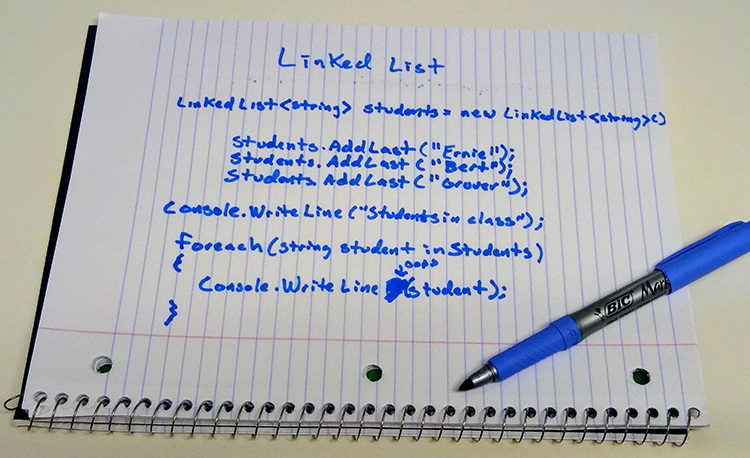
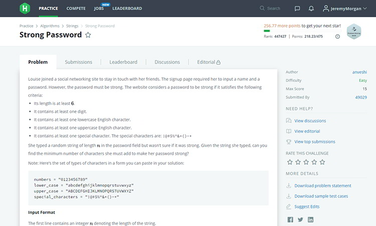

# Stop Fearing the Whiteboard. Conquer It.

[Share This](https://twitter.com/share?ref_src=twsrc%5Etfw)

Published:
Feb 22, 20205 min read

[programming](https://www.jeremymorgan.com/tags/programming/)

It’s time we stopped fearing, complaining, and arguing about whiteboard coding interviews.

With a solid plan, a little skilling up, and some practice, you can master the whiteboard interview. We can argue for days about the validity of this type of interview, but the fact is many organizations require it. So are you going to let this obstacle stop you from getting the job you want? Of course not. Let’s tackle the whiteboard interview, and defeat it.

### How Bad Do You Want It?

I’m a volunteer firefighter, and I’m afraid of heights. I know how silly that sounds. To try out to become a firefighter, you must climb this 104 foot ladder into the sky. It’s the first task. Oh yeah, and you get to do it every year after that if you’re accepted. If you want a job in another fire department, you’ll do it again.

If I’m more than about 15 feet off the ground, I’m uncomfortable. I’ve defeated the fear pretty well over the years, but at first, this ten-story ladder climb sure seemed like a nightmare to me. If you want to see what’s like, here’s a [helmet cam video of someone doing this test](http://bit.ly/104LadderClimb).

I had to ask myself a simple question:

> Am I going to let this scary but surmountable task keep me from being a firefighter?

Of course, you know the answer. **I gloved up and conquered that ladder**. I’ve done it many times since. I’ve never had to climb this ladder configured this way on a fire call. Just like **whiteboard interviews**, this isn’t the best way to judge how skilled of a firefighter you are or could be. But it’s part of the process. Deal with it.

> Are you going to let a whiteboard interview stop you from getting the job you want?

Of course not, so let’s **make a plan** to get you whiteboard ready.

## Step 1: Learning the Basics.

A solid grasp of the basics is crucial for the whiteboard interview. At most organizations, you don’t have to be an algorithms wizard and scribble out genius theorems up there. They just want to see *how you think*. They want to know how you break down a problem and work it out with some pseudocode.

These are programming language agnostic skills. They are core elements you should be learning as a Junior Developer. As a Senior Developer, you better know it well.

#### Data Structures

- Strings, arrays, lists
- Linked lists
- Stacks and Queues
- Trees and Graphs
- Binary Trees
- Hash Tables

#### Big O

- Time complexity
- Space complexity
- Recursion

#### Sorting

- Bubble Sort
- Insertion Sort
- Merge Sort
- Quick Sort

These are all things you should know at a basic level, so you’ll need to get familiar. Here’s how you can do that:

You can search for these things on Google, but it’s kind of a mixed bag. There’s good and bad information out there. I would suggest:

- **Read [Algorithms Illuminated Part 1](http://bit.ly/AlgorithmsIlluminated)** - This is a great book that digs into algorithms with very little fluff.
- **Read Chapters 1-6 and 10 of [Cracking the Coding Interview](http://bit.ly/CrackingCodingInterview)** - This gives a simple explanation of many of these concepts in a clear way.

If books aren’t the best way for you to learn, here are a couple of courses that cover all these topics in-depth, that **you can learn in about 6 hours**.

- **[Algorithms and Data Structures Part 1](http://bit.ly/AlgorithmsDataPartOne)** - This covers core data structures and algorithms mentioned above and more. Time: 3 hours and 14 minutes.
- **[Algorithms and Data Structures Part 2](http://bit.ly/AlgorithmsDataPartTwo)** - This covers more advanced data structures and algorithms, with real-world examples. Time: 2 hours and 30 minutes.

> You could spend a Saturday on these two courses and be leaps ahead in the interview process. The more you work on it, the more polished you will be.

If you want to step up your game check out [The Top 10 Algorithms and Data Structures for Competitive Programming](http://bit.ly/Top10AlgosCompetitive)

So now you have the basics down. What do you with this brain full of information?

## Step 2: Write It Out.

As you go through each of the concepts above, you should try writing out code in your chosen language to demonstrate the concept. Over and over again. This will not only help cement the concept in your head, but you can see how it applies.

You must write it down with pen and paper.

Preferably with a felt tip pen. It’s even better if you use a whiteboard to practice.

This can help you tremendously.

- It helps you focus on what you’re writing.
- It pulls you away from IDEs and editors - just like the interview.
- You activate multiple parts of your brain while writing and thinking it out.

Make an effort to write out each concept in your chosen language on paper. Find someone you can explain it to, and practice **explaining the concept to them** with only pen and paper. This will increase your skills in the interview as well.

## Step 3: Find Some Practice Problems

Practice problems are the best way to polish your skills for a whiteboard interview. You should take a couple of hours at a time and find a problem, then work it out with code.

- Check out [Project Euler](http://bit.ly/ProjectEuler) and start writing code solutions to the problems.
- Sign up at [Hacker Rank](http://bit.ly/30Y9U9h) and begin taking challenges there.
- Also, [LeetCode](http://bit.ly/2GxMO1v) is another excellent challenge site.

> Take as many challenges as you can, routinely. Start getting ruthlessly good at coding challenges.

Write out your solutions on paper for this too. Seriously. The more you do pen and paper or whiteboard coding, the more comfortable you’ll be.

## Follow This Plan and Get That Job.

Instead of fearing the whiteboard, conquer it. Dominate it. If you follow this plan and put in the work, you will be able to walk in that room and hit the whiteboard like it’s old hat. It will be so familiar to you and look so fluid it’s bound to impress even the most skeptical of interviewers.

If you’d like more information about the rest of the interview process, read [how to nail your next coding interview](https://www.jeremymorgan.com/blog/programming/how-to-coding-interview/).

Good luck, you got this!!!

**Get notified by email when a new article is posted:**

---

Published: Feb 22, 2020 by [Jeremy Morgan](https://www.twitter.com/JeremyCMorgan). Contact me before republishing this content.
