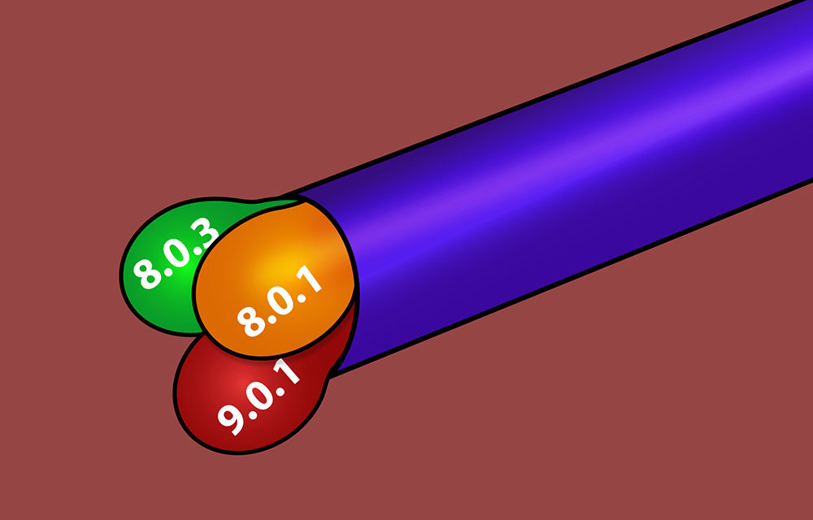
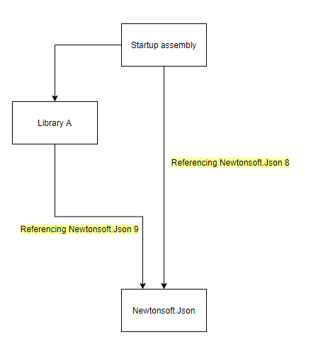
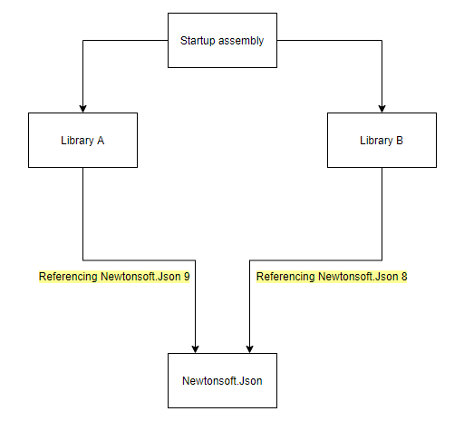
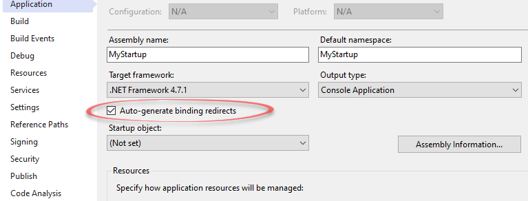

# Assembly Versioning and DLL Hell in C# .NET Framework: Problems and Solutions

[General](https://michaelscodingspot.com/category/general/) /  September 7, 2020

I don't know about you, but reference conflicts in .NET led me to tears multiple times. I like to deal with logical challenges, software design, and performance. Not dependency issues and strange assembly load conflicts. So in my struggles, I came to understand the inner depths of .NET references and lived to write about it. In this article, we'll talk about what exactly is DLL Hell, how these kinds of problems can occur, and the best ways to dealing with them.

###### For some background on assembly loading in .NET, check out my article [Understanding How Assemblies Load in C# .NET](https://michaelscodingspot.com/assemblies-load-in-dotnet/).

## DLL Hell

DLL Hell is an old term that got a new meaning in managed runtimes like .NET. The original DLL Hell issue was that many applications shared the same DLL file dependency. Then, if one of those applications updated that DLL, it broke the API for the other applications, and caused all sorts of trouble.

In .NET we don't have that problem. In most cases, applications don't share DLLs, which prevents issues in the first place. When apps do share libraries, they use the [Global Assembly Cache](https://docs.microsoft.com/en-us/dotnet/framework/app-domains/gac) (GAC). This is a place to share libraries on the machine, but it’s only for **strong-named libraries**. When an application uses a library from the GAC, it requests a specific version, and the strong name guarantees it will get that exact version.

But if you think this architecture solved all our problems, you will be disappointed. We still have problems, just different ones.

### Modern DLL Hell problems

A modern application depends on dozens of libraries that are usually consumed as NuGet packages. Each of those libraries depends on a dozen other libraries. And each one of those… well you get the idea. Reusing code is so simple nowadays, that even a simple program comes with hundreds of dependencies.

Consider that some of those dependencies might be shared. Libraries like [Newtonsoft.Json](https://www.nuget.org/packages/newtonsoft.json/) or [Serilog](https://www.nuget.org/packages/serilog/) are so common that every other applications or library uses them. So what happens if one of your hundred libraries depend on a different version of Newtonsoft.Json or Serilog? Here lies the problem.

Consider the following project structure:

Your startup project references **Newtonsoft.Json version 8**, while **Library B** references **Newtonsoft.Json version 9**. This can easily create a conflict. You could make this work at runtime (with binding redirects) but it can lead to all sorts of trouble. The trouble depends on which version ends up being loaded. If it's version 8, then Library A can call a non-existent method, that exists only in version 9, and fail at runtime. And if version 9 were to be loaded, then the same could happen with the startup project. In this case, you could probably update your startup project to use **Newtonsoft.Json version 9**. But this same problem can manifest in a more troublesome manner, like this:

This is called the **Diamond Dependency Conflict** and it can appear in [many forms](https://jlbp.dev/what-is-a-diamond-dependency-conflict). Unlike in the first scenario, you can't (easily) change the code of the libraries, which makes things more difficult.

## Possible Solutions

Everything can be solved in software, one way or another, so let's see some solutions.

### 1. Make the versions fit

The best way to solve version conflicts is to prevent these conflicts in the first place. If you can change dependencies to use the same library version, then that's the best policy. In the case of a diamond dependency conflict, updating the libraries sometimes changes their referenced libraries, which can match the right versions.

Remember that the convention in C# is that there are no breaking API changes in similar major versions. A version is built as follows `MAJOR.MINOR.PATCH` with the following [convention](https://docs.microsoft.com/en-us/dotnet/csharp/versioning):

- `MAJOR` is incremented when you make incompatible API changes
- `MINOR` is incremented when you add functionality in a backward-compatible manner
- `PATCH` is incremented when you make backward-compatible bug fixes

Not everyone follows conventions, but if they do, then the requirement is just to match major versions, not the exact version. When two projects reference a library with the same major version, make sure that the highest referenced version of that library is loaded into the process. This can be done with binding redirects (see further on). For example, if Library A references `Newtonsoft.Json` version 8.0.1 and Library B references version 8.2.1, then you should load 8.2.1 or risk that method calls from Library B will fail.

When referencing the code is in libraries, like in the case of the Diamond Dependency Conflict, changing their code to reference a different version might appear as a problem. But licensing issues aside, it's entirely possible to change library code. In fact, it's easy. Just open the library DLL in a decompiler like [dotPeek](https://www.jetbrains.com/decompiler/) or [ILSpy](https://github.com/icsharpcode/ILSpy) and export the code to a C# project. From there, you can do whatever you want, like changing referenced library versions. Note that the version changes might require to change some code, but it will likely be a minor issue. Recompile into a new DLL and reference that to solve the problem.

Of course, changing the library code in this manner is not very recommended. For one thing, you will no longer depend on a NuGet package, which will make updating much harder.

### 2. Binding redirects

We can forcefully tell our process which assembly to load in case of a conflict using [binding redirects](https://docs.microsoft.com/en-us/dotnet/framework/configure-apps/redirect-assembly-versions). To make this work, we’ll need to add something like the following code to the `app.config` of the startup assembly:

|  |  |
| --- | --- |
| 1  2  3  4  5  6  7  8  9  10  11  12  13 | <?xml version="1.0"encoding="utf-8"?>  <configuration>  <!--...-->  <runtime>  <assemblyBinding xmlns="urn:schemas-microsoft-com:asm.v1">  <dependentAssembly>  <assemblyIdentity name="Newtonsoft.Json"publicKeyToken="30ad4fe6b2a6aeed"culture="neutral"/>  <bindingRedirect oldVersion="0.0.0.0-12.0.0.0"newVersion="8.0.3"/>  </dependentAssembly>  </assemblyBinding>  </runtime>  </configuration> |

In this example, whenever the runtime wants to load `Newtonsoft.Json` of version 0 to 12, it will instead load version 8.0.3. This won't cause any runtime exceptions unless there's a method call that doesn't exist in the loaded `Newtonsoft.Json`.

This method is the easiest and the most common one to solve version conflicts. In fact, Visual Studio adds binding redirects automatically (by default) when you add a NuGet package. Note the `Auto-generate binding redirects` checkbox in your project properties.

Binding redirects solve many conflicts without issues, even when there are different major versions. In many cases, a higher version assembly will be loaded, and if there isn't too much deprecated API, it will be enough.

Sometimes binding redirects aren't enough though. If one of the libraries calls a non-existent method or uses parameters that aren't valid in the loaded version, it leads to a runtime exception. So if you can't make versions fit and binding redirects aren't enough, there are ways to load assemblies of different versions side-by-side.

### 3. Loading different-version assemblies side by side

Before moving forward with any of the techniques described below, be sure to understand the risks here. A library isn't aware that another version of itself lives in the same process. This means that any resource that the library uses can cause all kinds of trouble. Like logging to the same file, using a Mutex with the same name, or any number of things you can't foresee.

So now that you understand that loading libraries side-by-side is a bad idea, let's proceed to see how to load libraries side-by-side.

There are several ways to do that. Note that some of those work just for [strong-named assemblies](https://docs.microsoft.com/en-us/dotnet/framework/app-domains/strong-named-assemblies).

3.1. [Using AssemblyResolve event](https://michaelscodingspot.com/how-to-resolve-net-reference-and-nuget-package-version-conflicts/#assembly-resolve) – The `AppDomain.CurrentDomain.AssemblyResolve` event is fired when an assembly fails to load. This might happen when the same assembly of a different version is already loaded. You can use this opportunity to ignore the error and forcefully load the other version of the assembly side-by-side.
While this feels like a hack, this is the easiest way to achieve side-by-side loading and it works both for strong-named assemblies and for those that aren't.

3.2. [Use  to load assemblies from different folders](https://michaelscodingspot.com/how-to-resolve-net-reference-and-nuget-package-version-conflicts/#copy-codebase) – This method requires your libraries to have strong names. You can place the different versions of the libraries in different folders and instruct the runtime which folder to use for which version.

3.3. [Use the Global Assembly Cache](https://michaelscodingspot.com/how-to-resolve-net-reference-and-nuget-package-version-conflicts/#global-assembly-cache) – This method also requires your libraries to have strong names. Instead of referencing the libraries and copying them to the output *bin* folder, you can install them to the GAC. The runtime will know to load the correct versions side by side.

3.4. [Repack your libraries into a new assembly](https://michaelscodingspot.com/how-to-resolve-net-reference-and-nuget-package-version-conflicts/#repack) – You can prevent a version conflict altogether by *renaming* the library and its references. You won't be able to do it manually because of the way the CLR loads assemblies, but there are solutions like [ILMerge](https://github.com/dotnet/ILMerge) and [il-repack](https://github.com/gluck/il-repack) that can do that for you. They take care of issues like strong names and can merge assemblies and their references into a new target assembly with a different name.

## Summary

I think it's safe to say nothing is too easy about this subject, but I hope I was able to clear things up.

We saw how dependency conflicts can appear with simple library references. We saw why using binding redirects can be problematic and lead to runtime exceptions. And we saw a bunch of ways to solve version conflicts.

In almost all cases, the version conflict will be resolved by adjusting versions and a few binding redirects. In fact, since Visual Studio adds those binding redirects automatically, you mostly won't even know you had a conflict. Still, problems somehow manage to occur and I had to use all of the solutions mentioned (well, except for 3.2) at one time or another.

Share:

Get a free chapter from my new book: Practical Debugging for .NET Developers

Chapter 1: Tools
