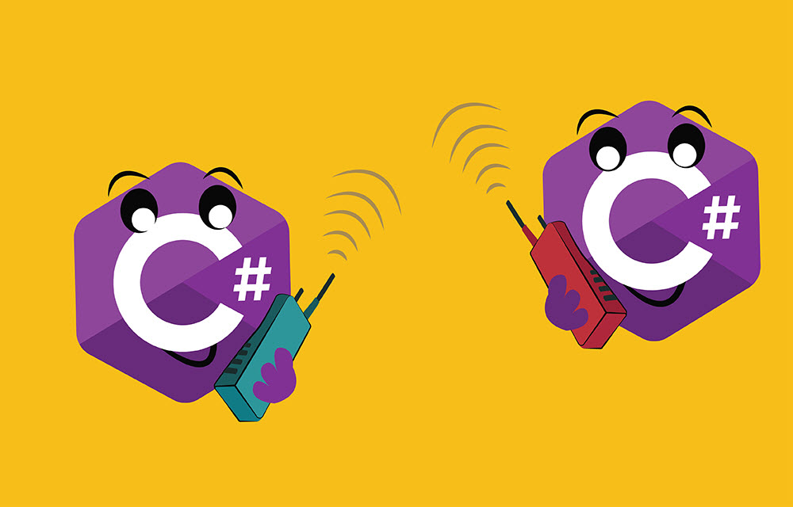

# C# to C# Communication: REST, gRPC and everything in between

[C#](https://michaelscodingspot.com/category/csharp/) /  February 10, 2020

There are many ways to communicate between a C# client and a C# server. Some are robust, others not so much. Some are very fast, others aren’t. It’s important to know the different options so you can decide what’s best for you. This article will go through the most popular technologies today and why they got to be so widely used. We’ll talk about REST, gRPC, and everything in between.

## Optimal scenario

Let’s consider how we would like to have our client-server communication to look like in an optimal world. I’m picturing something like this:

|  |  |
| --- | --- |
| 1  2  3  4  5  6  7 | // on client side  publicvoidFoo()  {  varserver=newMyServer(newUri("https://www.myserver.com/");)  intsum=server.Calculator.SumNumbers(12,13);  } |

|  |  |
| --- | --- |
| 1  2  3  4  5  6  7  8 | // on server side  classCalculatorController:Controller{  publicintSumNumbers(inta,intb)  {  returna+b;  }  } |

I’d like to have full Intellisense of course. When I click `server` and `.` I want Visual Studio to show all controllers. And when I click `CalculatorController` and `.` , I want to see all actions. I also want top-notch performance, very little network payloads, and bi-directional communication. And I want a robust system that deals with versioning perfectly so I can deploy new client versions and new server versions without friction.

Is that asking for too much?

Note that I’m talking here about a **stateless** API. This is equivalent to a C# project where there are just two types of classes:

- Static classes with nothing but static methods.
- [POCO classes](https://www.c-sharpcorner.com/UploadFile/5d065a/poco-classes-in-entity-framework/) with nothing but fields and properties whose type is a primitive or another POCO class.

Having a state in an API introduces complexity and that is the root of all evil. So for the sake of this article, let’s keep things nice and stateless.

## Traditional REST

REST API appeared in the early 2000s and swept the internet by storm. It’s now, by far, the most popular way to create web services.

REST defines a fixed set of operations **GET, POST, PUT**, and **DELETE** for client to server requests. Each request is answered with a response that contains a payload (usually JSON). Requests include parameters in the query itself or as a payload (usually JSON) when it’s a POST request.

There’s a standard called RESTful API that defines the following rules (which you don’t really have to use it):

- GET is used to retrieve a resource
- PUT is used to change a resource state
- POST is used to create a resource
- DELETE is used to delete a resource

If you’re not familiar with REST until now, the above explanation is probably not going to cut it, so here’s an example. In .NET, there’s built-in support for REST. In fact, ASP.NET Web API is built to be a REST web service by default. Here’s how a typical client and ASP.NET server looks like:

In server:

|  |  |
| --- | --- |
| 1  2  3  4  5  6  7  8  9  10  11 | [Route("People")]  publicclassPeopleController:Controller  {  [HttpGet]  publicPerson GetPersonById(intid)  {  Person person=\_db.GetPerson(id);  returnperson;//Automatically serialized to JSON  }  } |

In client:

|  |  |
| --- | --- |
| 1  2  3  4  5 | varclient=newHttpClient();  stringresultJson=  await client.GetStringAsync("https://www.myserver.com/People/GetPersonById?id=123");  Person person=JsonConvert.DeserializeObject<Person>(resultJson); |

REST is pretty damn convenient, but it doesn’t come near the optimal scenario. So let’s see if we can make this better.

## ReFit

ReFit is not an alternative to REST. Instead, it’s built on top of REST and allows us to call server endpoints like they were a simple method. This is achieved by sharing an interface between the client and the server. On server-side, your Controller will implement an interface:

|  |  |
| --- | --- |
| 1  2  3  4  5  6 | publicinterfaceIMyEmployeeApi  {  [Get("/employee/{id}")]  Task<Employee>GetEmployee(stringid);  } |

Then, on client side, you’ll need to include that same interface and use the following code:

|  |  |
| --- | --- |
| 1  2  3 | varapi=RestService.For<IMyEmployeeApi>("https://www.myserver.com");  varemployee=await api.GetEmployee("abc"); |

It’s as simple as that. There’s no need to run difficult automation or use any 3rd party tools beyond a couple of NuGet packages.

This gets much closer to the optimal scenario. We now have IntelliSense and a strong contract between the client and the server. But there’s another option, which is even better in some ways.

## Swagger

Like ReFit, Swagger is also built on top of REST. [OpenAPI](https://swagger.io/specification/), or **Swagger**, is a specification of a REST API. It describes a REST web service with simple JSON files. These files are the API schema of the web service. They include:

- All paths (URLs) in the API.
- The expected operations (GET, POST, …) for each path. Each path can handle different operations. For example, a single path like `https://mystore.com/Product` might accept a POST operation that adds a product and a GET operation that returns a product.
- The expected parameters for each path and operation.
- The expected responses for each path.
- Types of each parameter and response objects.

This JSON file is essentially the contract between the clients and the server. Here’s an example of a swagger file describing a web service called [Swagger Petstore](https://bfanger.nl/swagger-explained/#operationObject) (I removed some parts for clarity):

|  |  |
| --- | --- |
| 1  2  3  4  5  6  7  8  9  10  11  12  13  14  15  16  17  18  19  20  21  22  23  24  25  26  27  28  29  30  31  32  33  34  35  36  37  38  39  40  41  42  43  44  45  46  47  48  49  50  51  52  53  54  55  56  57  58  59  60 | {  "swagger":"2.0",  "info":{  "version":"1.0.0",  "title":"Swagger Petstore",  "description":"A sample API that uses a petstore as an example to demonstrate features in the swagger-2.0 specification",  },  "host":"petstore.swagger.io",  "basePath":"/api",  "schemes":[  "http"  ],  "consumes":[  "application/json"  ],  "produces":[  "application/json"  ],  "paths":{  "/pets":{  "get":{  "description":"Returns all pets from the system that the user has access to",  "operationId":"findPets",  "produces":[  "application/json",  "application/xml",  ],  "parameters":[  {  "name":"tags",  "in":"query",  "description":"tags to filter by",  "required":false,  "type":"array",  "items":{  "type":"string"  },  "collectionFormat":"csv"  },  {  "name":"limit",  "in":"query",  "description":"maximum number of results to return",  "required":false,  "type":"integer",  "format":"int32"  }  ],  "responses":{  "200":{  "description":"pet response",  "schema":{  "type":"array",  "items":{  "$ref":"#/definitions/Pet"  }  }  },  ... |

Let’s consider the consequence of this. With a JSON file like the one above, you can potentially create a C# client that has complete IntelliSense. After all, you know all the paths, operations, what parameters they expect, what are the parameter types, what are the responses, etc.

There are several tools that do just that. For the server-side, you can use [Swashbuckle.AspNetCore](https://github.com/domaindrivendev/Swashbuckle.AspNetCore) to add Swagger to your ASP.NET and produce said JSON files. For the client-side, you can use [swagger-codegen](https://github.com/swagger-api/swagger-codegen) and [AutoRest](https://azure.github.io/autorest/) to consume these JSON files and generate a client. Let’s see an example of how to do this:

### Adding Swagger to your ASP.NET server

Start by adding the the NuGet package [Swashbuckle.AspNetCore](https://www.nuget.org/packages/Swashbuckle.AspNetCore). In `ConfigureServices`, register Swagger generator:

|  |  |
| --- | --- |
| 1  2  3 | services.AddSwaggerGen(options=>  options.SwaggerDoc("v1",newOpenApiInfo{Title="My Web API",Version="v1"})); |

In `Configure` method of `Startup.cs` add:

|  |  |
| --- | --- |
| 1  2 | app.UseSwagger(); |

Finally, the actions inside the controllers should be decorated with `[HttpXXX]` and `[FromXXX]` attributes:

|  |  |
| --- | --- |
| 1  2  3  4  5  6  7  8  9  10  11  12 | [HttpPost]  publicasync Task AddEmployee([FromBody]Employee employee)  {  //...  }  [HttpGet]  publicasync Task<Employee>Employee([FromQuery]stringid)  {  //...  } |

It’s as simple as that for the server-side. When you run the project a `swagger.json` file will be generated, which you can use to generate the client.

### Generating a Client from Swagger with AutoRest

To start using [AutoRest](https://github.com/Azure/autorest), install it with [npm](https://www.w3schools.com/nodejs/nodejs_npm.asp): `npm install -g autorest`. Once installed, you’ll need to use AutoRest’s command line interface to generate a C# client from the `swagger.json` file. Here’s an example:

|  |  |
| --- | --- |
| 1  2 | autorest--input-file="./swagger.json"--output-folder="GeneratedClient"--namespace="MyClient"--override-client-name="MyClient"--csharp |

This will produce a folder `GeneratedClient` folder with the generated C# files. Note the namespace and client name are overridden. From here, add this folder to your client project in Visual Studio.

You’ll need to install `Microsoft.Rest.ClientRuntime` NuGet package because the generated code depends on it. Once installed, you can use the API like it’s a regular C# class:

|  |  |
| --- | --- |
| 1  2  3 | varclient=newMyClient();  Employee employee=client.Employee(id:"abc"); |

There are some subtleties which you can read about in AutoRest’s [documentation](https://azure.github.io/autorest/client/ops.html). And you’ll need to automate that process, so I suggest reading Patrik Svensson’s [tutorial](https://www.patriksvensson.se/2018/10/generating-api-clients-using-autorest) for some good advice as well as this [article](https://medium.com/@pjausovec/creating-c-client-library-for-web-api-projects-be132c831f9c) by Peter Jausovec.

My issue with Swagger is that the JSON file is created at runtime, so this makes it a bit difficult to automate in your CI/CD process.

## Traditional REST vs Swagger vs ReFit

Here are a few points to consider when making your choice.

- If you have a very simple private REST API, maybe don’t bother with client generation and shared interfaces. The small task doesn’t justify the extra effort.
- Swagger supports many languages, while ReFit supports just .NET. Swagger is also the basis for many tools, tests, automation, and UI tools. It’s probably going to be the best choice if you’re creating a big public API.
- Swagger is much more complicated than ReFit. With ReFit, it’s just a matter of adding a single interface in both your server and client project.
  On the other hand, with ReFit, you’ll have to create new interfaces for each controller, whereas Swagger takes care of that automatically.

But before deciding anything, check out a 4th option that has nothing to do with REST.

## gRPC

[gRPC](https://grpc.io/) (**gRPC Remote Procedure Call**) is an open-source remote procedure call system developed by Google. It’s a bit like REST in the way that it provides a way to send requests from a client to a server. But it’s different in many ways, here are the similarities and differences:

- Like REST, gRPC is language-agnostic. There are tools for all popular languages, including C#.
- gRPC is contract bases and uses `.proto` files to define a contract. This is somewhat similar to Swagger’s `swagger.json` and to ReFit’s shared interface. A client of any programming language can be generated from those files.
- gRPC uses [Protocol Buffer (Protobuf)](https://en.wikipedia.org/wiki/Protocol_Buffers) binary serialization. This is different from REST which serializes to JSON or XML (usually). The binary serialization is smaller and therefore faster.
- gRPC is made to create long-lasting connections using HTTP/2 protocol. This protocol is simpler and with more compact. Whereas REST uses HTTP 1.x protocol (usually HTTP 1.1).
- HTTP 1.1 requires a TCP handshake for each request whereas HTTP/2 keeps the connection open.
- HTTP/2 connection uses multiplexed streams. Which means a single TCP connection can support many streams. These streams can execute in parallel without waiting for each other like in HTTP 1.1.
- gRPC allows bidirectional streaming.

There are two ways to use gRPC. For .NET Core 3.0 there’s a fully-managed library called [gRPC for .NET](https://github.com/grpc/grpc-dotnet). For anything under that, you can use [gRPC C#](https://github.com/grpc/grpc/tree/master/src/csharp), which is built with native code under the hood. That doesn’t mean **gRPC for .NET** replaces **gRPC C#**. Let’s see an example with the newer **gRPC for .NET**.

### Server-side of gRPC for .NET

This is not a tutorial, but more of a general idea for what to expect. Here’s how a sample Controller will look like in gRPC:

|  |  |
| --- | --- |
| 1  2  3  4  5  6  7  8  9  10  11  12  13 | publicclassGreeterService:Greeter.GreeterBase  {  publicoverride Task<HelloReply>SayHello(HelloRequest request,  ServerCallContext context)  {  \_logger.LogInformation("Saying hello to {Name}",request.Name);  returnTask.FromResult(newHelloReply  {  Message="Hello "+request.Name  });  }  } |

You’ll need to add the following in `Configure` in `Startup.cs`:

|  |  |
| --- | --- |
| 1  2  3  4  5 | app.UseEndpoints(endpoints=>  {  endpoints.MapGrpcService<GreeterService>();  }); |

The API is described in a `.proto` file, which is part of the project:

|  |  |
| --- | --- |
| 1  2  3  4  5  6  7  8  9  10  11  12  13  14 | syntax="proto3";  serviceGreeter{  rpc SayHello(HelloRequest)returns(HelloReply);  }  messageHelloRequest{  stringname=1;  }  messageHelloReply{  stringmessage=1;  } |

This `.proto` file is added in the `.csproj`:

|  |  |
| --- | --- |
| 1  2  3  4 | <ItemGroup>  <Protobuf Include="Protos\greet.proto"/>  </ItemGroup> |

### Client-side of gRPC for .NET

The client is generated from the `.proto` files. The code itself is very simple:

|  |  |
| --- | --- |
| 1  2  3  4  5  6  7  8 | varchannel=GrpcChannel.ForAddress("https://localhost:5001");  varclient=newGreeter.GreeterClient(channel);  varresponse=await client.SayHello(  newHelloRequest{Name="World"});  Console.WriteLine(response.Message); |

## gRPC vs REST

gRPC sounds like a sweet deal. It’s faster and simpler under the hood. So should we all change from REST to gRPC? The answer is that it depends. Here are some considerations:

From my impression, working with gRPC and ASP.NET is still not great. You’re going to be better off with the mature support for REST. As far as a contract-based communication, it’s nice, except that you have similar alternatives in REST which we already talked about: Swagger and ReFit.

The biggest advantage is performance. In most cases, [according to these benchmarks](https://www.yonego.com/nl/why-milliseconds-matter/#gref), gRPC is much faster. Especially for big payloads, for which the Protobuf serialization really makes a difference. This means it’s a huge advantage for a high-load server.

Transitioning from REST to gRPC in a big ASP.NET application is going to be hard. However, if you have a microservices-based architecture, then this transition becomes much easier to do gradually.

## Other ways of Communication

There are some other ways of communication which I  didn’t mention at all, but it’s worth knowing these exist:

- [GraphQL](https://graphql.org/) is a query language for APIs developed by Facebook. It allows the client to ask for exactly the data it needs from the server. This way, you can create just one endpoint on the server that will be extremely flexible and return only the data the client needs. GraphQL is becoming very popular in recent years.
- [SignalR](https://github.com/SignalR/SignalR) is a technology that allows for real-time bi-directional communication between server and client. Instead of the client always sending requests to server, SignalR also allows the server to send push notifications to the client. This allows to see real-time updates in web applications. SignalR is extremely popular in ASP.NET.
- [TcpClient](https://docs.microsoft.com/en-us/dotnet/api/system.net.sockets.tcpclient?view=netframework-4.8) and [TcpListener](https://docs.microsoft.com/en-us/dotnet/api/system.net.sockets.tcplistener?view=netframework-4.8) (in `System.Net.Sockets`) provide a low-level connection over TCP. Basically, you’re going to establish a connection and transfer byte arrays. It’s not ideal for a big application where you can use ASP.NET’s controllers and actions to make order in a big API.
- [UdpClient](https://docs.microsoft.com/en-us/dotnet/api/system.net.sockets.udpclient?view=netframework-4.8) provides a way to communicate over UDP protocol. TCP establishes a connection and then sends data, whereas UDP just sends data. TCP makes sure there are no errors in the data, whereas UDP doesn’t. UDP is more effective to transfer data quickly that you don’t care enough for it to be reliable and error-free. Some examples are: Video streaming, Live broadcasts, and Voice over IP (VoIP).
- [WCF](https://docs.microsoft.com/en-us/dotnet/framework/wcf/whats-wcf) is an older technology that mostly uses SOAP-based communication between processes. It’s a huge framework that I’m not going to get into except to say that it lost its popularity to REST and JSON payloads.

That’s it for now. If you like this kind of content, [subscribe](https://michaelscodingspot.com/subscribe/) to the blog. Cheers.

Share:

Get a free chapter from my new book: Practical Debugging for .NET Developers

Chapter 1: Tools
