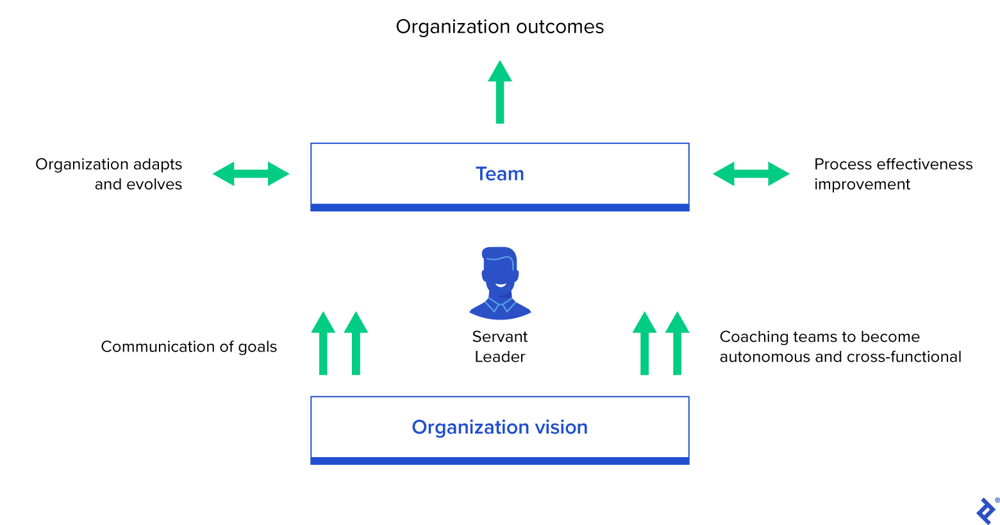
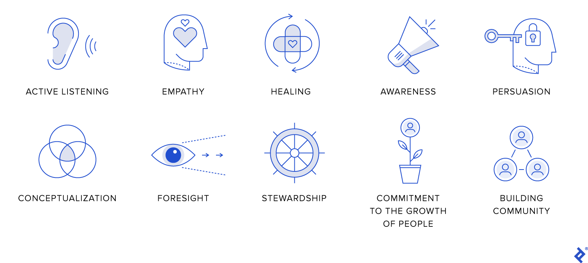
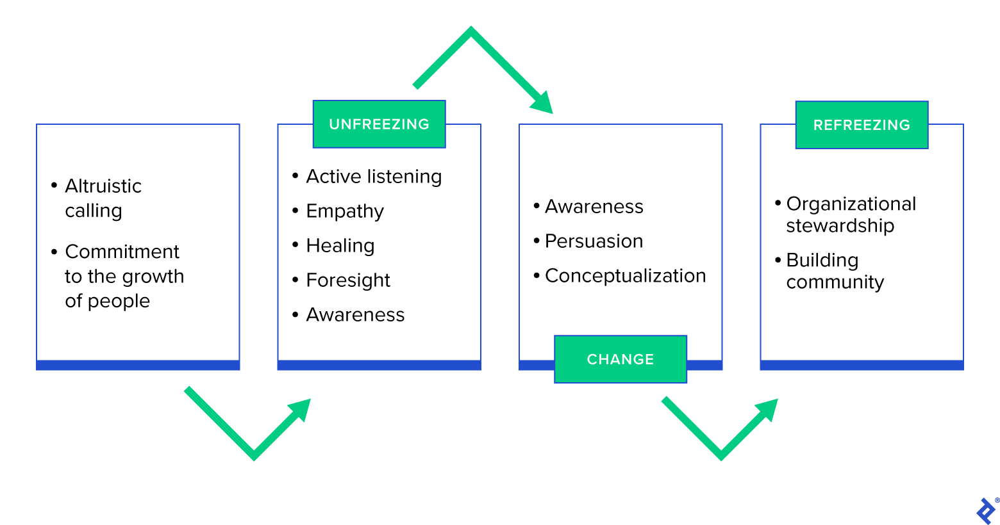

# How to Cultivate Agile Servant Leadership

In an uncertain environment, when it is crucial for businesses to be open to change, it is the responsibility of project managers to lead their teams through the period of transformation. However, many project managers struggle to manage and establish successful relationships with their teams, even in stable times. Taking on the philosophy of servant leadership grants project managers a superpower: [the ability to influence teams](https://hbr.org/2015/09/new-managers-need-a-philosophy-about-how-theyll-lead) without direct authority, which allows the project manager to drive change across the organization.

## Agile Servant Leadership

The arrival of the concept of servant leadership within organizations coincided with the birth of Agile. The values that Agile identified as critical for an organization’s success and growth resembled those of servant leaders: putting the leader’s primary focus on people and their interactions, working in a collaborative environment, and creating value.

A servant leader’s role in an agile organization.

Agile took the servant leadership concept and created a groundbreaking role surrounding it—a team coach. In the most widespread Agile framework, Scrum, this leader is called the scrum master and [is defined as a servant leader](https://www.scrum.org/resources/blog/scrum-master-servant-leader#:~:text=A%20Scrum%20Master%20is%20a,and%20business%20objectives%5B6%5D) who fosters the context for agility by connecting teams with the organization’s vision. To achieve that, Agile servant leaders facilitate communication around goals and coach teams to become autonomous and cross-functional. As a result, they improve process effectiveness, enable organizations to adapt and evolve, and produce the expected results.

Servant leaders act through a particular mindset, skills, and knowledge that emphasizes involving others in decision-making. This model has a strong base in ethical and caring behavior. The Spears Center [has identified](https://www.spearscenter.org/46-uncategorised/136-ten-characteristics-of-servant-leadership) 10 characteristics that are critically important to the work of servant leaders.

10 characteristics of a servant leader.

When articulated correctly, servant leadership is a powerful tool that can boost employee performance, enable business change, and increase commitment to the organization’s vision.

## A Servant Leadership Framework for Organizational Change

Let’s start by exploring the [servant leadership framework for organizational change](https://web.b.ebscohost.com/abstract?direct=true&profile=ehost&scope=site&authtype=crawler&jrnl=19447426&AN=112974936&h=G9J2rIT0QyJTxUKKT5yS5gxDyNiJjWS9rEjrboGZvf76o%2BJtZaS13Cnt9lBqIjDtnO9Nqb1gQNlWyN6PSKV07w%3D%3D&crl=c&resultNs=AdminWebAuth&resultLocal=ErrCrlNotAuth&crlhashurl=login.aspx%3Fdirect%3Dtrue%26profile%3Dehost%26scope%3Dsite%26authtype%3Dcrawler%26jrnl%3D19447426%26AN%3D112974936), a model that integrates servant leadership characteristics with the [Unfreeze–Change–Refreeze model](https://www.toptal.com/project-managers/transformation/getting-change-management-right) attributed to Kurt Lewin and regarded by many as the classic approach to managing change.

### An Altruistic Calling and Commitment to Growth

The bedrock of servant leadership is an altruistic calling to serve others rather than solely pursuing self-interest, that is, a selfless initiative to help without expecting a personal reward. From a leadership perspective, this call invites the leader to seek reconciliation instead of confrontation, to build a sense of community instead of tolerating separation, and to accept differences within the organization. The next step—a commitment to supporting the **professional and personal growth** of people—creates greater harmony in the organization, which is foundational to implementing business change.

Servant leadership framework for organizational change.

### Unfreezing

The change unfreezing process begins when a leader starts **actively listening** and identifying people’s needs. This first stage prepares employees to accept the change that will result in breaking the existing status quo and building up a new paradigm. The key to change management is **foresight**—by predicting the near future, project leaders develop a compelling vision message that shows people why the current workflow cannot continue. To develop this message, they must use their **empathy** and knowledge about people’s needs.

This is usually a difficult and hectic period, so a servant leader needs to find ways to **emotionally heal people**. Transmitting the confidence that people’s needs will be met is the first step to building momentum for change. In order to overcome psychological distress, servant leaders assist followers by:

- Actively listening to people’s frustrations so they can create time and space for self-awareness and communication of their needs
- Taking action to address people’s needs and delivering the necessary changes; injecting positivity
- Communicating a clear change vision and goals to set the right expectations and to provide structure for employees

Many of these actions derive from a leader’s wisdom as they become **aware** of their own and their team’s emotions and desires. The servant leader leverages this knowledge to make well-informed, conscious decisions about the change process.

### Change

This is where people start to resolve uncertainty and look for new ways to adapt. By using data, facts, and reasoning, a servant leader influences people—this means **persuading** them to adopt a new mindset. Persuasion makes a clear distinction between the traditional leader-first and servant leadership models: Servant leaders make people feel that it was they who made a decision or participated in the decision-making, rather than having it imposed by an authority.

While wisdom helps leaders to **conceptualize** and define the building blocks of change, persuasion opens the door to engaging people by encouraging them to propose new initiatives and commit to the ones that have been agreed upon. Servant leaders start by:

- Identifying people’s strengths and skills, giving positive feedback on their virtues
- Showing people how to apply their virtues to overcome challenges that will move the organization one step closer to its vision
- Helping people to build and commit to action plans with achievable deliverables in the short term

### Refreezing

The refreeze stage occurs when the organization internalizes the changes. After a new normal is set in place, the servant leader’s role changes to ensuring consistency and timeliness. They do so by clearly communicating that the whole organization is accountable for sustaining the change.

**Organizational stewardship** alludes to the willingness of both leaders and teams to take responsibility for the wellbeing of the organization. To achieve this, servant leaders **build a sense of community** across the organization. They encourage people to:

- Show sensitivity, compassion, and emotional intelligence to empathize within the organization
- Take accountability for negative results of a change
- Positively reinforce new behaviors by recognizing and celebrating changes

## Benefits

By applying the servant leadership framework for organizational change, [project managers](https://www.toptal.com/project-managers/agile) can more successfully manage the transformation process. When people recognize that leaders respond to their needs, they are more likely to embrace and support these changes. People start sharing the ownership of what they built together with their leader, and the organization becomes more transparent.

The bottom-up style of leadership also makes employees feel that they have social support from their managers. This model helps build trust for the leader and organization and is a key element in creating positivity, where employees express pride in being part of the organization.

Finally, by cultivating the characteristics of servant leadership, project managers enhance the potential of individuals and teams to achieve the goals that play a major role in the growth of their company.

## The First Step Is Always the Hardest

Servant leadership skills help project managers to prevent or counteract resistance to change. By cultivating a mindset to serve others in their leadership practices, project managers are better equipped to prepare their teams to change. Spreading the servant attitude is usually the hardest step to make, but the overall benefits for the Agile environment are enormous—processes are conducted in a structured and empathetic approach that involves and empowers both teams and individuals.
