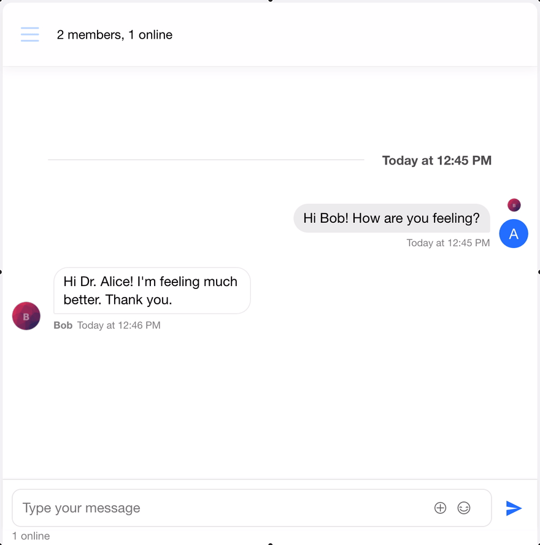

# End-to-End Encrypted Chat with the Web Crypto API

8 de out.
*Updated on Oct 09, 2020*
・9 min read

When transmitting or storing user data, especially private conversations, it's essential to consider employing cryptographic techniques to ensure privacy.

By reading this tutorial, you'll learn how to end-to-end encrypt data in web applications using nothing but JavaScript and the [Web Crypto API](https://developer.mozilla.org/en-US/docs/Web/API/Web_Crypto_API), which is a native browser API.

**Please note that this tutorial is very basic and strictly educational, may contain simplifications, and rolling your own encryption protocol is not advisable. The algorithms used can contain certain 'gotchas' if not employed properly with the help of security professionals**

You can also find the full project in this [GitHub repo](https://github.com/GetStream/encrypted-web-chat) if you happen to get lost. And if you have any questions, feel free to reach out to me on [Twitter](https://twitter.com/cardosodev) :).

## What Is End-to-End Encryption?

> End-to-end encryption is a communication system where the only people who can read the messages are the people communicating. No eavesdropper can access the cryptographic keys needed to decrypt the conversation—not even a company that runs the messaging service.
>
> - [Hacker Lexicon: What Is End-to-End Encryption](https://www.wired.com/2014/11/hacker-lexicon-end-to-end-encryption/)

## What Is the Web Crypto API?

> The Web Cryptography API defines a low-level interface to interacting with cryptographic key material that is managed or exposed by user agents. The API itself is agnostic of the underlying implementation of key storage but provides a common set of interfaces that allow rich web applications to perform operations such as signature generation and verification, hashing and verification, encryption and decryption, without requiring access to the raw keying material.
>
> - [W3C: Web Cryptography API](https://www.w3.org/TR/WebCryptoAPI/)

## Onto the Basics

In the following steps, we'll declare the essential functions involved in end-to-end encryption. You can copy each one into a dedicated `.js` file under a `lib` folder. Note that all of them are `async` functions due to the Web Crypto API's asynchronous nature.

Note: Not all browsers implement the algorithms we'll use. Namely, Internet Explorer and Microsoft Edge. Check the compatibility table at [MDN web docs: Subtle Crypto - Web APIs](https://developer.mozilla.org/en-US/docs/Web/API/SubtleCrypto#Browser_compatibility).

## Generate a Key Pair

Cryptographic key pairs are essential to end-to-end encryption. A **key pair** consists of a **public key** and a **private key**. Each user in your application should have a key pair to protect their data, with the public component available to other users and the private component only accessible to the key pair's owner. You'll understand how these come into play in the next section.

To generate the key pair, we'll use the [`window.crypto.subtle.generateKey`](https://www.w3.org/TR/WebCryptoAPI/#SubtleCrypto-method-generateKey) method, and export the private and public keys using [`window.crypto.subtle.exportKey`](https://www.w3.org/TR/WebCryptoAPI/#SubtleCrypto-method-exportKey) with the [JWK format](https://tools.ietf.org/html/rfc7517). The latter is needed to save or transmit these keys. Think of it as a way of serializing the keys for use outside of JavaScript.

PS: if you don't see `generateKeyPair.js` below due to a bug in dev.to, refresh this page.

|  |  |
| --- | --- |
|  | export default async () => { |
|  | const keyPair = await window.crypto.subtle.generateKey( |
|  | { |
|  | name: "ECDH", |
|  | namedCurve: "P-256", |
|  | }, |
|  | true, |
|  | ["deriveKey", "deriveBits"] |
|  | ); |
|  | const publicKeyJwk = await window.crypto.subtle.exportKey( |
|  | "jwk", |
|  | keyPair.publicKey |
|  | ); |
|  | const privateKeyJwk = await window.crypto.subtle.exportKey( |
|  | "jwk", |
|  | keyPair.privateKey |
|  | ); |
|  | return { publicKeyJwk, privateKeyJwk }; |
|  | }; |

Additionally, I chose the [ECDH algorith](https://www.w3.org/TR/WebCryptoAPI/#ecdh) with the [P-256 elliptic curve](https://en.wikipedia.org/wiki/Elliptic-curve_cryptography) as it is well supported and the right balance between security and performance. This preference can change with time as new algorithms become available.

Note: exporting the private key can lead to security issues, so it must be handled carefully. The approach of allowing the user to copy and paste it that will be presented in the integration part of this tutorial is not a great practice and only done for educational purposes.

## Derive Key

We'll use the key pair generated in the last step to derive the symmetric cryptographic key that encrypts and decrypts data and is unique for any two communicating users. For example, User A derives the key using their private key with User B's public key, and User B derives the same key using their private key and User A's public key. No one can generate the **derived key** without access to at least one of the users' private keys, so it's essential to keep them safe.

In the previous step, we exported the key pair in the JWK format. Before we can derive the key, we need to import those back to the original state using [`window.crypto.subtle.importKey`](https://www.w3.org/TR/WebCryptoAPI/#SubtleCrypto-method-importKey). To derive the key, we'll use the [`window.crypto.subtle.deriveKey`](https://www.w3.org/TR/WebCryptoAPI/#SubtleCrypto-method-deriveKey).

|  |  |
| --- | --- |
|  | export default async (publicKeyJwk, privateKeyJwk) => { |
|  | const publicKey = await window.crypto.subtle.importKey( |
|  | "jwk", |
|  | publicKeyJwk, |
|  | { |
|  | name: "ECDH", |
|  | namedCurve: "P-256", |
|  | }, |
|  | true, |
|  | [] |
|  | ); |
|  | const privateKey = await window.crypto.subtle.importKey( |
|  | "jwk", |
|  | privateKeyJwk, |
|  | { |
|  | name: "ECDH", |
|  | namedCurve: "P-256", |
|  | }, |
|  | true, |
|  | ["deriveKey", "deriveBits"] |
|  | ); |
|  | return await window.crypto.subtle.deriveKey( |
|  | { name: "ECDH", public: publicKey }, |
|  | privateKey, |
|  | { name: "AES-GCM", length: 256 }, |
|  | true, |
|  | ["encrypt", "decrypt"] |
|  | ); |
|  | }; |

In this case, I chose the [AES-GCM algorithm](https://www.w3.org/TR/WebCryptoAPI/#aes-gcm) for its known security/performance balance and browser availability.

## Encrypt Text

Now we can use the derived key to **encrypt** text, so it's safe to transmit it.

Before encryption, we encode the text to a `Uint8Array`, since that's what the encrypt function takes. We encrypt that array using [`window.crypto.subtle.encrypt`](https://www.w3.org/TR/WebCryptoAPI/#SubtleCrypto-method-encrypt), and then we turn its `ArrayBuffer` output back to `Uint8Array`, which we then turn to `string` and encode it to [Base64](https://en.wikipedia.org/wiki/Base64). JavaScript makes it a little bit complicated, but this is just a way to turn our encrypted data into transmittable text.

|  |  |
| --- | --- |
|  | export default async (messageJSON, derivedKey) => { |
|  | try { |
|  | const message = JSON.parse(messageJSON); |
|  | const text = message.base64Data; |
|  | const initializationVector = new Uint8Array(message.initializationVector).buffer; |
|  | const string = atob(text); |
|  | const uintArray = new Uint8Array( |
|  | [...string].map((char) => char.charCodeAt(0)) |
|  | ); |
|  | const algorithm = { |
|  | name: "AES-GCM", |
|  | iv: initializationVector, |
|  | }; |
|  | const decryptedData = await window.crypto.subtle.decrypt( |
|  | algorithm, |
|  | derivedKey, |
|  | uintArray |
|  | ); |
|  | return new TextDecoder().decode(decryptedData); |
|  | } catch (e) { |
|  | return `error decrypting message: ${e}`; |
|  | } |
|  | }; |

As you can see, the AES-GCM algorithm parameter includes an [initialization vector](https://en.wikipedia.org/wiki/Initialization_vector) (iv). For every encryption operation, it can be random, but absolutely must be unique to ensure the strength of the encryption. It is included in the message so it can be used in the decryption process, which is the next step. Also, though unlikely to reach this number, you should discard the keys after 2^32 usages, as the random IV can repeat at that point.

## Decrypt Text

Now we can use the derived key to **decrypt** any encrypted text we receive, doing precisely the opposite from the encrypt step.

Before decryption, we retrieve the initialization vector, convert the string back from Base64, turn it into a `Uint8Array`, and decrypt it using the same algorithm definition. After that, we decode the `ArrayBuffer` and return the human-readable string.

|  |  |
| --- | --- |
|  | export default async (messageJSON, derivedKey) => { |
|  | try { |
|  | const message = JSON.parse(messageJSON); |
|  | const text = message.base64Data; |
|  | const initializationVector = new Uint8Array(message.initializationVector).buffer; |
|  | const string = atob(text); |
|  | const uintArray = new Uint8Array( |
|  | [...string].map((char) => char.charCodeAt(0)) |
|  | ); |
|  | const algorithm = { |
|  | name: "AES-GCM", |
|  | iv: initializationVector, |
|  | }; |
|  | const decryptedData = await window.crypto.subtle.decrypt( |
|  | algorithm, |
|  | derivedKey, |
|  | uintArray |
|  | ); |
|  | return new TextDecoder().decode(decryptedData); |
|  | } catch (e) { |
|  | return `error decrypting message: ${e}`; |
|  | } |
|  | }; |

It's also possible that this decryption process will fail due to using a wrong derived key or initialization vector, which means the user does not have the correct key pair to decrypt the text they received. In such a case, we return an error message.

## Integrating in Your Chat App

And that is all the cryptographic work required! In the following sections, I'll explain how I used the methods we implemented above to end-to-end encrypt a chat application built with [Stream Chat's powerful React chat components](https://getstream.io/chat/react-chat/tutorial/).

## Clone the Project

Clone the [encrypted-web-chat repository](https://github.com/getstream/encrypted-web-chat) in a local folder, install the dependencies and run it.

|  |  |
| --- | --- |
|  | $ git clone https://github.com/getstream/encrypted-web-chat |
|  | $ cd encrypted-web-chat/ |
|  | $ yarn install |
|  | $ yarn start |

After that, a browser tab should open. But first, we need to configure the project with our own Stream Chat API key.

## Configure the Stream Chat Dashboard

Create your account at [GetStream.io](https://getstream.io/), create an application, and select development instead of production.

To simplify, let's disable both auth checks and permission checks. Make sure to hit save. When your app is in production, you should keep these enabled and have a backend to provide tokens for the users.

For future reference, see the [documentation on authentication](https://getstream.io/chat/docs/tokens_and_authentication/?language=js) and the [documentation on permissions](https://getstream.io/chat/docs/chat_permission_policies/?language=js).

Please take note of the Stream credentials, as we'll use them to initialize the chat client in the app in the next step. Since we disabled authentication and permissions, we'll only really need the key for now. Still, in the future, you'll use the secret in your backend to [implement authentication to issue user tokens for Stream Chat](https://getstream.io/docs/auth_and_permissions/), so your chat app can have proper access controls.

As you can see, I've redacted my keys. It would be best if you kept these credentials safe.

## Change the Credentials

In [`src/lib/chatClient.js`](https://github.com/GetStream/encrypted-web-chat/blob/main/src/lib/chatClient.js), change the key with yours. We'll use this object to make API calls and configure the chat components.

|  |  |
| --- | --- |
|  | import { StreamChat } from "stream-chat"; |
|  | export default new StreamChat("[api\_key]"); |

After this, you should be able to test the application. In the following steps, you'll understand where the functions we defined fit in.

## Set the User

In [`src/lib/setUser.js`](https://github.com/GetStream/encrypted-web-chat/blob/main/src/lib/setUser.js), we define the function that sets the chat client's user and updates it with the given key pair's public key. Sending the public key is necessary for other users to derive the key required for encrypting and decrypting communication with our user.

|  |  |
| --- | --- |
|  | import chatClient from "./chatClient"; |
|  | export default async (id, keyPair) => { |
|  | const response = await chatClient.setUser( |
|  | { |
|  | id, |
|  | name: id, |
|  | image: `https://getstream.io/random\_png/?id=cool-recipe-9&name=${id}`, |
|  | }, |
|  | chatClient.devToken(id) |
|  | ); |
|  | if ( |
|  | response.me?.publicKeyJwk && |
|  | response.me.publicKeyJwk != JSON.stringify(keyPair.publicKeyJwk) |
|  | ) { |
|  | await chatClient.disconnect(); |
|  | throw "This user id already exists with a different key pair. Choose a new user id or paste the correct key pair."; |
|  | } |
|  | await chatClient.upsertUsers([ |
|  | { id, publicKeyJwk: JSON.stringify(keyPair.publicKeyJwk) }, |
|  | ]); |
|  | }; |

In this function, we import the `chatClient` defined in the previous step. It takes a user id and a **key pair**, then it calls `chatClient.setUser` to set the user. After that, it checks whether that user already has a public key and if it matches the public key in the key pair given. If the public key matches or is non-existent, we update that user with the given public key; if not, we disconnect and display an error.

## Sender Component

In [`src/components/Sender.js`](https://github.com/GetStream/encrypted-web-chat/blob/main/src/components/Sender.js), we define the first screen, where we choose our user id, and can generate a key pair using the function we described in `generateKey.js`, or, if this is an existing user, paste the key pair generated at the time of user creation.

## Recipient Component

In [`src/components/Recipient.js`](https://github.com/GetStream/encrypted-web-chat/blob/main/src/components/Recipient.js), we define the second screen, where we choose the id of the user with whom we want to communicate. The component will fetch this user with [`chatClient.queryUsers`](https://getstream.io/chat/docs/query_users/?language=js). The result of that call will contain the user's public key, which we'll use to derive the encryption/decryption key.

## KeyDeriver Component

In [`src/components/KeyDeriver.js`](https://github.com/GetStream/encrypted-web-chat/blob/main/src/components/KeyDeriver.js), we define the third screen, where the key is derived using the method we implemented in `deriveKey.js` with the sender's (us) private key and the recipient's public key. This component is merely a passive loading screen since the information needed was collected in the previous two screens. But it will show an error if there's an issue with the keys.

## EncryptedMessage Component

In [`src/components/EncryptedMessage.js`](https://github.com/GetStream/encrypted-web-chat/blob/main/src/components/EncryptedMessage.js), we customize Stream Chat's Message component to decrypt the message using the method we defined in `decrypt.js` alongside the encrypted data and the derived key.

Without this customization of the Message component, it would show up like this:

The customization is done by wrapping Stream Chat's `MessageSimple` component and using the `useEffect` hook to modify the message prop with the decrypt method.

## EncryptedMessageInput Component

In [`src/components/EncryptedMessageInput.js`](https://github.com/GetStream/encrypted-web-chat/blob/main/src/components/EncryptedMessageInput.js), we customize Stream Chat's MessageInput component to encrypt the message written before sending it using the method we defined in `encrypt.js` alongside the original text.

The customization is done by wrapping Stream Chat's `MessageInputLarge` component and settings the `overrideSubmitHandler` prop to a function that encrypts the text before sending to the channel.

## Chat Component

And finally, in [`src/components/Chat.js`](https://github.com/GetStream/encrypted-web-chat/blob/main/src/components/Chat.js), we build the whole chat screen using Stream Chat's components and our custom Message and EncryptedMessageInput components.

The `MessageList` component has a `Message` prop, set to the custom `EncryptedMessage` component, and the `EncryptedMessageInput` can just be placed right below it in the hierarchy.

## Next Steps With Web Crypto API

Congratulations! You just learned how to implement basic end-to-end encryption in your web apps. It's important to know this is the most basic form of end-to-end encryption. It lacks some additional tweaks that can make it more bullet-proof for the real world, such as [randomized padding](https://en.wikipedia.org/wiki/Padding_(cryptography)#Randomized_padding), [digital signature](https://en.wikipedia.org/wiki/Digital_signature), and [forward secrecy](https://en.wikipedia.org/wiki/Forward_secrecy), among others. Also, for real-world usage, it's vital to get the help of application security professionals.

PS: Special thanks to Junxiao in the comments for correcting my mistakes :-)
