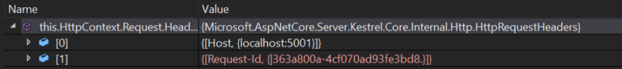
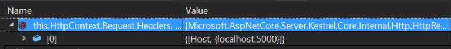
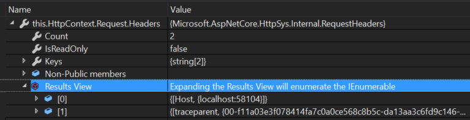
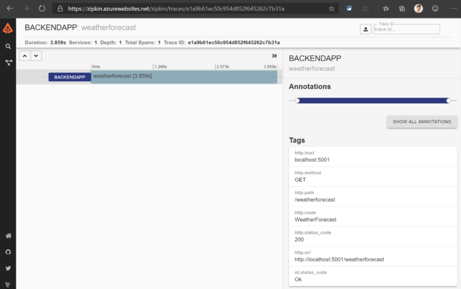
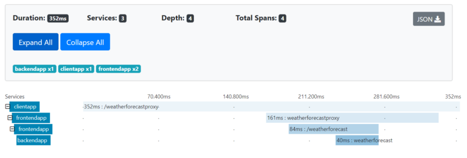
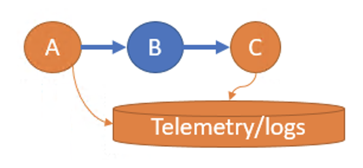
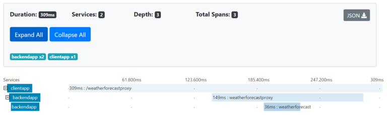
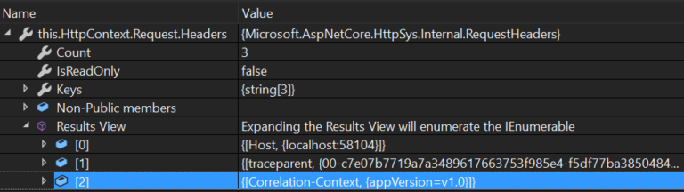

# Improvements in .NET Core 3.0 for troubleshooting and monitoring distributed apps


Sergey

November 13th, 2019

*Thank you [David Fowler](https://github.com/davidfowl) and [Richard Lander](https://github.com/richlander) for reviews.*

## Introduction

Operating distributed apps is hard. Distributed apps typically consists of multiple components. These components may be owned and operated by different teams. Every interaction with an app results in distributed trace of code executions across many components. If your customer experiences a problem – pinpointing the root cause in one of components participated in a distributed trace is a hard task.

One big difference of distributed apps comparing to monoliths is a difficulty to correlate telemetry (like logs) across a single distributed trace. Looking at logs you can see how each component processed each request. But it is hard to know which request in once component and request in other component belong to the same distributed trace.

Historically, Application Performance Monitoring (APM) vendors provided the functionality of distributed trace context propagation from one component to another. Telemetry is correlated using this context. Due to heterogeneous nature of many environments, with components owned by different teams and using different tools for monitoring, it was always hard to instrument distributed apps consistently. APM vendors provided automatic code injection agents and SDKs to handle complexity of understanding various distributed context formats and RPC protocols.

With the upcoming transition of [W3C Trace Context specification](https://www.w3.org/TR/trace-context/) into Proposed Recommendation maturity level, and support of this specification by many vendors and platforms, the complexity of the context propagation is decreasing. The W3C Trace Context specification describes semantics of the distributed trace context and its format. This ensures that every component in a distributed app may understand this context and propagate it to components it calls into.

Microsoft is working on making distributed apps development easier with many ongoing developments like [Orleans framework](https://devblogs.microsoft.com/dotnet/orleans-3-0/) and project [Dapr](https://dapr.io/). As for distributed trace context propagation – Microsoft services and platforms will be adopting a W3C Trace Context format.

We believe that ASP.NET Core must provide an outstanding experience for building distributed tracing apps. With every release of ASP.NET Core we execute on this promise. This post describes the scenario of distributed tracing and logging highlighting improvements in .NET Core 3.0 and talks about discussions of a new exciting features we plan to add going forward.

## Distributed Tracing and Logging

Let’s explore distributed tracing in .NET Core 3.0 and improvements recently made. **First**, we’ll see how two “out of the box” ASP.NET Core 3.0 apps has logs correlated across the entire distributed trace. **Second**, we’ll explore how easy it is to set distributed trace context for any .NET Core application and how it will automatically be propagated across http. And **third**, we’ll see how the same distributed trace identity is used by telemetry SDKs like [OpenTelemetry](https://opentelemetry.io/) and ASP.NET Core logs.

This demo will also demonstrate how .NET Core 3.0 embraces W3C Trace Context standard and what other features it offers.

### Demo set up

In this demo we will have three simple components: ClientApp, FrontEndApp and BackEndApp.

[](https://devblogs.microsoft.com/aspnet/wp-content/uploads/sites/16/2019/11/word-image.png)

BackEndApp is a template ASP.NET Core application called WeatherApp. It exposes a REST API to get a weather forecast.

FrontEndApp proxies all incoming requests into the calls to BackEndApp using this controller:

```
[ApiController][Route("[controller]")]publicclassWeatherForecastProxyController:ControllerBase{privatereadonlyILogger<WeatherForecastProxyController> _logger;privatereadonlyHttpClient _httpClient;publicWeatherForecastProxyController(ILogger<WeatherForecastProxyController> logger,HttpClient httpClient){
        _logger = logger;
        _httpClient = httpClient;}[HttpGet]publicasyncTask<IEnumerable<WeatherForecast>>Get(){var jsonStream =await 
                  _httpClient.GetStreamAsync("http://localhost:5001/weatherforecast");var weatherForecast =awaitJsonSerializer.DeserializeAsync<IEnumerable<WeatherForecast>>(jsonStream);return weatherForecast;}}
```

Finally, ClientApp is a .NET Core 3.0 Windows Forms app. ClientApp calls into FrontEndApp for the weather forecast.

```
privateasyncTask<string>GetWeatherForecast(){returnawait _httpClient.GetStringAsync("http://localhost:5000/weatherforecastproxy");}
```

Please note, there were no additional SDKs enabled or libraries installed on demo apps. As the demo progresses – every code change will be mentioned.

### Correlated logs

Let’s make the very first call from ClientApp and take a look at the logs produced by FrontEndApp and BackEndApp.

FrontEndApp (a few line breaks added for readability):

```
info:Microsoft.AspNetCore.Routing.EndpointMiddleware[1]=>ConnectionId:0HLR1BR0PL1CH=>RequestPath:/weatherforecastproxy 
         RequestId:0HLR1BR0PL1CH:00000001,SpanId:|363a800a-4cf070ad93fe3bd8.,TraceId:363a800a-4cf070ad93fe3bd8,ParentId:Executed endpoint 'FrontEndApp.Controllers.WeatherForecastProxyController.Get (FrontEndApp)'
```

BackEndApp:

```
info:BackEndApp.Controllers.WeatherForecastController[0]=>ConnectionId:0HLR1BMQHFKRL=>RequestPath:/weatherforecast 
         RequestId:0HLR1BMQHFKRL:00000002,SpanId:|363a800a-4cf070ad93fe3bd8.94c1cdba_,TraceId:363a800a-4cf070ad93fe3bd8,ParentId:|363a800a-4cf070ad93fe3bd8.Executed endpoint 'FrontEndApp.Controllers.WeatherForecastController.Get (BackEndApp)'
```

Like magic, logs from two independent apps share the same TraceId. Behind the scene, ASP.NET Core 3.0 app will initialize a distributed trace context and pass it in the header. This is how incoming headers to the BackEndApp looks like:

[](https://devblogs.microsoft.com/aspnet/wp-content/uploads/sites/16/2019/11/word-image-1.png)

You may notice that FrontEndApp didn’t receive any additional headers:

[](https://devblogs.microsoft.com/aspnet/wp-content/uploads/sites/16/2019/11/a-screenshot-of-a-cell-phone-description-automati.png)

The reason is that in ASP.NET Core apps – distributed trace being initiated by ASP.NET Core framework itself on every incoming request. Next section explains how to do it for any .NET Core 3.0 app.

### Initiate distributed trace in .NET Core 3.0 app

You may have noticed the difference in behavior of Windows Forms ClientApp and ASP.NET Core FrontEndApp. ClientApp didn’t set any distributed trace context. So FrontEndApp didn’t receive it. It is easy to set up distributed operation. Easiest way to do it is to use an API called `Activity` from the DiagnosticSource package.

```
privateasyncTask<string>GetWeatherForecast(){var activity =newActivity("CallToBackend").Start();try{returnawait _httpClient.GetStringAsync("http://localhost:5000/weatherforecastproxy");}finally{
        activity.Stop();}}
```

Once you have started an activity, HttpClient knows that distributed trace context needs to be propagated. Now all three components – ClientApp, FrontEndApp and BackEndApp share the same TraceId.

### W3C Trace Context support

You may notice that the context is propagating using the header called Request-Id. This header was introduced in Asp.Net Core 2.0 and is used by default for better compatibility with these apps. However, as the W3C Trace Context specification is being widely adopted, it is recommended to switch to this format of context propagation.

With .NET Core 3.0, it is easy to switch to W3C Trace Context format to propagate distributed trace identifiers. Easiest way to do it is in the main method- just add a simple line in the `Main` method:

```
staticvoidMain(){Activity.DefaultIdFormat=ActivityIdFormat.W3C;…Application.Run(newMainForm());}
```

Now, when the FrontEndApp receives requests from the ClientApp, you see a traceparent header in the request:

[](https://devblogs.microsoft.com/aspnet/wp-content/uploads/sites/16/2019/11/word-image-2.png)

The ASP.NET Core app will understand this header and recognize that it needs to use W3C Trace Context format for outgoing calls now.

Note, ASP.NET Core apps will recognize the correct format of distributed trace context automatically. However, it is still a good practice to switch the default format of distributed trace context to W3C for better interoperability in heterogeneous environments.

You will see all the logs attributed with the TraceId and SpanId obtained from the incoming header:

```
info:Microsoft.AspNetCore.Hosting.Diagnostics[1]=>ConnectionId:0HLQV2BC3VP2T=>RequestPath:/weatherforecast 
         RequestId:0HLQV2BC3VP2T:00000001,SpanId:da13aa3c6fd9c146,TraceId:f11a03e3f078414fa7c0a0ce568c8b5c,ParentId:5076c17d0a604244Request starting HTTP/1.1 GET http://localhost:5000/weatherforecast
```

### Activity and distributed tracing with OpenTelemetry

[OpenTelemetry](https://opentelemetry.io/) provides a single set of APIs, libraries, agents, and collector services to capture distributed traces and metrics from your application. You can analyze them using Prometheus, Jaeger, Zipkin, and other observability tools.

Let’s enable OpenTelemetry on the BackEndApp. It is very easy to do, just call `AddOpenTelemetry` on startup:

```
services.AddOpenTelemetry(b => 
    b.UseZipkin(o =>{
                    o.ServiceName="BackEndApp"; 
                    o.Endpoint=newUri("http://zipkin /api/v2/spans");}).AddRequestCollector());
```

Now, as we just saw, TraceId in the FrontEndApp logs will match TraceId in the BackEndApp.

```
info:Microsoft.AspNetCore.Mvc.Infrastructure.ControllerActionInvoker[2]=>ConnectionId:0HLR2RC6BIIVO=>RequestPath:/weatherforecastproxy 
         RequestId:0HLR2RC6BIIVO:00000001,SpanId:54e2de7b9428e940,TraceId:e1a9b61ec50c954d852f645262c7b31a,ParentId:69dce1f155911a45=>FrontEndApp.Controllers.WeatherForecastProxyController.Get(FrontEndApp)Executed action FrontEndApp.Controllers.WeatherForecastProxyController.Get(FrontEndApp)in3187.3112ms

info:Microsoft.AspNetCore.Mvc.Infrastructure.ControllerActionInvoker[2]=>ConnectionId:0HLR2RLEHSKBV=>RequestPath:/weatherforecast 
         RequestId:0HLR2RLEHSKBV:00000001,SpanId:0e783a0867544240,TraceId:e1a9b61ec50c954d852f645262c7b31a,ParentId:54e2de7b9428e940=>BackEndApp.Controllers.WeatherForecastController.Get(BackEndApp)Executed action BackEndApp.Controllers.WeatherForecastController.Get(BackEndApp)in3085.9111ms
```

Furthermore, the same Trace will be reported by Zipkin. So now you can correlate distributed traces collected by your distributed tracing tool and logs from the machine. You can also give this TraceId to the user when ClientApp experience issues. The user can share it with your app support and corresponding logs and distributed traces can be easily discovered across all components.

[](https://devblogs.microsoft.com/aspnet/wp-content/uploads/sites/16/2019/11/word-image-3.png)

Taking example one step further – you can easily enable monitoring for all three components and see them on the gantt chart.

[](https://devblogs.microsoft.com/aspnet/wp-content/uploads/sites/16/2019/11/word-image-4.png)

### ASP.NET Core apps integrates with distributed trace

As we just seen telemetry collected by Application Monitoring vendors is correlated using the same distributed trace context as ASP.NET Core uses. This makes ASP.NET Core 3.0 apps great for the environments where different components are owned by different teams.

Imagine that only two of apps – A and C on the picture below enabled telemetry collection using SDK like OpenTelemetry. Before ASP.NET Core 3.0 it would mean that distributed tracing will not work, and a trace will be “broken” by app B.

[](https://devblogs.microsoft.com/aspnet/wp-content/uploads/sites/16/2019/11/a-picture-containing-object-description-automatic.png)

With ASP.NET Core 3.0, since in most deployments ASP.NET Core apps are configured with the basic logging enabled, app B will propagate distributed trace context. This distributed traces from A and C will be correlated.

With the example of apps from before – if ClientApp and BackEndApp are instrumented and FrontEndApp is not – you see distributed trace is still being correlated:

[](https://devblogs.microsoft.com/aspnet/wp-content/uploads/sites/16/2019/11/word-image-5.png)

This also makes ASP.NET Core apps great for the service mesh environments. In service mesh deployments, A and C from the picture above may represent a service mesh. In order for service mesh to stitch request entering and leaving component B – certain headers have to be propagated by an app. See this note from the [Istio for example](https://istio.io/docs/tasks/telemetry/distributed-tracing/overview/#trace-context-propagation):

*Although Istio proxies are able to automatically send spans, they need some hints to tie together the entire trace. Applications need to propagate the appropriate HTTP headers so that when the proxies send span information, the spans can be correlated correctly into a single trace.*

As we work with service mesh authors to adopt W3C Trace Context format, ASP.NET Core apps will “just work” and propagate needed headers.

## Passing additional context

Talking about other scenarios, it is often the case that you want to share more context between components in a distributed app. Let’s say a ClientApp wants to send its version so all REST calls will know where the request is coming from. You can add these properties in Activity.Baggage like this:

```
privateasyncTask<string>GetWeatherForecast(){var activity =newActivity("CallToBackend").AddBaggage("appVersion","v1.0").Start();try{returnawait _httpClient.GetStringAsync("http://localhost:5000/weatherforecastproxy");}finally{
        activity.Stop();}}
```

Now on server side you see an additional header Correlation-Context in both – FrontEndApp and BackEndApp.

[](https://devblogs.microsoft.com/aspnet/wp-content/uploads/sites/16/2019/11/word-image-6.png)

And you can use the `Activity.Baggage` to attribute your logs:

```
var appVersion =Activity.Current.Baggage.FirstOrDefault(b => b.Key=="appVersion").Value;using(_logger.BeginScope($"appVersion={appVersion}")){
    _logger.LogInformation("this weather forecast is from random source");}
```

And you see the scope now contains an appVersion:

```
info:FrontEndApp.Controllers.WeatherForecastController[0]=>ConnectionId:0HLQV353507UG=>RequestPath:/weatherforecast 
         RequestId:0HLQV353507UG:00000001,SpanId:37a0f7ebf3ecac42,TraceId:c7e07b7719a7a3489617663753f985e4,ParentId:f5df77ba38504846
      =>FrontEndApp.Controllers.WeatherForecastController.Get(BackEndApp)=> appVersion=v1.0this weather forecast isfrom random source
```

## Next steps

With the improvements for ASP.NET Core 3.0 we hear that some of the features included in ASP.NET Core is hard to consume. Developers and DevOps wants a turnkey telemetry solution that will work with many APM vendors. We believe that investments we are making in OpenTelemetry will allow more people to benefit from investments we are making in ASP.NET Core monitoring and troubleshooting. This is one of the big areas of investments for a team.

We also help people adopt W3C Trace Context everywhere and will be making it a default distributed trace context propagation format in future versions of ASP.NET Core.

Another area of investments is to improve distributed context propagation scenarios. Distributed apps comparing to monoliths are lacking common shared state with the lifetime of a single distributed trace. This shared state (or context) can be used for basic logging as was described in this article, as well as for advanced routing of requests, experimentation, A/B testing, business context propagation, etc. Some of scenarios are described in this epic: [Distributed Context in ASP.NET and Open Telemetry](https://github.com/dotnet/corefx/issues/42305).

Please send us your feedback and tell what improvements in distributed apps troubleshooting and monitoring we need to make.

##### [Sergey Kanzhelev](https://devblogs.microsoft.com/aspnet/author/sergkanz/)

Principal Software Engineer, Azure Monitor: Application Insights

**Follow**
