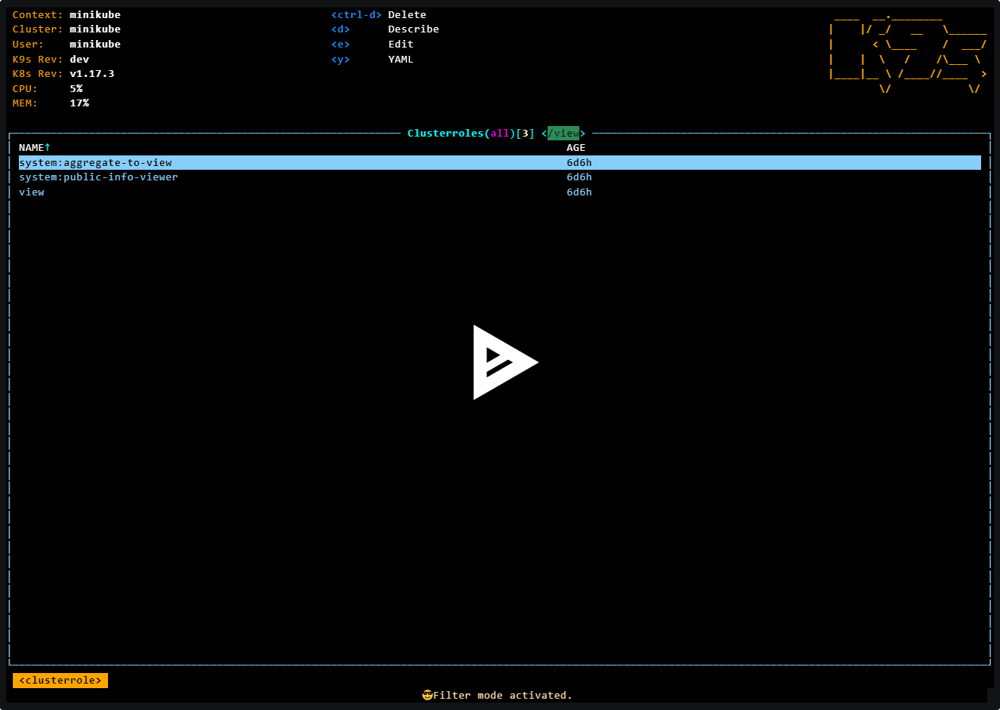
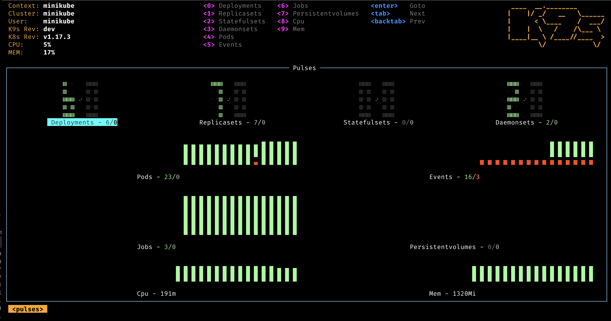
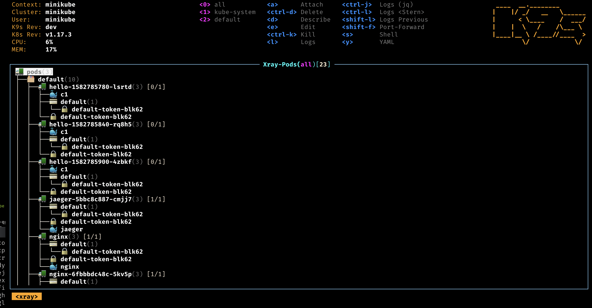
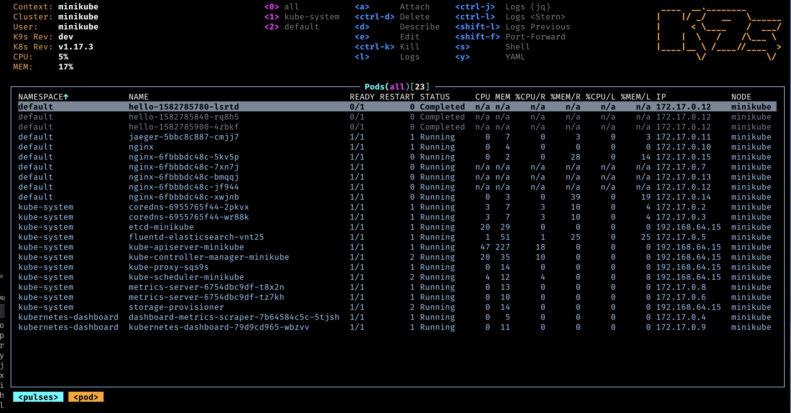
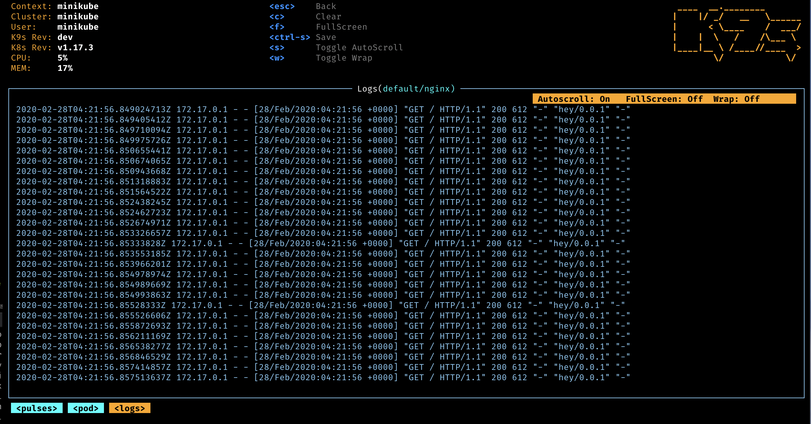
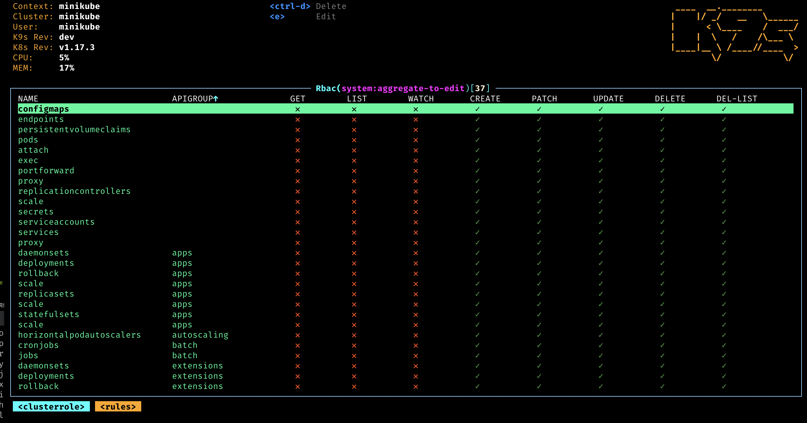
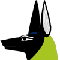

# Who Let The Pods Out?

K9s is a terminal based UI to interact with your Kubernetes clusters. The aim of this project is to make it easier to navigate, observe and manage your deployed applications in the wild. K9s continually watches Kubernetes for changes and offers subsequent commands to interact with your observed resources.

# Features

- Information At Your Finger Tips!
  - Tracks in real-time activities of resources running in your Kubernetes cluster.
- Standard or CRD?
  - Handles both Kubernetes standard resources as well as custom resource definitions.
- Cluster Metrics
  - Tracks real-time metrics associates with resources such as pods, containers and nodes.
- Power Users Welcome!
  - Provides standard cluster management commands such as logs, scaling, port-forwards, restarts…
  - Define your own command shortcuts for quick navigation via command aliases and hotkeys.
  - Plugin support to extend K9s to create your very own cluster commands.
  - Powerful filtering mode to allow user to drill down and view workload related resources.
- Error Zoom
  - Drill down directly to what’s wrong with your cluster’s resources.
- Skinnable and Customizable
  - Define your very own look and feel via K9s skins.
  - Customize/Arrange which columns to display on a per resource basis.
- Narrow or Wide?
  - Provides toggles to view minimal or full resource definitions
- MultiResources Views
  - Provides for an overview of your cluster resources via Pulses and XRay views.
- We’ve got your RBAC!
  - Supports for viewing RBAC rules such as cluster/roles and their associated bindings.
  - Reverse lookup to asserts what a user/group or ServiceAccount can do on your clusters.
- Built-in Benchmarking
  - You can benchmark your HTTP services/pods directly from K9s to see how your application fare and adjust your resources request/limit accordingly.
- Resource Graph Traversals
  - K9s provides for easy traversal of Kubernetes resources and their associated resources.

# Sponsor Us!

If you dig this effort and feel K9s is improving your Kubernetes experience and productivity for you or your team, please join our sponsorship program! K9s is complex and and a lot of work, by clicking the [Sponsor button](https://github.com/sponsors/derailed) you can help show your support and appreciation. Alternatively, just simply give us a shoot-out on social as these go a long way in keeping our batteries charged up!

# Documentation

## Previews

- Pulses - *A top level dashboard of the state of affairs of your cluster*

  
- XRay - *Dig in your cluster resources and view their dependencies*

  
- Pods - *List out your pods status and resource consumption*

  
- Logs - *View and interact with your container logs*

  
- RBAC - *View the who/what/how of authorizations on your cluster*

  

## ATTA Girls/Boys!

K9s sits on top of many open source projects and libraries. Our *sincere* appreciations to all the OSS contributors that work nights and weekends to make this project a reality!

## Get In Touch!

---

© 2020 Imhotep Software LLC. All materials licensed under
[Apache v2.0](http://www.apache.org/licenses/LICENSE-2.0)
