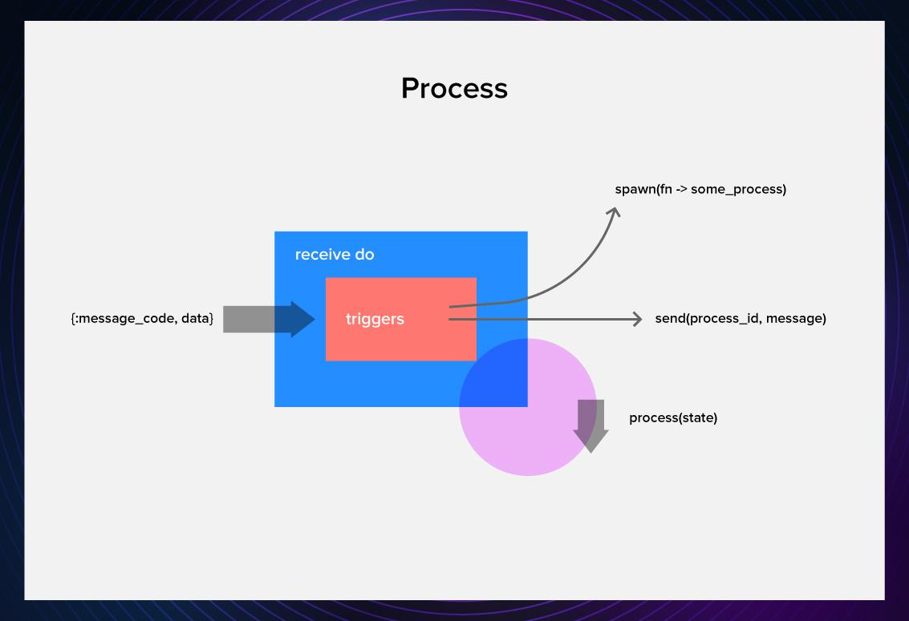

# A Brief Guide to OTP in Elixir

Article by [Gints Dreimanis](https://serokell.io/team#gintsdreimanis)

Wednesday, September 30th, 2020

7

One of the main advantages of Elixir is that it is awesome for server-side systems. Forget using a million different technologies for things like data persistence, background jobs, and service crash recovery, OTP can supply you with everything.

*So what exactly is this magical thing?*

In this article, I will introduce you to OTP, look at basic process loops, the GenServer and Supervisor behaviours, and see how they can be used to implement an elementary process that stores funds.

(This article assumes that you are already familiar with the basics of Elixir. If you’re not, you can check out the [Getting Started guide](https://elixir-lang.org/getting-started/introduction.html) on Elixir’s website or use one of the other resources listed in our [Elixir guide](https://serokell.io/blog/learn-elixir).)

## What is OTP?

OTP is an awesome set of tools and libraries that Elixir inherits from Erlang, [a programming language on whose VM it runs](https://serokell.io/blog/history-of-erlang-and-elixir).

OTP contains a lot of stuff, such as the Erlang compiler, databases, test framework, profiler, debugging tools. But, when we talk about OTP in the context of Elixir, we usually mean the Erlang actor model that is based on lightweight processes and is the basis of what makes Elixir so efficient.

## Processes


At the foundation of OTP, there are tiny things called processes.

Unlike OS processes, they are really, really lightweight. Creating them takes microseconds, and a single machine can easily run multiple thousands of them, simultaneously.

Processes loosely follow the [actor model](https://en.wikipedia.org/wiki/Actor_model). Every process is *basically* a mailbox that can receive messages, and in response to those messages it can:

- Create new processes.
- Send messages to other processes.
- Modify its private state.



### Spawning processes

The most basic way to spawn a process is with the spawn command. Let’s open IEx and launch one.

```
iex(1)> process = spawn(fn -> IO.puts("hey there!") end)
```

The above function will return:

```
hey there!
#PID<0.104.0>
```

First is the result of the function, second is the output of spawn – PID, a unique process identification number.

Meanwhile, we have a problem with our process. While it did the task we asked it to do, it seems like it is now… dead?

Let’s use its PID (stored in the variable `process`) to query for life signs.

```
iex(2)> Process.alive?(process)
false
```

If you think about it, it makes sense. The process did what we asked it to do, fulfilled its reason for existence, and closed itself. But there is a way to extend the life of the process to make it more worthwhile for us.

### Receive-do loop

Turns out, we can extend the process function to a loop that can hold state and modify it.

For example, let’s imagine that we need to create a process that mimics the funds in a palace treasury. We’ll create a simple process to which you can store or withdraw funds, and ask for the current balance.

We’ll do that by creating a loop function that responds to certain messages while keeping the state in its argument.

```
defmodule Palace.SimpleTreasury do

  def loop(balance) do
      receive do
        {:store, amount} ->
          loop(balance + amount)
        {:withdraw, amount} ->
          loop(balance - amount)
        {:balance, pid} ->
          send(pid, balance)
          loop(balance)
      end
    end
end
```

In the body of the function, we put the receive statement and pattern match all the messages we want our process to respond to. Every time the loop runs, it will check from the bottom of the mailbox (in order they were received) for messages that match what we need and process them.

If the process sees any messages with atoms `store`, `withdraw`, `balance`, those will trigger certain actions.

To make it a bit nicer, we can add an `open` function and also dump all the messages we don’t need to not pollute the mailbox.

```
defmodule Palace.SimpleTreasury do

  def open() do
    loop(0)
  end

  def loop(balance) do
    receive do
      {:store, amount} ->
        loop(balance + amount)
      {:withdraw, amount} ->
        loop(balance - amount)
      {:balance, pid} ->
        send(pid, balance)
        loop(balance)
      _ ->
        loop(balance)
      end
    end
  end
end
```

While this seems quite concise, there’s already some boilerplate lurking, and we haven’t even covered corner cases, tracing, and reporting that would be necessary for production-level code.

In real life, we don’t need to write code with receive do loops. Instead, we use one of the behaviours created by people much smarter than us.

## Behaviours

Many processes follow certain similar patterns. To abstract over these patterns, we use behaviours. Behaviours have two parts: abstract code that we don’t have to implement and a callback module that is implementation-specific.

In this article, I will introduce you to [GenServer](https://hexdocs.pm/elixir/GenServer.html), short for *generic server*, and [Supervisor](https://hexdocs.pm/elixir/Supervisor.html). Those are not the only behaviours out there, but they certainly are one of the most common ones.

### GenServer


To start off, let’s create a module called `Treasury`, and add the GenServer behaviour to it.

```
defmodule Palace.Treasury do
  use GenServer
end
```

This will pull in the necessary boilerplate for the behaviour. After that, we need to implement the callbacks for our specific use case.

Here’s what we will use for our basic implementation.

|  |  |  |
| --- | --- | --- |
| Callback | What it does | What it *usually* returns |
| `init(state)` | Initializes the server. | `{:ok, state}` |
| `handle_cast(pid, message)` | An async call that doesn’t demand an answer from the server. | `{:noreply, state}` |
| `handle_call(pid, from, message)` | A synchronous call that demands an answer from the server. | `{:reply, reply, state}` |

Let’s start with the easy one – `init`. It takes a state and starts a process with that state.

```
 def init(balance) do
   {:ok, balance}
 end
```

Now, if you look at the simple code we wrote with `receive`, there are two types of triggers. The first one (`store` and `withdraw`) just asks for the treasury to update its state asynchronously, while the second one (`get_balance`) waits for an answer. `handle_cast` can handle the async ones, while `handle_call`can handle the synchronous one.

To handle adding and subtracting, we will need two casts. These take a message with the command and the transaction amount and update the state.

```
def handle_cast({:store, amount}, balance) do
  {:noreply, balance + amount}
end

def handle_cast({:withdraw, amount}, balance) do
  {:noreply, balance - amount}
end
```

Finally, `handle_call`takes the balance call, the caller, and state, and uses all that to reply to the caller and return the same state.

```
def handle_call(:balance, _from, balance) do
  {:reply, balance, balance}
end
```

These are all the callbacks we have:

```
defmodule Palace.Treasury do
  use GenServer

  def init(balance) do
    {:ok, balance}
  end

  def handle_cast({:store, amount}, balance) do
    {:noreply, balance + amount}
  end

  def handle_cast({:withdraw, amount}, balance) do
    {:noreply, balance - amount}
  end

  def handle_call(:balance, _from, balance) do
    {:reply, balance, balance}
  end
end
```

To hide the implementation details, we can add client commands in the same module. Since this will be the only treasury of the palace, let’s also give a name to the process equal to its module name when spawning it with `start_link.`This will make it easier to refer to it.

```
defmodule Palace.Treasury do
  use GenServer

  # Client

  def open() do
    GenServer.start_link(__MODULE__, 0, name: __MODULE__)
  end

  def store(amount) do
    GenServer.cast(__MODULE__, {:store, amount})
  end

  def withdraw(amount) do
    GenServer.cast(__MODULE__, {:withdraw, amount})
  end

  def get_balance() do
    GenServer.call(__MODULE__, :balance)
  end

  # Callbacks

  def init(balance) do
    {:ok, balance}
  end

  def handle_cast({:store, amount}, balance) do
    {:noreply, balance + amount}
  end

  def handle_cast({:withdraw, amount}, balance) do
    {:noreply, balance - amount}
  end

  def handle_call(:balance, _from, balance) do
    {:reply, balance, balance}
  end
end
```

Let’s try it out:

```
iex(1)> Palace.Treasury.open()
{:ok, #PID<0.138.0>}
iex(2)> Palace.Treasury.store(400)
:ok
iex(3)> Palace.Treasury.withdraw(100)
:ok
iex(4)> Palace.Treasury.get_balance()
300
```

It works.

Here’s [a cheatsheet on GenServer](https://elixir-lang.org/cheatsheets/gen-server.pdf) to help you remember where to put what.

### Supervisor


However, just letting a treasury run without supervision is a bit irresponsible, and a good way to lose your funds or your head.

Thankfully, OTP provides us with the [supervisor behaviour](https://hexdocs.pm/elixir/Supervisor.html). Supervisors can:

- start and shutdown applications,
- provide fault tolerance by restarting crashed processes,
- be used to make a hierarchical supervision structure, called a *supervision tree*.

Let’s equip our treasury with a simple supervisor.

```
defmodule Palace.Treasury.Supervisor do
  use Supervisor

  def start_link(init_arg) do
    Supervisor.start_link(__MODULE__, init_arg,  name: __MODULE__)
  end

  def init(_init_arg) do
    children = [
      %{
       id: Palace.Treasury,
       start: {Palace.Treasury, :open, []}
      }
    ]   

    Supervisor.init(children, strategy: :one_for_one)
  end
end
```

In its most basic, a supervisor has two functions: `start_link()`, which runs the supervisor as a process, and `init`, which provides the arguments necessary for the supervisor to initialize.

Things we need to pay attention to are:

- **The list of children.** Here, we list all the processes that we want the supervisor to start, together with their init functions and starting arguments. Each of the processes is a map, with at least the `id`and `start` keys in it.
- **Supervisor’s `init` function.** To it, we supply the list of children processes and a supervision strategy. Here, we use `:one_for_one`– if a child process will crash, only that process will be restarted. There are [a few more](https://hexdocs.pm/elixir/Supervisor.html#module-strategies).

Running the `Palace.Treasury.Supervisor.start_link()` function will open a treasury, which will be supervised by the process. If the treasury crashes, it will get restarted with the initial state – 0.

If we wanted, we could add several other processes to this supervisor that are relevant to the treasury function, such as a process that can exchange looted items for their monetary value.

Additionally, we could also duplicate or persist the state of the treasury process to make sure that our funds are not lost when the treasury process crashes.

Since this is a basic guide, I will let you investigate the possibilities by yourself.

## Further reading

This introduction has been quite basic to help you understand the concepts behind OTP quickly. If you want to learn more, there are a lot of nice resources out there:

- **[Intro to OTP in Elixir](https://www.youtube.com/watch?v=CJT8wPnmjTM).** A brief and concise look at OTP in video format.
- **[Designing Elixir Systems with OTP](https://pragprog.com/titles/jgotp/designing-elixir-systems-with-otp/).** Learn how to structure your Elixir applications and make use of OTP properly.
- **[OTP as the Core of Your Application](https://akoutmos.com/post/actor-model-genserver-app/).** A cool 2-part series on creating an actually useful app with GenServer.
- **[The Little Elixir & OTP Guidebook](https://www.manning.com/books/the-little-elixir-and-otp-guidebook).** A handy book on Elixir and OTP that features a cool toy project on weather data.

If you’re interested in learning more about Elixir, I can suggest our valuable [resource guide](https://serokell.io/blog/learn-elixir). To read more of our posts on Elixir and other functional programming languages, follow us on [Twitter](https://twitter.com/serokell) and [Medium](https://medium.com/@Serokell).
