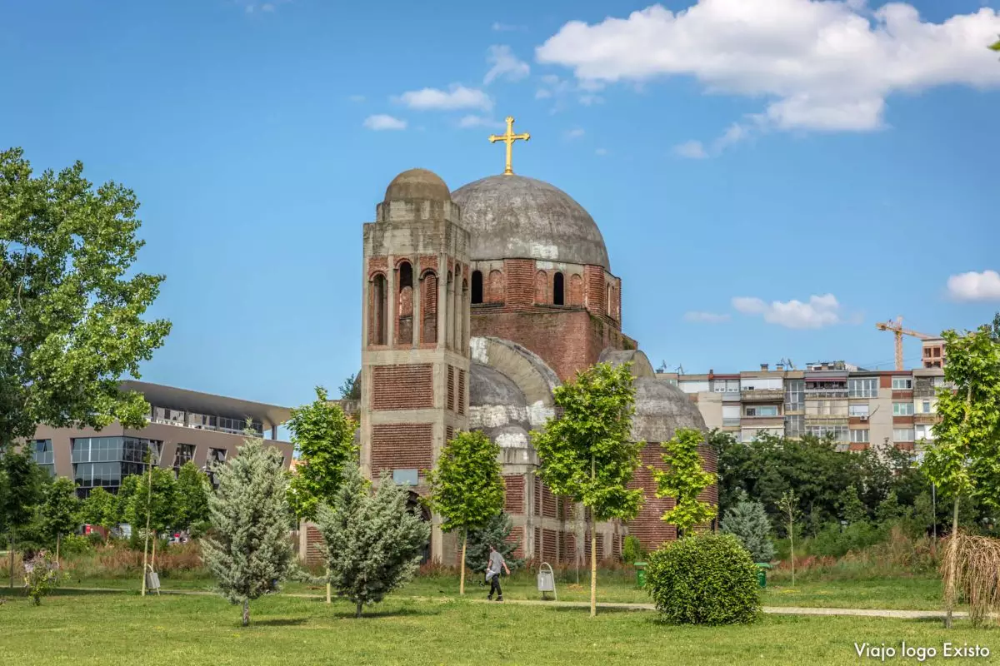
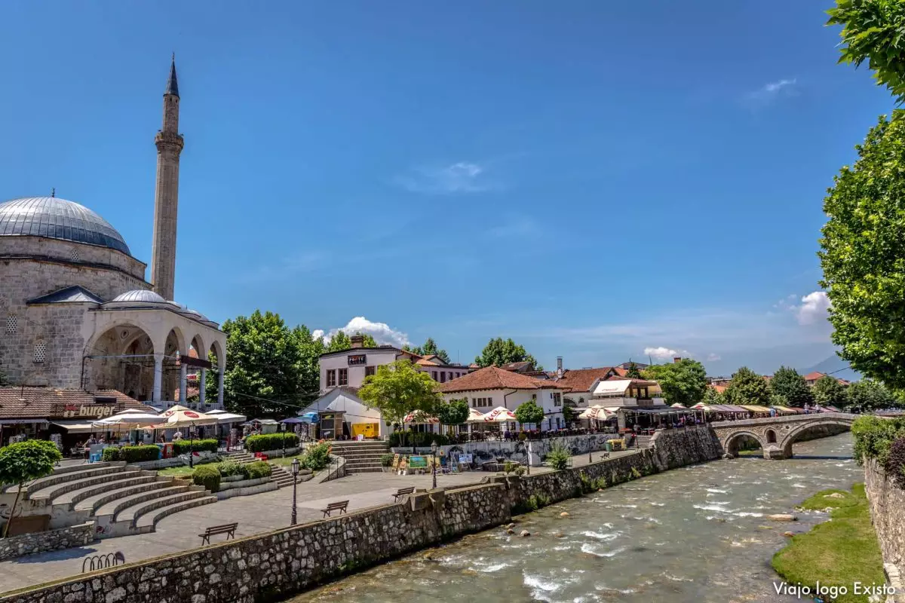
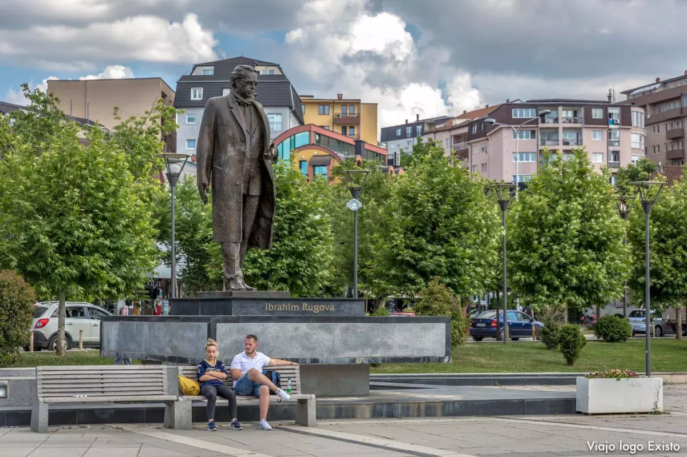
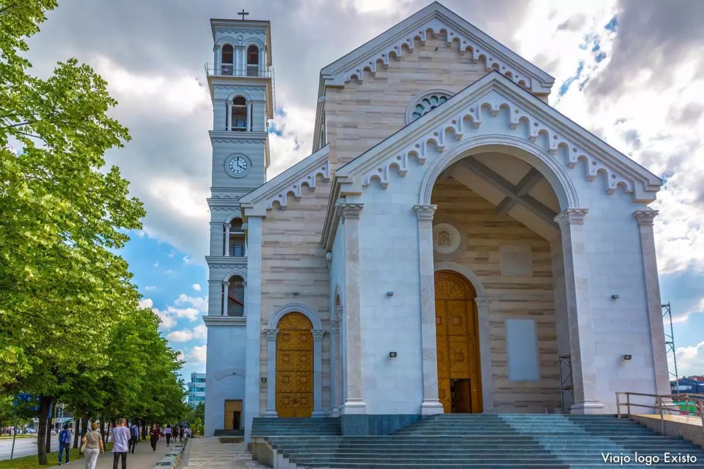
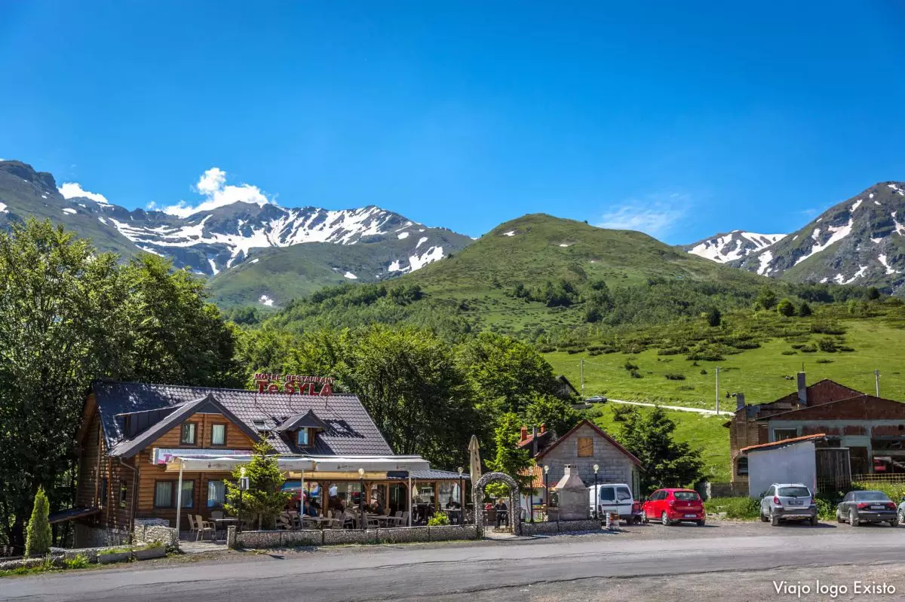
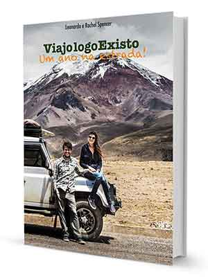
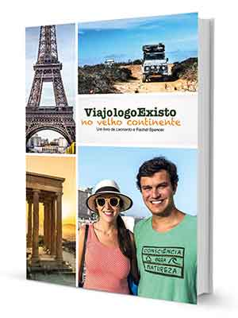
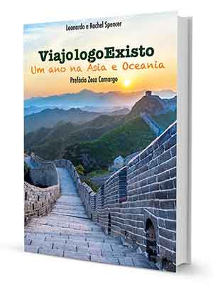

# Porque você não deve passar apenas um dia em Kosovo

## O Kosovo é um dos países que não são reconhecidos pela ONU, mas, ao contrário do que se imagina, o lugar é culturalmente rico e você não deve passar apenas um dia em Kosovo.

Reconhecido por 109 Estados membros da ONU, o [Kosovo](https://www.viajologoexisto.com.br/kosovo/) ainda é considerado um país que não existe devido ao passado histórico e delimitação de fronteiras. Com apenas 10.908km², o país, que possui aproximadamente 1.800 milhão de habitantes, se declarou independente em 2008 e desde então tenta atrair turistas para conhecer as belezas que por lá existem.

Quem pretende incluir o país no roteiro pelo Balcãs deve saber que apenas um dia em [Kosovo](https://www.viajologoexisto.com.br/kosovo/) não é o suficiente. A capital, Pristina, é um lugar movimentado e repleto de atrações. Por lá, o velho e novo, passado e presente, estão lado a lado fazendo da cidade um interessante lugar para se conhecer.

**Kosovo pode ser um destino exótico, mas vale a pena**

**Antes da viagem: atenção ao visto e fronteiras**

Brasileiros não precisam de visto para entrar no [Kosovo](https://www.viajologoexisto.com.br/kosovo/). E a parte boa é que todas as fronteiras com os países vizinhos, [Macedônia](https://www.viajologoexisto.com.br/macedonia/), [Albânia](https://www.viajologoexisto.com.br/albania/) e [Montenegro](https://www.viajologoexisto.com.br/montenegro/), estão abertas. O único problema é que não é permitido seguir para a [Sérvia](https://www.viajologoexisto.com.br/servia/), já que essa entrada é ilegal.

Entretanto, se estiver na [Sérvia](https://www.viajologoexisto.com.br/servia/) você consegue seguir para o [Kosovo](https://www.viajologoexisto.com.br/kosovo/), pois, para os sérvios, o país ainda é considerado parte do território. Mas, nesse caso, terá que voltar para a [Sérvia](https://www.viajologoexisto.com.br/servia/) e ter o carimbo de saída, caso contrário terá problemas para entrar na [Sérvia](https://www.viajologoexisto.com.br/servia/) no futuro.

**Descobrindo as belezas do mais novo país europeu**

**Por que passar mais que um dia no Kosovo?**

Considerado o país mais jovem da Europa, o [Kosovo](https://www.viajologoexisto.com.br/kosovo/) tem uma longa e dramática história que se faz presente até os dias atuais nas ruas do país. Ao contrário do que possa parecer, o [Kosovo](https://www.viajologoexisto.com.br/kosovo/) não é um lugar perigoso ou deprimente, mas sim uma terra fascinante no coração dos Balcãs e um dos poucos lugares no Leste Europeu que o turismo de massa ainda não chegou.

Para quem gosta de conhecer lugares exóticos em viagem, o [Kosovo](https://www.viajologoexisto.com.br/kosovo/) é o destino ideal. Os visitantes que decidem desbravar o país são recompensados com cidades charmosas, sorrisos gentis dos moradores, trilhas de caminhadas fantásticas e mosteiros sérvios do século XIII.

A moeda local é o euro e, apesar da cotação desfavorável para o real, o custo de uma viagem ao [Kosovo](https://www.viajologoexisto.com.br/kosovo/) é bem baixo quando se comparado aos demais destinos europeus. Por exemplo, a diária em um hotel econômico simples pode sair por €20, o almoço €12, a entrada em museus é de €1 a €3, já a cerveja custa, em média, €2.

**As praças no Kosovo são repletas de estátuas de ícones importantes**

**Essa é a primeira catedral no mundo dedicada à Santa Teresa de Calcutá**

**Biblioteca Nacional do Kosovo, um dos pontos turísticos do país**

**O que fazer em Pristina, capital do Kosovo**

Pristina está mais para uma cidade provinciana do que uma cidade grande. Por lá, o clima é descontraído, com pessoas de diversas nacionalidades circulando pelas ruas. Devido a forte presença da ONU e União Europeia, o centro de Pristina acabou se tornando um lugar mais rico e sofisticado, repleto de restaurantes renomados e opções de cafeterias. Mas, basta sair dessa zona para conhecer e se encantar com os pitorescos bairros turcos que definem a cidade.

É um contraste ver os lugares sofisticados ao lado de apartamentos em forma de blocos da era comunista. Na capital, o velho e o novo estão lado a lado, lembrando a todos o passado histórico do país.

Quanto as atrações de Pristina, não deixe de circular pelo enorme calçadão chamado de Madre Teresa, que é uma das regiões mais movimentadas da cidade. Por ali estão localizados cafés, lojas e chafarizes iluminados.

Uma curiosidade é que Madre Teresa, conhecida por seus trabalhos humanitários na [Índia](https://www.viajologoexisto.com.br/india/), nasceu em Skopje, onde hoje é a capital da [Macedônia](https://www.viajologoexisto.com.br/macedonia/), mas que na época integrava o território do [Kosovo](https://www.viajologoexisto.com.br/kosovo/). Por isso, ao longo do país há diversas referências a ela. Inclusive, um dos pontos turísticos de Pristina é o Santuário Madre Teresa de Calcutá.

Não muito distante está a estátua de Bill Clinton, outro lugar que merece destaque em Pristina. Apesar da aparente incoerência política, no [Kosovo](https://www.viajologoexisto.com.br/kosovo/) há uma nítida proximidade com a nação americana que é percebida através dos nomes das ruas, nomes de lojas ou estátuas.

Nos arredores de Pristina está o belo monastério ortodoxo de Gracanica. Ele é um dos edifícios remanescentes da cultura sérvia na região. Além disso, é considerado Patrimônio Mundial pela Unesco e vale a visita.

**Além de história, o Kosovo tem paisagens naturais fantásticas**

**Quando ir ao Kosovo**

Nos meses de inverno, de dezembro a abril, visitar o [Kosovo](https://www.viajologoexisto.com.br/kosovo/) é sinônimo de esqui. Nesses meses a prática do esporte é muito boa, devido ao clima da região.

E junho acontece o Festival de Cinema Shqip, que leva curtas-metragens a Pejë, uma cidade no oeste de [Kosovo](https://www.viajologoexisto.com.br/kosovo/).

O verão no país é ameno, com temperaturas beirando os 25ºC, ou seja, um dos climas mais favoráveis da Europa durante essa época do ano.

O lugar pode não ser um destino tão popular, mas com certeza merece uma visita de mais de um dia em [Kosovo](https://www.viajologoexisto.com.br/kosovo/). Com atrações naturais e históricas, o destino encanta todos que dão uma chance de visitá-lo.

Se você já foi ao [Kosovo](https://www.viajologoexisto.com.br/kosovo/) nos conte como foi a experiência aqui nos comentários! E se você ainda não foi, mas pretende depois de ler esse texto, escreve para a gente nos comentários também!

**Inspire-se com nossos livros**

Livro Viajo logo Existo Um Ano na Estrada (1)

R$ 65,00

Livro Viajo logo Existo no Velho Continente (2)

R$ 80,00

Livro Viajo logo Existo na África Selvagem (3)

R$ 80,00

Livro Viajo logo Existo Um Ano na Ásia e Oceania (4)

R$ 80,00

**Nossos Parceiros**

**Deixe seu comentário! Queremos sua opinião.**

**Queremos te ajudar a viajar ainda mais!**

[Veja nossos guias de viagem](https://www.viajologoexisto.com.br/guias-de-viagem-viajo-logo-existo/)
