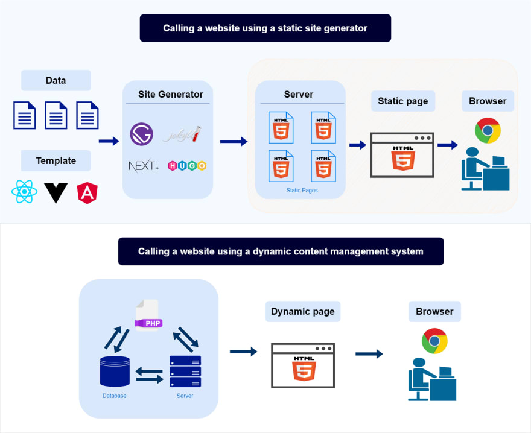
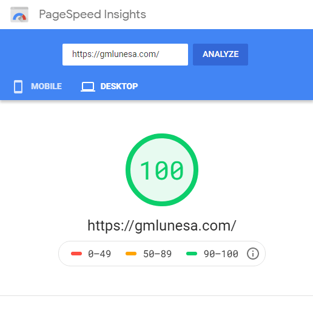

# How I developed and deployed my optimized website within a day

Oct 30
*Originally published at
[gmlunesa.com](https://gmlunesa.com/blog/blog-series-website-within-a-day/)*
・3 min read

Days ago, I decided that my [personal website](https://gmlunesa.com/) needed updating, as some things weren't working anymore. The [old version](https://gmlunesa.com/archive-gmlunesa-website/) was written in plain HTML and CSS (as I am a front-end newbie), and I wanted to try out the popular Javascript libraries everyone seems to be talking about— React and Vue. As I did my research, I discovered more frameworks built on top of those, as well as a technology called static site generators. If you want to build a website fast without compromising speed and quality, then this article might be for you.

## Exploring our options

Perhaps, the easiest way to publish your website is to download free HTML templates, edit them with your information and upload them to Github pages or your own server. However, this method leaves out important aspects such as SEO and performance optimization.

There are also multiple website builders available in the market. Most of them offer free tiers, but in my experience and observation, websites built through free tiers load slower and do not offer many customization options.

## Static Site Generators and Gatsby

This is where static site generators come in. A static site generator (SSG) is a tool that takes your source files and content, apply it to your template, then generate a structure of static HTML pages that are ready to be viewed by the users.

Let's compare this to a dynamic content management system (like Wordpress), which manage and store content in a database. When a user requests for a particular page

- data has to be retrieved from the database
- integrate it to the template files
- generate an HTML page and serve it to the user.

Sounds like a longer process for each page view, right? With static site generators, when a user requests for a particular page, the server just serves the generated static HTML pages, thus, removing the latency of database processes.

There are already multiple static site generators available. After reading comparisons, I chose to go with [Gatsby](https://www.gatsbyjs.com/features/jamstack/) due to the optimization options it offers as well as the rich ecosystem of tools and plugins.

There are also so many [Gatsby starters](https://www.gatsbyjs.com/starters/) available, which work similar to HTML templates— you download a Gatsby template, customize it with your information and upload your website to the web! These are the added benefits to your site:

- **Fast** - no need to wait for the server runtime to generate your pages, since the pages are already generated during build time
- **Secure** - no database queries that might compromise your security
- **Inexpensive** - companies like Netlify, Vercel and even Github offer free hosting for your Gatsby or SSG-powered sites
- **Better SEO** - due to site speed, search engines can give your site a better rating

It can be the same effort as coding a standard HTML site, but with 1000x power! Important things like site optimization and speed already gets taken care of, so you can focus more on customizing the visual components and writing the content for your site.

## Moving forward

So that's how you can utilize static site generators to help you develop and deploy a fast and optimized site in just a day! Web development technologies have come so far, you better not miss out.

If you are looking for a minimalist personal website, you can check out the starter that I made:

✨ **[Demo website here](https://gatsby-starter-personal-portfolio.vercel.app/)**  
It has dark mode, super fast speed, high Google Lighthouse rating, and beginner-friendly code! Check out my site [(gmlunesa.com)](https://gmlunesa.com/) to see what you can do with the starter.

With that being said, it will take more than a day to achieve a fully featured website and master web development skills. Gatsby and static site generators offer a good starting point in deploying your own website, for personal or prototype purposes.
