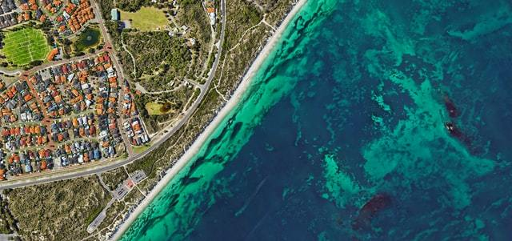
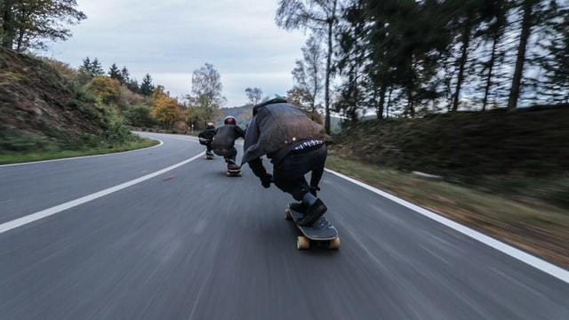
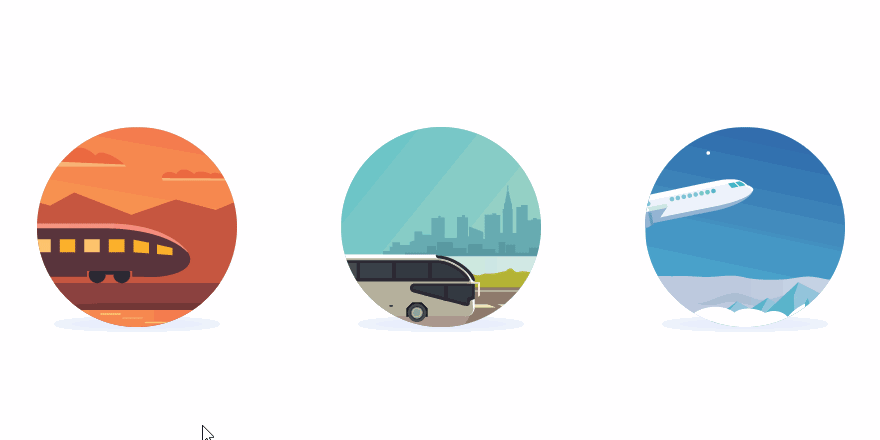
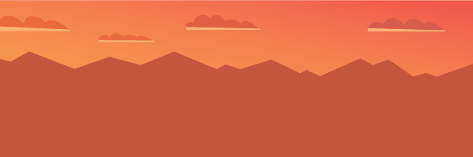
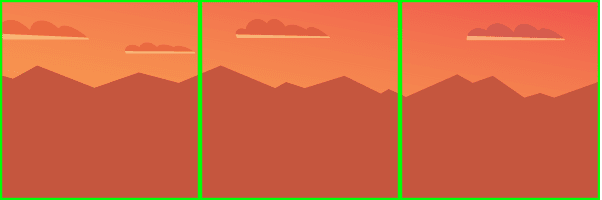
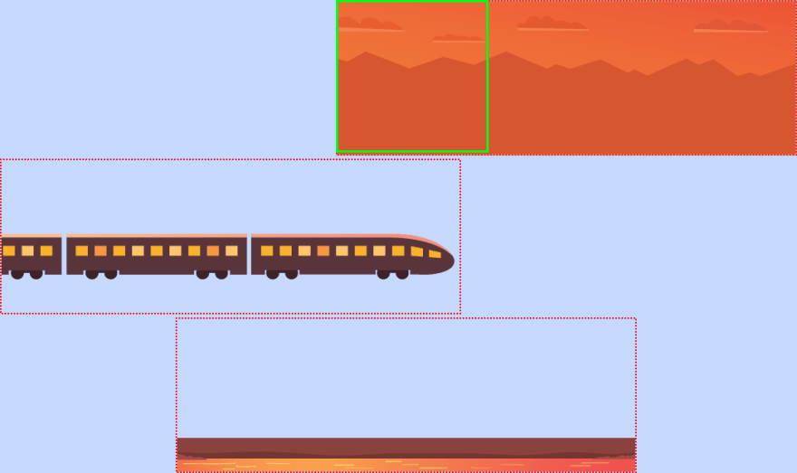

# How to Make an Awesome Horizontal Parallax Animation

Nov 18
*Originally published at
[roboleary.net](https://roboleary.net/css/2020/11/17/parallax-animation.html)*
・*Updated on Nov 23*
・7 min read

The parallax effect creates a greater perception of depth, making movement appear more dynamic. It is used mostly to create slick scrolling animations.

I'm going to deconstruct how you can create the parallax effect with a very visual, interactive example. I will create a fun animated scene that you can use as a loading animation or as a dynamic hover effect.

The theory will serve you in adding parallax dynamics to your UI in whatever way you like.

## How the effect works

Our perception of depth is based on scale, light, and speed.

If something is further away, it appears to be smaller.

[](https://res.cloudinary.com/practicaldev/image/fetch/s--m_VB4Ae_--/c_limit%2Cf_auto%2Cfl_progressive%2Cq_auto%2Cw_880/https://dev-to-uploads.s3.amazonaws.com/i/czr8ylz7v4xi7tydfefd.jpg)

Photo by [Mohit](https://unsplash.com/@98mohitkumar?utm_source=unsplash&utm_medium=referral&utm_content=creditCopyText)

If you are travelling in a vehicle and look out the window, the further away something is, the slower it appears to be passing by. If you look at the ground just a few meters away, it appears to be passing by very fast.

[](https://res.cloudinary.com/practicaldev/image/fetch/s--ulKkSxq_--/c_limit%2Cf_auto%2Cfl_progressive%2Cq_auto%2Cw_880/https://dev-to-uploads.s3.amazonaws.com/i/0njz6xrk6f44ijsa3zhr.jpg)

Photo by [Alternate Skate](https://unsplash.com/@alternateskate?utm_source=unsplash&utm_medium=referral&utm_content=creditCopyText)

So, to give a greater sense of depth to a scene with movement: make things nearby move faster, and things further away move slower.

## Train Example

I will demonstrate the parallax effect with an adapted, deconstructed version of [this codepen](https://codepen.io/jcoulterdesign/pen/OMOqjy) by Jamie Coulter. It is called "Parallax Orbs". Great title!

[](https://res.cloudinary.com/practicaldev/image/fetch/s--S1i6GRPv--/c_limit%2Cf_auto%2Cfl_progressive%2Cq_66%2Cw_880/https://dev-to-uploads.s3.amazonaws.com/i/nfen0kkow1o3grr284k8.gif)

The codepen animates a travel-related mini-scene when you hover over one of the orbs to give a cool preview.

I have adapted the train orb into a complete example that you can play with to understand how it works behinds the scenes! You can *explode* the animation to show the individual layers.

To construct the image(s) for the animation, you must group elements together based on their vicinity (how near or far away they are) to the observer. In your graphics editor, you will create a group/layer for each of these groups, so that they can be referenced in CSS to add an independent animation to each of them.

For our train scene, we are observing the train from across a river. Closest to us is the river and the elevated area where the track is on. Let's call this the foreground.

The train is in the midground.

The background is a collection of hills and the sky.

Jamie created 3 PNGs of 600px by 200px for each of these groups as below.

[](https://res.cloudinary.com/practicaldev/image/fetch/s--zxsPGQq3--/c_limit%2Cf_auto%2Cfl_progressive%2Cq_auto%2Cw_880/https://dev-to-uploads.s3.amazonaws.com/i/wetnmuuz6qp7yufd96hh.png)

Background

[](https://res.cloudinary.com/practicaldev/image/fetch/s--yr8UX9TR--/c_limit%2Cf_auto%2Cfl_progressive%2Cq_auto%2Cw_880/https://dev-to-uploads.s3.amazonaws.com/i/ih0xc0psovilv7m174ey.png)

Train (Midground)

[](https://res.cloudinary.com/practicaldev/image/fetch/s--DfLzohPg--/c_limit%2Cf_auto%2Cfl_progressive%2Cq_auto%2Cw_880/https://dev-to-uploads.s3.amazonaws.com/i/5ydcr3ugum646i5bj0oo.png)

Foreground

You could create more groups if you wish to create a more dynamic scene. We will stick to these 3 groups for simplicity.

Instead of creating separate PNGs, you could create a single SVG with 3 different groups (`g` elements), and add it inline into the webpage. I will show you this in another example later to highlight the differences between the approaches.

### What should you consider when you prepare the image?

Baking in the scale of the elements when you draw the image makes the animation simpler. Make the hills and the train an appropriate size and don't resize them. This ensures that in our animation, we only need to manipulate the horizontal position of an image group.

To create an animation we must have at least 2 frames for an image group to do anything! So, the image you create must be at least 2 times wider than our intended viewport.

Our viewport of the scene is 200px by 200px. This gives us 3 frames to play with.

[](https://res.cloudinary.com/practicaldev/image/fetch/s--Rv3p5nQ---/c_limit%2Cf_auto%2Cfl_progressive%2Cq_auto%2Cw_880/https://dev-to-uploads.s3.amazonaws.com/i/g51ahqa9wkyvsnt2vibg.png)

We always want our viewport to have a complete frame of the background and the foreground. Otherwise we will have a weird blank space. The train can be positioned completely outside of the viewport if you want.

My advice is to create groups that are the same width if possible. Use the viewport width as a base unit, so make the image groups a multiple of 200px in this case. This makes it simpler to make adjustments with the animation later.

If you want to create a longer animation, you can create wider image groups for more variation.

Our animation is an unique one-time animation. The train comes into the scene from the left. This means if we want to run the animation in a loop, it will look strange as the train will re-appear on the left as it resets.

If you want to create an animation that loops, you should create the first frame and the last frame to be very similar. You can have some minor differences without it being noticeable, but if something like skyline varies, it appears as a jolt when the animation resets.

## The Code

The required HTML is short. We create a containing `div` with the `content` class. Then, we have 3 child divs that contain our image groups.

```
<div class="content">
    <div class="layer background background-animation">
        
    </div>
    <div class="layer train train-animation">
        
    </div>
    <div class="layer foreground foreground-animation">
        
    </div>
</div>
```

The `.content` div is given a `position:relative`, and the child divs are positioned absolutely to stack them up. The overflow is hidden, so anything left or right of the container is out of sight.

We set the initial position of each image group to create our desired initial scene using the `transform` property. We add a translation on the x-axis e.g. `transform: translateX(-400px)` to position it to the left of the viewport.

You can see the initial positions in the picture below, which is the "exploded" view in the codepen.

The green box is the `.content` div "viewport".

[](https://res.cloudinary.com/practicaldev/image/fetch/s--HzVEHttz--/c_limit%2Cf_auto%2Cfl_progressive%2Cq_auto%2Cw_880/https://dev-to-uploads.s3.amazonaws.com/i/3ej4a96vtgxgqoz4oswx.png)

Jamie chose to have the same duration for the animation of each image group, and uses the positioning to control the speed of each animation. As you can see above, the different groups are staggered at different points to accommodate this. The background moves the smallest amount, of course!

I copied Jamie's offsets, but I think the foreground should move a bit faster. What do you think? Adjust it and see!

```
.content {
  position: relative;
  height: 200px;
  width: 200px;
  margin: 60px auto;
}

.layer {
  position: absolute;
}

.background {
    transform: translateX(0);
    animation: background-shift 4s linear 1 forwards;
}

.train {
    transform: translateX(-440px);
    animation: train-shift 4s linear 1 forwards;
}

.foreground {
    transform: translateX(-210px);
     animation: foreground-shift 4s linear 1 forwards;
}

@keyframes background-shift {
  to {
    transform: translateX(-80px);
  }
}

@keyframes train-shift {
  to {
    transform: translateX(-140px);
  }
}

@keyframes foreground-shift {
  to {
    transform: translateX(-400px);
  }
}
```

Conversely, you could set the initial position of the background and foreground image groups to be the same, and adjust the duration of the animations to control the speed. It will look the same. Personally, I prefer this way as it is simpler to adjust time and fix the distance the image groups move. Either way is fine.

I strongly recommend using the `transform` property rather than `left` for the animation. Jamie uses `left` in his codepen. The performance is a lot better with `transform` and will get you close to running at a super silky 60 frames per second.

> A common pitfall is to animate left/top/right/bottom properties instead of using css-transform to achieve the same effect. For a variety of reasons, the semantics of transforms make them easier to offload, but left/top/right/bottom are much more difficult.
>
> Source: [MDN Web Docs: Firefox OS performance testing](https://developer.mozilla.org/en-US/docs/Archive/B2G_OS/Firefox_OS_apps/Performance/Firefox_OS_performance_testing#Animation_logging)

That's it. As you can see the code is actually very short. The knack is to create the image intelligently, and then tinker with the timing of the animation to get the right result.

## Alternative Implementation using SVG

The advantage of using an inline SVG instead of PNGs is two-fold.

Firstly, you cut out 3 HTTP requests for the images. Less requests is good for performance.

Secondly, it is responsive. Want to increase the size of the animation and not have it be a pixelated mess? No problem, just bump up the size (width and height) of the `.content` div, and the SVG will grow to that size. Just maintain the same aspect ratio e.g. 1:1 for our aspect ratio!

Here is the SVG version to play with.

You can tinker with the size control in the codepen to see how beautifully the animation scales when it is resized.

I changed the design of the scene to be suitable for running infinitely. You can see below that the first frame and last frame are almost identical (I have removed the train to highlight this). This symmetry prevents a deja-vu in The Matrix (animation reset glitch).

[](https://res.cloudinary.com/practicaldev/image/fetch/s--9jQf5RvO--/c_limit%2Cf_auto%2Cfl_progressive%2Cq_auto%2Cw_880/https://dev-to-uploads.s3.amazonaws.com/i/80vkb0eekjxvges92gte.png)

All the image groups in the SVG are positioned equally. I use the animation duration to adjust the speeds as below.

```
#background {
  animation: background-shift 8s linear infinite forwards;
}

#train {
  animation: train-shift 4s linear infinite forwards;
}

#foreground {
  animation: foreground-shift 2s linear infinite forwards;
}
```

The SVG I created has simple geometry, the shapes I have drawn are not detailed! This demonstrates that you don't need to be an artist to make something like this!

The gradients I use are from top to bottom to ensure the image is uniform in the leading and trailing frames. Jamie uses some left-to-right gradients which would make it more difficult to create a repeating animation.

One thing to be mindful when you create the SVG is the cumulative effect of transformations. Some vector graphic editors add a transformation such as `style="transform:translate(-100,200);"` when you preposition grouped elements (contained in a `g` element). Having one transformation on the group in the SVG and another in the CSS animation (both using the `transform` property), the sum total of these can throw off your animation. So, just check that if a group is misbehaving!

## Conclusion

I hope that this guide was useful to give you a real understanding of parallax and equips you well to create some slick UI effects.

If you are interested in any similar topics, let me know.
