# A productive command-line Git workflow for indie app developers

Nov 11
*Originally published at
[blog.inkdrop.info](https://blog.inkdrop.info/a-productive-command-line-git-workflow-for-indie-app-developers-afc050a7a771)*
・10 min read

Hi, it's [Takuya](https://twitter.com/inkdrop_app).

Git is an essential tool for managing your codebase and change history, even if you are developing an app alone.  
I'm a solo developer of [Inkdrop](https://www.inkdrop.app/) which is a plain-text Markdown note-taking app for desktop and mobile platforms.  
This app is built on top of [Electron for desktop and React Native for mobile](https://blog.inkdrop.info/how-ive-support-5-platforms-aa4cdd18e9b4).  
I'm basically working on terminal with tmux and vim, as I shared my vim setup for coding JavaScript here:

- [My vim setup to speed up JavaScript coding for my Electron and React Native apps](https://dev.to/craftzdog/my-vim-setup-to-speed-up-javascript-coding-for-my-electron-and-react-native-apps-4ebp)

In this article, I'm going to explain my Git workflow.  
It is for those who already know the basics of Git.

I also prefer using git on terminal.  
I tried various GUI git clients out there but couldn’t get used to any of them because I’m basically happy with the Git command at the moment.  
But I’m not saying that everyone should use Git on terminal.  
If you already have a favorite Git GUI client app, please go ahead and use it.

## My Git setup

- **Command aliases** for faster command inputs
- **[Commitizen](https://github.com/commitizen/cz-cli)** for human and machine-friendly commit messages
- **[tig](https://github.com/jonas/tig)** for Git TUI
- **[fugitive](https://github.com/tpope/vim-fugitive)** for using Git on Vim

My Git config is published here:

# Takuya's dotfiles

**Warning**: Don’t blindly use my settings unless you know what that entails. Use at your own risk!

## Contents

- vim (NeoVim) config
  - Plugins are managed with [dein.vim](https://github.com/Shougo/dein.vim)
- tmux config
- git config

## How to use

Watch [the video tutorial](https://www.youtube.com/watch?v=sSOfr2MtRU8).

[View on GitHub](https://github.com/craftzdog/dotfiles-public)

I'm going to explain more in detail.

## Mission: Refurbishing my homepage

I have a good side project in order to show you my Git workflow.  
It's been 3 or 4 years since I've built [the current my homepage](https://www.craftz.dog/).  
So, I'd like to refurbish it and was thinking of its new design.

By the way, do you know [MagicaVoxel](https://ephtracy.github.io/)?  
It allows you to make low-poly voxel arts by combining 3D boxes something like Minecraft, characters, towns, kitchens, and things like that without effort.  
I built a dog with it:

[](https://res.cloudinary.com/practicaldev/image/fetch/s--rYf8Pcjd--/c_limit%2Cf_auto%2Cfl_progressive%2Cq_auto%2Cw_880/https://dev-to-uploads.s3.amazonaws.com/i/8jw0yhmd9oyg0nty9ywc.png)

I also built a "Dev As Life" logo with it so that I can use them for my YouTube channel.  
In this renewal, I'd like to use those voxel arts for my new homepage.  
But it's not interesting to just put them as pre-rendered images.  
I think it would be more fun if they are dynamically rendered and you can move them around.  
So, I'm working on it now.

## Create and register a git repository for VoxelDog

I successfully exported the model from MagicaVoxel and got it to render on browser.  
Now, I'm gonna show you how I create a git repository for this project and manage the code on it.

Here is the voxel dog project.  
Let me show you how it looks like right now.  
Cute, isn't it? :)

[](https://res.cloudinary.com/practicaldev/image/fetch/s--d_CU1d67--/c_limit%2Cf_auto%2Cfl_progressive%2Cq_auto%2Cw_880/https://dev-to-uploads.s3.amazonaws.com/i/huxzyycjo1hyr8raslcw.png)

It is a dog using a laptop on a standing desk.  
It's not perfect yet - the color is too light and the shadows are shaggy.  
But it just works fine for now, as you can see, you got the camera moving around.  
I'm happy with it. I'm gonna store it in a git repository.  
Here, I created the one:

### A cute 3D dog rendered with three.js

## Use Git aliases to shorten commands

When you run `git`, you typically type 'git'.  
But it is kind of annoying to type 'git' every time, so I set an alias for git as 'g'.

- In fish shell, you can do it with `alias g git`.
- In zsh or bash, it's `alias g='git'`.

Then, let's make a local Git repository.

[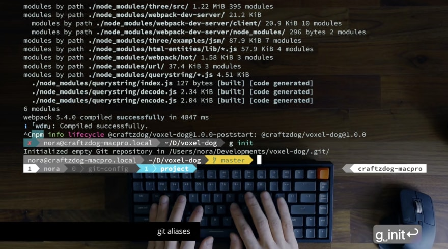](https://res.cloudinary.com/practicaldev/image/fetch/s--keu1xZWP--/c_limit%2Cf_auto%2Cfl_progressive%2Cq_auto%2Cw_880/https://dev-to-uploads.s3.amazonaws.com/i/x0ibw8qe7tnex0wg15go.png)

It looks nice.  
Next, I'm gonna register the GitHub repository as the remote origin:

```
g remote add origin git@github.com:craftzdog/voxel-dog.git
```

Okay, now it's been registered.

You run the Git command many times a day.  
Say, if you run it 10 times a day, it's three hundred times a month, and then it's more than 3 thousand times a year.  
So, you can't type 'git' every time right?  
Aliasing 'git' with 'g' helps you type it quickly.

Next, the status command is aliased to 'st' so you can avoid typing 'g status'.  
The location of the configuration for this is in the `.gitconfig` file, at `alias` section here:

[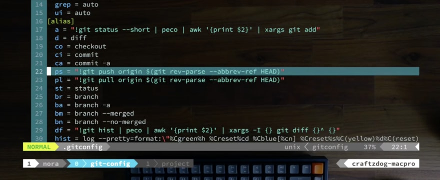](https://res.cloudinary.com/practicaldev/image/fetch/s--OavcDp86--/c_limit%2Cf_auto%2Cfl_progressive%2Cq_auto%2Cw_880/https://dev-to-uploads.s3.amazonaws.com/i/htxsaietkr6mqtp323xx.png)

In this way, status is aliased to `st`.  
I have a lot of other aliases, as you can see, like `diff`, `checkout`, `commit`, `push`, `pull`, `branch`, and so on.  
I define aliases for commands that I often use in from two to four letters.  
I will explain other aliases later.

None of the files are staged right now. Let's add them all:

```
g add .
```

Now that all the files have been staged.

## Use `commitizen` to input nice commit messages

Next, to commit them, you can type `g commit` as usual,  
then you get an editor launched and you can input a commit message. But it's also annoying to do it many times.  
So, I'm using a helper tool which is called [commitizen](https://github.com/commitizen/cz-cli).  
If you type 'g cz', as you can see, it asks you to select a commit type from the list.

[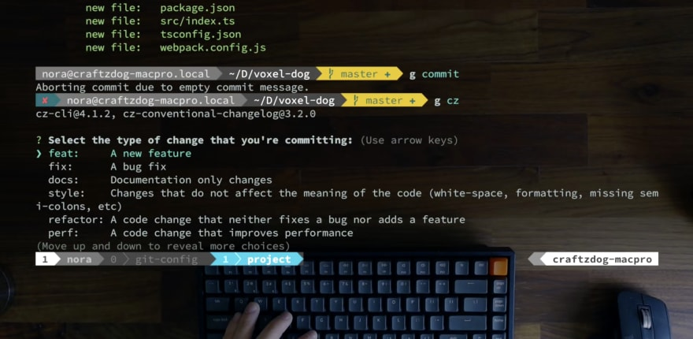](https://res.cloudinary.com/practicaldev/image/fetch/s--25s0Pz83--/c_limit%2Cf_auto%2Cfl_progressive%2Cq_auto%2Cw_880/https://dev-to-uploads.s3.amazonaws.com/i/41f0qw8lafzka7kx4y6c.png)

For this commit, I select 'feat' as it's the first time to commit.  
Next, it asks to select what scope this change is:

[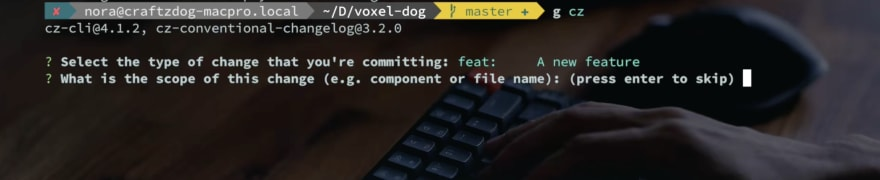](https://res.cloudinary.com/practicaldev/image/fetch/s--QCM68f6m--/c_limit%2Cf_auto%2Cfl_progressive%2Cq_auto%2Cw_880/https://dev-to-uploads.s3.amazonaws.com/i/vnnuh1uljjms8tqgji77.png)

And, this time I specify `*` because it is the first commit and it's related to the whole scope.  
Next is to write a short description of this change.  
So, it's gonna be like 'Initial commit'.  
And then, next is a long description, about the detail of this change. It's optional. As this change doesn't have anything to describe, I leave it empty.  
Are there any breaking changes? No.  
Does this change affect any open issues? No.

[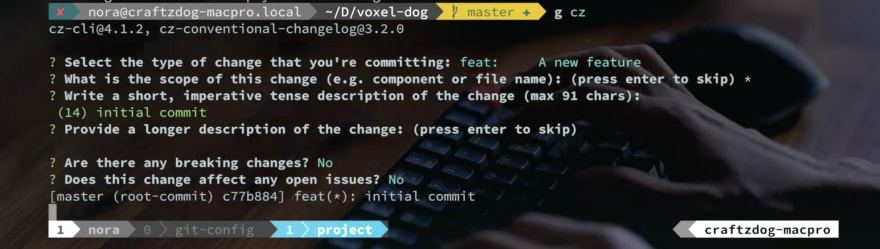](https://res.cloudinary.com/practicaldev/image/fetch/s--T81aU6DY--/c_limit%2Cf_auto%2Cfl_progressive%2Cq_auto%2Cw_880/https://dev-to-uploads.s3.amazonaws.com/i/q6x8i8zqmyq7fbulglin.png)

Then, the change has been committed.  
Well, what the commit message looks like is this:

```
feat(*): initial commit
```

It's very handy because you don't have to think about the commit message format.  
Because commit messages tend to be slipshod.  
But, it helps you input well-formatted messages without effort.  
All you have to do is to select from the pre-defined commit types. And you can input good commit messages without thinking too much about them.  
It's useful not only for teams but also for solo developers.  
For example, in my case, when I write release notes of my app Inkdrop by checking the commit history,  
here is the desktop version's commit history.

[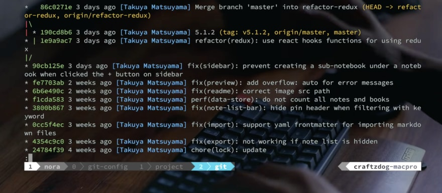](https://res.cloudinary.com/practicaldev/image/fetch/s--S7xiOiJD--/c_limit%2Cf_auto%2Cfl_progressive%2Cq_auto%2Cw_880/https://dev-to-uploads.s3.amazonaws.com/i/gcww8m9aojkfmj0evno8.png)

As you can see, you can easily and quickly understand each commit.  
I often forget what I did soon.  
I totally don't remember what I did if I see a change that's been made 3 or 4 weeks ago.  
But in this way, the commit messages are obvious to understand what type and what scope of the change and even what change you made in detail.  
It helps you a lot.

### How to quickly view commit logs

Then, back to the voxel dog project,  
Speaking of the command that I run like `git hist`, it's also an alias:

```
[alias]
  hist = log --pretty=format:\"%Cgreen%h %Creset%cd %Cblue[%cn] %Creset%s%C(yellow)%d%C(reset)\" --graph --date=relative --decorate --all
```

So, I have `hist` alias with many options in order to make commit messages beautiful.  
You got another alias named `llog`:

```
[alias]
  llog = log --graph --name-status --pretty=format:\"%C(red)%h %C(reset)(%cd) %C(green)%an %Creset%s %C(yellow)%d%Creset\" --date=relative
```

It displays not only commit logs but also which files have been changed.  
In my Inkdrop project, you can quickly know which files have been changed:

[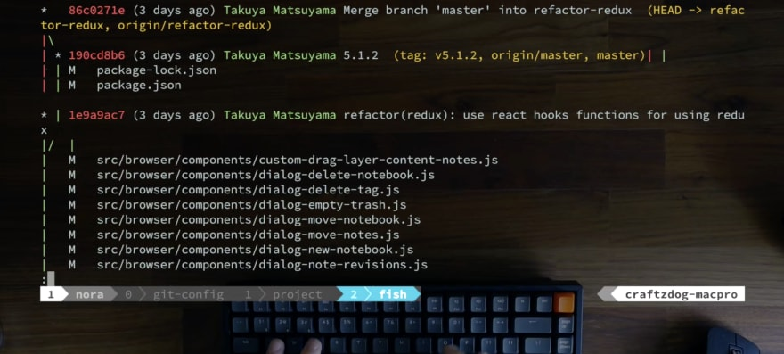](https://res.cloudinary.com/practicaldev/image/fetch/s--dj-WhOJc--/c_limit%2Cf_auto%2Cfl_progressive%2Cq_auto%2Cw_880/https://dev-to-uploads.s3.amazonaws.com/i/o428eog5btlmjpct3bds.png)

The `log` command is very flexible to format the output.  
It's very powerful. I recommend you to check it out on the web and to find your favorite log format.

When you run `df` alias, you get a commit history:

[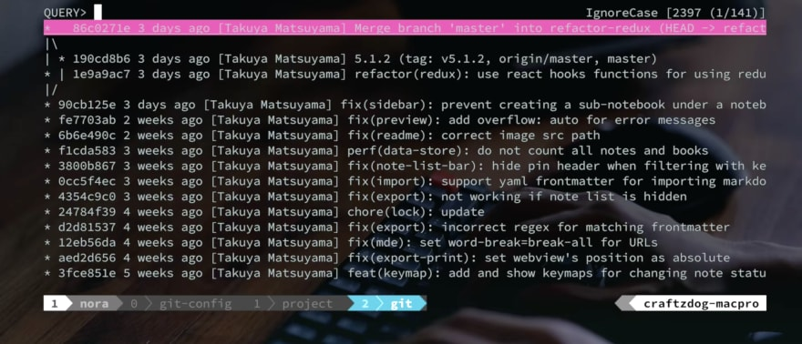](https://res.cloudinary.com/practicaldev/image/fetch/s--LJmn4Bhl--/c_limit%2Cf_auto%2Cfl_progressive%2Cq_auto%2Cw_880/https://dev-to-uploads.s3.amazonaws.com/i/iqd62ro4gxe07lj4xa4h.png)

And say, you wanna know the detail of this commit of the sidebar change, then if you chose it, it shows the diff:

[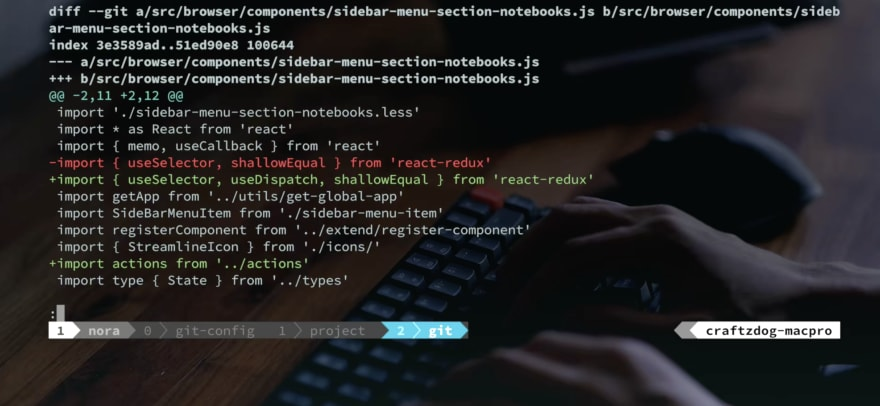](https://res.cloudinary.com/practicaldev/image/fetch/s--w-pXQzu2--/c_limit%2Cf_auto%2Cfl_progressive%2Cq_auto%2Cw_880/https://dev-to-uploads.s3.amazonaws.com/i/ujssqoyamx02mgndjjr7.png)

The alias looks like this:

```
[alias]
  df = "!git hist | peco | awk '{print $2}' | xargs -I {} git diff {}^ {}"
```

It runs `git hist` and passes the output to `peco`, which is a command-line that allows you to select a line from stdin, then it passes the selected line to `awk` to extract the commit hash, then it runs `git diff` for it.  
In a nutshell, it allows you to see a diff of an arbitrary commit that you chose from the commit history.  
So you can quickly look into the detail of the commit.

## tig - TUI for git

You also got [tig](https://jonas.github.io/tig/) command.  
It's a reversed name of Git.  
With this command, you can interactively select a commit.  
It supports vim-like keybindings like this, so it's nice for vimmers.  
For example, if you chose this commit by hitting enter key,   
it splits the pane and displays the diff here.

[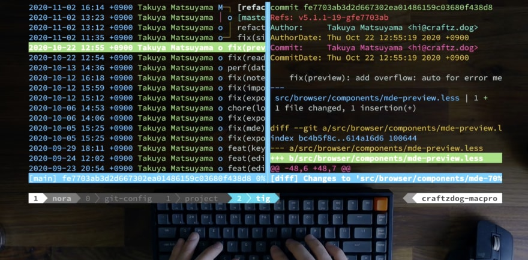](https://res.cloudinary.com/practicaldev/image/fetch/s--FkaGXyVf--/c_limit%2Cf_auto%2Cfl_progressive%2Cq_auto%2Cw_880/https://dev-to-uploads.s3.amazonaws.com/i/gihvajifopgsryn4zkee.png)

So, I usually use `tig` to look into the recent change logs when writing release notes for my app.  
You can check other commits without running the command many times.  
So, it improves your workflow.

## Push it to the remote repository

Well, let's push it to the remote repository.  
Now that you have one commit in the local repository.  
So, I'm gonna push it to the remote:

```
g ps
```

Well, it's done.  
Looks good.

This `ps` is an alias as well:

```
[alias]
  ps = "!git push origin $(git rev-parse --abbrev-ref HEAD)"
```

It's annoying to type `git push origin master`. It's too long, right?  
So, I made an alias as `ps` for it.  
In this alias, it does some work for you.  
It helps you push to the remote branch that has the same name as the current local branch.  
If you are on 'master', it pushes from the local 'master' to the remote 'master' branch.

To pull, you got `pl` alias.

```
[alias]
  pl = "!git pull origin $(git rev-parse --abbrev-ref HEAD)"
```

Similarly, it pulls from a remote branch that has the same name as the currently selected local branch.  
So you can avoid specifying a branch name when you were working on a branch other than `master`.  
So, it helps your workflow as well.

And also you got `br` alias which is for `branch`:

```
[alias]
  br = branch
```

So, anyway, I'm talking about you should take advantage of alias.

## How to quickly open up GitHub project page

Now I created a git repository on GitHub.  
But you don't always have the tab opened, right?  
When you want to see an issue or want to look into the detail on GitHub, you can type `g open`.

[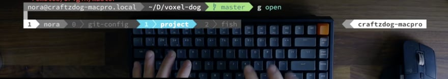](https://res.cloudinary.com/practicaldev/image/fetch/s--EpJjZLln--/c_limit%2Cf_auto%2Cfl_progressive%2Cq_auto%2Cw_880/https://dev-to-uploads.s3.amazonaws.com/i/dfu113wmdc9l2kvs078r.png)

Then, you can quickly open the GitHub repository page on browser from terminal.  
`g open` alias is defined like so:

```
[alias]
  open = "!hub browse"
```

It actually runs a shell command `hub browse`.  
So, it's equivalent to running `hub browse`, and you can get the exact same result.  
So, the [**hub**](https://github.com/github/hub) is a command-line tool by GitHub that provides you some GitHub-specific commands for git.  
For example, you can clone a repo without specifying a full URL to the repository like so:

```
g clone craftzdog/dotfiles-public
```

So, it helps you do some GitHub-specific tasks.  
By using this, you can quickly open up a GitHub project page of the remote git repository with `git open` command, like this.

## vim-fugitive for using Git on Vim

I usually code with vim and I often want to use git from vim.  
To do that, for example, [here](https://github.com/craftzdog/voxel-dog) is the source code of the voxel dog project that renders a dog using three.js.  
Now, the camera is moving around.  
Let's rotate the dog itself as well.

[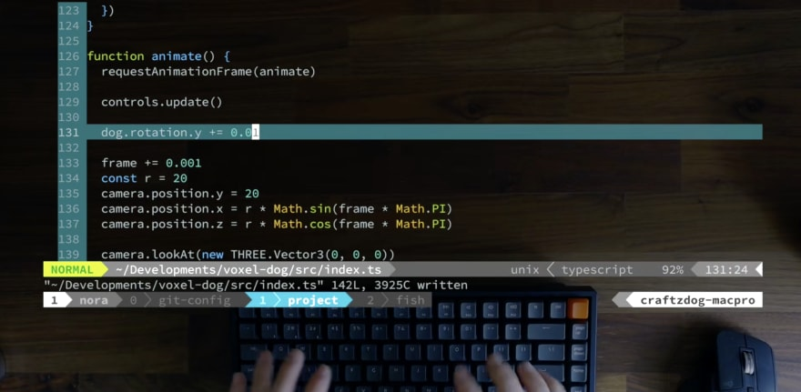](https://res.cloudinary.com/practicaldev/image/fetch/s--dnjO0EtY--/c_limit%2Cf_auto%2Cfl_progressive%2Cq_auto%2Cw_880/https://dev-to-uploads.s3.amazonaws.com/i/b8hxn10nhdolppvgmpfw.png)

Okay, it started rotating:

[](https://res.cloudinary.com/practicaldev/image/fetch/s--Cv49eyWd--/c_limit%2Cf_auto%2Cfl_progressive%2Cq_auto%2Cw_880/https://dev-to-uploads.s3.amazonaws.com/i/25ftwp2tfgr179bd0ugv.png)

Great, haha.

So, let's commit it.  
Check the current git status.  
Then, run `g d` which is an alias for `diff`.

Okay, as you can see, it adds a line to rotate the dog.  
Like this, I always check the diff before commiting it.  
And if it looks ok, I run `g cz` to run commitizen.  
But when you do this, if you added `-a` option, you can make a commit that includes unstaged changes.

Then, you got another commit here.  
Then, push it with `g ps`.  
Looks good.

Now that I made a change with vim.

Fast-forward to 3 months later, I no longer remember this change - Why I made this change, when I did it, or who did it.  
I have no idea.  
To check it, run `:Gblame` on vim like so:

Then, you get a commit history on the left side and the corresponding lines on the right side.  
If you scrolled it, both panes sync.  
So, you can see which line corresponds with which commit respectively.  
Then, when you hit enter, you can look into the diff.

So, you found that this commit has been made on 11:53 November 5th in order to rotate the dog.

I often forget what I did months ago.  
That way, I can quickly look into the past changes directly on vim without browsing GitHub or running `git blame` command.

And, if you still don't get it, and you wanna look more into it on GitHub, run `:gopen` command.  
Then, you can open up the file on GitHub immediately.  
It refers to the corresponding commit, it comes in handy when you wanna look into diffs with another commit.  
Like this, I go back and forth between terminal and browser.

So, how to do this. I use a vim plugin called [vim-fugitive](https://github.com/tpope/vim-fugitive).  
It's a git wrapper for vim.  
It supports various commands as you can see.  
Please fiddle with it.  
`gopen` is an alias for `gBrowse`.  
It's just my preference.

Well, that's it!

---

As you may notice, workflows would look different if you work with a team.  
But I guess some tips should be also useful for your teamwork.  
That’s pretty much it. Hope it’s helpful for improving your development workflow.  
Thank you for reading/watching. See you in the next one.

## See also
