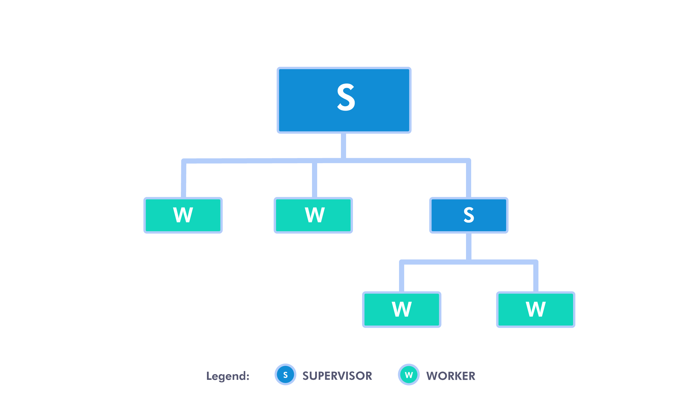

# How to build a self-healing system using supervision tree in Elixir

Tags: programming, elixir, supervisor, supervision tree

As developers, we always strive to offer our clients a high-quality service (or at least we should :) ). One of the most important features of high-quality service is its reliability. In other words, the service should rarely, if ever, be unavailable.

In the Elixir world, we can achieve this easily using a concept known as a supervision tree. Supervision tree is a structure of processes that allows us to build reliable, fault-tolerant and self-healing systems. This can make our application resistant to unexpected bugs that can creep up in the production. The kind of bugs that are really difficult to reproduce and that require specific state of the application to appear (google the term heisenbug). Supervision tree helps us in dealing with those kinds of bugs by simply restarting the part of the tree that's causing the problems. That way, we get to start off with a clean slate, and most of the times, that's enough to solve our issues.

So, how does Elixir make that possible?

First, let's take a look at how a supervision tree looks graphically.



At its core, the supervision tree consists of two types of processes: workers and supervisors (imaginatively marked W and S, respectively).

Workers are simply processes which run some kind of logic. They are the meat of your application. Supervisors, on the other hand, are processes which supervise other processes, be it workers or other supervisors. This sounds like some kind of processeption, but at its base, it's not that complicated.

There are two main tasks a supervisor has: restarting its children processes in the desired way when they terminate (expectedly or unexpectedly), and terminating itself along with its children processes if it deems necessary, i.e. when there's something off with the state in its part of the application.

In simpler terms, workers run the domain code and if some error occurs and the worker crashes, or it finishes its work and “dies”, its supervisor restarts it. If crashing happens too often, the supervisor terminates the said process, along with the rest of its children and then terminates itself.

There are three available restart strategies:  
- `:one_for_one` - the supervisor restarts just the process that terminated,  
- `:one_for_all` - the supervisor restarts all of its children if any of its children processes terminates,  
- `:rest_for_one` - the supervisor restarts the terminated process and the processes defined after the crashed one (I'll refer to this later, to make it more clear with an example).

If the restart strategy isn't enough to fix our application, self-termination kicks in. When we define a supervisor process, we can also define its restart tolerance, i.e. how many restarts of its children it will tolerate in certain amount of time before it decides to terminate itself and its children processes (default tolerance is total of 3 restarts in 5 seconds). That way we propagate process restart one level up, making the parent supervisor process restart our supervisor process, which, in turn, starts all of its children processes once again, and we're starting off with a clean slate.

Now, enough theory, let's put all this into practice!

## Simple supervision tree

Let's start off by making an extremely simple supervision tree, which will be made of one supervisor process and two of its children, which will be workers.


First, we'll define our supervisor process.

```
defmodule SimpleSupervisor do
  def start do
    children = [
      ProcessA,
      ProcessB
    ]

    Supervisor.start_link(children, strategy: :one_for_one)
  end
end
```

As you can see, it's quite simple. We have `start/0` function, which we'll call to start our tree. In it, we define the list of our children processes and we pass it to `Supervisor.start_link/2`, along with the desired restart strategy.

Next, let's see what our children look like.

```
defmodule ProcessA do
  def start_link() do
    IO.inspect("Starting process A.")

    Task.start_link(fn ->
      Process.sleep(1_000_000)
    end)
  end

  def child_spec(_) do
    %{
      id: __MODULE__,
      start: {__MODULE__, :start_link, []},
      name: __MODULE__
    }
  end
end
```

There is a bit more going on here. First, let's discuss `child_spec/1` function. When we passed `ProcessA` as one of the children to `start_link/2` in `SimpleSupervisor`, `start_link/2` called `ProcessA.child_spec/1`, passing it `[]` as an argument. `child_spec/1` has to return a map with `:id` and `:start` as required keys. `:id` is used for identifying the child specification. `:start` contains a tuple `{Module, function, args}` which defines a function to call to start the process where `args` is a list of arguments (`Module.function(args)`).

`child_spec/1` is nicely explained at <https://hexdocs.pm/elixir/Supervisor.html#module-child_spec-1>, so we won't go into too much details.

In our `child_spec/1`, we defined `start_link/0` as the starting function. That function has to return `{:ok, pid}`, where `pid` will be used by the supervisor to track the process. In `start_link/0`, we just log to the console that we're starting the process and use Elixir's `Task` module to start a simple process. `Task.start_link/1` returns `{:ok, pid}`, which is just what we need.

We set the process to sleep for 1 000 000 milliseconds so that we have the time to play around with them, shutting them down and watching them restart. In real world applications, you would probably use `GenServer` or something similar here, i.e. some useful logic, but that's not the point of this post. The point is just to see how supervising processes works, regardless of what they do.

`ProcessB` looks the same, except for logging `"Starting process B."`.

This is the final code, if you want to copy/paste it into your console:

```
defmodule SimpleSupervisor do
  def start do
    children = [
      ProcessA,
      ProcessB
    ]

    Supervisor.start_link(children, strategy: :one_for_one)
  end
end

defmodule ProcessA do
  def start_link() do
    IO.inspect("Starting process A.")

    Task.start_link(fn ->
      Process.sleep(1_000_000)
    end)
  end

  def child_spec(_) do
    %{
      id: __MODULE__,
      start: {__MODULE__, :start_link, []},
      name: __MODULE__
    }
  end
end

defmodule ProcessB do
  def start_link() do
    IO.inspect("Starting process B.")

    Task.start_link(fn ->
      Process.sleep(1_000_000)
    end)
  end

  def child_spec(_) do
    %{
      id: __MODULE__,
      start: {__MODULE__, :start_link, []},
      name: __MODULE__
    }
  end
end
```

Now if we start the supervision tree with `{:ok, pid} = SimpleSupervisor.start()`, we'll see this output:

```
iex(1)> {:ok, pid} = SimpleSupervisor.start()
"Starting process A."
"Starting process B."
{:ok, #PID<0.163.0>} <--- your pid will be different
```

To stop the supervisor, just run `Supervisor.stop(pid)`.

Next, we'll use `Supervisor.which_children(pid)` to fetch processes A and B's `pid`s.

```
iex(2)> [{_, pid_b, _, _}, _] = Supervisor.which_children(pid)
# …
iex(3)> [_, {_, pid_a, _, _}] = Supervisor.which_children(pid)
[
  {ProcessB, #PID<0.163.0>, :worker, [ProcessB]},
  {ProcessA, #PID<0.162.0>, :worker, [ProcessA]}
]
```

This is not a typo, processes are listed backwards compared to `children` list we defined.

Now we can see what happens when we terminate a supervised process using `Process.exit(pid_a, :kill)`.

```
iex(4)> Process.exit(pid_a, :kill)
true
"Starting process A."
```

As we can see, the supervisor immediately restarts the terminated process. If we run `Supervisor.which_children(pid)` again, we will see that process B still has the same `pid`, while process A has a different one. That means that process B is still running, totally unaffected by the process A's fate. It's obvious that every process is handled independently by the supervisor and the termination and restart of one process doesn't affect the other ones. This is due to `:one_for_one` restart strategy. Now we'll see what happens when we choose `:one_for_all`. In `SimpleSupervisor` replace `:one_for_one` with `:one_for_all` and repeat the steps. If we run `Process.exit(pid_a, :kill)` again, this is what we'll see:

```
iex(10)> Process.exit(pid_a, :kill)
true
"Starting process A."
"Starting process B."
```

As you can see, when process A is terminated, supervisor restarts it, along with process B, even though process B was still running. This strategy is useful when you have a set of processes that depend on some mutual state. If that state gets inconsistent, there is no point in keeping any of the processes alive.

For the sake of completeness, we'll cover `:rest_for_one`. To understand what's happening, we'll add one more process, unexpectedly called process C. The code is as same as for the processes A and B, except for logging the `"Starting process C."`. Also, we'll have to add process C to the `children` list in `SimpleSupervisor`. If we terminate process B, this is what we'll see:

```
iex(13)> Process.exit(pid_b, :kill)
true
"Starting process B."
"Starting process C."
```

If we terminate process A next, this will be the output:

```
iex(14)> Process.exit(pid_a, :kill)
true
"Starting process A."
"Starting process B."
"Starting process C."
```

As you can see, when process B terminates, supervisor restarts it, along with process C. But when process A terminates, the supervisor restarts all the processes. What's happening is that the supervisor restarts a process that terminates, along with the rest of the processes that are listed after said process in the `children` list (hence the name `:rest_for_one`).

To complete the basics, we'll finish off with the self-termination. First, let's change the restart strategy back to `:one_for_one`. Next, start the supervision tree and paste this code 4 times into the terminal (by default, supervisor tolerates maximum of 3 restarts in 5 seconds).

```
[_, {_, pid_a, _, _}] = Supervisor.which_children(pid) # We need this because a process gets new pid on every restart
Process.exit(pid_a, :kill)
```

This will be the result:

```
iex(20)> Process.exit(pid_a, :kill)
true
** (EXIT from #PID<0.104.0>) shell process exited with reason: shutdown
```

If you want to continue playing around with the supervision tree, you can just run `{:ok, pid} = SimpleSupervisor.start()` again, and you're back in business.

## More complex supervision tree

We'll finish this post off with a supervision tree from the beginning of the post. It's a bit more complex, although still quite simple.


Since there is nothing new to explain, I'll just put the code here for you to copy/paste.

```
defmodule ComplexSupervisor do
  def start do
    children = [
      ProcessA,
      ProcessB,
      ProcessC
    ]

    Supervisor.start_link(children, strategy: :one_for_one)
  end
end

defmodule ProcessA do
  def start_link() do
    IO.inspect("Starting process A.")

    Task.start_link(fn ->
      Process.sleep(1_000_000)
    end)
  end

  def child_spec(_) do
    %{
      id: __MODULE__,
      start: {__MODULE__, :start_link, []},
      name: __MODULE__
    }
  end
end

defmodule ProcessB do
  def start_link do
    IO.inspect("Starting process B.")

    Task.start_link(fn ->
      Process.sleep(1_000_000)
    end)
  end

  def child_spec(_) do
    %{
      id: __MODULE__,
      start: {__MODULE__, :start_link, []},
      name: __MODULE__
    }
  end
end

defmodule ProcessC do
  def start_link do
    IO.inspect("Starting process C.")

    children = [
      ProcessD,
      ProcessE
    ]

    Supervisor.start_link(children, strategy: :one_for_one)
  end

  def child_spec(_) do
    %{
      id: __MODULE__,
      start: {__MODULE__, :start_link, []},
      name: __MODULE__,
      type: :supervisor
    }
  end
end

defmodule ProcessD do
  def start_link() do
    IO.inspect("Starting process D.")

    Task.start_link(fn ->
      Process.sleep(1_000_000)
    end)
  end

  def child_spec(_) do
    %{
      id: __MODULE__,
      start: {__MODULE__, :start_link, []},
      name: __MODULE__
    }
  end
end

defmodule ProcessE do
  def start_link do
    IO.inspect("Starting process E.")

    Task.start_link(fn ->
      Process.sleep(1_000_000)
    end)
  end

  def child_spec(_) do
    %{
      id: __MODULE__,
      start: {__MODULE__, :start_link, []},
      name: __MODULE__
    }
  end
end
```

Just like before, we'll start the supervision tree with `{:ok, pid} = ComplexSupervisor.start()`. If we run `Supervisor.which_children(pid)`, we'll get the list of 3 processes: A, B and C. Processes D and E are not on the list because they are not ComplexSupervisor's children, they are the children of process C, which is their supervisor. So each supervisor is only taking care of its direct children processes. That way we get a nicely fragmented application, which is easier to reason about.

For starters, let's keep it simple and just terminate process B. First, we get its `pid` using `[_, {_, pid_b, _, _}, _] = Supervisor.which_children(pid)`, and then we run `Process.exit(pid_b, :kill)`. Just as before, the output is:

```
iex(1)> Process.exit(pid_a, :kill)
true
"Starting process B."
```

But what if we terminate process C? Let's try it.

```
iex(2)> [{_, pid_c, _, _}, _, _] = Supervisor.which_children(pid)
[
  {ProcessC, #PID<0.234.0>, :supervisor, [ProcessC]},
  {ProcessB, #PID<0.233.0>, :worker, [ProcessB]},
  {ProcessA, #PID<0.245.0>, :worker, [ProcessA]}
]
iex(3)> Process.exit(pid_c, :kill)
true
"Starting process C."
"Starting process D."
"Starting process E."
```

What happened here is this: process C first terminated its children processes, then itself, then `ComplexSupervisor` restarts process C, which in turn starts processes D and E again. The last thing I'd like to show is what happens when processes D or E crash too many times. Let's try it out.

```
iex(4)> [{_, pid_c, _, _}, _, _] = Supervisor.which_children(pid)
[
  {ProcessC, #PID<0.249.0>, :supervisor, [ProcessC]},
  {ProcessB, #PID<0.253.0>, :worker, [ProcessB]},
  {ProcessA, #PID<0.254.0>, :worker, [ProcessA]}
]
iex(5)> [{_, pid_e, _, _}, _] = Supervisor.which_children(pid_c)
[
  {ProcessE, #PID<0.252.0>, :worker, [ProcessE]},
  {ProcessD, #PID<0.251.0>, :worker, [ProcessD]}
]
iex(6)> Process.exit(pid_e, :kill)
"Starting process E."
true

# Repeat
# [{_, pid_e, _, _}, _] = Supervisor.which_children(pid_c)
# Process.exit(pid_e, :kill)
# three more times

# Fourth time
iex(10)> [{_, pid_e, _, _}, _] = Supervisor.which_children(pid_c)
[
  {ProcessE, #PID<0.265.0>, :worker, [ProcessE]},
  {ProcessD, #PID<0.251.0>, :worker, [ProcessD]}
]
iex(11)> Process.exit(pid_e, :kill)
true
"Starting process C."
"Starting process D."
"Starting process E."
```

When process C's maximum number of restarts was reached, it terminated both of its children processes and itself. `ComplexSupervisor` registered it and restarted process C, which again started processes D and E.

I think this is enough information for you to play around with if you want. You can try different restart strategies to see what happens, add more processes or other supervisors, but it should be pretty clear to you now how this whole thing with a supervision tree works.

## Conclusion

Finally, we've reach the end. It was a long journey, but I hope that now you have an understanding of what a supervision tree is, how it works, and what problems it solves. If it's still a big hot mess in your head, I'll try to sum it up. Supervision tree is a tree-like structure of supervised processes, where the structure itself handles starting, terminating, and restarting processes according to our instructions (see restart strategies). This way we can create applications in which we don't have to frantically worry about handling all kinds of errors, we just let the parts of the application which are causing the problem crash, and the supervisor process of that part of the application will restart it, which will, hopefully, solve our problems.

I hope this post will solve some of your problems, or at least expand your knowledge about supervision trees. Thanks for sticking with me all the way through. Have a nice day! :)

---

**References:**

Jurić, S. (2019). *Elixir in Action*. Shelter Island, NY: Manning Publications Co.  
 <https://hexdocs.pm/elixir/Supervisor.html>  
 <https://hexdocs.pm/elixir/Task.html>  
 <https://hexdocs.pm/elixir/Process.html>
