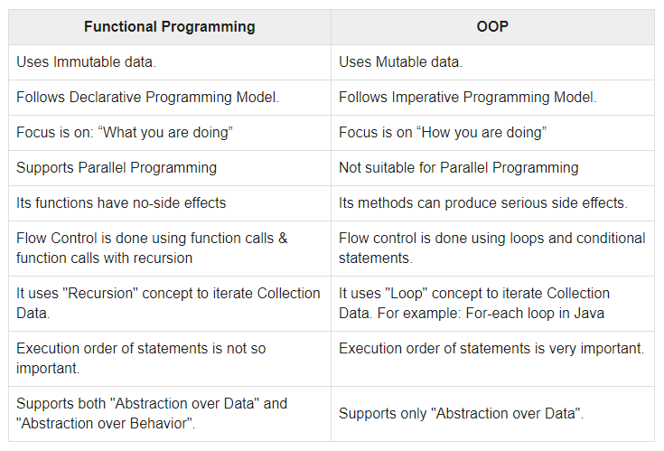

# Functional vs Object-Oriented Programming

Subscribe to my newsletter and never miss my upcoming articles

In the world of JavaScript, there are typically 2 programming paradigms: Functional and Object-Oriented Programming (OOP). But what exactly are these paradigms, how are they different and when is it best to use them?

## What's a Programming Paradigm?

Programming paradigms are approaches in which code is organized to implement solutions in a program. There are many programming paradigms, but we will only focus on Functional and Object-Oriented in this article.

### Functional vs OOP

According to [Wikipedia](https://en.wikipedia.org/wiki/Programming_paradigm), in functional programming, programs are treated as a sequence of stateless function evaluations. In object-oriented programming, programs are treated as a set of interacting objects.

Below is a table from [tutorialspoint.com](http://tutorialspoint.com/) that summarizes some key differences between them.



## An Example

To get a better understanding on how to use these 2 different programming paradigms, let's illustrate an example.

Let's say you have this super simple form that calculates the sum of 2 numbers.


### Functional Programming

Let's make the form work with the first approach, functional programming.

Our first function is to perform the calculations from the data supplied.

```
const x =  document.querySelector('#number1').value;
const y =  document.querySelector('#number2').value;

function sum(x, y) {
    return x + y;
}
```

Then, another function will output the result on console.

```
function displayResult(result){
   console.log(result);
}
```

And that's a simple example with functional programming. Let's take a look at the OOP approach.

### Object-Oriented Programming

For this approach, we can create a class for our form in which we add the following properties in the constructor function:

- `form`: the form element
- `number1` and `number2`: the 2 input fields
- `calculateHandler` event function, bind to the class to sum inputs and show on console

```
class SumForm {
  constructor(form, number1, number2) {
    this.form = form;
    this.number1 = number1;
    this.number2 = number2;
    this.form.addEventListener('submit', this.calculateHandler.bind(this));
  }

  calculateHandler(event) {
    event.preventDefault();
    console.log(this.number1 + this.number2);
  }
}

new SumForm(document.getElementById('sum-form'), document.getElementById('number1').value, document.getElementById('number2').value);
```

And that's the OOP approach for this simplistic example.

## Conclusion

There are many ways to solve real-world problems. This translates to programming as well. These 2 programming paradigms are just one of the many different ways you can structure and organize your code to implement solutions.

Understanding on how they work can give you more flexibility in problem-solving as a programmer. Knowing when it's best to use them takes time and experience. Most of the time, you will not use strictly either one of them but a mix of both, depending on the problem.

Thanks for reading! I hope it has been insightful. Please share or like this article if it is and leave questions in the comments below if you have any. Till next time, cheers!
